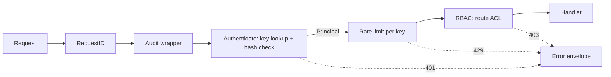

# Authentication, authorization, audit and rate limits

How `flowforge-api` decides who a caller is and what it may do (task 02.05, ADR-015, FR-SEC-01..03, FR-SEC-05). Conventions shared by all endpoints are in [`README.md`](README.md); the route × role table is `00E` §9.



The audit wrapper sits outside authentication, so it also records the requests that authentication or authorization reject. `/healthz`, `/readyz`, `/metrics` and `/openapi.json` skip the whole chain: they need no key and are never rate limited. `/metrics` should be network-restricted in deployments.

## API keys

A key looks like `ff_<keyid>_<secret>`. Send it as `Authorization: Bearer ff_<keyid>_<secret>`.

- **Format:** `keyid` is 12 lowercase base32 characters and identifies the key in logs, audit rows and `created_by`. `secret` is 32 random bytes in unpadded base64url.
- **Storage:** the server stores only a 16-byte random salt and `SHA-256(salt ‖ secret)`, and compares hashes in constant time. The secret appears exactly once, in the response that creates the key; it can't be recovered, only replaced.
- **Lifecycle:** create with `POST /api/v1/api-keys`, list with `GET /api/v1/api-keys` (never secrets), revoke with `DELETE /api/v1/api-keys/{key_id}`. All three are admin-only. Revocation sets `revoked_at` and keeps the row, so audit rows still resolve. Revoking twice is fine (204).
- **The last admin:** the last active admin key can't be revoked (`409 CONFLICT`). Concurrent revocations are serialized by row locks, so at least one admin key always remains.
- **Expiry:** a key may have an `expires_at`, which must be in the future when it is created; an expired key is rejected like a revoked one. There is no endpoint to change a key's role or expiry, so a key can't elevate itself: create a new key and revoke the old one.
- **Rejections:** every rejection is the same `401 UNAUTHENTICATED` "invalid API key", whether the key is malformed, unknown, has the wrong secret, or is revoked or expired. An unknown key id still costs one hash comparison, so neither the response nor its timing reveals which key ids exist.
- **Lookup cache:** lookups are cached for up to 30 s (`auth.CacheTTL`). A key revoked through an API instance stops working on that instance immediately, and on other instances within 30 s.

```bash
# Create an operator key for CI (as an admin); store the returned "key" now.
curl -s -X POST localhost:8080/api/v1/api-keys -H "Authorization: Bearer $FF_ADMIN_KEY" \
  -H 'Content-Type: application/json' --data '{"name":"ci","role":"operator"}'
# 201 {"id":"<keyid>","name":"ci","role":"operator",…,"key":"ff_<keyid>_<secret>"}
curl -s -X DELETE localhost:8080/api/v1/api-keys/<keyid> -H "Authorization: Bearer $FF_ADMIN_KEY"   # 204
```

### Bootstrap

On every start, before serving, the API makes sure an admin can get in (`auth.Bootstrap`). It is safe to run repeatedly and on several instances:

| Situation | What happens |
|---|---|
| `FF_ADMIN_BOOTSTRAP_KEY` set (required when `FF_ENV=prod`) | The value must be a well-formed key, or startup fails. If no active admin key exists, it is stored as admin key `bootstrap-admin`; storing it again is a no-op. |
| Not set, `FF_ENV=dev`, no active admin key | A new admin key is generated, stored, and printed **once** to the server's log output at WARN. Copy it then. |
| Otherwise | Nothing; existing keys are used. |

The logger masks everything that looks like a key (`logging.Redact`), so the generated dev key is written straight to the log output, past the logger. That one line is the deliberate exception to "no secrets in logs". It happens only in dev, only on the start that creates the key. For production, generate a key in the same `ff_<keyid>_<secret>` format and pass it as `FF_ADMIN_BOOTSTRAP_KEY`.

### Development without keys

`FF_AUTH_DISABLED=true` makes every `/api/v1` request the dev admin (key id `dev`). It is allowed only in `dev` and `test`: configuration validation rejects it when `FF_ENV=prod`, and the server logs a WARN at startup. RBAC, rate limiting and auditing still run.

## Roles

| Role | May call |
|---|---|
| `viewer` | Every read (`GET`) route of `/api/v1` except API keys |
| `operator` | Everything `viewer` may, plus creating workflows and starting runs (and, as they land: cancel, retry, approve) |
| `admin` | Everything, including API keys (and, later, triggers) |
| `worker` | Only the worker gRPC API (03.01); no REST route |
| `ai-readonly` | Only the internal read API `/internal/v1` (06.02); no `/api/v1` route |

Human roles are ordered `viewer < operator < admin`. The service roles match only their own route groups: they never reach a human route, and no human role reaches theirs (`auth.Allowed`). A refused role gets `403 PERMISSION_DENIED`.

The minimum role of each route is in `internal/api/rest/routes_acl.go`, which mirrors `00E` §9. A route missing from it is admin-only. `TestACL_EveryRouteHasAnEntry` fails the build when a registered route has no entry (or an entry names no route), and `TestRBAC_Matrix` checks every role against every route. **When you add a route, add its ACL entry and its `00E` §9 row.**

gRPC services verify keys with `Authenticator.VerifyToken(ctx, token)`, which is transport-free and returns the same `Principal{KeyID, Name, Role}`. They apply their own role rule; the worker service accepts only `worker`.

## Rate limits

Each API key has a token bucket:

| Keys | Sustained | Burst |
|---|---|---|
| `viewer`, `operator`, `admin` | `FF_API_RATE_LIMIT_RPS` requests/s (default 50) | 2× (100) |
| `worker`, `ai-readonly` | 4× (200/s) | 8× (400) |

- **Exhausted bucket:** an empty bucket gives `429 RATE_LIMITED` with `Retry-After` (whole seconds until the next token).
- **Scope:** buckets are per key and per API instance.
- **Exempt:** the operational endpoints aren't limited.
- **Unauthenticated requests** aren't limited either, since there's no key to charge (see "Not covered").

## Audit log

Every request that changes something (any method but `GET`), and every request refused with 401 or 403 (including `GET`s), writes one `audit_log` row:

| Column | Value |
|---|---|
| `actor_key_id`, `actor_role` | The caller's key id and role; empty when it wasn't authenticated |
| `action` | `METHOD /route/pattern`, e.g. `POST /api/v1/workflows/{id}/runs` |
| `resource_type`, `resource_id` | What the route names: the created resource from `Location`, else the first path parameter (e.g. `runs`, `run_…`) |
| `request_id` | The request's `req_…`, also in the response and the server log |
| `outcome` | `ok` (2xx/3xx), `denied` (401/403), `error` (any other 4xx/5xx) |
| `details` | `{"status": 201, "body_bytes": 1234}`, nothing else |

Bodies, query strings, headers and keys never reach the audit log; the tests check that neither a key nor definition content appears in it.

**Availability over audit completeness.** The row is written after the response, with a 2 s deadline. If the write fails, the server logs at ERROR and increments `flowforge_audit_write_failures_total`, and the request's result stands. Alert on that counter; a failed write means a gap in the audit trail, not a failed request.

`persistence.AuditRepo.Record` is the recorder. Code that records a decision outside this middleware (approvals, 06.06) uses the same method.

## Not covered (known limitations)

- **No OIDC/SSO and no user accounts:** API keys only (ADR-015).
- **No automated key rotation or expiry reminders:** rotate by creating a new key and revoking the old one.
- **Rate limits are per instance.** With N API instances, a key can reach N× its limit.
- **Unauthenticated requests are neither rate limited nor cheap to audit.** Each 401 writes an audit row, so put a network-level limiter (ingress, WAF) in front of the API in deployments.
- **The 30 s cache window:** a key revoked on one instance keeps working on the others for up to 30 s.
- **Key ids are visible:** in logs, audit rows and `created_by`. They aren't secret; the secret part never is logged.
