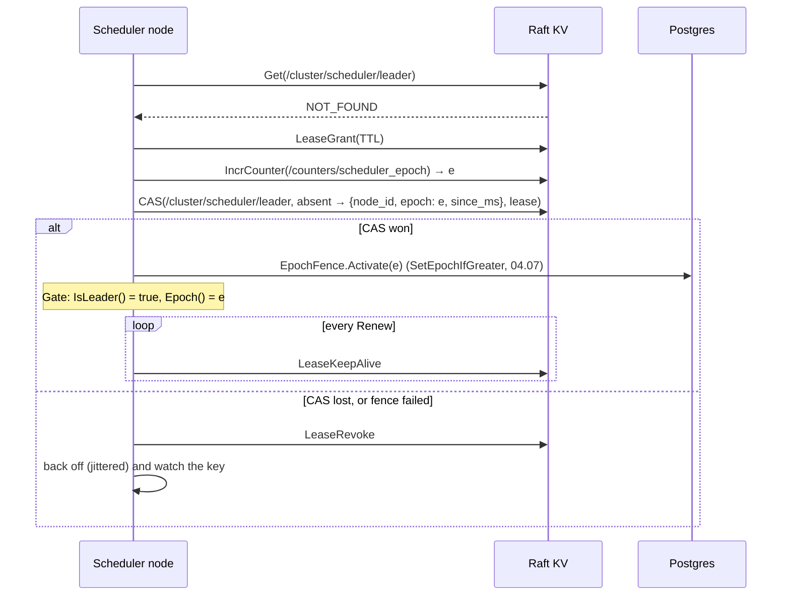

# Coordination

This page describes the coordination primitives FlowForge builds on the Raft KV (task 04.05, FR-RAFT-06, ADR-003, ADR-005): scheduler leader election with fencing epochs, worker liveness leases, and fencing helpers.

- **Where:** `internal/coordination`, a client-side library over [the KV API](raft-kv-api.md). It never touches Raft server code.
- **Who uses it:** 04.07 wires the `Elector`'s `Gate` into `flowforge-scheduler` and the `WorkerRegistry` behind `workerapi.LeaseProvider` in `flowforge-api`.
- **What it guarantees:** leadership here says who *should* act. What guarantees that a deposed leader can't commit is the Postgres epoch assertion in every scheduler transaction (ADR-003), not timing.

## Leader election



The `Elector` (`elector.go`) runs one loop:

1. **Watch.** While the leader key exists, it only reads it again every `Renew`, jittered over [½, 1½) × `Renew` so candidates don't move in lockstep.
2. **Campaign** when the key is absent:
   - grant a `TTL` lease;
   - take the next epoch from `/counters/scheduler_epoch`. A lost campaign still uses up an epoch; the gaps are fine, because only monotonicity matters.
   - CAS the leader key from absent to `{node_id, epoch, since_ms}` (00E §5.2), bound to the lease. The CAS lets exactly one candidate win.
3. **Activate the fence.** It calls `EpochFence.Activate(epoch, node)`. Only after that succeeds is the term announced on the `Gate`, so the scheduler never acts on an epoch Postgres doesn't know. If activation fails, the candidate revokes its lease (freeing the key) and campaigns again after a backoff, with a new epoch.
4. **Hold.** It sends a keep-alive every `Renew`:
   - **`LEASE_EXPIRED` or `LEASE_NOT_FOUND`:** the term ends at once.
   - **Any other failure** (a Raft failover, no quorum): retried every `Renew`/3 until the local deadline.
5. **End.** The term ends at the local deadline, on shutdown, or when the lease is lost. The `Gate` closes `Done()`, and the elector revokes its lease so a successor doesn't wait out the TTL.

**Reading the leader:** `Current(ctx)` returns the leader key's value with a linearizable read, or `ErrNoLeader`.

## Local conservative expiry

The `Gate` (`gate.go`, implementing `scheduler.Gate`) stops claiming leadership before the server could expire the lease:

```text
deadline = start of the last successful LeaseGrant / LeaseKeepAlive + TTL − SafetyMargin
IsLeader() = a term is running && now < deadline        (checked on every call)
server expiry ≥ that same start + TTL                    (the server stamps its ts after the call started;
                                                          keep-alive sets max(expires_at, ts + TTL))
```

- **The margin:** it absorbs clock-rate drift between the scheduler and the Raft leader, plus scheduling delays.
- **No goroutine needed:** `IsLeader` is judged on each call, so it turns false at the deadline even if the elector's goroutine is stuck, for example in a hung keep-alive or a GC pause. `Done()` closes when the goroutine notices.
- **Tests:**
  - `TestElector_StepsDownBeforeTheServerExpires`: the leader key is still live on the server when the leader stops claiming it.
  - `TestGate_DeadlineHoldsWhileTheElectorIsStuck`.

## Timing parameters

| Parameter | Value | Source |
|---|---|---|
| `TTL` | 10 s | `FF_LEADER_TTL` |
| `Renew` | 3 s | `FF_LEADER_RENEW` (the config requires it below half the TTL) |
| `SafetyMargin` | TTL/3 (3.3 s) | default; `Renew < TTL − SafetyMargin` is enforced |
| Keep-alive retry | Renew/3 (1 s) | while the KV is unreachable |
| Watch interval | Renew, jittered [½, 1½) | |

With the defaults:

- **A leader that can't renew** stops leading 6.7 s after its last successful renewal started.
- **A crashed leader's key** disappears from reads 10 s after its last renewal, by the Raft leader's clock.
- **A new leader** follows within one more jittered watch interval: under `TTL + 1.5 × Renew` ≈ 14.5 s after the old leader's last renewal. This is the task's liveness bound of `TTL` + campaign interval.

## Fencing helpers

`Fence{Epoch}` (`fence.go`):

- **`FenceFromLeader(gate)`** returns the current term's fence, or `false` while not leading. Without proven leadership, do nothing (00C §10.1).
- **`Fence.Current(stored)`** holds only for the epoch stored in Postgres.
- **`Fence.Supersedes(other)`** orders terms.

The scheduler's transactions assert the epoch against `cluster_state` (ADR-003); these helpers name that comparison for callers.

## Worker leases

`WorkerRegistry` (`registry.go`) keeps one key per live worker, `/workers/{id}`, bound to the worker's lease (TTL `FF_WORKER_LEASE_TTL`, 15 s). Workers never talk to Raft; the API tier calls the registry on their behalf (04.07).

| Call | Effect |
|---|---|
| `Register(info)` | **Validation:** ids are 1–256 bytes without `/` (`ErrInvalidWorkerID`). **Lease:** grants a new lease, then a CAS moves the key onto it, so concurrent registrations can't both win; the old lease is revoked. **Conflict:** a worker id live under another API key is `ErrWorkerConflict` |
| `Renew(handle)` | **Keep-alive**, returning the handle to keep using. When the lease is gone: **another live lease** (another API instance re-registered the worker) is adopted, not revoked; an **expired lease** (`LEASE_EXPIRED`) means it re-registers transparently; a **missing lease** (`LEASE_NOT_FOUND`: revoked by `Deregister`, or already swept) returns `ErrNotRegistered` without re-registering, so a heartbeat racing a graceful shutdown can't bring the worker back. Other failures, including a failed re-registration, return the handle unchanged and are counted in `flowforge_worker_lease_renewal_failures_total` |
| `Handle(workerID)` | Rebuilds a handle from the key alone, so any API instance can renew a worker another instance registered |
| `Deregister(handle)` | Revokes the lease, which deletes the key. A lease already gone is fine |
| `List()` | The live workers, in id order, from linearizable reads one page at a time |
| `Expired(known)` | The workers in `known` that hold no live lease, sorted and deduplicated. The caller supplies `known` from Postgres (`worker_observations`), because Raft only knows the live ones |

The value is 00E §5.2's `{"capabilities","queues","capacity","version","registered_ms"}`, extended with:

- **`key_id`:** one worker id per API key;
- **`lease_token`:** the lease's fencing token, which `Handle` needs. A fencing token orders holders and is not a secret (04.03).

## Metrics

| Metric | Meaning |
|---|---|
| `flowforge_scheduler_is_leader` | 1 while this scheduler instance leads |
| `flowforge_scheduler_epoch` | the epoch of the current or last term |
| `flowforge_leader_changes_total` | terms this instance started or ended |
| `flowforge_worker_lease_renewal_failures_total` | worker renewals the KV did not confirm (API tier) |

## Failure behavior (00_MASTER §6.2)

| Situation | Behavior | Test |
|---|---|---|
| The Raft leader node dies | The client fails over (an election takes about 100–200 ms with 10 ms test ticks, 1–2 s in production). Renewals continue inside `TTL − SafetyMargin`, so the scheduler keeps its term. Measured: the longest gap between successful renewals across three kills was 301 ms, against a 1.3 s local deadline | `TestRaft_LeaderNodeKillKeepsSchedulerLeadership` |
| Raft quorum lost | The leader can't renew and steps down at its local deadline. Measured: 1.29 s, against a bound of 1.6 s with a 2 s TTL. No scheduler leads while quorum is lost. When it returns, a scheduler leads again at a higher epoch | `TestRaft_QuorumLossStepsDownUntilItReturns` |
| The leader is partitioned from the KV | It steps down before its lease can expire; a follower takes over after the server expiry with a strictly higher epoch | `TestElector_StepsDownBeforeTheServerExpires` |
| Postgres down while campaigning | The fence fails, nothing is announced, and the candidate retries with a new epoch | `TestElector_FenceFailureIsNotAnnouncedAndRetried` |
| 5 candidates, 200 leadership changes at random points | Never two leaders at once; epochs strictly increase | `TestElector_RandomizedRounds` |
| Graceful shutdown | The term ends and the lease is revoked, so the successor takes over at once | `TestElector_ShutdownStepsDownAndFreesTheKey` |

## Limitations

- **The single-leader guarantee assumes bounded clock-rate drift.** It holds if the scheduler's and the Raft leader's clocks don't diverge by more than `SafetyMargin` over one `TTL`. A GC pause longer than the margin, between a check of `IsLeader` and a decision, can still let a deposed leader try to act. The Postgres epoch assertion rejects it (ADR-003), and 04.07 and 04.08 prove that end to end.
- **Epochs are consumed by every campaign,** including lost ones and failed fence activations.
- **The leader key is re-checked every `Renew`.** A new leader is noticed within about 1.5 × `Renew`.
- **Expiry delay:** a worker's lease expires one TTL after its last renewal, judged by the Raft leader's clock. During a leader change that judgement can be delayed by up to an election timeout (ADR-005).
