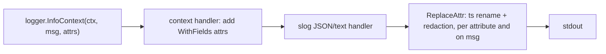

# Cross-cutting foundations

The five platform packages from task 01.04 that every service uses. They import nothing from FlowForge except `internal/clock` (used by `internal/ids`), so any layer may depend on them (`00C` §8).

| Package | Use it for |
|---|---|
| `internal/logging` | Structured logs with canonical fields, context-carried IDs and redaction |
| `internal/apperrors` | The application error type and its HTTP/gRPC mapping |
| `internal/ids` | Prefixed ULID identifiers |
| `internal/clock` | Every time read, timer, ticker and sleep |
| `internal/obs` | The metrics registry and the `/metrics`, `/healthz`, `/readyz` server |

## Logging

`logging.New(logging.Config{Level, Format, Service, Version})` returns a `*slog.Logger`. `Level` and `Format` come from `FF_LOG_LEVEL` and `FF_LOG_FORMAT` ([configuration](../configuration.md)). Records are JSON by default, with the fields from `00E` §11: `ts, level, msg, service, version, request_id, run_id, task_id, attempt_id, worker_id, trace_id, span_id, err`. Use the `logging.Key*` constants for field names and `logging.Err(err)` for errors.

Request-scoped IDs travel in the context: `ctx = logging.WithFields(ctx, logging.KeyRunID, runID)`. Every `…Context` call on a logger from `New` adds them, and `logging.FromContext(ctx)` returns the logger stored by `NewContext` with them bound. A field already on the record, or bound with `With`, is not added twice.



**Redaction.** The handler runs every attribute and the message through redaction, including attributes bound with `With`, attributes inside groups, and values produced by `LogValue`:

- a value whose key, or any enclosing group name, matches `(?i)(password|passwd|secret|token|api[_-]?key|authorization|dsn)` becomes `***`;
- string values, error text and the message pass through `logging.Redact`, which masks FlowForge API keys (`ff_<id>_<secret>`), bearer tokens, the password in `postgres://user:pass@…`, and the value in `password=…`, `token: …`, `"api_key":"…"` and similar;
- a struct or map is turned into text only when that text contains something to mask; otherwise it keeps its JSON shape.

Use `logging.Redact` directly for text that is stored or forwarded rather than logged: audit details, shipped task logs (03.01), AI evidence (06.04). Redaction is a safety net, not a licence: credentials still belong in `config.Secret` fields and never in log calls (`00C` §10.2).

## Errors

`apperrors.Error{Code, Message, Details, Cause, RetryAfter}` carries one of the 14 codes in [`00E` §4](../../implementation/00E_CONTRACTS_REFERENCE.md); a test parses that table so the code set can't drift. `Message` and `Details` are client-safe; `Cause` is for logs only.

- Construct with `NotFound`, `Conflict`, `InvalidState`, `StaleAttempt`, `InvalidWorkflow(msg, details...)`, `Unavailable(msg, retryAfter, cause)`, `NotLeader(hint)` and the rest, or `New`/`Wrap`.
- Wrap freely with `%w`; branch with `errors.As`, `apperrors.CodeOf(err)` or `errors.Is(err, &apperrors.Error{Code: apperrors.CodeNotFound})`.
- At the API boundary, `apperrors.FromError(err)` returns the first `*Error` in the chain, or `INTERNAL` with the message `internal error` for anything else (the original error stays in `Cause`).
- `HTTPStatus(code)` and `GRPCCode(code)` follow `00E` §4. Where `00E` leaves a choice: `CONFLICT` maps to gRPC `AlreadyExists` (a handler may return `Aborted` for version conflicts explicitly), and `NOT_LEADER`/`NO_QUORUM`, which have no HTTP mapping, return 503.
- `Retryable(err)` is true for `UNAVAILABLE`, `RATE_LIMITED`, `NOT_LEADER` and `NO_QUORUM`. Retry only idempotent operations (`00C` §10.1).

## Identifiers

IDs are `<prefix>_<ULID>`, for example `run_01JC7Z8Q3V6N2X4RTMB9WKD5HF`: 26 Crockford base32 characters that sort by creation time. Prefixes are constants: `wf`, `run`, `task`, `att`, `evt`, `inv`, `apr`, `req`, `trg`.

- Services take an `ids.Generator`; production passes `ids.NewGenerator(clock, crypto/rand.Reader)`, tests pass `&ids.Fake{}` (`run_00000000000000000000000001`, `…02`, …).
- IDs from one generator are strictly increasing across goroutines, even within one millisecond or if the clock steps back.
- `ids.New(prefix)` uses a process-wide generator for code without an injected one.
- `ids.Parse(prefix, s)` and `ids.Validate(prefix, s)` reject a wrong prefix or a malformed ULID with an error wrapping `ids.ErrInvalid`.

## Clock

Only `internal/clock` and `cmd/**` may call `time.Now`, `Since`, `Until`, `Sleep`, `After`, `AfterFunc`, `Tick`, `NewTimer` or `NewTicker`; the `forbidigo` lint rule enforces it and `make lint-selftest` proves the rule fires. Everything else takes a `clock.Clock` (`Now`, `Sleep(ctx, d)`, `NewTimer`, `NewTicker`, `After`).

- `clock.Real{}` is the wall clock, created in `main`.
- `clock.NewFake(start)` is for tests. Time moves only through `Advance(d)` and `Set(t)`. Due timers fire synchronously inside `Advance`, in deadline order and, for equal deadlines, creation order, with `Now` set to each deadline as it fires. `BlockUntilWaiters(n)` waits until a goroutine is blocked in `Sleep` or on a timer, so tests can advance without sleeping. Like `time.Ticker`, an unread tick is dropped.
- Where a single authoritative clock matters (retry `available_at`, deadlines), use the database's `now()` instead (ADR-021).

## Metrics and health

Each service creates one `obs.NewRegistry()` (Go and process collectors included) and registers metrics through it:

```go
tasks, err := reg.Counter(prometheus.CounterOpts{Name: "flowforge_tasks_total", Help: "…"}, "status")
```

`Counter`, `Gauge` and `Histogram` return an error wrapping `obs.ErrInvalidMetric` when the full name doesn't match `flowforge_<area>_<name>`, a counter doesn't end in `_total`, a non-counter does, or a label is outside `obs.AllowedLabels()`: `queue, task_type, status, outcome, node, topic, partition, group, route, method, code, peer, reason, stage, kind, tool, disposition, result, symbol` (the labels of every metric in `00E` §11 and §11.1). IDs, users and free text are never labels; `symbol` only while the symbol universe is at most 50. Durations are histograms in seconds named `…_seconds`.

`obs.NewServer(addr, reg, checks...)` returns an `*http.Server` (with read, write and idle timeouts) serving:

| Route | Response |
|---|---|
| `GET /metrics` | Prometheus exposition of the registry |
| `GET /healthz` | `200 {"status":"ok"}` while the process runs |
| `GET /readyz` | `200` when every `ReadinessCheck` passes within 5 s, otherwise `503`; the body names each check `ok` or `fail` without error text, because the route is unauthenticated |

## Limitations

- Context fields added while a logger has an open group (`WithGroup`) land inside that group.
- Redaction is pattern-based; a secret in an unrecognised shape under an innocuous key is not caught.
- `ids.New` relies on one package-level generator, the single exception to "no package-level mutable state" (`00C` §8).
