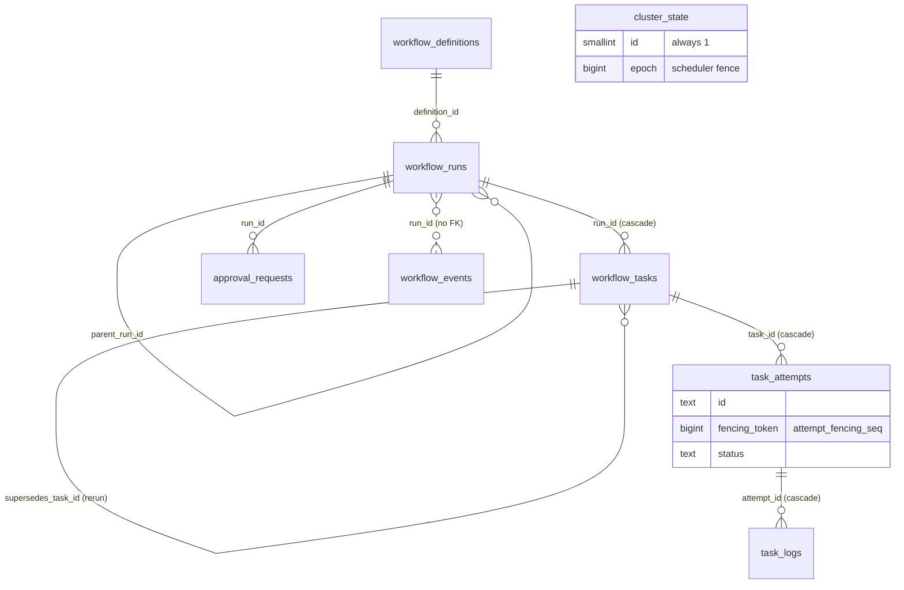

# Database

FlowForge's workflow state lives in the PostgreSQL database `flowforge`, the single source of truth for definitions, runs, tasks and attempts (ADR-003). Market data lives in TimescaleDB (`marketdata`), and the AI service owns `aiops` (ADR-013). This page covers `flowforge` and how migrations work for both Go-managed databases. The canonical DDL is [`00E` §2](../../implementation/00E_CONTRACTS_REFERENCE.md); this page doesn't repeat it.

## Schema overview

Migrations `0001`–`0004` create 14 tables, the `attempt_fencing_seq` sequence and the single `cluster_state` row.

Tables without foreign keys: `outbox`, `worker_observations`, `api_keys`, `audit_log`, `cron_triggers`, `investigations`, and `workflow_events` (its `run_id` is deliberately not a foreign key, so history and the outbox survive independently).

| Migration | Contents |
|---|---|
| `0001_core.sql` | `workflow_definitions`, `cluster_state` (+ seed row), `workflow_runs`, `workflow_tasks`, `attempt_fencing_seq`, `task_attempts` |
| `0002_events_outbox_logs.sql` | `workflow_events`, `outbox`, `task_logs` |
| `0003_workers_security.sql` | `worker_observations`, `api_keys`, `audit_log` |
| `0004_triggers_approvals.sql` | `cron_triggers`, `approval_requests`, `investigations` |

Safety-relevant parts of the schema:

- **Fencing.** `cluster_state` has exactly one row (`CHECK (id = 1)`), and scheduler transactions check its `epoch` (ADR-003). Every attempt gets a `fencing_token` from `attempt_fencing_seq`, which completions must match (`00E` §3.2).
- **State checks.** Run, task and attempt statuses are `CHECK` constraints, so an invalid status is rejected by the database as well as by code (ADR-020).
- **Original task keys.** `UNIQUE (run_id, task_key, supersedes_task_id)` treats NULLs as distinct, so the partial index `uq_tasks_original_key ON workflow_tasks(run_id, task_key) WHERE supersedes_task_id IS NULL` keeps original task keys unique per run. A rerun row (ADR-008) may reuse the key once per task it supersedes.
- **Idempotent run start.** `uq_runs_idem` is a partial unique index on `idempotency_key` (FR-WF-13).

## Migrations

Migrations are goose SQL files under `migrations/<database>/`, embedded into binaries by the `migrations` package and applied by `internal/persistence/migrate` (ADR-014).

| Run them with | Notes |
|---|---|
| `make migrate-up` / `make migrate-status` | Dev databases (`make dev-up` first). `DB=marketdata` for the other set. DSNs come from `FF_PG_DSN` / `FF_MD_PG_DSN` ([configuration](../configuration.md)) |
| `flowforge-migrate [--db flowforge\|marketdata] up\|status` | The CLI behind the targets |
| `testutil.NewFlowforgeDB(t)` | Integration tests: a fresh database with every migration applied |
| Compose init job | Wired in task 09.02 |

Rules:

- **Forward-only.** Once a migration is on `main`, never edit it; add a new one. The `Down` sections are documented no-ops, and tests use a fresh database instead of rolling back.
- **Services never migrate themselves.** From task 02.04, `flowforge-api` compares `migrate.Version` with `migrate.Latest` at startup and refuses to start on an older schema.
- **Concurrent runs are safe.** `Up` takes a Postgres advisory lock (polled every second, for up to 5 minutes), so several migrators can start at once and run one after another.
- **Running twice is a no-op**; goose records applied versions in `goose_db_version`.
- **The marketdata set is empty** until task 05.03. `Up` on it only checks the connection.

## Adding a migration

1. Create `migrations/flowforge/NNNN_short_description.sql` with the next free number (`00C` §9), starting with `-- +goose Up` and ending with a `-- +goose Down` section (a comment if there is no safe rollback).
2. Put indexes and constraints in the migration that creates the table. Destructive changes are an architectural change (`00C` §2.4).
3. If the change alters a contract, update the DDL in `00E` §2 in the same change. `TestMigrations_VerbatimFrom00E` compares `0001`–`0004` with `00E` §2.
4. Add or change queries in `internal/persistence/queries/*.sql`, run `make sqlc`, and commit the regenerated `internal/persistence/sqlcgen`. CI's `sqlc-drift` job runs `make sqlc-check`.
5. Run `make test-integration`. The schema tests apply every migration from an empty database and from each previous version.

## sqlc

`sqlc.yaml` reads the schema from `migrations/flowforge` (ignoring `Down` sections) and the queries from `internal/persistence/queries/`, and generates the `sqlcgen` package for pgx/v5. Generated code is committed and never edited by hand (`00C` §2.11). Install the pinned version with `go install github.com/sqlc-dev/sqlc/cmd/sqlc@v1.31.1` (see `docs/decisions/versions.md`); `make sqlc` refuses any other version.
