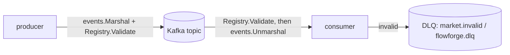

# Event schemas, topics and the Kafka client

Every FlowForge Kafka record carries one versioned JSON envelope, described by the JSON Schemas in [`schemas/events`](../../schemas/events) (task 05.01, FR-KAFKA-01/02, ADR-010). This page covers:

- the envelope;
- the compatibility rules and the test that enforces them;
- the topic catalogue and why each topic is sized as it is;
- the Go client wrapper.

The workflow events and their outbox relay are in [`events.md`](events.md); the contract tables are in `00E` §7.

## The envelope

```json
{"event_id":"evt_01JCX…","event_type":"task.queued","event_version":1,
 "occurred_at":"2026-11-02T14:30:00Z","producer":"flowforge-scheduler",
 "correlation_id":"run_01JCX…","aggregate_id":"task_01JCX…",
 "trace":"00-<trace id>-<span id>-01",
 "payload":{…}}
```

| Field | Meaning |
|---|---|
| `event_id` | Globally unique; consumers dedupe on it. Workflow events use `evt_` ULIDs; synthetic market ticks use `sha1(source\|symbol\|sequence\|event_time)` (05.03). |
| `event_type`, `event_version` | Together they select the payload schema. |
| `occurred_at` | RFC 3339, UTC. |
| `producer` | The service that wrote the event. |
| `correlation_id` | The request id, else the run id, else the aggregate id. |
| `aggregate_id` | The entity the event is about: task, run, symbol, … |
| `trace` | W3C traceparent (optional; 08.01 fills it). The same value travels in the record's `traceparent` header. |
| `payload` | The event's data, described by its own schema. |

**Go types (`pkg/events`):**

- **`Envelope[T]`:** the envelope, with a typed payload. `internal/events.Envelope` (the outbox) is `Envelope[json.RawMessage]`.
- **`Marshal`:** writes `occurred_at` in UTC.
- **`Unmarshal`:** ignores unknown fields.
- **`Registry`:** compiles the embedded schemas once. `Validate(name, bytes)` returns a `*ValidationError` whose `Path` is the JSON pointer of the offending value, for example `/payload/price: exclusiveMinimum: got -1, want 0`.



### Schemas

There is one file per schema version, `schemas/events/<name>.schema.json`, in JSON Schema draft 2020-12.

- **The file layout:** each file has a canonical `$id` and at least one valid `examples` entry. The registry compiles them with `format` asserted (`date-time`) and never fetches a `$ref`.
- **One call for a known event:** `envelope.v1` also checks the payload of every event type and version it knows. An unknown type or version keeps any object payload, so a newer producer's events still pass an older consumer.

| Schema | Describes |
|---|---|
| `envelope.v1` | Every record value; checks the payload of the known types below |
| `flowforge_event.v1` | A workflow event (`envelope.v1` restricted to the 00E §7 workflow types); the relay validates against it (05.08) |
| `workflow_run.v1`, `workflow_task.v1`, `workflow_attempt.v1`, `workflow_approval.v1`, `workflow_worker.v1`, `workflow_leader_changed.v1` | The payloads of the `run.*`, `task.*`, `task.attempt.*`, `approval.*`, `worker.*` and `scheduler.leader_changed` events (`internal/events`) |
| `market_tick.v1` | `market.tick` on `market.ticks` (00E §7); `event_time` ≤ now + 5 s is a domain rule, not in the schema |
| `market_aggregate.v1` | `market.aggregate` on `market.aggregates`: one window of one symbol (00E §12 `market_aggregates`) |
| `market_invalid.v1` | `market.invalid` on `market.invalid`: the rejected record (base64) and the reason; the source topic, partition and offset when the processor read it (05.04), absent for a tick the producer rejected before publishing (05.03) |

`internal/events`' `TestRecord_EnvelopesMatchSchema` records every workflow event type and validates the outbox envelope against `flowforge_event.v1`. So the Go structs and the published schemas can't drift apart.

## Compatibility rules

1. **Consumers must ignore unknown fields.** `Unmarshal` does, and no schema sets `additionalProperties: false`.
2. **Within a schema version, fields are only added, and only as optional ones.** These are breaking changes:
   - removing a field;
   - renaming a field;
   - changing its type;
   - making an optional field required;
   - adding a required field.
3. **A breaking change is a new version:** a new file (`market_tick.v2`) and a new `event_version`. Producers publish both versions during a deprecation window of at least one release, until every consumer reads v2.
4. **`event_id` is globally unique.** Delivery is at least once (ADR-009), so consumers dedupe on it.
5. **`key` is the Kafka record key:** the partition key of 00E §7 (`symbol`, `run_id`). One key's records stay in order on one partition.

**How the compatibility test enforces this:**

- **The snapshots:** `schemas/baseline/` holds a snapshot of every published schema version.
- **The comparison:** `pkg/events`' `TestSchemaCompat_CurrentMatchesBaseline` compares each schema in `schemas/events` with its snapshot, walking nested properties and array items. It fails on:
  - a removed or retyped property;
  - a required property that was removed or made optional;
  - a new required property;
  - an `enum` that lost a value (adding values is allowed);
  - any other change to a validation keyword: `pattern`, lengths, bounds, `format`, `const`, `additionalProperties`, the `allOf`/`if`/`then` mapping from event type to payload schema, `$ref`. Whether such an edit only widens is not decided, so it needs a new version;
  - a deleted schema version;
  - a schema without a snapshot.

  Annotations (`title`, `description`, `examples`) may change freely.
- **Proof it can fail:** `TestSchemaCompat_DetectsBreakingChanges` applies each breaking edit to a temporary copy and expects it to be caught.
- **Adding a schema version:** copy the new file into `schemas/baseline/` in the same change. Never edit a snapshot.
- **Payload schemas reached through a `$ref`** are checked in their own files.

**Why JSON and JSON Schema (ADR-010):**

- **Gains:** records are human-readable in any Kafka tool and in AI evidence, there is no schema registry to run, and validation happens at the edges.
- **Costs:** payloads are larger, and the broker enforces nothing. The validator on both sides and the compatibility test above make up for that.

## Topics

[`deploy/kafka/topics.yaml`](../../deploy/kafka/topics.yaml) is the catalogue, as data. `make topics` (`flowforgectl topics ensure`) applies it.

**What the command does:**

- creates every topic that is missing;
- for one that exists, only warns when its partitions, replication factor or a listed config differ;
- never changes or shrinks a topic.

Adding partitions would move keys to other partitions and break per-key order, so changing a topic is a deliberate operation with `kafka-topics.sh`/`kafka-configs.sh`, recorded in the file and in `00E` §7.

The broker runs with `auto.create.topics.enable=false`, so a misspelt topic fails with `UNKNOWN_TOPIC_OR_PARTITION` instead of appearing silently.

| Topic | Key | Partitions | Retention | Why |
|---|---|---|---|---|
| `market.ticks` | `symbol` | 6 | 7 d, delete | The hot path. 6 partitions spread symbols over up to 6 processor instances. 7 days is the replay window (05.07). |
| `market.invalid` | `event_id` or `symbol` | 3 | 14 d, delete | DLQ: low volume, kept longer so rejects can be inspected and replayed. |
| `market.aggregates` | `symbol` | 6 | 7 d, `compact,delete` | Informational. Compaction keeps the latest aggregate per symbol, and everything expires after 7 days; the database is the record (FR-KAFKA-10). |
| `flowforge.workflow-events` | `run_id` | 3 | 7 d, delete | Run, approval, worker and scheduler events; a run's events stay ordered (ADR-009). |
| `flowforge.task-events` | `run_id` | 3 | 7 d, delete | Task and attempt events, keyed by run for the same order. |
| `flowforge.dlq` | `run_id` | 3 | 14 d, delete | Outbox events the relay could not publish after its retries (05.08). |

Replication factor 1 matches the single dev broker. A multi-broker deployment (09.06) raises it to 3 with `min.insync.replicas=2`.

## Kafka in Compose

`make dev-up` (profile `streaming`; `make dev-up PROFILE=streaming` alone) runs `kafka`:

- **Image and mode:** `apache/kafka:4.1.1` in KRaft mode, with broker and controller in one process and a fixed cluster id, so the `kafkadata` volume survives restarts.
- **Listeners:** containers use `kafka:9092`, and the host uses `localhost:19092` (`FF_DEV_KAFKA_PORT`). Its healthcheck asks the broker for its API versions.
- **Then:** run `make topics`.

```bash
make dev-up PROFILE=streaming   # timescaledb + kafka, healthy
make topics                     # creates the topics; run again: "no changes"
docker compose exec kafka /opt/kafka/bin/kafka-topics.sh --bootstrap-server localhost:9092 --describe
```

## The Go client (`internal/kafka`)

**Configuration:** `config.Load[config.Kafka]` reads `FF_KAFKA_BROKERS`, `FF_KAFKA_CLIENT_ID` and `FF_KAFKA_SECURITY_PROTOCOL` (`00E` §6).

- **The security placeholder:** `FF_KAFKA_SECURITY_PROTOCOL` stands in for TLS and SASL, and only `PLAINTEXT` is accepted until task 09.01.
- **No dialling at construction:** creating a client does not dial; the first produce or poll does.

**`NewProducer`:**

- idempotent writes with `acks=all`, so a retried batch is written once and per-partition order holds;
- murmur2 key partitioning, the Java client's, so one key maps to one partition;
- bounded batching: 5 ms linger, 1 MiB batches, at most 10 000 buffered records (beyond that, `Produce` blocks);
- deadlines of 10 s per request and 30 s per record.
- **`Produce`** waits for every acknowledgement and adds the context's traceparent header. On an error some records may have been written, so callers retry and consumers dedupe.

**`NewConsumer`:**

- is a member of a consumer group, and a new group starts at the earliest offset;
- auto-commit is off: `Commit` is called only after the records' effects are durable (commit-after-write, ADR-011). A crash before `Commit` redelivers the records, which `TestConsumer_RedeliversUncommitted` proves;
- a batch keeps its partitions until the next `Poll`: rebalances wait, so no two members handle one batch and a late `Commit` can't move the group's offset backwards (`TestConsumer_HoldsPartitionsUntilNextPoll`). The loop is `Poll`, handle, `Commit`, `Poll`, and handling a batch must stay under the rebalance timeout (60 s);
- fetches are bounded: 16 MiB per response, 1 MiB per partition.

**Headers:**

- **Tracing:** `WithTraceparent`, `InjectTrace` and `ExtractTrace` carry the W3C `traceparent` header. 08.01 swaps the context value for OpenTelemetry's propagator.
- **Other headers:** `Header` and `SetHeader` read and set the rest, such as the `event_id` the outbox relay sends.

## Testing with Kafka

`kafkatest.Start(t)` gives an integration test the same `apache/kafka` image as a container. It is shared by the test binary; `Topic(t, partitions)` makes a fresh topic, deleted at the end of the test, and `Name` makes unique group names.

- **Using an existing broker:** `FF_TEST_KAFKA_BROKERS=localhost:19092` uses the Compose broker instead of a container.
- **Without Docker:** the test is skipped, or fails when `FF_TEST_REQUIRE_DOCKER` is set (CI).
- **Why not the testcontainers Kafka module:** it runs only Confluent's image, so `kafkatest` runs Apache's image as a generic container, the same image Compose runs.

## Limitations

- **Broker-side validation:** the broker doesn't validate payloads; producers and consumers do.
- **Compatibility test strictness:** any change to a validation keyword other than adding an `enum` value counts as breaking, including ones that only widen (a looser `pattern`). Those need a new version too.
- **Listing lag after creation:** a topic created or deleted moments ago may not be listed yet (`UNKNOWN_TOPIC_OR_PARTITION`, `LEADER_NOT_AVAILABLE`). `topics ensure` then counts it as existing and warns that it was not compared; run it again.
- **Single dev broker:** replication factor 1, no TLS and no SASL until 09.01.
