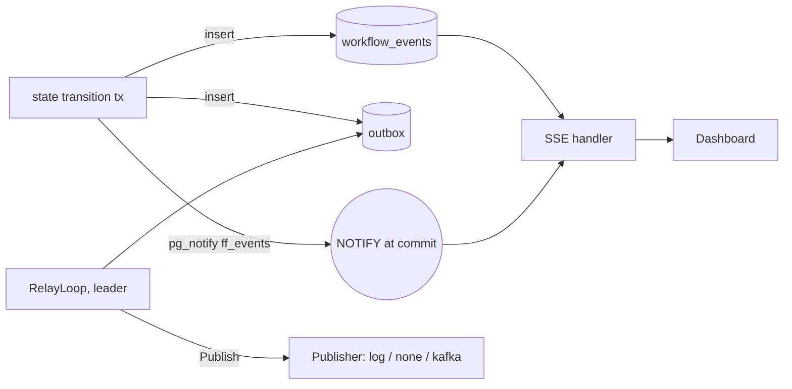

# Events: outbox relay, SSE stream and retention

How FlowForge publishes what happens to runs (task 03.07, ADR-009, FR-WF-15, FR-API-06):
- the transactional outbox and the relay that publishes it;
- the Server-Sent Events stream the dashboard reads;
- the jobs that keep the history tables bounded.

The envelope and topics are `00E` §7.

Code: `events.Recorder` (`internal/events`), `outbox.RelayLoop` and the `Publisher`s (`internal/outbox`), `sse.Handler` and `sse.Hub` (`internal/api/sse`), and `retention.Loop` (`internal/retention`).

## Writing an event

Every state change records its event inside its own transaction (`events.Recorder.Record`), so the event and the change commit or roll back together.



| Row | Table | Read by | Kept |
|---|---|---|---|
| The run's history: id, type, payload, correlation id | `workflow_events` (run events only) | SSE stream, `GET /runs/{id}/events` | 30 days |
| The full envelope, topic and key (the run id) | `outbox` (every event) | The relay | 3 days after it was published; never while unpublished |
| `NOTIFY ff_events` with an empty payload | — | The API's shared listener | Delivered at commit, dropped on rollback |

## The relay

`outbox.RelayLoop` runs on the scheduler leader every `FF_SCHED_TICK`. Each pass is one transaction:

1. **Fence.** It calls `AssertEpoch`, so a deposed leader publishes nothing (ADR-003).
2. **Lock.** It locks up to 500 unpublished rows in id order with `FOR UPDATE SKIP LOCKED`.
3. **Publish.** It hands them to the `Publisher`, bounded by a 10 s timeout.
4. **Mark.** It sets `published_at` on exactly the prefix the publisher reports delivered, and commits.

Passes repeat until the backlog is drained or leadership ends. A failed pass backs off: the tick doubles per failure, up to 30 s (`scheduler.RunTicking`).

**The `Publisher` contract** (`internal/outbox/publisher.go`):
- Messages with the same key are delivered in order, and none after one of that key failed.
- `nil` means everything was delivered.
- `*PartialError{Published: n}` means the first `n` were delivered.
- Any other error means nothing can be assumed delivered.

**Selecting a publisher** with `FF_EVENT_PUBLISHER`:

| Value | Publisher | Effect |
|---|---|---|
| `log` (default) | `LogPublisher` | Logs topic, key and event id at debug level, never the envelope |
| `none` | `DiscardPublisher` | Drops events but marks them published, so the outbox stays small |
| `kafka` | — | A startup error until task 05.01 adds the Kafka publisher; the relay doesn't change |

With `log` or `none` no event leaves the system, so the scheduler logs a warning at startup saying so.

### Failure semantics

| What fails | Result |
|---|---|
| Publish fails outright | Nothing is marked. The next pass retries from the first unpublished id, so order holds |
| Publish fails after a prefix (`PartialError`) | The prefix is marked; the rest is retried next pass |
| The acknowledgement is lost, or the relay crashes after publishing but before commit | Nothing is marked, and the batch is published again |
| The transaction manager reruns the pass after a serialization failure | The batch is published again |
| This scheduler loses leadership | Its next `AssertEpoch` fails and it stops; the new leader continues from the first unpublished id |

**Delivery is at least once, ordered per run.** Duplicates carry the same `event_id`, so consumers dedupe on it; it is also sent as the `event_id` header. `TestRelayPG_CrashBetweenPublishAndMark` kills the relay between publish and mark (failpoint `outbox/after-publish-before-mark`). The restarted relay publishes all 120 events a second time, and deduping restores exactly one of each.

**Ordering across concurrent transactions.** Ids come from a sequence assigned at insert, and transactions can commit out of id order. A row is only published once it's visible, so two *concurrent* transactions of the same run may be published in commit order rather than id order. Events that depend on each other can't be reordered this way: a decision that reacts to a change can only see it after that change committed, so its event always gets a later id.

**The transaction spans the publish call.** The task requires the row locks, which conflicts with `00C` §9's rule against network calls inside transactions (see the `00A` amendment for 03.07). The publish timeout bounds how long the outbox row locks and the epoch share lock are held. A new leader's epoch raise can therefore wait up to that long.

**Metrics:**
- `flowforge_outbox_backlog` and `flowforge_outbox_oldest_age_seconds`, refreshed after each pass;
- `flowforge_outbox_publish_lag_seconds`, from row creation to publication;
- `flowforge_outbox_publish_failures_total`;
- `flowforge_loop_errors_total{loop="outbox"}`.

## The SSE stream

`GET /api/v1/events/stream` needs the viewer role. It reads Postgres, not Kafka, so the dashboard works while Kafka is down.

| Input | Meaning |
|---|---|
| `run_id` | Only this run's events; the stream then starts at the run's first event |
| `types` | Comma-separated event types, e.g. `task.failed,run.failed`; an unknown type is 400 |
| `since` | RFC 3339; only events recorded at or after it, and the stream starts there |
| `Last-Event-ID` header | Resume after this event id, ignoring the start rules above; EventSource sends it on reconnect |
| none of the above | New events only |

Each event is one message:

```text
id: 1042
event: task.succeeded
data: {"event_id":"evt_…","event_type":"task.succeeded","event_version":1,"occurred_at":"…","producer":"flowforge-api","correlation_id":"run_…","aggregate_id":"task_…","payload":{…}}

```

- **Ids** are `workflow_events.id`, the same ids `GET /runs/{id}/events` pages on. Resuming with `Last-Event-ID` therefore gives exactly the newer events, with no gap or duplicate (`TestStreamPG_RunEventsInOrderAndResume`).
- **The commit horizon.** Ids are assigned at insert, not at commit, so a lower id can become visible after a higher one. If a stream moved past such an id, the event would be lost for good, also for clients resuming with `Last-Event-ID`. A stream therefore never moves past a missing id until one of these happens:
  - it appears;
  - it has been missing for 1 s (`GapTimeout`: the transaction rolled back);
  - the row after it is older than 30 s (a rollback long ago, or retention).

  Events the filter drops still move the stream forward, so a stream waiting for a rare type doesn't rescan them (`TestStream_StaysBehindAnInFlightLowerID`, `TestStream_SkipsARolledBackID`, `TestStream_FilteredStreamAdvancesPastNonMatching`).
- **The envelope** comes from the outbox while that row exists. After the outbox row is removed (3 days), it's rebuilt from `workflow_events`: `occurred_at` becomes the row's creation time, `aggregate_id` the task or run id, and `producer` is empty.

**Wake-ups.**
- The API holds **one** `LISTEN ff_events` connection (a `workerapi.Waker`), and `sse.Hub` fans it out to every stream.
- Each stream also polls every 500 ms, so it keeps up while the listener reconnects.
- **Read failures:** a failed read keeps the stream open and is retried. It is logged once when reads start failing and once when they recover, not on every poll.
- `TestStreamPG_NotifyLatency` sets polling to a minute, so only NOTIFY can deliver in time. Over 50 events it measured p50 1.7 ms, p95 2.0 ms and max 2.5 ms on a laptop with Postgres in Docker, against a bound of 1 s.

**Limits.**
- **Keep-alive:** a `: keep-alive` comment every 15 s.
- **Connection cap:** at most `FF_SSE_MAX_CONNECTIONS` (200) open streams. Beyond that the API answers `503 UNAVAILABLE` with `Retry-After: 5`, and a closed stream frees its slot (`TestStream_ConnectionLimit` opens 200 and gets 503 on the 201st).
- **Slow clients:** every write carries a 10 s deadline, so a client that stops reading is dropped (`TestStream_SlowClientIsDropped`).
- **Shutdown:** `http.Server.Shutdown` doesn't cancel open requests, so flowforge-api registers `Hub.Close` with `RegisterOnShutdown`. It ends every stream and refuses new ones, which lets the server drain (`TestHub_CloseEndsStreams`).
- **Timeouts:** the stream is exempt from the 30 s request timeout, and it clears the server's read deadline, so the server's timeouts never cut it (`TestStream_OutlivesServerTimeouts`).

## Retention

`retention.Loop` runs on the scheduler leader every hour.

| Target | Removed when | Default | Setting |
|---|---|---|---|
| Published outbox rows | Created more than … ago | 3 days | `FF_RETENTION_OUTBOX` |
| `workflow_events` | Created more than … ago | 30 days | `FF_RETENTION_EVENTS` |
| `task_logs` | The log line's own timestamp is more than … old | 14 days | `FF_RETENTION_TASK_LOGS` |
| Runs' `idempotency_key` (set to NULL) | The run was created more than … ago | 24 hours | `FF_RETENTION_IDEMPOTENCY` |

**How a pass works.**
- **Bounded batches.** Each target is purged in batches of at most 5,000 rows, oldest first (`… WHERE id IN (SELECT id … ORDER BY id LIMIT 5000)`), one short statement per batch, with a 200 ms pause between batches.
- **Never blocks hot tables.** No statement holds many row locks, and no long transaction is held.
- **Leader-checked.** Leadership is checked before each batch.
- **Resumable.** Deleting history is idempotent, so an interrupted pass simply continues next hour.

`flowforge_retention_deleted_rows_total{kind}` counts what was removed.

## Limitations

- **No Kafka yet.** Kafka publishing arrives in 05.01. Until then, `log` only writes debug lines.
- **NOTIFY serializes commits.** Postgres takes a global lock at commit for every transaction that sent NOTIFY, so run-event transactions commit one at a time. The task requires the NOTIFY for SSE latency; if it ever limits throughput, the 500 ms poll alone still delivers.
- **A hung publisher holds the relay.** The relay relies on the publisher honoring its context. One that ignores it keeps the relay's transaction, and the epoch share lock, open until it returns. 05.01's Kafka publisher must honor `ctx`.
- **A new live-only stream can miss a concurrent commit.** Without `run_id`, `since` or `Last-Event-ID`, a stream starts after the newest visible id, so an event with a lower id that commits at that same moment is not sent.
- **Rebuilt envelopes lack `producer`,** and their `aggregate_id` is the task id even for attempt events.
- **Global `since` is slow on a large history.** Without `run_id`, `since` scans `workflow_events` from the start on the stream's first read; there is no `created_at` index. With `run_id`, the run index is used.
- **Resuming past retention leaves a silent gap.** A client resuming with a `Last-Event-ID` older than the retention window simply continues after the deleted events, with no marker that events were skipped.
- **Old history loses an invariant.** Events older than 30 days are deleted, so a run's latest event may no longer match its status. `testutil.AssertInvariants` applies to live data only.
