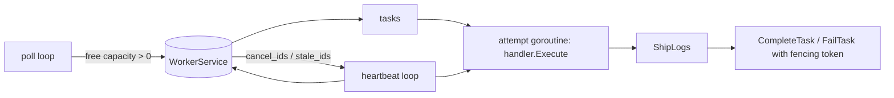

# Worker runtime and handler SDK

`flowforge-worker` runs task handlers (task 03.03, ADR-004, ADR-007, ADR-021). It registers with `flowforge-api`'s WorkerService, pulls work within its capacity, runs each attempt through a handler, and reports the outcome with the attempt's fencing token. The wire protocol is in [worker protocol](worker-protocol.md).

Code: `internal/worker/handlers` (the SDK and built-in handlers), `internal/worker/runtime` (the engine), `cmd/flowforge-worker` (the binary).

## Writing a handler

```go
type Handler interface {
	Type() string
	Execute(ctx context.Context, tc handlers.TaskContext) (json.RawMessage, error)
}
```

`TaskContext` carries the attempt's identity and input:

| Field | Meaning |
|---|---|
| `TaskID`, `RunID` | The task and its run |
| `AttemptID`, `AttemptNumber` | This attempt; numbers start at 1 |
| `IdempotencyKey` | `task_id:attempt_number`: unique per attempt |
| `Input` | The resolved input JSON |
| `Deadline` | The server's deadline for the attempt |
| `Logger` | A `*slog.Logger` whose lines go to the attempt's logs (`GET /api/v1/attempts/{id}/logs`) |
| `Traceparent` | W3C trace context; empty until tracing lands (08.01) |

Register handlers before the worker starts:

```go
reg := handlers.NewRegistry()
if err := reg.Register(myHandler{}); err != nil { … } // a duplicate type is an error
```

The worker advertises `reg.Types()` when it registers, so it only ever receives tasks it has a handler for.

## Idempotency: required for side effects

Execution is **at least once**, never exactly once (ADR-007). The same task can run more than once, for any of these reasons:

- a timeout;
- a lost worker;
- a crash between the side effect and the report;
- a retry (03.04).

So any handler that changes something outside FlowForge **must** make that change idempotent. Choose the key for the scope you need:

- **`TaskContext.TaskID`:** use this when the effect must happen once per task, across all of its attempts. This is the usual case.
- **`TaskContext.IdempotencyKey`:** use this when each attempt may legitimately produce its own effect.

**Worked example: an idempotent insert with a unique key.** The target table carries a unique constraint on the key, and the handler inserts with `ON CONFLICT DO NOTHING`, so a second execution is a no-op that still succeeds:

```sql
CREATE TABLE payouts (
  idempotency_key text PRIMARY KEY,      -- the task id: one payout per task, however many attempts
  account         text    NOT NULL,
  amount_cents    bigint  NOT NULL,
  created_at      timestamptz NOT NULL DEFAULT now()
);
```

```go
func (h Payout) Execute(ctx context.Context, tc handlers.TaskContext) (json.RawMessage, error) {
	var in struct {
		Account string `json:"account"`
		Cents   int64  `json:"amount_cents"`
	}
	if err := json.Unmarshal(tc.Input, &in); err != nil {
		return nil, handlers.NonRetryable(handlers.CodeInvalidInput, err)
	}
	tag, err := h.DB.Exec(ctx, `INSERT INTO payouts (idempotency_key, account, amount_cents)
	                            VALUES ($1, $2, $3) ON CONFLICT (idempotency_key) DO NOTHING`,
		tc.TaskID, in.Account, in.Cents)
	if err != nil {
		return nil, handlers.Retryable("DB_UNAVAILABLE", err) // safe to retry: the key dedupes
	}
	return json.Marshal(map[string]any{"inserted": tag.RowsAffected() == 1})
}
```

For an external HTTP API, send the same key as its idempotency header (for example `Idempotency-Key: <task id>`) instead.

## Errors

Return the result JSON on success. On failure, return an error, and classify it when you know whether another attempt could help:

| What you return | Reported as | Retryable |
|---|---|---|
| `handlers.Retryable(code, err)` | `code` | yes |
| `handlers.NonRetryable(code, err)` | `code` (e.g. `INVALID_INPUT`) | no: 03.04 never retries it |
| any other error | `HANDLER_ERROR` | yes |
| a panic | `PANIC`; the stack goes to the attempt's logs, never into the reported message | yes |
| `ctx` ended because the server cancelled | `CANCELLED` | no |
| `ctx` ended at the deadline | `DEADLINE` | yes |
| `ctx` ended because the worker shut down | `WORKER_SHUTDOWN` | yes |
| a result that is not valid JSON | `INVALID_RESULT` | no |

Codes are 1–64 characters; anything else is reported as `HANDLER_ERROR`. The error's message is sent with `FailTask`, where it is redacted, capped at 4 KiB, and never put into events.

## Cancellation contract

`Execute` **must** return promptly once `ctx` is done. The worker cancels `ctx` in four cases:

- **The server cancelled the attempt.** The heartbeat answer carries its id in `cancel_attempt_ids`; this is wired in 03.05. The outcome is reported as `CANCELLED`.
- **The attempt is stale.** Either a heartbeat lists it in `stale_attempt_ids`, or a report was answered `STALE_ATTEMPT`. The result is **dropped and never reported**, because another attempt owns the task, and a rejected report is never retried.
- **The attempt is near its deadline.** `ctx` ends one second before `Deadline`. That is only a courtesy: the server's timeout decision is final (ADR-021), so a handler that overruns finds its report rejected.
- **The worker shut down** and the grace period ran out.

Cancellation reaches the handler within two heartbeat intervals (`FF_WORKER_HEARTBEAT`, 5 s by default; `TestWorker_ServerCancellation` checks this with 200 ms).

## How the runtime works



- **Capacity:** the poll loop asks only for `capacity − running` tasks, and it's the only thing that starts attempts, so a worker never runs more than `FF_WORKER_CAPACITY` at once (`TestWorker_CapacityHonored`). At full capacity it waits for an attempt to end.
- **Heartbeat:** it runs in its own goroutine, every interval the API returns from `Register`. It shares no lock with handlers, so it keeps going while handlers block, and through the shutdown grace too.
- **Reports:** results are reported with the fencing token. While the API is unreachable, a report is retried with bounded exponential backoff and jitter (100 ms to 5 s), up to the attempt's deadline. `STALE_ATTEMPT` ends it at once. Other rejections are logged and counted, not retried.
- **Reconnect:** grpc-go reconnects on its own, with 100 ms to 5 s backoff. After any unreachable or not-registered answer, the worker calls `Register` again before its next poll or heartbeat. Running attempts keep running through an outage (master spec §6.2), and `TestWorker_ReconnectAfterAPIRestart` covers this.
- **Logs:** each attempt keeps up to 1000 lines in memory. On overflow the oldest line is dropped, and drops are counted in `flowforge_worker_log_lines_dropped_total`. The lines are shipped in one `ShipLogs` stream when the attempt ends, just before its outcome is reported. The server redacts them, caps each at 8 KiB and caps each attempt at 1000 lines.

## Shutdown

On SIGTERM or SIGINT, the worker shuts down in five steps:

1. Polling stops, so no new attempt starts. A poll already in flight is **not** cancelled: the API may already have claimed tasks for this worker, and cancelling would drop the response that carries them and orphan those attempts. So shutdown can take up to one poll wait (10 s) longer, and any tasks that poll returns get the grace too.
2. Running attempts get `FF_WORKER_SHUTDOWN_GRACE` (30 s by default) to finish and report normally.
3. Any still running are cancelled and report `WORKER_SHUTDOWN` (retryable). Their reports get another 10 s; after that they are abandoned, and recovery (03.04) finds the attempts.
4. Heartbeats stop.
5. The worker calls `Deregister`.

The process then exits 0. Nothing outlives `Worker.Run`; goleak checks this in the tests.

## Built-in handlers

| Type | Input | Behavior |
|---|---|---|
| `noop` | anything | Returns the input |
| `echo` | anything | Logs one line; returns `{input, task_id, run_id, attempt_number, idempotency_key}` |
| `sleep` | `{"duration_ms": n}` | Waits n ms, honoring `ctx`; returns `{"slept_ms": n}` |
| `fail` | `{"code", "retryable", "message"}` | Always fails as classified (code defaults to `FAILED`, not retryable) |
| `flaky` | `{"fail_attempts": n}` | Fails with retryable `FLAKY` while `attempt_number <= n`, then returns the input |
| `crash` | — | Exits the process with status 1, leaving the attempt for recovery. Registered only with `FF_WORKER_ENABLE_CRASH_HANDLER=true`, which is rejected under `FF_ENV=prod` |

## Configuration and metrics

Variables (see [configuration](../configuration.md)):

- Identity and API: `FF_WORKER_ID`, `FF_WORKER_QUEUES`, `FF_WORKER_CAPACITY`, `FF_API_GRPC_TARGET`, `FF_WORKER_TOKEN` (an API key with role `worker`).
- Timing: `FF_WORKER_HEARTBEAT`, `FF_WORKER_SHUTDOWN_GRACE`.
- Operations: `FF_WORKER_ENABLE_CRASH_HANDLER`, and `FF_WORKER_HTTP_ADDR` (`:8082`), which serves `/metrics`, `/healthz` and `/readyz`.

| Metric | Meaning |
|---|---|
| `flowforge_worker_active_tasks` | Attempts running now |
| `flowforge_worker_task_outcomes_total{outcome}` | `succeeded`, `failed`, `cancelled`, `shutdown`, `stale` (result dropped), `report_failed` |
| `flowforge_worker_log_lines_dropped_total` | Log lines lost to overflow or failed shipping |
| `flowforge_worker_lease_renewal_failures_total` | Heartbeat ticks that did not renew the lease |

## Limitations

- **Plaintext transport.** The connection to the API is plaintext with a bearer token, matching how 03.01 serves it; TLS arrives with the deployment hardening tasks.
- **Logs arrive at the end.** A long-running attempt's logs appear only when it ends, and a crashed worker's buffered lines are lost.
- **Readiness doesn't check the API.** `/readyz` reports only that the process serves; that the API is reachable shows in registration, the metrics and the logs.
