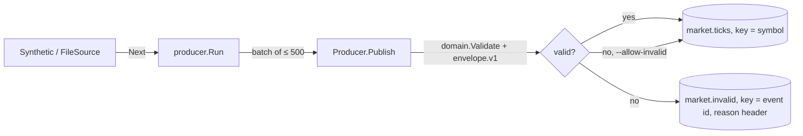

# Market-data generator, file loader and producer

`flowforge-producer` (task 05.03, FR-KAFKA-04/05) publishes market-data ticks to Kafka. It reads them from one of two sources behind one interface, then publishes:

- **The synthetic generator** is seeded and deterministic, and injects faults on request.
- **The file loader** reads CSV or JSON lines.
- **The producer** validates every tick, wraps it in the event envelope, keys it by symbol and publishes it.
- **Rejected ticks** go to the `market.invalid` DLQ with a reason, unless the producer is told to let them through.

The downstream processor (05.04) consumes `market.ticks`. The envelope and schemas are in [`event-schemas.md`](event-schemas.md), and the tick math in [`market-data-math.md`](market-data-math.md).



## Running it

```bash
make dev-up PROFILE=streaming && make topics
FF_KAFKA_BROKERS=localhost:19092 go run ./cmd/flowforge-producer --clock simulated --count 10000 --seed 42
FF_KAFKA_BROKERS=localhost:19092 go run ./cmd/flowforge-producer --rate 50 --inject dup=1%,late=2%,ooo=3%,invalid=1%
FF_KAFKA_BROKERS=localhost:19092 go run ./cmd/flowforge-producer --file testdata/marketdata/sample_ticks.csv
```

| Flag | Default | Meaning |
|---|---|---|
| `--file PATH` | — | Read ticks from a `.csv` or `.jsonl` (`.ndjson`, `.json`) file instead of generating them |
| `--symbols` | `ACME,BOLT,CRUX` | Synthetic symbols, each `^[A-Z]{1,6}(\.[A-Z])?$` |
| `--seed` | `1` | PRNG seed: the same seed and flags give the same stream |
| `--rate` | `FF_PRODUCER_RATE` (`100`) | Ticks per second of event time |
| `--clock` | `realtime` | `realtime`: paced, with event time = now. `simulated`: as fast as possible, on a virtual clock |
| `--start` | now; simulated: now minus the run's span | First event time, RFC 3339 |
| `--duration` | — | Stop after this much event time (synthetic only; with `--file`, use `--count`) |
| `--count` | — | Stop after this many ticks |
| `--inject` | none | Fault injection, e.g. `dup=1%,late=2%,ooo=3%,invalid=1%,gap=1%,late_max=2m` |
| `--batch` | `500`; realtime: rate/20 (about 50 ms) | Ticks per publish: the bound on the producer's memory |
| `--allow-invalid` | off | Send invalid ticks to `market.ticks`, to test the processor's DLQ path |

**When it stops:**

- **Bounded runs:** with `--count` or `--duration`, or at the end of a file (a CSV without a usable header is an error, exit 1), it publishes the rest, prints a JSON summary to stdout and exits 0. The summary has `read`, `published`, `rejected`, `forced_invalid`, `bad_rows`, `bad_lines` and, for synthetic runs, `injected` per kind.
- **Unbounded runs:** without a bound it runs until SIGINT or SIGTERM, then prints the summary.
- **Exit codes:** 2 for a mistake in the flags, 1 for a failure such as an unreachable broker.

**Simulated runs need a bound**, because their event times would otherwise run ahead of the clock and be rejected as future (5 s, 00E §7).

- **Where they start and stop:** a simulated stream starts its span before now (the span is `--duration`, or `--count` ticks at `--rate`) and stops at the end of that span. With gap injection that can be fewer than `--count` ticks.
- **The 14-day limit:** a span longer than the 14-day tick retention is refused, because its start would be `too_old`.
- **`-h`** prints the flags.

**Metrics:** it serves `/metrics`, `/healthz` and `/readyz` on `FF_PRODUCER_HTTP_ADDR` (`:8084`). The metrics are `flowforge_producer_events_total{result}` (`published`, `invalid`, `forced_invalid`, `error`) and `flowforge_producer_publish_latency_seconds`, per batch (00E §11.1).

## Determinism

`internal/stream/source.Synthetic` draws every random decision from one PCG source seeded with `(seed, GeneratorVersion)`. The global `math/rand` is never used.

- **The price walk:** each symbol's price is a geometric random walk in integer cents, moving at most 0.20 % per tick. Sizes are integers from 1 to 1 000.
- **No floats in the stream:** floats would let an arm64 build (which may fuse multiply-add) and an amd64 build drift apart, so prices are integer cents. The same seed gives byte-identical ticks on every platform.
- **The golden test:** `TestSynthetic_GoldenStream` pins the SHA-256 of the stream for seed 42, three symbols and 1 000 ticks (`internal/stream/source/testdata/golden_v1_seed42.sha256`).
- **Changing the generator:** bump `GeneratorVersion`, then rerun `go test ./internal/stream/source/ -run Golden -update`.
- **Event times:** normal ticks are one 1/rate step apart. A symbol's sequence numbers count up from 1.

**Event ids** are deterministic (00E §7): `event_id = hex(sha1(source|symbol|sequence|event_time))`, with `event_time` in Unix nanoseconds (`source.EventID`). The same tick always gets the same id, and the processor dedupes on it. A file row may bring its own `event_id`; otherwise it gets this one.

## Fault injection

`--inject` gives each kind a share of the ticks returned. The shares hold to within ±0.5 percentage points over 100 000 ticks (`TestSynthetic_InjectionRates`).

| Kind | What the tick is | What the processor must do |
|---|---|---|
| `dup` | An exact copy of one of the last 64 good ticks: the same event id | Dedupe it (`ON CONFLICT DO NOTHING`, counted) |
| `late` | Event time 31 s to `late_max` (default 2 min) behind the latest event time | Store it and recompute its closed window, or reject it as `too_late` beyond the max lateness (10 min) |
| `ooo` | Event time up to 5 s behind the latest one: out of order but on time | Aggregate it normally |
| `invalid` | Breaks one domain rule: a negative price, a lower-case symbol, a negative size, or a time 1 h in the future | The producer sends it to `market.invalid`; with `--allow-invalid`, the processor must |
| `gap` | Not a tick: a whole one-minute window with no ticks (the chance per window) | Show the window as missing (the quality check, 05.09) |

- **What a fault is:** the faults are in event time only. Kafka keeps each symbol's records in produced order on one partition (key = symbol), so out-of-order and late ticks are disorder *inside* that order, which is what the processor handles.
- **Duplicates, late and out-of-order ticks need a good tick first:** before the first one, they come out as normal ticks.

## File formats

**CSV:** a header row names the columns `event_time,symbol,price,size,source`, plus optional `sequence` and `event_id`, in any order. This is [`testdata/marketdata/sample_ticks.csv`](../../testdata/marketdata/sample_ticks.csv):

```csv
event_time,symbol,price,size,source,sequence,event_id
2026-11-02T14:30:00.100Z,ACME,101.25,300,csv,1,
2026-11-02T14:32:05Z,ACME,100.95,200,csv,4,hist-acme-4
```

**JSON lines:** one object per line with the same keys. `price` and `size` may be JSON numbers or strings, and blank lines are skipped ([`sample_ticks.jsonl`](../../testdata/marketdata/sample_ticks.jsonl)).

**How rows are read:**

- `event_time` is RFC 3339; prices and sizes are exact decimals.
- **Structural problems:** a row with an unreadable time or number, or missing fields, is reported with its line (`source.ParseError`), and the read continues. The summary counts `bad_rows` and lists the first 20 `bad_lines`.
- **Domain problems** (a negative price, a bad symbol) are the producer's to reject, so those rows reach the DLQ with their reason.

## The producer

`internal/stream/producer.Producer.Publish` takes a batch of ticks. For each tick:

1. It applies `domain.Validate` at the producer's clock: missing fields, bad symbol, non-positive price, negative size, more than 5 s in the future, or older than the 14-day retention.
2. It validates the envelope against `envelope.v1`, which checks the `market_tick.v1` payload. A tick that passes the domain rules but not the schema (size 0, for example) is rejected as `schema_invalid`.
3. **A valid tick** goes to `market.ticks`: key = symbol, header `event_id`, an `envelope.v1` value with event type `market.tick`.
4. **An invalid tick** goes to `market.invalid`: key = event id, headers `event_id` and `reason`, and a `market_invalid.v1` payload `{reason, detail, original}`, where `original` is the tick's payload, base64. A producer reject has no `source_topic`, `source_partition` or `source_offset`, because it was never on a topic (00A amendment 05.03).
5. **With `--allow-invalid`,** invalid ticks go to `market.ticks` as they are.

**Delivery:**

- **Acknowledgement:** a batch is published with the idempotent, `acks=all` producer of `internal/kafka` and waits for every acknowledgement.
- **On error:** part of the batch may be written. The run stops, and a rerun is safe because consumers dedupe on `event_id`.
- **Memory:** it is bounded by the batch size and the Kafka client's buffer.

## Limitations

- **No speed-up factor:** simulated mode is as fast as the broker allows, and realtime mode runs at `--rate`.
- **Unsorted file input:** the loader reads rows in file order. If one symbol's rows are out of order in the file, they are published out of order, as the processor's lateness handling expects.
- **History older than 14 days is rejected:** the tick retention (`MaxTickAge`) makes older rows `too_old`, so they go to the DLQ. The bundled `sample_ticks` fixtures (2026-11-02) are for parsing tests; loading them a fortnight later rejects every row.
- **Real-time accuracy:** realtime event times are the scheduled times (start + n/rate), not the moment of sending. Under load, publishing can lag them.
