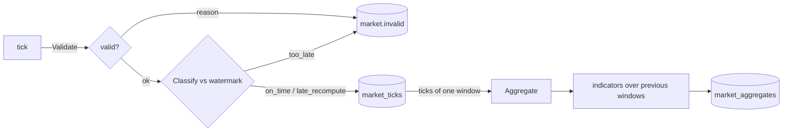

# Market-data math: windows, aggregates, indicators and lateness

The market-data domain (`internal/stream/domain`, task 05.02, FR-KAFKA-08..10) turns ticks into per-window aggregates. This page gives every formula, with worked examples that are also the package's test vectors, and the TimescaleDB tables they are stored in. The stream processor (05.04, 05.05) calls these functions; the table definitions are in `00E` §12.

**Purity:**

- The package does no I/O and reads no clock or randomness. The current time is a parameter.
- It imports no FlowForge package.
- Lint enforces this with depguard rule `stream-domain-pure`, and `make lint-selftest` proves the rule fires.

The same ticks always give the same results, in a live run and in a replay.

## Ticks and validation

A `Tick` has an event id, symbol, price, size, event time, source and sequence (`market_tick.v1`).

- **Prices and sizes are exact decimals:** `shopspring/decimal` in Go and `numeric` in TimescaleDB, never floating point.
- **Floats only for statistics:** only the statistics of log returns (volatility, z-score) are `float64` / `double precision`.

`Validate(tick, now)` returns the first reason that applies, in this order. The reason is the `market.invalid` DLQ reason.

| Reason | When |
|---|---|
| `missing_field` | No event id, symbol, source or event time |
| `bad_symbol` | Symbol not `^[A-Z]{1,6}(\.[A-Z])?$` (`ACME`, `BRK.B`) |
| `nonpositive_price` | Price ≤ 0 |
| `negative_volume` | Size < 0. A zero size is valid here and in `market_ticks` (the zero-volume VWAP rule below), but the published `market_tick.v1` schema requires size > 0 (00E §7), so at the Kafka edge a zero-size tick goes to the DLQ as `schema_invalid` before `Validate` runs. Loosening the schema would be a `market_tick.v2` |
| `future_timestamp` | Event time more than 5 s after `now` (`MaxFutureSkew`, 00E §7) |
| `too_old` | Event time more than 14 days before `now` (`MaxTickAge`, the tick retention) |

`too_late` (below) is the seventh reason, from the lateness policy.

## Windows

The windows are tumbling, 1 m and 5 m (`Window1m`, `Window5m`).

- **Alignment:** `WindowFor(t, size)` returns the window that contains `t`: the half-open interval `[start, start + size)`, with `start` on a multiple of the size since the Unix epoch, in UTC.
- **Any zone:** an event time in any zone maps to the same UTC window. For example, `09:32:10-05:00` falls in the 5 m window starting `14:30:00Z`.
- **Boundaries:** a tick exactly on a boundary belongs to the window that starts there. Times before the epoch round down (`1969-12-31T23:59:59.999Z` → `23:59:00Z`).
- **No DST, no leap seconds:** UTC has no daylight-saving changes, and Go time has no leap seconds.

## Aggregate (OHLCV, VWAP, count, input hash)

`Aggregate(ticks, window)` takes the stored ticks of one symbol in one window.

- **Order of ticks:** the ticks are ordered by `(event_time, seq, event_id)`, then price and size as last tie-breaks, so even a batch that holds one event twice is deterministic. The first is the open, the last is the close.
- **The other fields:**
  - high and low are the extremes;
  - volume = Σ size;
  - VWAP = Σ(price · size) / Σ size, rounded half away from zero to 8 decimal places (`DerivedScale`). When Σ size = 0, VWAP is defined as the close;
  - count is the number of ticks;
  - `input_hash` = hex SHA-256 of the sorted event ids, each written as `<byte length>:<id>`, so no id can run into the next whatever characters it contains.
- **Order-independent:** the result depends only on the set of ticks, never on the order they arrive in. `TestAggregate_OrderIndependent` checks 1 000 random permutations (seed 502).
- **Using the hash:** the processor stores `input_hash` and skips rewriting a window whose hash has not changed (ADR-011, 05.05).
- **Empty windows:** a window without ticks gives `Count` 0 and is never upserted; `market_aggregates` requires `event_count > 0`.

**Worked example 1** (1 m window starting `2026-11-02T14:30:00Z`):

| Event id | Event time | Seq | Price | Size | Price · size |
|---|---|---|---|---|---|
| a | 14:30:05 | 1 | 100.00 | 10 | 1000.00 |
| b | 14:30:20 | 2 | 101.50 | 5 | 507.50 |
| c | 14:30:40 | 3 | 99.75 | 20 | 1995.00 |
| d | 14:30:59.999 | 4 | 100.25 | 15 | 1503.75 |

- **Prices:** open 100.00, high 101.50, low 99.75, close 100.25.
- **Volume:** 50.
- **VWAP:** 5006.25 / 50 = **100.125**.
- **Count:** 4.
- **`input_hash`:** SHA-256(`1:a1:b1:c1:d`) = `40b395eaa29be6f59881ada1804095a0b13309429bdaf4e86c1a7e2ed2167ea0`.

## Indicators

The indicators are computed from the closes of the previous windows of the same symbol and size, oldest first.

**Moving average:** `MovingAverage(closes, n)` is the mean of the last n closes, at 8 places.

- The default is n = 5 (`DefaultMAWindows`).
- With fewer than n closes it is undefined, and the column stays null.

**Worked example 2:**

- closes 10, 11, 12, 13, 14, 15 with n = 5 → (11 + 12 + 13 + 14 + 15) / 5 = **13**;
- closes 1, 2, 2 with n = 3 → 5 / 3 = **1.66666667**.

**Volatility:** `Volatility(closes, n)` uses the log returns of the last n closes, r_i = ln(c_i / c_{i−1}), m = n − 1 of them.

- **The formula:** the **sample** standard deviation, σ = √(Σ(r_i − r̄)² / (m − 1)).
- **Not annualised.**
- **The default** is n = 20 (`DefaultVolatilityWindows`).
- **Undefined when:** there are fewer than 3 closes (two returns are the least a sample standard deviation needs), or a close is not positive.

**Worked example 3:** closes 100, 110, 99, 108.9 with n = 4.

- **Returns:** ln 1.1 = 0.0953102, ln 0.9 = −0.1053605, ln 1.1 = 0.0953102.
- **Their mean:** 0.0284200.
- **σ** = √((0.0668902² + 0.1337805² + 0.0668902²) / 2) = **0.11585728004354241**.

**Anomaly:** `DetectAnomaly(history, close, params)` scores the window's close against the previous n closes. With mean μ and sample standard deviation s of those closes:

z = (close − μ) / s, flagged when |z| > k.

- **Defaults:** n = 20, k = 3, at least 10 previous closes (`DefaultAnomalyParams`).
- **Not enough history:** with fewer samples than the minimum, nothing is flagged, however extreme.
- **Flat history:** when all the previous closes are equal (compared as exact decimals, because a float64 std-dev can round to a tiny non-zero value), any different close gives z = ±∞ and is flagged, and an equal close gives z = 0.

**Example (anomaly test):** a history of 20 closes alternating 100 and 102 has μ = 101 and s = 1.0259783520851542.

- **Close 110:** z = 8.7721…, flagged.
- **Close 102:** z = 0.9747, not flagged.
- **Only 9 previous closes:** nothing is flagged.

## Watermark and lateness

The policy is FR-KAFKA-09 and ADR-011.

- **The watermark:** `Watermark(maxEventTime, allowedLateness)` = the latest event time seen − allowed lateness. The default allowed lateness is 30 s (`DefaultAllowedLateness`).
- **Closed windows:** a window is closed once its end is at or before the watermark.
- **Classification:** `Classify(windowEnd, watermark, maxLateness)` decides a tick's fate from its window's end.

| Decision | When | What the processor does |
|---|---|---|
| `on_time` | end > watermark | Store the tick and aggregate normally |
| `late_recompute` | watermark − max lateness ≤ end ≤ watermark | Store it with `late = true` and recompute the closed window |
| `too_late` | end < watermark − max lateness | Don't store it. Send it to `market.invalid` with reason `too_late` and count it (a decision, not a silent drop) |

- **Max lateness:** defaults to 10 min (`DefaultMaxLateness`; `FF_STREAM_MAX_LATENESS` is added by the processor, 05.04).
- **No wall clock:** classification uses event time only, so replaying the same events classifies them exactly as the live run did.

## The TimescaleDB schema

The schema is migrations `0001`–`0004` in `migrations/marketdata` (`00E` §12). The rationale for the tables and keys:

- **`market_ticks`:**
  - **Hypertable** on `event_time`, with 1-day chunks.
  - **Why the key is `(event_id, event_time)`:** TimescaleDB requires the partitioning column in every unique index, so uniqueness is on that pair. `event_id` is deterministic and `event_time` is part of the event, so one event always maps to one pair, and the processor's `INSERT … ON CONFLICT DO NOTHING` dedupes replays and duplicates.
  - **Two event times, one event id:** two events with the same `event_id` but different event times are stored as two rows. That is a producer bug, which the quality check (05.09) reports.
  - **Policies:** compressed after 2 days (segmented by symbol, ordered by event time and id) and dropped after 14 days.
- **`market_aggregates`:**
  - **Hypertable** on `window_start`, one row per `(symbol, window_size, window_start)`.
  - **Bookkeeping:** `status` (`open` | `final`), `version` and `input_hash` serve the recompute-and-upsert of 05.05.
  - **Column types:** prices are `numeric`; volatility is `double precision`.
- **`market_ingest_state`:** one row per consumer group and partition (last offset, latest event time). It is informational; Kafka's group commits are authoritative.
- **`market_replay_jobs`:** bounded replays (05.07). The id is the idempotency key.

## Limitations

- **Caller-side checks:** the package trusts the caller to pass one symbol's stored ticks of one window. `Aggregate` rejects other ticks, but it does not dedupe: the table's key does that.
- **Indicator precision:** volatility and z-scores are `float64`, computed from the decimal closes, so they are not bit-exact across platforms with different `math.Log` implementations. Stored prices are exact.
- **Classification needs a watermark:** the watermark (the latest event time) is tracked by the processor per partition (`market_ingest_state.max_event_time`). The domain only computes from it.
