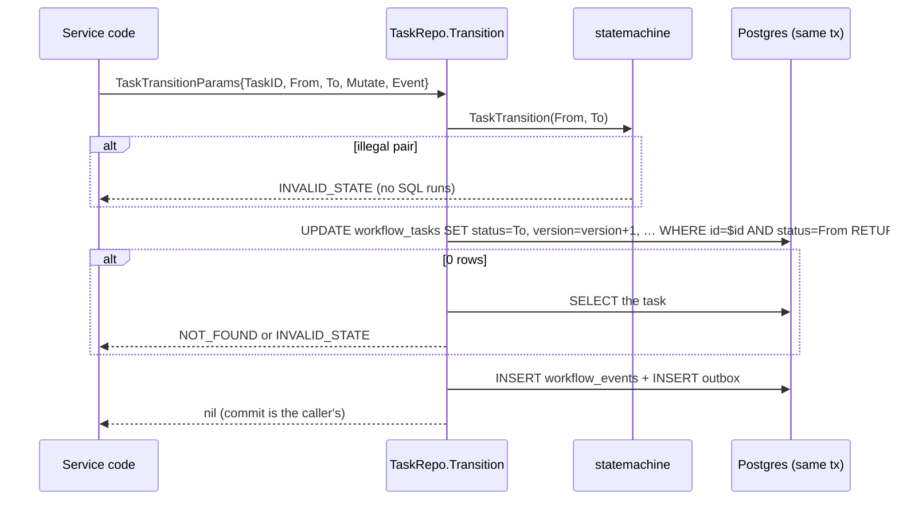

# Persistence layer

How control-plane services read and change workflow state in the `flowforge` database (task 02.03). The schema itself is in [`database.md`](database.md) and `00E` §2; the state machines the layer enforces are in [`workflow-semantics.md`](workflow-semantics.md) and `00E` §3.

## Packages

| Package | Holds |
|---|---|
| `internal/persistence` | The contract: `TxManager`, the repository interfaces (`DefinitionRepo`, `RunRepo`, `TaskRepo`, `AttemptRepo`, `EventRepo`, `ClusterRepo`), their parameter types, the read models (`RunView`, `TaskView`, …) and keyset cursors. |
| `internal/persistence/pg` | The Postgres implementation: `NewPool`, `TxManager`, and one repository type per interface. |
| `internal/persistence/queries` | All SQL, compiled by sqlc into `internal/persistence/sqlcgen` (`make sqlc`). No SQL is built from strings. |
| `internal/events` | Typed event constructors for every `00E` §7 type, the envelope, and `Recorder.Record`. |

Services wire the layer once at startup:

```go
pool, err := pg.NewPool(ctx, cfg.PGDSN)
tm := pg.NewTxManager(pool, clock.Real{}, rand.New(rand.NewPCG(seed, seed)))
rec := events.NewRecorder(clock.Real{}, ids.NewGenerator(clock.Real{}, crand.Reader), "flowforge-api")
runs, tasks := pg.NewRunRepo(gen, rec), pg.NewTaskRepo(rec)
```

## Transactions and locking

- **Isolation:** `READ COMMITTED` by default (`pgx.TxOptions{}`). Correctness comes from conditional `UPDATE`s and unique constraints, not from high isolation. Claim code that needs row locks (03.01/03.02) uses `FOR UPDATE SKIP LOCKED` in its own queries.
- **`TxManager.WithTx(ctx, opts, fn)`** commits when `fn` returns nil and rolls back on an error or a panic; it re-raises the panic. A serialization failure (`40001`) or deadlock (`40P01`), from `fn` or from commit, reruns `fn` up to `pg.MaxTxRetries` (3) times, after a backoff of 10 ms·2ⁿ jittered to ±50 %. After that the error is returned. So `fn` must have no side effects outside its transaction: no network calls, no channel sends.
- **Short transactions:** never span a network call (`00C` §9).
- **Database clock for deadlines:** `deadline_at`, `available_at`, `started_at`, `completed_at` and `updated_at` use `now()` in SQL, so one clock decides expiry (ADR-021). `occurred_at` in event envelopes comes from the injected `clock.Clock`.

## Transition helper contract

Every status change goes through a repository `Transition` method. No other query writes a `status` column; `TestQueries_OnlyTransitionsWriteStatus` fails the build if one does.



| Repository | Condition in the `UPDATE` | 0 rows means |
|---|---|---|
| `TaskRepo.Transition` | `id`, `status = From` | `NOT_FOUND` (no task) or `INVALID_STATE` |
| `RunRepo.Transition` | `id`, `status = From`, `version = Version` | `NOT_FOUND`, `INVALID_STATE` (status moved) or `CONFLICT` (stale version) |
| `AttemptRepo.Transition` | `id`, `status = From`, `fencing_token = FencingToken` | `NOT_FOUND` or `STALE_ATTEMPT` (ADR-003, `00E` §4) |

- **One winner:** of several transactions racing the same `From → To`, the first to commit wins. The others wait on the row lock, re-check the `WHERE` and get 0 rows (`TestTaskRepo_ConcurrentTransitionHasOneWinner`: 20 racers, 1 winner, 1 event).
- **Mutations:** `TaskMutation` sets `input`, `result`, `attempt_count++` and a retry delay (`available_at = now() + delay`). `AttemptMutation` sets the error code, message, `retryable` and result. Nil and zero fields leave a task column unchanged.
- **Side columns:** a run's `started_at` is set on its first move to `RUNNING` and `completed_at` on a terminal status. `leader_epoch` is stamped when `LeaderEpoch` is given.
- **Methods that write more than one row take a `pgx.Tx`, not a `Querier`:** every `Transition`, `RunRepo.CreateWithTasks`, `AttemptRepo.Create`, `ClusterRepo.AssertEpoch` and `Recorder.Record`. The compiler then rejects a call that would commit a status change without its event.

## Event and outbox recording

`events.Recorder.Record(ctx, tx, ev)` writes, in `tx`:

1. a `workflow_events` row, the run's history read by SSE (ADR-009);
2. an `outbox` row with the `00E` §7 envelope, which the relay (03.x) publishes.

| Field | Value |
|---|---|
| `event_id` | `evt_<ulid>`, also the outbox's unique key, so consumers dedupe on it |
| topic | `flowforge.task-events` for `task.*` and `task.attempt.*`; `flowforge.workflow-events` for everything else |
| key | `run_id`, so one run's events stay ordered; cluster events use their aggregate id |
| `correlation_id` | the request id from `logging.WithFields(ctx, logging.KeyRequestID, …)`, else the run id |
| `trace` | omitted until tracing lands (08.01) |

- **Default events:** each `Transition` records the event `statemachine.*TransitionEvent(From, To)` gives, with a typed payload. Set `Event` in the params to record a richer event of your own instead.
- **Attempt cancel:** an attempt `RUNNING → CANCELLED` records nothing, because `00E` §7 has no type for it; the task's `task.cancelled` covers it.
- **Cluster events:** `worker.*` and `scheduler.leader_changed` have no run, so they go to the outbox only (`workflow_events.run_id` is `NOT NULL`).
- **Payloads are typed structs** (`RunPayload`, `TaskPayload`, `AttemptPayload`, `ApprovalPayload`, `WorkerPayload`, `LeaderChangedPayload`). They carry IDs, statuses and error codes, never error messages, inputs or results. `Record` rejects a payload that doesn't match its event type's family.

## Epoch fencing

`cluster_state` row 1 holds the scheduler epoch (ADR-003, master spec §3.5). Epoch 0 is unfenced single-scheduler mode.

- **A new leader** calls `ClusterRepo.SetEpochIfGreater(epoch, leaderID)` once; it is a no-op unless `epoch` is higher than the stored one.
- **Every scheduler transaction** calls `ClusterRepo.AssertEpoch(ctx, tx, myEpoch)` first. It takes `SELECT … FOR SHARE` on the row, held until commit, and returns `NOT_LEADER` wrapping `persistence.ErrStaleEpoch` unless the stored epoch equals `myEpoch`.
- **Why the share lock matters:** a new leader's `SetEpochIfGreater` waits for in-flight transactions of the old leader. After it commits, every later old-leader transaction fails its assert.

## Reads and pagination

- **Keyset pagination:** `DefinitionRepo.List` and `RunRepo.List` page on `(created_at DESC, id DESC)`. The cursor is opaque (base64url of `unix_micro|id`); `persistence.Page.Limit` defaults to 50 and is capped at 200. Equal timestamps are safe because `id` breaks ties (`TestRunRepo_KeysetPaginationWithEqualTimestamps`, 250 runs sharing one `created_at`).
- **Run filters:** `RunFilter` filters on status, workflow name (a join on `workflow_definitions`), and `since`/`until` on `created_at`.
- **Per-run lists:** task, attempt and event lists per run are bounded by `maxRows` (10 000) or the page limit. A task list that reaches the cap is an error, never a silent truncation.
- **Read models:** `TaskView.State()` gives the `statemachine.TaskView` that `EvaluateReadiness` and `DeriveRunStatus` take.

## Limitations

- **Unfiltered run lists have no dedicated index.** The status filter uses `ix_runs_status_created`; listing all runs sorts on `created_at`. That is fine at demo scale; add `(created_at DESC, id DESC)` in a migration if run volume grows.
- **The envelope JSON Schema is still to come.** `schemas/events/envelope.v1.schema.json` arrives with 05.01; until then `TestRecord_EnvelopeMatches00E` pins the envelope keys to `00E` §7.
- **No repository API for cancellation yet.** `cancel_requested` and run cancellation from `CREATED`/`PAUSED` wait on the `00E` §3.3 decision recorded in the 02.02 report.
