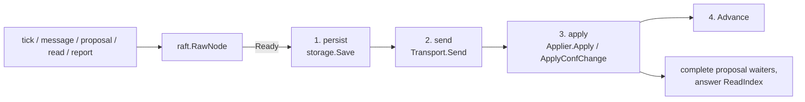

# Raft node runtime

This page describes how a FlowForge Raft replica runs (task 04.02, FR-RAFT-01, FR-RAFT-11). The consensus algorithm is the etcd raft library's, `go.etcd.io/raft/v3` v3.7.0 (ADR-002). FlowForge drives it with three pieces: the Ready loop in `internal/raftkv/node`, the peer transport in `internal/raftkv/transport`, and the storage from [`raft-storage.md`](raft-storage.md). The state machine plugs in through the `Applier` interface (04.03). Raft holds only coordination state (ADR-003).

## The node

`node.New(cfg, storage, applier)` opens a replica, `Start(transport)` runs it, and `Stop()` stops it. A `Node` cannot be restarted: to restart, create a new one over the same storage.

The node wraps a `raft.RawNode` (not `raft.StartNode`):

- **One goroutine owns it.** Proposals, reads, inbound messages, transport reports and ticks all reach that goroutine through bounded channels, so no raft state is shared and nothing needs a lock.
- **Why RawNode:** a manual ticker can step it deterministically in tests (see the test harness below).

Configuration (`node.Config`) follows `00E` §5.3:

| Field | Default |
|---|---|
| `ElectionTick` | 10 |
| `HeartbeatTick` | 1 |
| `TickInterval` | 100 ms |
| `MaxSizePerMsg` | 1 MiB |
| `MaxInflightMsgs` | 256 |
| `SnapshotEntries` | 10 000 |
| `SnapshotTrailing` | 1 000 |

Some settings are fixed rather than configurable:

- **Always on:** `PreVote` and `CheckQuorum`.
- **Always disabled:** proposal forwarding.
- **Library logging:** goes to slog at WARN and above.

`FF_RAFT_PEERS` entries have the form `<id>=<host:port>`, for example `1=raft-1:7001,2=raft-2:7001,3=raft-3:7001`, and `node.ParsePeers` parses them.

## Ready loop



Each `Ready` runs through these steps in order:

1. **Persist** the hard state, entries and snapshot with one atomic, fsynced `Save`.
   - A message may promise what it describes: a vote, an appended entry, an acknowledgement. So nothing is sent before it is on disk.
   - The loop uses this conservative order for leaders too (rule 1).
   - A storage error stops the node (`Err()` reports it) rather than acknowledge anything that isn't durable.
   - **If the Ready carries a leader's snapshot,** `Applier.Restore` loads it next.
2. **Send** the messages. `Transport.Send` queues them and never blocks.
3. **Apply** the committed entries in log order, skipping any at or below the applied index (rule 2).
   - **Normal entries** go to `Applier.Apply`.
   - **Empty entries** are a new leader's no-ops and are skipped.
   - **Conf-change entries** go to `RawNode.ApplyConfChange`.
4. **Advance.**

### Snapshots and compaction

Every `SnapshotEntries` applied entries, the node takes a snapshot:

- **Snapshot:** it calls `Applier.Snapshot()`, then stores the snapshot at the applied index with `SaveSnapshot`.
- **Compaction:** it compacts the log to `SnapshotTrailing` entries before the snapshot.
- **Failure:** a failure is logged and retried only after another `SnapshotEntries` entries, because each attempt serialises the whole state. The log stays complete.
- **Configuration and on demand (04.06):** `FF_RAFT_SNAPSHOT_ENTRIES` and `FF_RAFT_SNAPSHOT_TRAILING` set the two values. `SnapshotNow` and `CompactNow` run the same steps on request, through the `Admin` service ([`raft-operations.md`](raft-operations.md#snapshot-policy)).
- **A wiped node (04.06):** a heartbeat whose commit index is past the node's log is capped at the node's commit, so a node restarted with an empty data directory doesn't panic. It gets the data after a leadership transfer ([`raft-operations.md`](raft-operations.md#a-wiped-node)).

### Restart (rule 5)

The Applier's state lives in memory, so the applied index that is "stored with the FSM state" is the latest snapshot's index. On start, the node:

1. restores the Applier from that snapshot;
2. passes its index to raft as `Applied`;
3. re-applies only the committed entries after it.

Storage's `meta/applied` stays unused. Persisting a later applied index without the state it describes would make a restart skip entries whose effects were lost.

## Proposals

`Propose(ctx, data)` returns a `Result{Index, Data, Err}` once this node has **applied** the entry (rule 3), so a read on this node that follows it sees it. `Result.Err` is the Applier's own verdict on the command, and every replica returns the same one; it isn't a replication failure.

Each entry is framed with a proposal id (version byte, node id, per-start random nonce, sequence), so the waiter for an entry can be found even after restarts.

Only the leader accepts proposals; the errors split into two groups:

| Error | Meaning | Applied? |
|---|---|---|
| `*NotLeaderError` (`errors.Is(err, ErrNotLeader)`) | A follower got it; `Leader` and `Addr` name the leader | Never |
| `ErrNoQuorum` | No leader known: an election, or CheckQuorum stepped this node down | Never |
| `ErrProposalDropped` | Raft refused it (leadership transfer), or a new leader overwrote the entry before it committed | Never |
| `ErrProposalTooLarge` | Data exceeds `MaxSizePerMsg` (1 MiB). Raft sends at least one entry per message, so a bigger entry could exceed the peers' gRPC limit and stall replication | Never |
| `ErrProposalTimeout` | The context ended first | Unknown |
| `ErrNodeStopped` | The node stopped after the proposal was submitted | Unknown |

So a proposal that fails with a definite error is never applied anywhere. The chaos test checks this on every proposal. Retrying after an unknown outcome is safe only for commands the state machine deduplicates (request ids, 04.03).

A waiter is resolved in one of three ways:

- **Applied:** it completes when its entry is applied.
- **Overwritten:** it fails with `ErrProposalDropped` when a different entry is applied at its index.
- **Covered by a snapshot:** it is dropped unanswered (the caller sees a timeout), because the snapshot may or may not include it.

`Applier.Restore` receives exactly what `Snapshot` returned, empty data included, at startup and when a leader sends a snapshot. The one exception is the bootstrap snapshot at index 1, which carries no Applier state and is not restored.

## ReadIndex

`ReadIndex(ctx)` works like this:

1. It confirms the leader with a quorum heartbeat round (raft's `ReadOnlySafe`; followers ask the leader).
2. It takes the commit index at that moment.
3. It waits until this node has applied through that index.

State read from the Applier afterwards reflects every write that committed before the call. That is the basis of 04.04's linearizable reads.

It fails in two ways:

- **No leader known:** it fails at once with `ErrNoQuorum`.
- **Leader cut off from its quorum:** the leader never answers, so the call ends with `ErrReadIndexTimeout`.

Raft never retransmits a lost `MsgReadIndex` or its response. So every election timeout, a read that is still unconfirmed is handed to raft again under the same key, which the leader ignores if it already holds it (`TestCluster_ReadIndexSurvivesALostRequest`).

## Leadership transfer

`TransferLeadership(ctx, to)` (added by 04.04 for `flowforge-raft`'s graceful shutdown) asks the leader to hand off to voter `to`, or with `0` to the follower with the most replicated log, and waits until another node leads.

- **Best effort:** raft abandons a transfer after an election timeout, so the request is renewed until `ctx` ends; a node that is still leader then returns `ctx`'s error.
- **On a follower:** it returns the `NotLeaderError` (or `ErrNoQuorum`).
- **While pending:** raft drops proposals (`ErrProposalDropped`), which clients retry.

Tests: `TestTransferLeadership_*` (20 seeds; a named target; refused on a follower; gives up at the deadline when partitioned).

## Transport

`transport.GRPC` implements `RaftPeer.Stream` (`proto/coordination/v1/raft.proto`).

**Outbound**, every peer has a bounded queue (4 096 messages) and one goroutine that streams the queue over one client stream:

- **Waiting for a connection:** the goroutine waits for the connection with `WaitForReady`, and gRPC redials it with its own backoff.
- **Broken stream:** the goroutine reports the peer unreachable and reopens the stream with a backoff that doubles from 50 ms to 2 s.
- **Full queue:** the message is dropped and `ReportUnreachable` is called. A dropped `MsgSnap` is also reported as `SnapshotFailure`. Memory per down peer stays bounded by the queue, and raft's `MaxInflightMsgs` bounds the pipeline.

**Snapshots** (`MsgSnap`) travel as `SnapshotChunk`s of at most 1 MiB:

- **The first chunk** carries the message with its data emptied.
- **Delivery:** the snapshot counts as delivered (`SnapshotFinish`) once its last chunk is written.
- **If the follower didn't install it,** its next response makes the leader probe and resend.

**Inbound**, `Register(grpcServer)` serves the stream:

- **Dropped envelopes:** an envelope is dropped if it is for another cluster or node, if its sender doesn't match the message, if it can't be decoded, or if it is a `MsgSnap` outside chunks.
- **Reassembly:** chunks are reassembled per stream, in order, up to `storage.MaxSnapshotBytes`.
- **Delivery to the node:** messages go to `Node.Step`, which never blocks. When the node's inbound queue is full, the message is dropped, and raft retransmits.
- **Response direction:** only the client-to-server direction of a stream is used.

**Reports to the node:** `ReportUnreachable` and `ReportSnapshot` never block and are never dropped.

- **Coalesced per peer:** pending reports are kept per peer, with the latest snapshot status, until the loop takes them. A flood of unreachable reports therefore can't crowd out a snapshot report, which raft needs before it resumes replication to that follower.
- **Unknown ids:** reports for ids that aren't configured peers are ignored.

**TLS:** `Config.Creds` secures outbound connections, and the server's credentials are its `grpc.Server`'s. Plaintext is the default until 09.01 wires TLS.

## Membership (static)

On first start (empty storage), every node writes the same bootstrap state:

- **Snapshot:** a snapshot at index 1, term 1, whose `ConfState` lists every configured voter.
- **Hard state:** `{term 1, commit 1}`.

This is equivalent to `raft.StartNode(peers)`, but leaves the conf state in `InitialState` (`TestNode_BootstrapIsIdenticalOnEveryNode`).

On later starts, a peer list that differs from the persisted voters, or persisted learners, is refused with `ErrPeersMismatch`.

Dynamic membership (FR-RAFT-11, optional) is **not** implemented:

- **What exists:** conf-change entries are applied through `ApplyConfChange`, and an unexported `proposeConfChange` exercises that path.
- **What's missing:** a public API, joint consensus handling, and restart validation against conf changes that are in the log but not yet in a snapshot.

## Metrics

| Metric | Meaning |
|---|---|
| `flowforge_raft_is_leader` | 1 while leader |
| `flowforge_raft_term` | Current term |
| `flowforge_raft_commit_index` | Commit index |
| `flowforge_raft_applied_index` | Applied index |
| `flowforge_raft_proposals_pending` | Proposals waiting to apply on this node |
| `flowforge_raft_peer_unreachable{peer}` | 1 after an unreachable report, 0 once a message from that peer arrives (configured peers only, since an envelope's sender is unauthenticated) |
| `flowforge_raft_write_duration_seconds` | Durable Ready write time |

Register them with `node.NewMetrics(registry)` and pass them as `Config.Metrics`; 04.06 extends them.

## Fault injection and the test harness

`transport.Fault` wraps any sender and injects five faults:

- **Drop**
- **Duplicate** (as independent copies)
- **Delay** (counted in its own `Tick`s; messages released by `Tick` are reordered with the default probability)
- **Reorder**
- **Partition**

It can apply faults per link, set defaults for every link, and use partition groups.

With the same seed and call sequence it makes the same decisions. It has no build tag, but only tests and chaos tooling create one.

`nodetest.Cluster` runs real nodes over an in-memory network behind a `Fault`:

```go
c := nodetest.New(t, nodetest.Options{Seed: seed, SnapshotEntries: 20})
lead := c.WaitLeader(50)                       // ticks until the running nodes agree
res, err := c.Node(lead).Propose(ctx, []byte("x"))
c.Fault.Partition([]uint64{lead}, c.Others(lead))
c.Stop(lead); c.Start(lead)                    // crash and restart from storage
if err := c.CheckPrefixes(); err != nil { ... } // applied sequences are prefixes of one another
```

How the harness works:

- **Ticks:** each node uses a `node.ManualTicker`. A `Tick` returns only after the node has stepped every message queued before it, ticked, and handled the resulting Ready. That bounds message latency to one round, so elections don't depend on machine speed.
- **Message delivery:** messages are delivered as copies, as over a wire, and snapshot delivery is reported back to the sender.
- **Applier:** each node gets a `nodetest.Recorder`, which records every applied entry and flags any index that does not increase.
- **Storage:** Mem by default, kept across restarts; `Options.Storage` can supply Bolt instead.
- **Observing sends:** `Options.OnSend` sees every message a node sends.

## Evidence

All of the tests below run once per seed, 20 seeds (3 with `-short`), under `-race`:

| Property | Test |
|---|---|
| Persist before send (rule 1) | `TestCluster_PersistsBeforeSending`: an instrumented storage checks every sent message against what is persisted |
| Apply once, in order, at or below commit (rule 2) | the Recorder's ordering check in every cluster test; `TestCluster_NoQuorumAppliesNothing` |
| Complete after apply (rule 3) | `TestNode_ProposeWaitsForApply` |
| CheckQuorum and PreVote (rule 4) | `TestCluster_PartitionedLeaderStepsDownAndRejoins` |
| Restart from storage (rule 5) | `TestNode_RestartResumesFromSnapshotWithoutReapplying`, `TestCluster_RestartAllPreservesState` (bbolt files for 3 seeds) |
| Failover and catch-up via snapshot | `TestCluster_LeaderKillFailoverAndCatchUp`, `TestGRPC_ThreeNodeClusterReplicatesAndShipsSnapshots` |
| Random faults | `TestCluster_ChaosKeepsAppliedSequencesConsistent` |
| Slow peer | `TestGRPC_FullQueueDropsAndReportsUnreachable` |

Mutation runs confirmed the tests catch eight seeded bugs:

- send before persist;
- re-apply from 0;
- the skip check removed;
- overwritten-entry detection removed;
- followers accepting proposals;
- the cluster-id check removed;
- CheckQuorum off;
- completing a proposal before applying it.

## Limitations

- **No dynamic membership** (see above).
- **Synchronous writes:** each Ready fsyncs, which is about 10 ms per Ready on the development machine. Concurrent proposals share a Ready, so throughput comes from batching.
- **The snapshot is a single in-memory blob** of up to 64 MiB (04.01), and it is sent whole.
- **The library's election randomness can't be seeded,** so seeds make the fault decisions reproducible but not the election timing.
- **No reconnection jitter:** a node has at most two peers.
