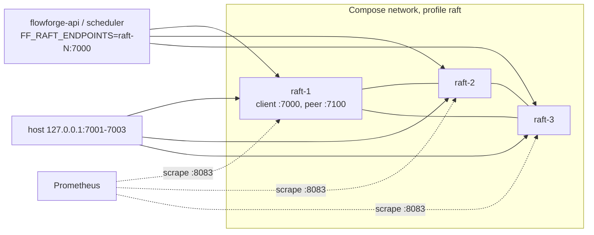

# Raft operations

This page covers running the 3-node Raft KV locally (task 04.06, FR-RAFT-07): the Compose layout and ports, cluster status and health, the operator subcommands, metrics, and the snapshot policy. The API itself is in [`raft-kv-api.md`](raft-kv-api.md), and failures are handled in the runbook [`raft-quorum-loss.md`](../runbooks/raft-quorum-loss.md).

## Compose layout

| Item | Value |
|---|---|
| Services | `raft-1`, `raft-2`, `raft-3` (profiles `raft` and `full`), image `flowforge-raft:dev` built from `deploy/docker/Dockerfile.raft` |
| Node ids | Fixed: `raft-N` is node `N`. Every node has the same static peer list, `FF_RAFT_PEERS=1=raft-1:7100,2=raft-2:7100,3=raft-3:7100` |
| Client port | `7000` in the container, the address 00E §6's `FF_RAFT_ENDPOINTS` names. Published on the host as `127.0.0.1:7001`–`7003` |
| Peer port | `7100`, internal network only, **never published** |
| Operational HTTP | `8083` (`/metrics`, `/healthz`, `/readyz`), internal only |
| Data | One named volume per node (`raft1data`–`raft3data`) at `/data`. The first start with an empty volume bootstraps the static membership; later starts reuse the storage |
| Healthcheck | `flowforge-raft health --addr 127.0.0.1:7000`, which exits 0 only when the node is READY |
| Admin token | `FF_RAFT_ADMIN_TOKEN`, with the dev-only default `dev-only-raft-admin-token` |
| Image | Multi-stage (`golang:1.27.3-bookworm` → `gcr.io/distroless/static-debian12:nonroot`): a static binary run as uid 65532 with no shell. Hardening is 09.02's |

### Make targets

| Target | Effect |
|---|---|
| `make raft-up` | Build the image, start the three nodes and wait until each is healthy |
| `make raft-down` | Stop and remove the nodes; the volumes are kept |
| `make raft-status` | Print each node's `Cluster.Status` |
| `make raft-logs` | Follow the nodes' logs |
| `make raft-kill N=2` | SIGKILL node 2 |
| `make raft-restart N=2` | Start node 2 again and wait until it is healthy |

**Smoke test:** `scripts/dev/raft-smoke.sh` runs `make raft-up`, then the `compose`-tagged Go test (`test/integration/raft`), then a `raft-kill` and `raft-restart`. The Go test checks:

- one leader, every node READY, and `Put`/`Get` through the client;
- after the leader's container is killed, the survivors report a new leader in a higher term within 5 s (measured: 1.09 s);
- `transfer-leader` moves leadership;
- every node reports the same state hash at the same applied index.

## Status and health

`Cluster.Status` (`flowforge-raft status`) reports:

| Field | Meaning |
|---|---|
| `node_id`, `leader_id`, `term`, `state` | The node and its role: `LEADER`, `FOLLOWER`, `CANDIDATE` or `PRE_CANDIDATE` |
| `commit_index`, `applied_index` | The node's raft indexes |
| `peers` | On the leader only: per voter, `addr`, `reachable` (heard from within an election timeout), `match_index` and `lag` (the commit index minus `match_index`) |
| `state_hash`, `state_hash_index` | SHA-256 of the state machine's canonical state, and the applied index it describes. Replicas at the same index have equal hashes |
| `snapshot_index`, `first_index` | The latest snapshot, and the first entry still in the log |
| `uptime_ms` | Time since the server started |
| `members` | The static voters |

Computing the state hash encodes the whole state (up to 64 MiB), so `Status` is for operators, not for frequent polling.

**`Cluster.Health`:** `READY` only when the node runs, knows a leader, and has applied to within **100** entries of the leader's commit index (the highest commit a leader has sent it); `NOT_READY` otherwise. A node still replaying its log, waiting for a snapshot or installing one isn't ready. The node's own commit index isn't used, because a wiped or far-behind follower's commit is bounded by its short log.

## Operator subcommands

`flowforge-raft <subcommand> --addr host:port` talks to a node's client address. These are dev/ops tooling.

| Subcommand | Effect | Token |
|---|---|---|
| `status` | `Cluster.Status` as JSON | — |
| `health` | Prints `READY` or `NOT_READY`; exits 0 only when READY | — |
| `dump-state-hash --addr a,b,c` | `node=… applied=… state_hash=…` per node | — |
| `transfer-leader --to ID` | The leader (`--addr`) hands leadership to `ID`; `0` picks the most up-to-date reachable follower | yes |
| `snapshot-now` | Snapshot the node now and compact its log to the trailing entries | yes |
| `compact` | Drop the node's whole log up to its latest snapshot | yes |

The mutating subcommands call the `Admin` gRPC service with `authorization: Bearer $FF_RAFT_ADMIN_TOKEN`. The token is read from the environment, never from a flag, so it doesn't show in process listings.

- **No token configured on the node:** the service refuses everything (`PERMISSION_DENIED`).
- **A missing or wrong token:** `UNAUTHENTICATED`.
- **Exit codes:** 0 ok, 1 failure, 2 usage.

In Compose, run them in a container, for example `docker compose --profile raft exec raft-1 /usr/local/bin/flowforge-raft status`, or from the host against `127.0.0.1:700N`.

## Metrics

Each node serves Prometheus metrics on `:8083/metrics`.

- **From the node:** `flowforge_raft_is_leader`, `_term`, `_commit_index`, `_applied_index`, `_proposals_pending`, `_peer_unreachable{peer}`, `_snapshot_total`, `_apply_duration_seconds`, `_write_duration_seconds` and `_leader_changes_total`.
  - `_peer_unreachable` is exported as 0 for every peer from the start, so the series exists before the first failure.
  - `_leader_changes_total` counts each time the node sees a new leader.
- **From the server:** `flowforge_raft_requests_total`, `_request_duration_seconds`, `_read_index_duration_seconds` and `_leases_swept_total` ([`raft-kv-api.md`](raft-kv-api.md#metrics)).
- **Test:** `TestAdminAndMetrics_AgainstACluster` checks that every 00E §11 Raft name is on `/metrics`.

## Snapshot policy

| Setting | Default | Meaning |
|---|---|---|
| `FF_RAFT_SNAPSHOT_ENTRIES` | 10 000 (at least 50) | Snapshot the state machine every this many applied entries |
| `FF_RAFT_SNAPSHOT_TRAILING` | 1 000 (positive, below the above) | Log entries kept before the snapshot |

- **Why trailing entries:** the log stays bounded, and a follower that is only slightly behind catches up from the log.
- **Further behind:** a follower behind the compacted log, or wiped, gets the snapshot through the peer transport in 1 MiB chunks (04.02).
- **Tests:**
  - `TestNode_AutomaticSnapshotCompactsTheLog`: 500 writes at threshold 50 leave a snapshot near the head and a compacted log.
  - `TestSnapshot_WipedFollowerRecoversViaSnapshot`: a wiped follower ends with its peers' state hash.
- **On demand:** `snapshot-now` and `compact` do the same thing through the admin tooling.

### A wiped node

A node restarted with an empty data directory under the same id is supported, as long as the operator then moves leadership. The node itself survives the restart; the move is what gets it the data.

- **Why the node survives:** the leader still holds the wiped node's old match index, so its heartbeats name a commit index past the node's empty log. The raft library panics on that, so the node caps such a heartbeat's commit at its own commit index (`node.step`).
- **Why the move is needed:** raft never lowers a match index, because it trusts acknowledged entries to be durable. So the current leader never resends what the node lost. A new leader starts every peer's progress afresh, probes the wiped node and sends it the snapshot.
- **The procedure:** `transfer-leader` to another node, as the runbook describes.

**This is not safe in general.** Raft assumes a node never forgets what it acknowledged; a wiped node has forgotten both its log and its vote. Two things can then go wrong:

- **A committed write can be lost.** An entry committed on the leader and the wiped node alone now lives on one node. If that node fails before the wiped node catches up, the third node can be elected without the entry, with the wiped node's vote.
- **A double vote.** The wiped node can vote a second time in a term it already voted in.

So wipe only under all of these conditions, and treat it as a last resort:

- one node at a time;
- the other two nodes run and have a leader;
- the leader's `status` shows the other follower at `lag` 0, so both survivors hold every committed entry;
- after the restart, do `transfer-leader` and wait for the wiped node's `health` to be READY before touching anything else.

The safe replacement for a lost node is removing it and adding a new member, which needs dynamic membership (FR-RAFT-11, not built).

## Limitations

- **No TLS or authentication** on the client and peer ports until 09.01. The admin token travels in plaintext; keep the ports on a private network.
- **Static membership:** there is no add or remove. A permanently lost node can only be replaced by wiping and restarting it under the same id, with the procedure and the risks above.
- **The cost of the hash in `Status`:** see above.
