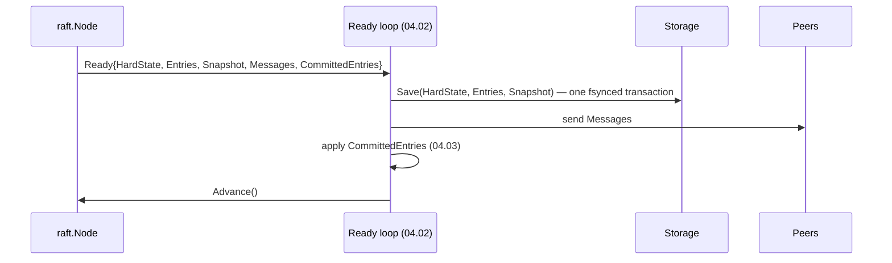

# Raft storage and coordination contracts

This page describes the coordination service's contracts and the durable storage under each Raft node (task 04.01, FR-RAFT-01). The consensus algorithm itself is the etcd raft library's, `go.etcd.io/raft/v3` v3.7.0 (ADR-002). FlowForge supplies its storage, transport and state machine. Postgres still owns workflow state; Raft holds only coordination state (ADR-003).

## Contracts (`proto/coordination/v1`)

| File | Service | Purpose |
|---|---|---|
| `kv.proto` | `KV` | `Get`, `Put`, `Delete`, `List`, `CAS`, `Txn`, `LeaseGrant`, `LeaseKeepAlive`, `LeaseRevoke`, `IncrCounter` (`00E` §5.1) |
| `kv.proto` | `Cluster` | `Status`, `Health` |
| `raft.proto` | `RaftPeer` | `Stream(stream Envelope) returns (stream Envelope)`: Raft messages between peers |

The contracts in more detail:

- **Reads:** a read is `CONSISTENCY_LINEARIZABLE` (the default, ReadIndex on the leader) or `CONSISTENCY_SERIALIZABLE` (this node's applied state).
- **Mutations:** every mutation carries `RequestMeta{client_id, request_id}` for deduplication. The receiving node stamps the command's timestamp; clients never send one (ADR-005).
- **Keys:** every key has a per-key `version` and the `mod_index` of its last change.
- **Errors:** a gRPC status with `ErrorInfo`, whose reason is a `00E` §4 code. `NOT_LEADER` (metadata `leader_hint`), `NO_QUORUM`, or `CONFLICT` with `current_version` for a version mismatch.
- **CAS:** a `CAS` carries either a value to write or an empty `CASDelete`.
- **Peer messages:** an `Envelope` carries a marshalled `raftpb.Message`. Snapshot messages travel as `SnapshotChunk`s of at most 1 MiB, with the message in the first chunk.

04.02 implements the transport, and 04.03 and 04.04 the KV semantics. The generated Go is in `internal/gen/proto/coordination/v1` (`make proto`).

## The `Storage` interface

`internal/raftkv/storage.Storage` is the library's `raft.Storage`:

- `InitialState`, `Entries`, `Term`, `FirstIndex`, `LastIndex`, `Snapshot`

plus the writes a node's Ready loop needs:

| Method | What it does |
|---|---|
| `Save(hs, ents, snap)` | Persists one `Ready`, atomically and durably. It installs `snap` if one is given (replacing the log), then appends `ents` (replacing any conflicting suffix), then writes `hs`. |
| `SaveSnapshot(snap)` | Stores a snapshot the node took of its own state machine. The log is untouched. |
| `LoadSnapshot()` | The latest snapshot. |
| `Compact(i)` | Drops entries up to `i`, keeping `i`'s term for matching. Refused past the latest snapshot. |
| `Close()` | |

Its semantics match the library's `MemoryStorage`:

- `Entries` returns at least one entry, then more while the total encoded size fits `maxSize`.
- `raft.ErrCompacted` for indexes before `FirstIndex()`; `raft.ErrUnavailable` past `LastIndex()`.
- `raft.ErrSnapOutOfDate` for a snapshot that isn't newer than the current one.

Where `MemoryStorage` would panic (reading or compacting past the last index), these implementations return errors.

There are two implementations, both run through the same conformance suite (`storage/storagetest.Run`):

- **`Bolt`** (`OpenBolt(path, Identity)`): durable, one bbolt file per node.
- **`Mem`** (`NewMem()`): wraps `raft.MemoryStorage`, for tests. It checks every write before applying it, so a rejected write changes nothing. Every method holds its lock, so readers never see half a `Save`, and values are copied in and out.

### Ready-loop order

The Ready loop handles each `Ready` in this order:

A message may promise something only what is on disk can back, such as a vote or an append acknowledgement. So `Save` must be durable before the messages leave.

## Bolt layout

| Bucket / key | Value |
|---|---|
| `meta/identity` | cluster id and node id (16 bytes, big-endian) |
| `meta/hardstate` | `raftpb.HardState` |
| `meta/confstate` | the latest snapshot's `raftpb.ConfState` (what `InitialState` returns) |
| `meta/compacted` | index and term of the entry before `FirstIndex()` (16 bytes, big-endian) |
| `meta/applied` | reserved: the state machine's last applied index, written with applied batches (04.03) |
| `entries/<index>` | `raftpb.Entry`, keyed by its index as 8 big-endian bytes, so the key order is the log order |
| `snap/meta` | `raftpb.SnapshotMetadata` of the latest snapshot |
| `snap/data` | that snapshot's state-machine bytes |

`FirstIndex()` is `compacted + 1` and `LastIndex()` is the last key, or `compacted` when the log is empty. Installing a snapshot drops the `entries` bucket and moves `compacted` to the snapshot.

## Crash safety

The argument rests on three properties of bbolt and how `Bolt` uses it:

- **Durable when it returns.** The database is opened with `NoSync: false`, bbolt's default. Every read-write transaction is fsynced on commit, so data is on disk when `Save`, `SaveSnapshot` or `Compact` returns.
- **Atomic.** Each of those methods is one transaction. bbolt commits copy-on-write pages, then a new meta page. A crash before the meta page leaves the previous state; a crash after it leaves the new one. A `Save` therefore never leaves entries without their hard state, or the reverse. Installing a snapshot and truncating the log happen in one transaction too.
- **Checked before any change.** Every check runs first, so a rejected write changes nothing.
- **Never writes what it would refuse to open.** A write that would break the invariants below is refused whole with `ErrBrokenInvariant`. In `Bolt` the check runs on the transaction's final state, before commit. The invariants are what the raft library needs to restart:
  - the hard state's term is at or after the last entry's;
  - its commit lies between the compaction marker and the last index;
  - a compacted log has a hard state;
  - `SaveSnapshot` takes only committed indexes.

`OpenBolt` also validates the file before anyone can use it. On a violation it returns `ErrCorruptStorage`, naming the problem. The checks:

- the compaction marker is at or before the latest snapshot;
- entries are contiguous from the marker, and each is stored under its own index;
- terms never go down along the log;
- the hard-state invariants above.

A file recorded for another cluster or node id is refused with `ErrIdentityMismatch`. That catches a data directory mounted on the wrong node.

### Evidence

- **`TestBolt_CrashSafety`** (`integration` tag) re-runs the test binary as a child. The child continues the log with up to 10 000 `Save`s, each of 1–5 entries plus a hard state whose commit is the new last index, and snapshots and compacts every 200 indexes. The test SIGKILLs it at 50 seeded random moments. After every kill:
  - the file opens, so its invariants hold;
  - the log reads back contiguous;
  - the commit equals `LastIndex()`.

  As a check of the test itself: with the hard state moved to a second transaction, the test reports a torn `Save` at the first kill.
- **`TestBolt_DetectsCorruption`** damages a valid file eight ways. Each one is refused, with the specific problem named. With validation turned off, the cases fail.
- **The conformance suite's `InvariantsEnforced`** shows each refused write leaves the state untouched.
- **`TestBolt_ReadersDuringWrites`** has four readers read the whole log while the writer saves. Each sees a complete, contiguous log, under `-race`, 20× each at `GOMAXPROCS` 1, 2 and 8.

## Performance

`BenchmarkBolt_Save100`: one `Save` of 100 entries of 128 bytes plus a hard state takes **9.4–11.1 ms**. It allocates about 110 KB in about 915 allocations. That was measured on Apple Silicon with an APFS SSD (`go test -bench BenchmarkBolt_Save100 -benchmem -count=3`). The time is dominated by the fsyncs of bbolt's two-phase commit, so it bounds a node's synchronous Ready rate at about 100 a second, however many entries each Ready carries; batching entries per Ready is what scales.

## Limits

- **Snapshot size:** at most 64 MiB (`MaxSnapshotBytes`), held in one bbolt value and read whole into memory. Coordination state is small; larger state machines are out of scope.
- **Writers:** one, the Ready loop. Readers may run concurrently.
- **`InitialState`'s ConfState:** that of the latest snapshot, as with `MemoryStorage`. Configuration changes after it are replayed from the log. Membership is static (04.02).
- **Disk-full and I/O errors** are returned from the write that hit them. The raft library then stops the node (`raft.Storage` contract), and recovery is a restart.
