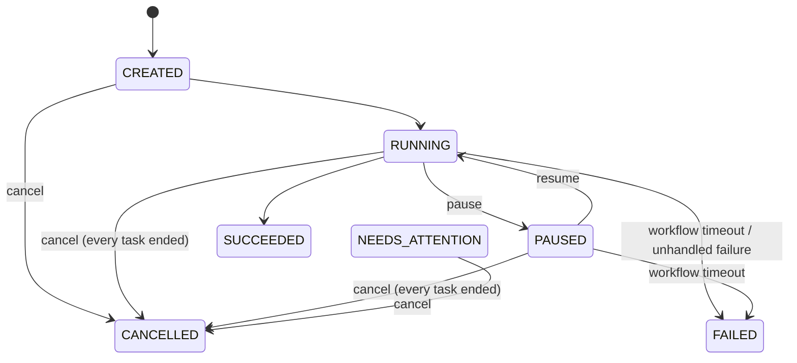

# Run control: cancel, pause, resume and the workflow timeout

How an operator stops or holds a run, and how a run's own deadline ends it (task 03.05, FR-WF-10, FR-WF-08). The endpoints call `RunService.Cancel`, `Pause` and `Resume` (`internal/api/service/runs.go`), so the approved actions in 06.06 reuse the same rules.

## States

CREATED → CANCELLED, PAUSED → CANCELLED and PAUSED → FAILED were added to `00E` §3.3 by this task.

## Endpoints

All three require role `operator` (a viewer gets 403), are audited by the API middleware, and answer `200` with the run.

| Endpoint | From | Repeat | Otherwise |
|---|---|---|---|
| `POST /api/v1/runs/{run_id}/cancel[?force=true]` | CREATED, RUNNING, PAUSED, NEEDS_ATTENTION | Returns the run; a `CANCELLED` run is returned unchanged | `409 INVALID_STATE` (SUCCEEDED, FAILED) |
| `POST /api/v1/runs/{run_id}/pause` | RUNNING | A PAUSED run is returned unchanged | `409 INVALID_STATE`, also for a run being cancelled |
| `POST /api/v1/runs/{run_id}/resume` | PAUSED | — | `409 INVALID_STATE`, RUNNING included |

## Cancel

1. **The request.** The API sets `cancel_requested` and pulls the run's `deadline_at` in to `now + FF_CANCEL_GRACE` (30 s by default), or to `now` with `force=true`. It never moves a deadline later, and it wakes the scheduler.
2. **Tasks that haven't started.** The scheduler's next pass moves every PENDING, READY, QUEUED and RETRY_WAIT task to `CANCELLED`. Workers no longer claim them.
3. **Running tasks: cooperative cancellation.**
   - `workerapi.RunCancelSource` returns the cancel-requested run's RUNNING attempts in each worker's heartbeat answer.
   - The worker cancels the handler's context and reports `FailTask(error_code=CANCELLED)`.
   - That attempt is recorded as `CANCELLED`, and the task too, not retried.
   - `TestCancel_RunningTaskCooperative` measured the cancel reaching the handler 0.99 s after the request with a 1 s heartbeat, inside the bound of 2 intervals.
4. **Running tasks: forced cancellation.** A worker that never stops in time (dead, paused or hung) hits the run's deadline. `scheduler.TimeoutLoop` then ends the attempt as `CANCELLED` through the fenced `AttemptEnder`, so the worker's late report gets `STALE_ATTEMPT`. The task becomes `CANCELLED`.
5. **The end.** When every task has ended, the run becomes `CANCELLED`, with event `run.cancelled`.

**No retries for a cancelled run.** `RetryOutcomeHandler` turns any outcome other than success in a cancel-requested run into `CANCELLED`. That covers failures, timeouts, and attempts the recovery loop abandons. A task that completes successfully meanwhile stays `SUCCEEDED`.

## Pause and resume

- **Pause** moves the run RUNNING → PAUSED (`run.paused`). While it's paused:
  - the scheduler queues none of its tasks and requeues none of its retries;
  - `PollTask` never claims them;
  - running attempts carry on, and their reports are processed normally.
- **Resume** moves the run PAUSED → RUNNING (`run.resumed`) and wakes the scheduler, which continues where it stopped.
- **The deadline keeps running while paused.** A paused run whose workflow deadline passes is failed by `TimeoutLoop`. A run resumed after its deadline passed fails on the next timeout pass.

## Workflow timeout

- **When the deadline is set.** When a run starts (CREATED → RUNNING), the scheduler sets `deadline_at = now + definition.timeout_seconds` on its injected clock, if the definition has a timeout.
- **What happens when it passes.** `TimeoutLoop` (1 s) finds RUNNING or PAUSED runs past their deadline:
  - it force-cancels their RUNNING attempts;
  - it cancels their other unfinished tasks;
  - it ends the run `FAILED`, with event `run.failed` carrying `reason: WORKFLOW_TIMEOUT`.
- **Cancels use the same deadline.** A cancel-requested run whose grace ran out goes through this same path, but ends `CANCELLED`.
- **Transactions.** Each run is one transaction that asserts the epoch (ADR-003). The same code enforces both the timeout and the end of a cancel's grace, because a cancel only shortens the deadline.

## Caveats

- **Handlers must honour their context.** A handler that ignores `ctx` keeps running on its worker after a cancel. That includes an AI investigation task, which is cancelled the same way. Its attempt still ends at the grace, and its report is then rejected.
- **Forced cancellation has a lag.** It happens on the timeout pass after the grace, up to one `TimeoutLoop` tick (1 s) late.
- **The cancel grace is the API's setting.** A scheduler with a different idea of the grace has no say, because the API writes the deadline.
