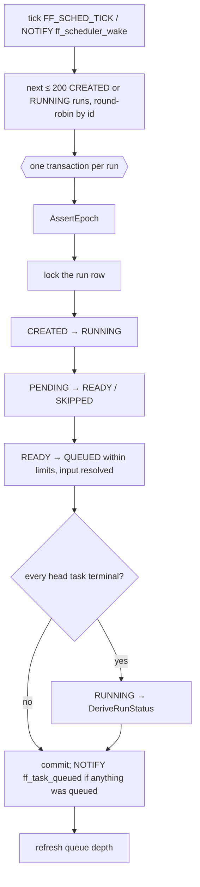

# Scheduler

`flowforge-scheduler` moves workflows forward (task 03.02, ADR-003, ADR-004, ADR-020). It promotes tasks `PENDING → READY/SKIPPED → QUEUED`, starts runs, and gives each finished run its final status. It never talks to workers: workers claim `QUEUED` tasks through `flowforge-api` (see [worker protocol](worker-protocol.md)), and the scheduler only changes rows.

Code: `internal/scheduler`, wired by `cmd/flowforge-scheduler`.

## Components

| Symbol | Role |
|---|---|
| `Gate` | Whether this instance may decide: `IsLeader`, `Epoch`, `Done` (closed when the term ends), `Wait` (blocks until leader). |
| `AlwaysLeader` | The single-scheduler `Gate`: always leader at epoch 0, the unfenced `cluster_state` value. It needs no Raft and stays a supported dev mode; 04.07 adds the Raft-backed `Gate`. |
| `Loop` | A leader-only job: `Name()` and `Run(ctx, gate)`. |
| `Runner` | Runs every registered `Loop` while the `Gate` says leader. `RegisterLoop` is the extension point: 03.04 registers `TimeoutLoop` and `recovery.Loop` ([recovery](recovery.md)); 03.07 (outbox relay) and 03.08 (cron) follow. |
| `RunTicking` | The shared loop body: runs `Once` every tick (or when woken), stops on a stale epoch, and backs off failures (the tick doubled per failure, up to 30 s), counting them in `flowforge_loop_errors_total{loop}` |
| `DecisionLoop` | The core loop described below (the task file calls it `SchedulerLoop`; renamed to avoid the `scheduler.SchedulerLoop` stutter). |
| `InputResolver` | Computes a task's input at `READY → QUEUED`. The default `IdentityResolver` copies `config`; 03.06 replaces it with templating. |
| `statemachine.ExprEvaluator` | Evaluates `run_if: expr`. None until 03.06 (see *Limitations*). |

## Gate contract

- **Leadership bounds the loops.** On each new term the `Runner` starts every loop with a context it cancels the moment `Done()` closes, so loops stop within one tick of losing leadership. They start again on the next term.
- **No decision after `Done()`.** `DecisionLoop` also checks `Done()` before each run's transaction.
- **The epoch is asserted in every decision transaction.** `processRun` calls `ClusterRepo.AssertEpoch` first. It takes a share lock on the `cluster_state` row, so a new leader's `SetEpochIfGreater` waits until this transaction ends. A deposed scheduler that has not noticed yet still cannot commit; this is belt and braces with `Done()`.
- **A stale epoch stops the scheduler.** The loop logs `STALE_EPOCH` and returns `persistence.ErrStaleEpoch`. The `Runner` then stops every loop and returns the error, and the process exits (00C §10.1, fail safe).
- **A failing loop takes the others down.** A loop that returns an error or panics stops all loops, and `Runner.Run` returns that error. Transient failures, such as one run's transaction failing, are logged inside the loop and retried on the next tick.

## The decision loop

**`processRun(tx)`, for one run:**

0. **Assert and lock.** `AssertEpoch` runs first. Then `LockRun` reads the run with `FOR NO KEY UPDATE`, which serializes decisions on that run. `NO KEY UPDATE` still lets task rows referencing the run be inserted, which reruns need. A `PAUSED` run is left untouched, which is the seam for 03.05. Any other status that is neither `CREATED` nor `RUNNING` is skipped.
1. **Start.** A `CREATED` run moves to `RUNNING`; `started_at` and `run.started` are set by the repository.
2. **Readiness.** Each `PENDING` head task goes through `statemachine.EvaluateReadiness` (00E §3.4) and becomes `READY` or `SKIPPED`. Head tasks come in creation order, which is topological, so a skip propagates through a whole chain in a single pass.
3. **Promotion.** `READY` tasks, and `RETRY_WAIT` tasks whose `available_at` has come (03.04, keeping their input), are queued oldest `available_at` first, then in creation order, as long as the budget allows (see below). Each one is queued with the resolved input. If resolution fails, the task moves `READY → FAILED` with no attempt, and its `task.failed` event carries `error_code: INVALID_INPUT`. That code is non-retryable, and this transition was added to 00E §3.1 by this task.
4. **Completion.** When every head task is terminal, the run moves `RUNNING →` `statemachine.DeriveRunStatus`. The result is `SUCCEEDED`, `FAILED` (an unhandled failure), or `NEEDS_ATTENTION` (under `on_failure: needs_attention`).
5. **Notify.** If anything was queued, the transaction sends `NOTIFY ff_task_queued`. It is delivered at commit, and not at all on rollback.

Every status change goes through `RunRepo.Transition` or `TaskRepo.Transition`: a state-machine check followed by a conditional `UPDATE … WHERE status = $from` (ADR-020). `scheduler.sql` only reads.

### Idempotency

Every promotion is conditional on the row's current status. Running `processRun` again, after a crash or concurrently, re-evaluates the same inputs, so it either finds the work already done or does it. A transition that finds its row already moved returns `INVALID_STATE`, or `CONFLICT` for a run version. The loop treats that as "a previous or concurrent decision did it", counts nothing, and carries on.

Two concurrent `processRun` calls on the same run serialize on the run lock, so the second one sees the first one's commits. The test `TestScheduler_ConcurrentProcessRun` shows that this produces no duplicate events. Metrics are applied only after the transaction commits, because `TxManager` reruns the function on serialization failures and deadlocks.

### Head instances

A task row is a **head** when no other row has `supersedes_task_id = task.id` (`ListHeadTasks`, a `NOT EXISTS` within the run). Only heads take part in readiness, limits and run status. A remediation rerun (03.06) adds a new row that supersedes a failed one: the old row stops counting, and dependents wait for the new row. `TestScheduler_HeadInstance` inserts such a row by hand.

## Fairness and limits

- **Runs per tick.** A tick takes at most 200 `CREATED`/`RUNNING` runs. Successive ticks continue round-robin by run id, wrapping to the start to fill a short page, so even with more than 200 active runs every run is served in turn (`TestScheduler_RoundRobinServesEveryRun`).
- **Promotions per run.** At most 100 tasks are promoted per run per tick, so a giant run cannot starve the others.
- **Per-run limit.** `concurrency.max_parallel_tasks` caps a run's `QUEUED` plus `RUNNING` tasks. 0 means unlimited.
- **Per-queue limit.** `FF_QUEUE_LIMITS` (`queue=n,…`) caps `QUEUED` plus `RUNNING` tasks per queue across all runs. A queue that isn't listed is unlimited. A task from a full queue is passed over, so tasks from other queues can still be queued.
- **Memory.** Each run's head tasks are loaded on their own, at most 500 of them (the definition limit).

## Waking up

The loop runs every `FF_SCHED_TICK` (500 ms by default). It also wakes on `NOTIFY ff_scheduler_wake`, which `flowforge-api` sends inside the transaction that finishes an attempt. A dedicated connection listens for it (`workerapi.NewChannelWaker`). Missing a notification costs at most one tick.

## Metrics (00E §11)

| Metric | Meaning |
|---|---|
| `flowforge_scheduler_tick_duration_seconds` | Duration of a tick |
| `flowforge_scheduler_queue_depth{queue}` | `QUEUED` tasks per queue, read once per tick |
| `flowforge_tasks_total{status}` | Task transitions the scheduler made (`READY`, `SKIPPED`, `QUEUED`, `FAILED`) |
| `flowforge_workflows_started_total` | Runs moved `CREATED → RUNNING` |
| `flowforge_workflows_completed_total{status}` | Runs given a final status, or `NEEDS_ATTENTION` |
| `flowforge_workflow_duration_seconds` | From `started_at` to the final status |

The binary serves `/metrics`, `/healthz` and `/readyz` on `FF_SCHED_HTTP_ADDR` (`:8081`). `/readyz` checks Postgres and the schema version.

## Limitations

- **`run_if: expr` stays `PENDING`.** Without an `ExprEvaluator` (03.06), such a task stays `PENDING`, and a warning is logged on every tick.
- **Pause, resume and `cancel_requested` belong to 03.05.** A PAUSED run is only skipped. Retries, timeouts and recovery are described in [recovery](recovery.md).
- **Queue limits assume one leader.** `FF_QUEUE_LIMITS` counts are read in each run's transaction. With a single leader the runs are processed one at a time, so the counts are exact.
- **The duration uses two clocks.** `flowforge_workflow_duration_seconds` subtracts the database-clock `started_at` from the scheduler clock (ADR-021). In production both are host clocks.
- **The definition cache is unbounded.** Definitions are immutable and cached by id, one entry per definition ever run.
