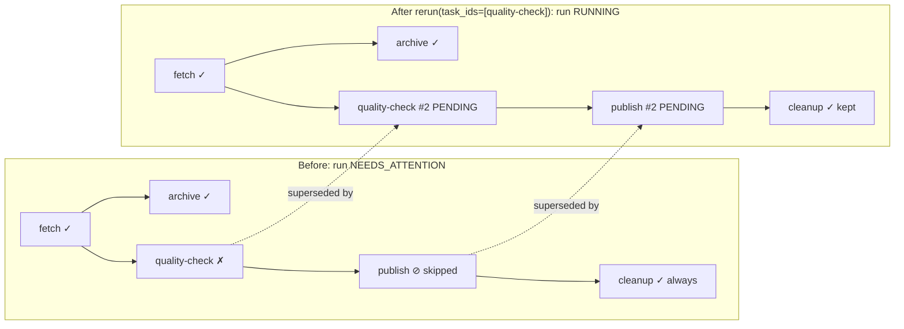

# Templating, `run_if` expressions and rerun

How data flows from one task to the next, how conditional tasks decide whether to run, and how an operator remediates a failed run without loops and without rewriting history (task 03.06, FR-WF-11, FR-WF-12, FR-WF-10, ADR-008).

Code: `internal/workflow/template` (placeholders), `internal/workflow/expr` (expressions), `scheduler.TemplateResolver`, `dag.Validator`, and `service.RunService.Rerun` (`internal/api/service/rerun.go`).

## Placeholders in `config`

A task's `config` can contain placeholders in any string, at any depth of objects and arrays. They're resolved when the task moves `READY → QUEUED`, and the result is stored as the task's `input` (`00E` §2). Object keys are never templated.

| Placeholder | Value |
|---|---|
| `${run.input.<path>}` | Part of the run's input; `${run.input}` alone is the whole input object |
| `${tasks.<id>.result.<path>}` | Part of a task's result; `${tasks.<id>.result}` alone is the whole result |
| `${tasks.<id>.status}` | The task's status, e.g. `"SUCCEEDED"` or `"SKIPPED"` |

- **Paths** are dotted keys with `[n]` array indexes, e.g. `rows[0].px`. Keys use `[A-Za-z0-9_-]`, so a key with any other character can't be referenced.
- **Whitespace** inside the braces is ignored: `${ run.input.x }` is the same as `${run.input.x}`.
- **Type preservation:** a string that is exactly one placeholder becomes the referenced JSON value, keeping its type (number, boolean, object, array or null).
- **Interpolation:** placeholders inside a longer string are replaced by text. Strings are inserted verbatim; anything else is inserted as compact JSON, so `null` becomes `null` and an array becomes `["a","b"]`.
- **Only ancestors.** A task can only reference tasks it depends on, directly or transitively. Those are the tasks that are guaranteed to be finished when it's queued.

```json
{"config": {"symbols": "${run.input.symbols}", "from": "${tasks.fetch.result.window_start}", "note": "run ${run.input.label}"}}
```

With run input `{"symbols": ["AAPL","MSFT"], "label": "hourly"}` and `fetch`'s result `{"window_start": "2026-11-15T10:00:00Z"}`, the task is queued with:

```json
{"symbols": ["AAPL","MSFT"], "from": "2026-11-15T10:00:00Z", "note": "run hourly"}
```

### Errors

| When | What happens |
|---|---|
| A reference names an unknown task or one that isn't an ancestor, or a placeholder doesn't parse | The definition is rejected at creation: `INVALID_WORKFLOW` with issue `INVALID_REFERENCE` |
| A path doesn't exist at run time, or the referenced task has no result (for example, it was `SKIPPED` or `FAILED`) | `template.TemplateError{Path}`; the task moves `READY → FAILED` with `error_code: INVALID_INPUT` and no attempt, and is never retried |
| The resolved input is over 256 KiB (`template.MaxInputBytes`) | Same as a missing path: `FAILED` with `INVALID_INPUT` |

Templates are deliberately not a scripting language: there are no functions, operators, defaults or loops.

## `run_if` expressions

A task with `"run_if": "expr"` runs when its `run_if_expr` evaluates to `true`, once all its dependencies are terminal; on `false` it's `SKIPPED` (`00E` §3.4). The language is parsed by a hand-written Pratt parser in `internal/workflow/expr`.

```text
expr    = or
or      = and { "||" and }
and     = not { "&&" not }
not     = [ "!" ] cmp
cmp     = primary [ ( "==" | "!=" | "<" | "<=" | ">" | ">=" ) primary ]
primary = literal | path | "(" expr ")"
literal = number | string | "true" | "false" | "null"
path    = run.input<path> | tasks.<id>.status | tasks.<id>.result<path>
```

- **Precedence:** `||` binds loosest, then `&&`, then the comparisons. `!` negates a whole comparison, so `!tasks.a.status == "FAILED"` means `!(tasks.a.status == "FAILED")`. Comparisons don't chain: `1 < x < 3` is a syntax error.
- **Literals:** numbers like `-1.5e3`; strings in double quotes with Go escapes, or in single quotes with no escapes.
- **Paths** are the same as in placeholders, and the ancestor rule is checked at definition time the same way.
- **Missing values:** a path that doesn't exist, or a result path of a task without a result, evaluates to `null`. That's how to test for a missing value: `tasks.x.result.count == null`.
- **Equality:** `==` and `!=` work on any two values. Numbers compare by value, and values of different types are simply unequal, so `1 == "1"` is `false`.
- **Ordering:** `<` `<=` `>` `>=` need two numbers or two strings; anything else is an evaluation error.
- **Logic:** `&&`, `||` and `!` need booleans. `&&` and `||` short-circuit, so `false && (1 < "a")` is `false` with no error.
- **Result type:** the whole expression must evaluate to a boolean.
- **Evaluation errors:** an expression that fails to evaluate leaves the task `PENDING`, and the scheduler logs a warning on every tick ([scheduler](scheduler.md#limitations)).
- **Limits:** expressions are at most 4096 bytes, nested at most 64 deep.

```text
tasks.quality-check.status == "FAILED" && tasks.fetch.result.rows >= run.input.min_rows
```

`TestExpr_RandomInputsNeverPanic` feeds 50,000 seeded random inputs, half of them well-formed, through the parser and evaluator, and none panics. `FuzzEval` explores further with `go test -fuzz FuzzEval ./internal/workflow/expr/`.

## Rerun

Definitions are acyclic (ADR-008), so "retry the quality check after fixing the data" is a **rerun**, not a loop back in the graph. A rerun creates new task rows and leaves the old ones as history.

| Endpoint | Body | Role |
|---|---|---|
| `POST /api/v1/runs/{run_id}/rerun` | `{"task_ids": ["quality-check"], "reason": "vendor data fixed"}`. `task_ids` holds task keys; leaving it out means every `FAILED` or `TIMED_OUT` task. `reason` is required, up to 1000 characters | operator |
| `POST /api/v1/runs/{run_id}/retry` | Optional `{"reason": "..."}`, defaulting to `retry`: a rerun of every `FAILED` and `TIMED_OUT` task | operator |
| `GET /api/v1/runs/{run_id}/tasks?include_superseded=true` | Every generation of every task. Without the flag, only the current instance of each task (the *head*) | viewer |

Both POSTs answer `200 {"run": Run, "task_ids": [...]}` with the new rows' ids. Approved actions (06.06) call `RunService.Rerun(ctx, RerunParams{RunID, TaskKeys, Reason, Actor})` directly.

### Algorithm

In one transaction:

1. **Check the run.** It must be `FAILED` or `NEEDS_ATTENTION` and not being cancelled; otherwise `409 INVALID_STATE`.
2. **Load the heads.** These are the run's rows that no other row supersedes.
3. **Pick the targets.** Each requested key must be a head that is `FAILED`, `TIMED_OUT` or `CANCELLED`. An unknown key is `404`; any other status is `409`.
4. **Pick the rows to replace.** These are the targets plus every descendant head that did not succeed (`SKIPPED`, `FAILED`, `CANCELLED`…). The walk passes through succeeded descendants too, but they are kept. Ancestors and unrelated tasks are untouched. Every row to be replaced must be finished, otherwise `409`.
5. **Insert the new rows.** Each replaced row gets a new `PENDING` row with the same definition fields, `attempt_count = 0`, no input or result, and `supersedes_task_id` pointing at the old row. They're inserted dependencies first, and task ids increase, so the new rows keep topological order among the heads.
6. **Reopen the run.** It moves `FAILED`/`NEEDS_ATTENTION → RUNNING`: `completed_at` is cleared and the workflow deadline restarts at `now + timeout_seconds`. The event is `run.resumed`, with `reason`, `actor`, `superseded_task_ids` and `rerun_task_ids`.
7. **Wake the scheduler** with `NOTIFY ff_scheduler_wake`. From here on the new rows are ordinary heads: readiness, input templating, limits and run status all use heads only.



The task file's example works the same way: `quality-check` failed and its `on_failure` branch `ai-investigate` and `report` (`always`) succeeded. Rerunning `quality-check` creates `quality-check #2` plus new rows for its descendants that didn't succeed. `ai-investigate` and `report` are kept, and the ancestors are untouched.

### History and concurrency

- **Immutability.** Old rows are never updated. Their attempts, events and results stay, and a chain of `supersedes_task_id` links every generation of a task. The UI and `include_superseded=true` show all of them.
- **Two identical requests at once** (a double click). Each one inserts its rows and moves the run at the run's current version. One commits; the other hits the version check (`CONFLICT`) or the unique `(run_id, task_key, supersedes_task_id)` constraint (`CONFLICT`) and rolls back, creating nothing. `TestRerun_CreatesNewGenerationAndCompletes` runs two requests concurrently and checks this.
- **The same request again** after the first committed. The run is now `RUNNING`, so it's `409 INVALID_STATE`.

## Limitations

- **Reruns are judged by status alone.** Kept succeeded descendants are not re-evaluated against the new generation's results: `report` above keeps its old output.
- **No escaping for `${`.** There is no way to write a literal `${` in a config string, and any `${` must be a valid placeholder.
- **A rerun has no `Idempotency-Key`.** A repeated request is rejected by the run-status check instead.
- **Reruns restart the workflow deadline** from the rerun, so the run's total time can exceed `timeout_seconds`.
