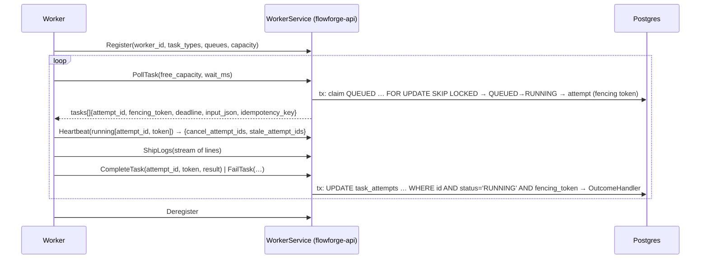

# Worker protocol

How workers get tasks from `flowforge-api` and report back (task 03.01, ADR-003, ADR-004, ADR-007, ADR-021). The contract is [`proto/worker/v1/worker.proto`](../../proto/worker/v1/worker.proto) (shape: `00E` §8); `make proto` generates `internal/gen/proto/worker/v1`, and the server is `internal/workerapi`. The API serves it over gRPC on `FF_API_GRPC_ADDR` (`:9090`).

## Authentication and errors

- **Authentication:** every RPC needs `authorization: Bearer ff_…` metadata with an API key of role `worker` ([`authentication.md`](../api/authentication.md)). No or a bad key is `UNAUTHENTICATED`; any other role is `PERMISSION_DENIED`.
- **Error mapping:** errors are the `00E` §4 codes mapped by `apperrors.GRPCCode`, with an `ErrorInfo` detail whose `reason` is the code (e.g. `STALE_ATTEMPT`) and whose `domain` is `flowforge.dev`. Branch on the reason.
- **Request id:** each call gets a request id (response header `x-request-id`) that appears in the server's log line.
- **Message size:** messages are capped at 4 MiB.

| Situation | gRPC code | Reason |
|---|---|---|
| Missing or invalid key | `UNAUTHENTICATED` | `UNAUTHENTICATED` |
| Key without role `worker`; using another key's worker or attempt | `PERMISSION_DENIED` | `PERMISSION_DENIED` |
| Invalid registration or request | `INVALID_ARGUMENT` | `INVALID_ARGUMENT` |
| Worker not registered or deregistered (call `Register`) | `FAILED_PRECONDITION` | `INVALID_STATE` |
| `worker_id` live under another API key | `ALREADY_EXISTS` | `CONFLICT` |
| Stale fencing token, or the attempt is no longer `RUNNING` | `FAILED_PRECONDITION` | `STALE_ATTEMPT` |
| Result over 256 KiB | `RESOURCE_EXHAUSTED` | `PAYLOAD_TOO_LARGE` |
| Unknown attempt in a report | `NOT_FOUND` | `NOT_FOUND` |

## Register and Deregister

- **`Register(worker_id, task_types, queues, capacity, version)`:**
  - `worker_id` must match `^[a-z0-9][a-z0-9-]{2,62}$`; types and queues must be non-empty; `capacity` is 1–1000.
  - Re-registering refreshes the registration.
  - Another API key can take over an id only once the old registration is deregistered or has been unseen for `FF_WORKER_LEASE_TTL`; while it is live, that's `ALREADY_EXISTS`.
  - The response carries `lease_ttl_ms` and `heartbeat_interval_ms` (`FF_WORKER_LEASE_TTL`, `FF_WORKER_HEARTBEAT`).
- **`Deregister`** ends the registration; polls and heartbeats then fail with `INVALID_STATE` until the worker registers again.

## Claiming (PollTask)

`PollTask(worker_id, free_capacity, wait_ms)` returns up to `free_capacity` tasks (never more than the registered capacity). It claims in one short transaction:

1. Lock claimable tasks: `SELECT … FROM workflow_tasks t JOIN workflow_runs r … WHERE t.status = 'QUEUED' AND t.task_type = ANY(registered types) AND t.queue_name = ANY(registered queues) AND t.available_at <= now AND r.status <> 'PAUSED' AND NOT r.cancel_requested ORDER BY available_at, created_at LIMIT free FOR UPDATE OF t SKIP LOCKED` (`queries/claim.sql`).
2. For each, move it `QUEUED → RUNNING` through `TaskRepo.Transition` (`attempt_count + 1`, event `task.started`).
3. Create its attempt through `AttemptRepo.Create`:
   - `attempt_number = attempt_count + 1`;
   - a fresh fencing token from `attempt_fencing_seq`;
   - `deadline_at = now + timeout_seconds`;
   - idempotency key `task_id:attempt_number`;
   - event `task.attempt.started`.

**Guarantees:** a task goes to at most one poller (row locks; tested with 50 concurrent pollers over 100 tasks); a worker gets only its registered types and queues, and never more than `free_capacity` per poll; tasks of paused or cancel-requested runs are never claimed. `input_json` is the task's resolved input (`{}` until the scheduler resolves inputs), and `correlation_id` is the run id.

**Long poll:**
- **When nothing is claimable,** the call waits up to `wait_ms` (default 10 000, at most 30 000) and returns an empty list.
- **Waking up:** it holds no database connection while waiting. One dedicated connection per API process runs `LISTEN ff_task_queued` (`workerapi.Waker`) and wakes all waiting polls; each poll also re-checks every second, so a missed notification costs at most a second.
- **Cancellation:** a cancelled call returns at once.
- **Who notifies:** whatever queues tasks (the scheduler, 03.02) must run `NOTIFY ff_task_queued` after committing.

## Reporting (CompleteTask, FailTask)

- **The fencing check is SQL:** `UPDATE task_attempts … WHERE id = $1 AND status = 'RUNNING' AND fencing_token = $2` (`AttemptRepo.Transition`). No row means `STALE_ATTEMPT`, counted in `flowforge_stale_attempt_rejections_total`. This covers a wrong token, a second report, and an attempt the server has already ended (`TIMED_OUT`, `ABANDONED`). The Go layer never checks first and writes after. A worker that gets `STALE_ATTEMPT` must drop the result; another attempt owns the task.
- **The outcome handler:** in the same transaction, the finished attempt goes to `OutcomeHandler.OnAttemptFinished`. The default `TerminalOutcomeHandler` makes the task `SUCCEEDED` (storing the result) or `FAILED` (`TIMED_OUT`/`CANCELLED` for those kinds). It does no retries; 03.04 replaces it.
- **Results:** at most 256 KiB of valid JSON. Larger fails the attempt as `RESULT_TOO_LARGE`, non-retryable, and answers `RESOURCE_EXHAUSTED`.
- **Failures:** `FailTask` takes an `error_code` (1–64 characters), a message (redacted with `logging.Redact`, capped at 4 KiB) and `retryable`. Failure messages never enter events.

## Heartbeat

`Heartbeat(worker_id, running[{attempt_id, fencing_token}])`:

- **Records a heartbeat:** sets `last_heartbeat_at` on each listed attempt that is still `RUNNING` on this worker with that token. Every other listed id comes back in `stale_attempt_ids`; abort those without reporting.
- **Renews the lease:** renews the worker's lease (`LeaseProvider.Renew`) and records the number of live attempts.
- **Returns cancellations:** returns `cancel_attempt_ids` from the `CancelSource` (none until 03.05), plus `lease_ttl_ms` and `server_time`.

Expiry is the server's decision (ADR-021): a worker that overruns its deadline finds its attempt ended and its report stale.

## Logs (ShipLogs)

`ShipLogs` is a client stream of `LogLine{attempt_id, fencing_token, ts, level, message, fields_json}`.

- **Authorization:** each line's attempt must carry that attempt's fencing token (else `STALE_ATTEMPT`) and belong to a worker registered by the caller's key (else `PERMISSION_DENIED`). Either ends the stream.
- **Redaction:** messages and fields pass through `logging.Redact`. Fields that aren't a JSON object, or are over 8 KiB, are dropped. Unknown levels become `INFO`.
- **Line size:** lines over 8 KiB are cut to 8 KiB ending in `…[truncated]`.
- **Line count:** at most 1000 lines per attempt. The next line becomes one `WARN log limit reached` marker, and everything after it is dropped. The response reports `accepted` and `dropped`.
- **Storage:** lines go to `task_logs` in batches of up to 100, one transaction each. They're readable at `GET /api/v1/attempts/{attempt_id}/logs?after_id=&limit=` (viewer).

## Seams

Defined in `internal/workerapi/seams.go`; `cmd/flowforge-api` wires the defaults.

| Seam | Contract | Default | Replaced by |
|---|---|---|---|
| `OutcomeHandler.OnAttemptFinished(ctx, tx, AttemptOutcome)` | Runs in the report's transaction with the attempt already terminal and the task still `RUNNING`; moves the task only through `TaskRepo.Transition` | `TerminalOutcomeHandler` (no retries) | 03.04 (retries) |
| `LeaseProvider{Register, Renew, Release, Expired, Alive}` | Worker liveness; a live id held by another key is `CONFLICT` | `PGLeaseProvider`: `worker_observations.last_seen_at`, expired after `FF_WORKER_LEASE_TTL` on the API clock | 04.x (Raft leases, ADR-003) |
| `CancelSource.CancelledAttempts(ctx, ids)` | Which live attempts to cancel | `NoCancels` | 03.05 |

`GET /api/v1/workers` (viewer) lists every known worker. Its `status` is `ACTIVE`, `DEREGISTERED`, or `LOST` for an `ACTIVE` worker not seen within the lease TTL.

## Limitations

- **The waker is per API process.** Each instance keeps one extra Postgres connection for `LISTEN`.
- **Liveness is Postgres-based** (`PGLeaseProvider`) until Raft leases arrive. Nothing acts on expired workers yet (recovery is 03.04).
- **`traceparent` is empty** until tracing lands (08.01).
