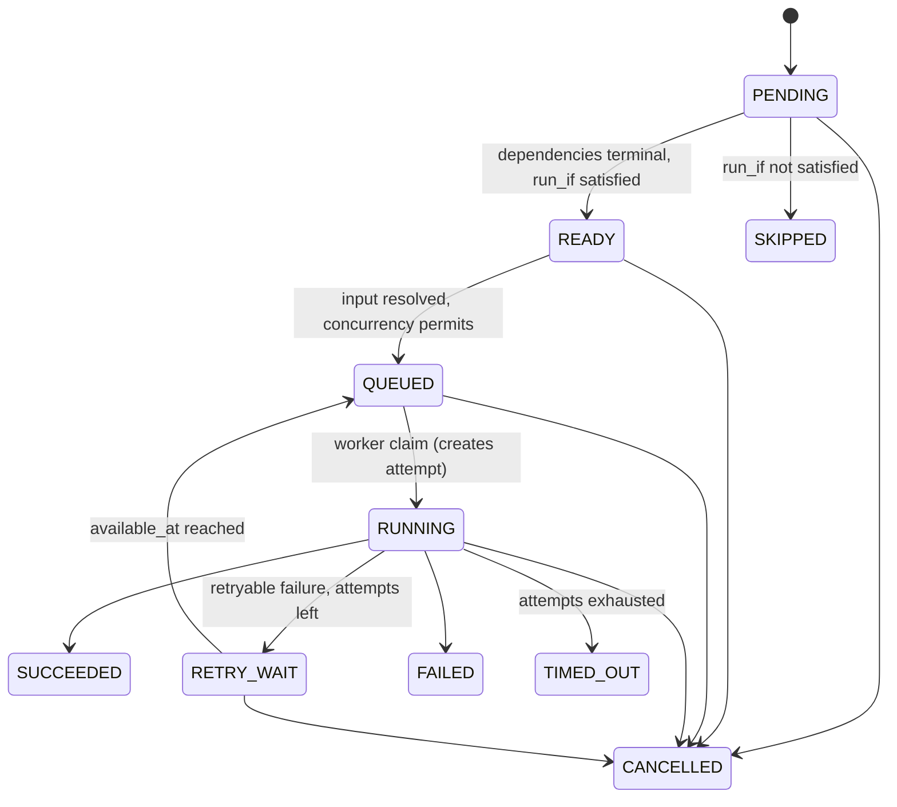
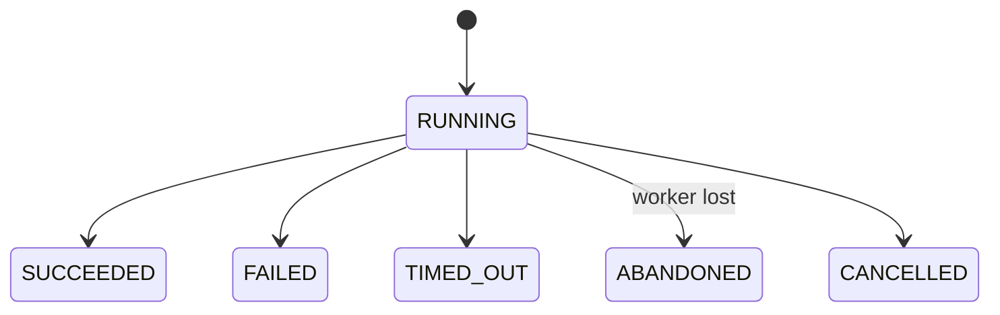
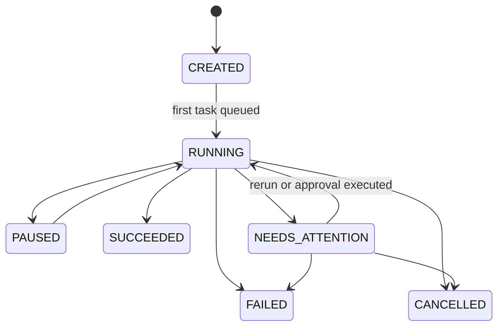

# Workflow semantics

How FlowForge reads a workflow definition, decides what runs next, and moves tasks, attempts and runs between states. The code is pure (no database, transport or clock) and lives in three packages from task 02.02:

| Package | Contents |
|---|---|
| `internal/workflow/model` | Definition types, status enums, `Decode` with defaults |
| `internal/dag` | `Validate` and its issue codes; `TopoOrder`, `Ancestors`, `Roots`, `Children` |
| `internal/workflow/statemachine` | Transition tables, `EvaluateReadiness`, `DeriveRunStatus`, `NextRetryDelay`, event types |

The contracts these implement are in [`00E` §3](../../implementation/00E_CONTRACTS_REFERENCE.md); ADR-008 (acyclic definitions, reruns) and ADR-020 (pure state machines + conditional SQL) explain why.

## Definition format

A definition is JSON (`00E` §3.5). `model.Decode` parses it strictly: unknown fields, trailing data and bodies over 512 KiB are rejected with `INVALID_ARGUMENT` (`PAYLOAD_TOO_LARGE` for size). Absent fields get these defaults; an explicit value, even `0`, is kept so validation can reject it.

| Field | Default |
|---|---|
| `timeout_seconds` (workflow) | `0`: no workflow timeout |
| `on_failure` | `fail` |
| `concurrency.max_parallel_tasks` | `0`: no per-run limit |
| task `queue` | `default` |
| task `timeout_seconds` | `3600` |
| task `run_if` | `on_success` |
| `retry.max_attempts` / `strategy` | `1` / `fixed` |
| `retry.initial_delay_ms` / `max_delay_ms` | `1000` / `60000` |
| `retry.multiplier` / `jitter` | `2.0` / `0` |

A `run_if: "expr"` task carries its expression in `run_if_expr` (the `workflow_tasks.run_if_expr` column).

## Validation

`dag.Validate(def)` returns every problem at once, sorted by (task ID, code, message), so the same definition always yields the same list. 02.04 returns them as `INVALID_WORKFLOW` details. The codes are stable; never rename one.

| Code | Raised when |
|---|---|
| `DUPLICATE_TASK_ID` | Two tasks share an ID |
| `INVALID_TASK_ID` | ID doesn't match `^[a-z][a-z0-9_-]{0,62}$` |
| `UNKNOWN_DEPENDENCY` | `depends_on` names a task that doesn't exist |
| `SELF_DEPENDENCY` | A task depends on itself (reported instead of `CYCLE`) |
| `CYCLE` | The dependencies form a cycle; `path` lists one concrete cycle, each task depending on the next |
| `TOO_MANY_TASKS` | More than 500 tasks |
| `INVALID_RETRY` | `max_attempts` outside 1–20; unknown `strategy`; `initial_delay_ms` outside 0–86 400 000; `max_delay_ms` below `initial_delay_ms` or above 24 h; `multiplier` < 1; `jitter` outside 0–1; a blank `non_retryable_errors` entry |
| `INVALID_TIMEOUT` | Task `timeout_seconds` outside 1–86 400 |
| `MISSING_TYPE` | `type` blank or longer than 128 characters |
| `INVALID_QUEUE` | Queue doesn't match the task-ID pattern |
| `INVALID_RUN_IF` | Unknown `run_if`; `on_failure` on a task with no dependencies; `run_if_expr` set without `run_if: "expr"`; an expression the syntax hook rejects; an expression referring to a task that isn't an ancestor |
| `EMPTY_EXPRESSION` | `run_if: "expr"` with a blank `run_if_expr` |
| `INVALID_WORKFLOW_FIELD` | Name not matching `^[a-z][a-z0-9_-]{0,127}$`; `version` < 1; workflow `timeout_seconds` outside 0–604 800; unknown `on_failure`; `max_parallel_tasks` outside 0–500; no tasks |

Cycles are found with Kahn's algorithm; a cycle path is then extracted from the leftover nodes and rotated to start at its smallest ID. Validation runs in O(V+E); a 500-task DAG validates in under 0.4 ms on an Apple M1 (`go test -bench BenchmarkValidate500 ./internal/dag/`).

Expression syntax belongs to task 03.06. Until then `dag.Validator{}` only checks that an expression is non-empty and that every `tasks.<id>` it mentions is an ancestor. 03.06 sets `Validator.ValidateExpr` (and `Validator.Refs` if its grammar needs it).

## State machines

The tables are data in `statemachine` and match `00E` §3 exactly; a test compares them with an independent copy. Repositories check `Can*Transition` and then apply the change with a conditional `UPDATE … WHERE status = $from` (ADR-020). `TaskTransition`, `AttemptTransition` and `RunTransition` return an `INVALID_STATE` error wrapping `statemachine.ErrInvalidTransition`.

### Task



`SUCCEEDED`, `FAILED`, `TIMED_OUT`, `CANCELLED` and `SKIPPED` are terminal. Remediation never reopens a task; a rerun creates a new row with `supersedes_task_id` (ADR-008).

### Attempt



A completion must also match the attempt's fencing token; that check is in SQL, not in the table (ADR-003).

### Run



`00E` §3.3 has no move from `CREATED` or `PAUSED` to `CANCELLED`, so the code doesn't allow one either; cancelling a run in those states needs a `00E` change first.

Each allowed transition has an event type (`00E` §7): `TaskTransitionEvent`, `AttemptTransitionEvent` and `RunTransitionEvent` return it. Creation events (`run.created`, `task.attempt.started`) aren't transitions and are emitted by the code that creates the row. `RUNNING → CANCELLED` on an attempt has no event of its own; the task's `task.cancelled` covers it.

## Readiness (`run_if`)

`statemachine.EvaluateReadiness(task, deps, eval)` decides what happens to a `PENDING` task, given its direct dependencies:

| `run_if` | Ready when (all dependencies terminal) | Otherwise |
|---|---|---|
| `on_success` | every dependency `SUCCEEDED` | Skip |
| `on_failure` | at least one dependency `FAILED` or `TIMED_OUT` | Skip |
| `always` | always | — |
| `expr` | the injected `ExprEvaluator` returns true | Skip on false; error on evaluator error or a nil evaluator |

If any dependency is not terminal yet, or the task isn't `PENDING`, the decision is Wait. Because `on_success` needs every dependency to have succeeded, a skip propagates down a chain. A task without dependencies is Ready under `on_success` and `always`, and validation forbids `on_failure` without dependencies.

## Run status and the handled-failure rule

`statemachine.DeriveRunStatus(tasks, onFailure)` computes a run's outcome from the current instance of each task (callers leave out rows a rerun superseded, and check the run's own pause and cancel flags first):

1. Any task not terminal: `RUNNING`.
2. A `FAILED` or `TIMED_OUT` task is **handled** when a task that depends on it directly, with `run_if` `on_failure`, `always` or `expr`, `SUCCEEDED`. A `CANCELLED` task is never handled.
3. No unhandled failure: `SUCCEEDED`. Otherwise `NEEDS_ATTENTION` when the definition's `on_failure` is `needs_attention`, else `FAILED`.

So a quality-check failure whose `on_failure` investigation branch succeeds leaves the run `SUCCEEDED`; if the investigation itself fails or is skipped, the run fails.

## Retry delay

`statemachine.NextRetryDelay(policy, attempt, rng)` gives the wait after attempt `n` (1-based) fails (FR-WF-07):

```text
base  = initial_delay                                        (fixed)
base  = min(max_delay, initial_delay · multiplier^(n−1))     (exponential)
delay = base · (1 + jitter · u),   u uniform in [−1, 1]
```

The delay is never below 0 nor above `max_delay · (1 + jitter)`. With `jitter = 0`, or a nil `rng`, it is exactly `base`. Pass a seeded `*rand.Rand` so tests are reproducible (`00C` §8.1). Example, exponential from 1 s ×2 capped at 60 s: 1, 2, 4, 8, 16, 32, 60, 60 s.

## Limitations

- Expression syntax and evaluation arrive in task 03.06; until then `run_if: "expr"` tasks validate only for non-empty text and ancestor references, and readiness returns an error without an evaluator.
- `DeriveRunStatus` treats a `CANCELLED` task as an unhandled failure; a deliberate run cancellation is decided from the run's flags before it is called.
