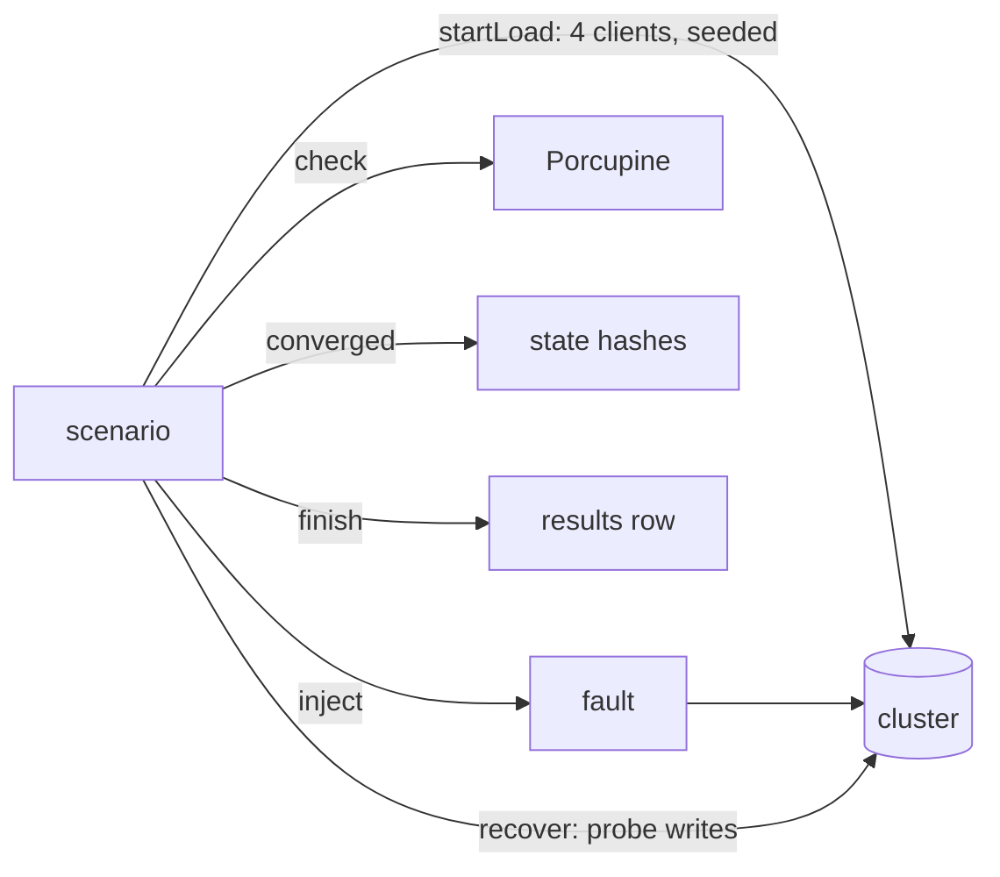

# Fault injection: the Raft fault suite

The Raft fault suite (task 04.08, FR-RAFT-10, NFR-TEST-03, ADR-019) is the Phase 04 gate. It automates the twelve failure scenarios of v1.0 §8.7, five extra scenarios and a negative control.

- **What every scenario does:** declares its expected behaviour in code, runs a client workload whose history Porcupine checks, and records what it observed.
- **The latest results:** [`raft-fault-report.md`](raft-fault-report.md), generated with its data file [`raft-fault-results.json`](raft-fault-results.json).

## Running it

```bash
make test-fault-raft                                 # in-process scenarios, 5 consecutive runs, then render the report
make test-fault-raft FAULT_RUNS=1                    # one run (what CI does on every push)
make raft-up && FF_FAULT_CONTAINERS=1 make test-fault-raft   # also the container-level scenarios (Docker; nightly)
go test -tags=fault -run 'TestFault_07' -v ./test/fault/raft/   # one scenario, no report
```

| Variable (tests only) | Effect |
|---|---|
| `FF_FAULT_RESULTS` | Results file (one JSON object per scenario run); the Make target sets `bin/raft-fault-results.jsonl` |
| `FF_FAULT_CONTAINERS=1` | Runs the container-level scenarios (`C*`) against the Compose `raft-1..3`, starting them if needed |
| `FF_FAULT_ARTIFACTS` | Where a non-linearizable history and its Porcupine visualization are kept (default: the temp dir) |

- **Rendering the report:** `make test-fault-raft` runs `scripts/chaos/render-fault-report.go`, which folds the runs into the committed `docs/testing/raft-fault-results.json` and `raft-fault-report.md`. It renders even when a scenario fails, so the failure is in the report; the target still fails.
- **Missing runs:** a scenario with fewer rows than `FAULT_RUNS` fails, so a hang or a panic can't hide a run.
- **The analysis:** the report's *Analysis* section comes from the hand-written [`raft-fault-notes.md`](raft-fault-notes.md). Missed targets and anything the numbers can't say go there; update it when a run changes the picture.
- **Docker:** scenarios 12 and X3 use Postgres through testcontainers.
- **CI:**
  - **Every push:** `.github/workflows/go.yml` runs the in-process scenarios once.
  - **Nightly:** `.github/workflows/nightly.yml` runs everything five times, container level included, and uploads the report as an artifact.

## How it works



- **Levels:**
  - **In-process:** every member is the full `flowforge-raft` stack (storage, FSM, node, peer transport, KV server) over loopback gRPC, from `internal/raftkv/kvtest`. It runs at the production timing of 100 ms ticks and a 1 s election timeout (00E §5.3), so measured recovery times compare with 00_MASTER §6.1.
  - **Container:** the Compose `raft-1..3` running the production image, driven by `test/fault/dockerctl` (`docker compose kill`, `pause`, `restart`, `docker network disconnect`) and measured through the host ports 7001–7003.
- **Faults in process:**
  - **Kills and restarts:** `kvtest` `Kill`/`Start`.
  - **Partitions and latency:** 04.02's `transport.Fault` around each member's peer transport (`Options.Faults`: `Partition`, `Heal`, `SetFaults`).
  - **Clock skew:** `Options.MemberClock`.
  - **Slow fsync:** `Options.WrapStorage`.
  - **Stale data and wiped nodes:** `Backup`/`Restore` and `Wipe`.
- **Network faults at container level** use `docker network disconnect`, not Toxiproxy. Cutting a node off its Compose network is a clean partition for peers and clients alike. Latency is covered in process, where it is deterministic (seeded).
- **Time-to-recover** is the time from the fault to the first successful linearizable write: `recover` probes with 1 s writes every 20 ms. Scenarios with a §6.1 target record whether it was met; a miss is reported, not hidden.
- **Linearizability:** every operation of the workload goes into a Porcupine history checked against the KV model (`internal/testutil/porcupine`).
  - **A write that failed** is recorded with an unknown outcome: it may have applied.
  - **A violation** fails the scenario and keeps the history.
  - **The negative control** (scenario N) proves the checker can fail. A deliberately broken client records a stale serializable read from a partitioned follower as a linearizable read, and Porcupine must judge the history Illegal.
- **Convergence:** every scenario ends by waiting until all members report the same state hash at the same applied index (scenario 10's property, checked everywhere).
- **Isolation:** key prefixes are unique per scenario **and per run** (`s<id>-<nanos>/`). The Compose cluster keeps its data between runs, and Porcupine's model starts every key absent.

## Adding a scenario

1. **Write a `TestFault_<ID>_<Name>` test** in `test/fault/raft` (build tag `fault`). Create a cluster with `prodCluster` (in-process) or `containers(t)` (container level), and call `newScenario(t, id, name, level, fault, expected)` with the fault and the expected behaviour in plain words.
2. **Start a load:** `l := s.startLoad(endpoints, clientsPer)`, and make a probe client with `s.client`.
3. **Inject the fault** inside `s.inject(...)`, then `s.recover(probe, limit)`. Add `s.target(name, limit)` when 00_MASTER §6.1 sets one.
4. **Assert the expected behaviour explicitly** with `t.Fatalf` on anything else, and describe what you saw with `s.observe(...)`.
5. **Finish** with `l.stop()`, `s.check()` (Porcupine) and `s.converged(...)` or `s.containersConverged()`. The row is written when the test ends; a scenario that never reached `check` counts as failed.
6. **Order:** IDs order the report as numbers (v1.0 §8.7), then `X*` (extra), `N` (negative control) and `C*` (container level).
7. **Verify:** run it 5× (`go test -count=5 -tags=fault -run TestFault_<ID>`) before committing, then `make test-fault-raft` to refresh the report.
