# 00B — Implementation Index and Dependency Tracking

Central navigation for the FlowForge build. **Giving an agent a task:** hand it the task file and tell it to follow `00C_AGENT_OPERATING_RULES.md`. Suggested prompt:

```text
You are an implementation agent for the FlowForge repository. Read, in order:
implementation/00_MASTER_PROJECT_SPEC.md, 00A_ARCHITECTURE_DECISIONS.md, 00E_CONTRACTS_REFERENCE.md,
00C_AGENT_OPERATING_RULES.md, then execute implementation/<phase>/<TASK FILE> exactly.
Review the predecessor files and completion reports it lists. When done, write the completion
report to docs/implementation-reports/<TASK_ID>.md and stop.
```

Totals: **56 tasks** in 10 phases; 1 optional. Critical path weight: 49 (S=1, M=2, L=3).

## 1. Handoff chain (recommended single-agent order)

Because every dependency points to a numerically earlier task, executing in numeric order is always valid:

```text
01.01 → 01.02 → 01.03 → 01.04
  → 02.01 → 02.02 → 02.03 → 02.04 → 02.05
  → 03.01 → 03.02 → 03.03 → 03.04 → 03.05 → 03.06 → 03.07 → 03.08 → 03.09
  → 04.01 → 04.02 → 04.03 → 04.04 → 04.05 → 04.06 → 04.07 → 04.08
  → 05.01 → 05.02 → 05.03 → 05.04 → 05.05 → 05.06 → 05.07 → 05.08 → 05.09 → 05.10
  → 06.01 → 06.02 → 06.03 → 06.04 → 06.05 → 06.06 → 06.07
  → 07.01 → 07.02 → 07.03
  → 08.01 → 08.02 → 08.03
  → 09.01 → 09.02 → 09.03 → 09.04 → 09.05 → 09.06
  → 10.01
```

## 2. Execution waves (what can run concurrently with multiple agents)

A wave contains tasks whose dependencies are all in earlier waves. Tasks in the same wave are *dependency-independent*; run them concurrently **only if** the task files mark them parallel-safe (listed in §5) — otherwise run them sequentially even if in the same wave, because they touch shared files.

| Wave | Tasks |
|---|---|
| 1 | 01.01 |
| 2 | 01.02, 01.04 |
| 3 | 01.03, 02.02, 05.02 |
| 4 | 02.01, 04.01, 05.01, 06.01 |
| 5 | 02.03, 04.02, 04.03, 05.03, 06.03 |
| 6 | 02.04, 03.02, 04.04, 05.04 |
| 7 | 02.05, 04.05, 04.06, 05.05 |
| 8 | 03.01, 03.08, 05.06, 05.09 |
| 9 | 03.03, 05.07 |
| 10 | 03.04 |
| 11 | 03.05, 03.07 |
| 12 | 03.06, 04.07, 05.08, 07.01 |
| 13 | 03.09, 04.08, 06.02, 07.02 |
| 14 | 05.10, 06.04 |
| 15 | 06.05 |
| 16 | 06.06 |
| 17 | 06.07, 07.03, 08.01, 08.02, 09.01 |
| 18 | 08.03 |
| 19 | 09.02 |
| 20 | 09.03, 09.04, 09.05, 09.06 |
| 21 | 10.01 |

## 3. Dependency graph

```mermaid
flowchart LR
  subgraph P01["Phase 01 — Foundation"]
    T01_01["01.01<br/>Repository, toolchain and CI skeleton"]
    T01_02["01.02<br/>Local development environment (Compose, databases, test utilities)"]
    T01_03["01.03<br/>Configuration management"]
    T01_04["01.04<br/>Cross-cutting foundations: logging, errors, IDs, clock, metrics/health server"]
  end
  subgraph P02["Phase 02 — Workflow Core (domain, persistence, API, security)"]
    T02_01["02.01<br/>Migration framework and core PostgreSQL schema"]
    T02_02["02.02<br/>Domain model, state machines and DAG validator (pure logic)"]
    T02_03["02.03<br/>Persistence layer: repositories, transactions, conditional transitions, event/outbox recording"]
    T02_04["02.04<br/>REST API: definitions, runs, tasks, OpenAPI contract, idempotent run start"]
    T02_05["02.05<br/>Authentication, RBAC authorization, audit log, rate limiting"]
  end
  subgraph P03["Phase 03 — Scheduler, Workers and Durable Execution"]
    T03_01["03.01<br/>Worker gRPC protocol and WorkerService (claim, heartbeat, complete, fail, logs)"]
    T03_02["03.02<br/>Scheduler core: readiness, concurrency limits, run lifecycle loop"]
    T03_03["03.03<br/>Worker runtime and handler SDK"]
    T03_04["03.04<br/>Retries, timeouts, worker-loss recovery and crash-consistent loops"]
    T03_05["03.05<br/>Run cancellation, pause/resume and workflow-level timeout"]
    T03_06["03.06<br/>Task result passing, templating, conditional tasks, rerun/remediation"]
    T03_07["03.07<br/>Event relay (outbox), SSE stream and retention jobs"]
    T03_08["03.08<br/>Cron triggers (scheduled runs)"]
    T03_09["03.09<br/>Phase gate: flowforgectl CLI and workflow-engine end-to-end/crash-recovery suite"]
  end
  subgraph P04["Phase 04 — Raft-backed Coordination"]
    T04_01["04.01<br/>Raft KV foundations: protobuf contracts and durable storage (WAL, hard state, snapshots)"]
    T04_02["04.02<br/>Raft node core: Ready loop, transport, proposals, membership (static)"]
    T04_03["04.03<br/>Deterministic KV state machine: CAS/Txn, leases, counters, dedupe, snapshots"]
    T04_04["04.04<br/>KV gRPC server, linearizable reads, leader redirect and Go client"]
    T04_05["04.05<br/>Coordination library: leader election, fencing epochs, worker leases"]
    T04_06["04.06<br/>3-node Raft cluster in Compose: cluster status, health, metrics, operator tooling"]
    T04_07["04.07<br/>Integrate Raft: scheduler leadership + Postgres epoch fencing + worker leases"]
    T04_08["04.08<br/>Phase gate: Raft fault-injection and linearizability suite"]
  end
  subgraph P05["Phase 05 — Kafka Streaming and Market-Data Workload"]
    T05_01["05.01<br/>Kafka (KRaft) infrastructure, topic bootstrap, event envelope and JSON Schemas"]
    T05_02["05.02<br/>Market-data domain library and TimescaleDB schema (windows, indicators, anomaly math)"]
    T05_03["05.03<br/>Deterministic tick generator, historical loader and Kafka producer"]
    T05_04["05.04<br/>Stream processor: consume, validate/normalize, DLQ, persisted dedupe"]
    T05_05["05.05<br/>Event-time windowed aggregation with late-data recompute and idempotent upserts"]
    T05_06["05.06<br/>Backpressure, rebalance-safe offset commits and graceful shutdown"]
    T05_07["05.07<br/>Replay and backfill service (offset/time/symbol/range) with isolated consumer group"]
    T05_08["05.08<br/>Outbox relay Kafka publisher for workflow events (flowforge.workflow-events, flowforge.task-events)"]
    T05_09["05.09<br/>Market-data analytics API, pipeline monitoring and data-quality check"]
    T05_10["05.10<br/>Market-data workflow, task handlers and streaming fault-injection gate"]
  end
  subgraph P06["Phase 06 — AI Operations Copilot"]
    T06_01["06.01<br/>AI service skeleton: FastAPI app, config, provider abstraction with deterministic mocks"]
    T06_02["06.02<br/>FlowForge internal read-only API and `ai-readonly` role"]
    T06_03["06.03<br/>Knowledge base: ingestion, chunking, embeddings in pgvector, retrieval with citations"]
    T06_04["06.04<br/>Typed read-only investigation tools and prompt-injection guardrails"]
    T06_05["06.05<br/>LangGraph investigation workflow with structured, evidence-backed reports"]
    T06_06["06.06<br/>FlowForge integration: AI_INVESTIGATION task handler and approval workflow"]
    T06_07["06.07<br/>AI evaluation harness (≥ 12 incidents) and Phase 06 gate"]
  end
  subgraph P07["Phase 07 — Operations Dashboard"]
    T07_01["07.01<br/>Dashboard shell: auth, navigation, definitions, runs and SSE live updates"]
    T07_02["07.02<br/>Dashboard: live DAG, attempts and logs, cluster/workers and market-data panels"]
    T07_03["07.03<br/>Dashboard: AI investigation reports, approval inbox and UI end-to-end gate"]
  end
  subgraph P08["Phase 08 — Observability"]
    T08_01["08.01<br/>OpenTelemetry tracing across API, workers, Kafka, processor and AI service"]
    T08_02["08.02<br/>Grafana dashboards as code and metrics catalogue audit"]
    T08_03["08.03<br/>Prometheus alert rules, structured-log audit and observability gate"]
  end
  subgraph P09["Phase 09 — Hardening, Deployment, Load and Chaos"]
    T09_01["09.01<br/>Security hardening: TLS/mTLS, secrets handling, key rotation, dependency scanning"]
    T09_02["09.02<br/>Container images, full-stack Compose profiles and one-command demo"]
    T09_03["09.03<br/>Load tests and benchmark methodology with honest performance reporting"]
    T09_04["09.04<br/>System-wide chaos suite, degraded-behavior matrix and graceful-shutdown verification"]
    T09_05["09.05<br/>Documentation set: README, runbooks (≥ 9), API docs, limitations and operator guides"]
    T09_06["09.06<br/>(Optional) Kubernetes manifests with Kustomize"]
  end
  subgraph P10["Phase 10 — Final Validation and Release"]
    T10_01["10.01<br/>Final validation: requirements traceability, full regression, release checklist"]
  end
  T01_01 --> T01_02
  T01_02 --> T01_03
  T01_01 --> T01_04
  T01_02 --> T02_01
  T01_03 --> T02_01
  T01_04 --> T02_02
  T02_01 --> T02_03
  T02_02 --> T02_03
  T01_04 --> T02_03
  T02_03 --> T02_04
  T01_03 --> T02_04
  T01_04 --> T02_04
  T02_04 --> T02_05
  T02_05 --> T03_01
  T02_03 --> T03_02
  T03_01 --> T03_03
  T03_02 --> T03_04
  T03_03 --> T03_04
  T03_04 --> T03_05
  T03_05 --> T03_06
  T03_04 --> T03_07
  T03_02 --> T03_08
  T02_05 --> T03_08
  T03_03 --> T03_09
  T03_05 --> T03_09
  T03_06 --> T03_09
  T03_07 --> T03_09
  T03_08 --> T03_09
  T01_03 --> T04_01
  T01_04 --> T04_01
  T04_01 --> T04_02
  T04_01 --> T04_03
  T04_02 --> T04_04
  T04_03 --> T04_04
  T04_04 --> T04_05
  T04_04 --> T04_06
  T04_05 --> T04_07
  T04_06 --> T04_07
  T03_07 --> T04_07
  T03_04 --> T04_07
  T04_07 --> T04_08
  T01_02 --> T05_01
  T01_03 --> T05_01
  T01_04 --> T05_02
  T05_01 --> T05_03
  T05_02 --> T05_03
  T05_03 --> T05_04
  T05_02 --> T05_04
  T05_04 --> T05_05
  T05_05 --> T05_06
  T05_06 --> T05_07
  T05_01 --> T05_08
  T03_07 --> T05_08
  T05_05 --> T05_09
  T02_05 --> T05_09
  T05_07 --> T05_10
  T05_08 --> T05_10
  T05_09 --> T05_10
  T03_09 --> T05_10
  T01_02 --> T06_01
  T01_03 --> T06_01
  T05_09 --> T06_02
  T04_07 --> T06_02
  T02_05 --> T06_02
  T06_01 --> T06_03
  T06_02 --> T06_04
  T06_03 --> T06_04
  T06_04 --> T06_05
  T06_05 --> T06_06
  T05_10 --> T06_06
  T03_06 --> T06_06
  T06_06 --> T06_07
  T03_07 --> T07_01
  T02_04 --> T07_01
  T02_05 --> T07_01
  T07_01 --> T07_02
  T04_07 --> T07_02
  T05_09 --> T07_02
  T07_02 --> T07_03
  T06_06 --> T07_03
  T06_06 --> T08_01
  T05_08 --> T08_01
  T06_06 --> T08_02
  T05_09 --> T08_02
  T04_06 --> T08_02
  T08_02 --> T08_03
  T08_01 --> T08_03
  T04_07 --> T09_01
  T06_06 --> T09_01
  T09_01 --> T09_02
  T07_03 --> T09_02
  T08_03 --> T09_02
  T09_02 --> T09_03
  T09_02 --> T09_04
  T09_02 --> T09_05
  T09_02 --> T09_06
  T09_03 --> T10_01
  T09_04 --> T10_01
  T09_05 --> T10_01
  classDef crit fill:#ffe0b2,stroke:#e65100,stroke-width:2px;
  classDef opt stroke-dasharray: 5 5;
  class T01_01,T01_04,T02_02,T02_03,T02_04,T02_05,T03_01,T03_03,T03_04,T03_07,T04_07,T06_02,T06_04,T06_05,T06_06,T08_02,T08_03,T09_02,T09_04,T10_01 crit;
  class T09_06 opt;
```



Orange = critical path; dashed = optional.

**Critical path:** 01.01 → 01.04 → 02.02 → 02.03 → 02.04 → 02.05 → 03.01 → 03.03 → 03.04 → 03.07 → 04.07 → 06.02 → 06.04 → 06.05 → 06.06 → 08.02 → 08.03 → 09.02 → 09.04 → 10.01

## 4. Roadmap by phase

### Phase 01 — Foundation

| ID | File | Description | Depends on | Previous (numeric) | Next (numeric) | Parallel-safe with | Critical |
|---|---|---|---|---|---|---|---|
| 01.01 | `phase-01-foundation/01.01_repo_toolchain_ci.md` | Repository, toolchain and CI skeleton — Create the FlowForge monorepo skeleton: Go module, lint/format configuration with package-boundary rules, Makefile with the standard targets, GitHub Actions for Go, and the version-recording convention. | — | — | 01.02 | — | ★ |
| 01.02 | `phase-01-foundation/01.02_development_environment.md` | Local development environment (Compose, databases, test utilities) — Provide a one-command local environment with the two Postgres-family instances and a reusable Go test harness that provisions real databases (testcontainers or the Compose DBs) for integration tests. | 01.01 | 01.01 | 01.03 | 01.04 |  |
| 01.03 | `phase-01-foundation/01.03_configuration_management.md` | Configuration management — Provide one typed, validated, layered configuration system (defaults < file < environment) for all Go services, with secret-safe types, and complete `.env.example` according to `00E §6`. | 01.02 | 01.02 | 01.04 | 01.04 |  |
| 01.04 | `phase-01-foundation/01.04_logging_errors_ids_clock_metrics.md` | Cross-cutting foundations: logging, errors, IDs, clock, metrics/health server — Implement the small shared libraries every later task depends on: structured logging with context fields and redaction, the application error type mapped to HTTP/gRPC, prefixed ULID identifiers, an injectable clock, and a Prometheus registry/HTTP helper (`/metrics`, `/healthz`). | 01.01 | 01.03 | 02.01 | 01.02, 01.03 | ★ |

### Phase 02 — Workflow Core (domain, persistence, API, security)

| ID | File | Description | Depends on | Previous (numeric) | Next (numeric) | Parallel-safe with | Critical |
|---|---|---|---|---|---|---|---|
| 02.01 | `phase-02-workflow-core/02.01_migrations_and_core_schema.md` | Migration framework and core PostgreSQL schema — Establish the goose-based migration system and create the canonical `flowforge` schema (migrations 0001–0004) exactly as specified in `00E §2`, plus the sqlc scaffold. | 01.02, 01.03 | 01.04 | 02.02 | 02.02 |  |
| 02.02 | `phase-02-workflow-core/02.02_domain_model_state_machines_dag.md` | Domain model, state machines and DAG validator (pure logic) — Implement the database-free core of the workflow engine: the workflow definition model with strict JSON decoding, the explicit task/attempt/run state machines, run-status derivation, and the DAG validator. | 01.04 | 02.01 | 02.03 | 02.01 | ★ |
| 02.03 | `phase-02-workflow-core/02.03_repository_layer.md` | Persistence layer: repositories, transactions, conditional transitions, event/outbox recording — Implement the Postgres access layer used by every control-plane service: transaction manager, repositories for definitions/runs/tasks/attempts/events/cluster-state, **conditional state transitions that enforce the state machine in SQL**, and atomic event + outbox recording on every transition. | 02.01, 02.02, 01.04 | 02.02 | 02.04 | — | ★ |
| 02.04 | `phase-02-workflow-core/02.04_rest_api_definitions_runs.md` | REST API: definitions, runs, tasks, OpenAPI contract, idempotent run start — Deliver `flowforge-api`: the REST surface for workflow definitions and runs (read paths for tasks/attempts/events too), the error envelope, pagination, request limits, health/readiness, the OpenAPI 3.1 contract with route-drift checking, and idempotent run creation. | 02.03, 01.03, 01.04 | 02.03 | 02.05 | — | ★ |
| 02.05 | `phase-02-workflow-core/02.05_authn_authz_audit.md` | Authentication, RBAC authorization, audit log, rate limiting — Replace the auth stub with API-key authentication, role-based authorization over every route, audit logging of all mutations, per-key rate limiting, and admin API-key management. | 02.04 | 02.04 | 03.01 | — | ★ |

### Phase 03 — Scheduler, Workers and Durable Execution

| ID | File | Description | Depends on | Previous (numeric) | Next (numeric) | Parallel-safe with | Critical |
|---|---|---|---|---|---|---|---|
| 03.01 | `phase-03-scheduler-workers/03.01_worker_grpc_protocol_service.md` | Worker gRPC protocol and WorkerService (claim, heartbeat, complete, fail, logs) — Define the worker protocol (`proto/worker/v1`) and implement the server side inside `flowforge-api`: authenticated gRPC with atomic task claiming, fencing-token-checked completion/failure, heartbeats, log shipping and worker listing. | 02.05 | 02.05 | 03.02 | 03.02 | ★ |
| 03.02 | `phase-03-scheduler-workers/03.02_scheduler_core.md` | Scheduler core: readiness, concurrency limits, run lifecycle loop — Implement `flowforge-scheduler` and its core loop: promote tasks PENDING→READY/SKIPPED→QUEUED according to dependency/`run_if` semantics and concurrency limits, drive run status transitions, behind a leadership `Gate` abstraction (always-leader for now) with epoch assertion on every decision transaction. | 02.03 | 03.01 | 03.03 | 03.01 |  |
| 03.03 | `phase-03-scheduler-workers/03.03_worker_runtime.md` | Worker runtime and handler SDK — Implement `flowforge-worker`: a pull-based worker with a handler registry, bounded concurrency, heartbeats, fenced result reporting, log shipping, cooperative cancellation and graceful shutdown; plus built-in demo handlers used by tests and the demo. | 03.01 | 03.02 | 03.04 | — | ★ |
| 03.04 | `phase-03-scheduler-workers/03.04_retry_timeout_recovery.md` | Retries, timeouts, worker-loss recovery and crash-consistent loops — Make execution resilient: retry policy with backoff/jitter and error classification, per-attempt timeouts, detection of lost workers with attempt abandonment and reassignment, and proof that scheduler/API restarts at any point converge. | 03.02, 03.03 | 03.03 | 03.05 | — | ★ |
| 03.05 | `phase-03-scheduler-workers/03.05_cancel_pause_resume_workflow_timeout.md` | Run cancellation, pause/resume and workflow-level timeout — Add run-level control: cooperative and forced cancellation, pause/resume, and the workflow deadline, including propagation of cancel signals to running workers through heartbeats. | 03.04 | 03.04 | 03.06 | — |  |
| 03.06 | `phase-03-scheduler-workers/03.06_results_templating_conditionals_rerun.md` | Task result passing, templating, conditional tasks, rerun/remediation — Implement data flow between tasks (constrained templates), the `run_if` expression language, and the remediation **rerun** mechanism that resolves the v1.0 'retry loop' contradiction while preserving immutable history. | 03.05 | 03.05 | 03.07 | — |  |
| 03.07 | `phase-03-scheduler-workers/03.07_events_outbox_sse_retention.md` | Event relay (outbox), SSE stream and retention jobs — Deliver reliable event publication via the transactional outbox (publisher-agnostic until Kafka arrives in 05.01), the Server-Sent Events stream used by the dashboard, and the retention/cleanup jobs. | 03.04 | 03.06 | 03.08 | 03.08 | ★ |
| 03.08 | `phase-03-scheduler-workers/03.08_cron_triggers.md` | Cron triggers (scheduled runs) — Allow workflows to be started on a schedule without double-firing or losing a fire across leader changes, using the idempotent run-start path. | 03.02, 02.05 | 03.07 | 03.09 | 03.07 |  |
| 03.09 | `phase-03-scheduler-workers/03.09_workflow_engine_e2e_gate.md` | Phase gate: flowforgectl CLI and workflow-engine end-to-end/crash-recovery suite — Close the workflow-engine milestone: ship the `flowforgectl` CLI and an end-to-end test suite (real Postgres, real binaries or in-process equivalents) proving the Phase-1 acceptance criteria, including crash/restart and soak scenarios. | 03.03, 03.05, 03.06, 03.07, 03.08 | 03.08 | 04.01 | — |  |

### Phase 04 — Raft-backed Coordination

| ID | File | Description | Depends on | Previous (numeric) | Next (numeric) | Parallel-safe with | Critical |
|---|---|---|---|---|---|---|---|
| 04.01 | `phase-04-raft-coordination/04.01_raftkv_proto_storage.md` | Raft KV foundations: protobuf contracts and durable storage (WAL, hard state, snapshots) — Create the protobuf contracts for the coordination service and Raft peer messages, and implement the durable storage layer behind a `Storage` interface (bbolt-backed) that satisfies the etcd Raft library's `raft.Storage` contract. | 01.03, 01.04 | 03.09 | 04.02 | — |  |
| 04.02 | `phase-04-raft-coordination/04.02_raft_node_core.md` | Raft node core: Ready loop, transport, proposals, membership (static) — Implement the Raft node runtime on top of the etcd Raft library: the Ready/Advance loop honoring the persistence contract, a gRPC streaming peer transport, proposal handling with completion futures, leader/term tracking, static three-voter membership, and in-process fault-injecting transport for tests. | 04.01 | 04.01 | 04.03 | 04.03 |  |
| 04.03 | `phase-04-raft-coordination/04.03_kv_state_machine_snapshots.md` | Deterministic KV state machine: CAS/Txn, leases, counters, dedupe, snapshots — Implement the replicated state machine (FSM): a purely deterministic key-value store with versions, CAS, small transactions, TTL leases (timestamps carried in commands), monotonic counters, request-id deduplication and snapshot/restore — with a determinism test proving replicas converge byte-for-byte. | 04.01 | 04.02 | 04.04 | 04.02 |  |
| 04.04 | `phase-04-raft-coordination/04.04_kv_grpc_server_reads_client.md` | KV gRPC server, linearizable reads, leader redirect and Go client — Expose the replicated KV as a gRPC service (`flowforge-raft` binary) with linearizable reads via ReadIndex, leader-evaluated lease expiry, a lease-expiry sweeper, request-id retry safety, and a typed Go client that follows leader hints and retries safely. | 04.02, 04.03 | 04.03 | 04.05 | — |  |
| 04.05 | `phase-04-raft-coordination/04.05_coordination_library.md` | Coordination library: leader election, fencing epochs, worker leases — Build the higher-level coordination primitives FlowForge needs on top of the KV client: scheduler leader election with epochs (implementing the scheduler `Gate`), worker registration/liveness leases (implementing the `LeaseProvider` seam), and fencing-token helpers. | 04.04 | 04.04 | 04.06 | 04.06 |  |
| 04.06 | `phase-04-raft-coordination/04.06_cluster_compose_status_metrics.md` | 3-node Raft cluster in Compose: cluster status, health, metrics, operator tooling — Run the 3-node Raft cluster locally with healthchecks, expose accurate cluster status and Prometheus metrics, and provide operator/debug tooling (`flowforge-raft` admin subcommands) used by chaos tests. | 04.04 | 04.05 | 04.07 | 04.05 |  |
| 04.07 | `phase-04-raft-coordination/04.07_scheduler_leadership_worker_leases_integration.md` | Integrate Raft: scheduler leadership + Postgres epoch fencing + worker leases — Wire the coordination library into the control plane: multi-instance schedulers elect a leader through Raft; every leader-gated loop uses the Raft-backed `Gate`; Postgres epoch fencing rejects stale leaders; worker heartbeats renew Raft leases, and the recovery loop consumes Raft lease expirations. | 04.05, 04.06, 03.07, 03.04 | 04.06 | 04.08 | — | ★ |
| 04.08 | `phase-04-raft-coordination/04.08_raft_fault_injection_suite.md` | Phase gate: Raft fault-injection and linearizability suite — Automate all twelve Raft failure scenarios from the original spec (§8.7) plus fencing scenarios, with expected-vs-observed documentation and linearizability checking. | 04.07 | 04.07 | 05.01 | — |  |

### Phase 05 — Kafka Streaming and Market-Data Workload

| ID | File | Description | Depends on | Previous (numeric) | Next (numeric) | Parallel-safe with | Critical |
|---|---|---|---|---|---|---|---|
| 05.01 | `phase-05-kafka-marketdata/05.01_kafka_infra_topics_envelope.md` | Kafka (KRaft) infrastructure, topic bootstrap, event envelope and JSON Schemas — Add Kafka (single-broker KRaft for dev) to Compose, create an idempotent topic bootstrap, and define the versioned event envelope with JSON Schemas plus the Go envelope/validation library and franz-go client wrapper used by every producer and consumer. | 01.02, 01.03 | 04.08 | 05.02 | 05.02 |  |
| 05.02 | `phase-05-kafka-marketdata/05.02_marketdata_domain_timescale.md` | Market-data domain library and TimescaleDB schema (windows, indicators, anomaly math) — Implement the pure, fully unit-tested market-data domain: tick model and validation, window arithmetic, OHLCV/VWAP, moving average, rolling volatility, z-score anomaly flag, watermark/late policy decisions — plus the TimescaleDB migrations. | 01.04 | 05.01 | 05.03 | 05.01 |  |
| 05.03 | `phase-05-kafka-marketdata/05.03_tick_generator_loader_producer.md` | Deterministic tick generator, historical loader and Kafka producer — Provide the market-data source side: a seeded synthetic generator (configurable rate, symbols, fault injection of duplicates/late/out-of-order/invalid ticks), a CSV/JSON historical loader behind the same `Source` interface, and a producer that validates, keys by symbol and publishes with deterministic event ids. | 05.01, 05.02 | 05.02 | 05.04 | 05.08 |  |
| 05.04 | `phase-05-kafka-marketdata/05.04_processor_consume_validate_persist.md` | Stream processor: consume, validate/normalize, DLQ, persisted dedupe — Implement the processor's ingest half as a long-running service: consume `market.ticks`, validate and normalize, route poison/invalid events to `market.invalid` with reasons, and persist valid ticks to TimescaleDB with `ON CONFLICT DO NOTHING` dedupe and duplicate counting. | 05.03, 05.02 | 05.03 | 05.05 | — |  |
| 05.05 | `phase-05-kafka-marketdata/05.05_windowed_aggregation_recompute.md` | Event-time windowed aggregation with late-data recompute and idempotent upserts — Turn persisted ticks into 1m and 5m aggregates with indicators and anomaly flags. | 05.04 | 05.04 | 05.06 | — |  |
| 05.06 | `phase-05-kafka-marketdata/05.06_backpressure_offsets_shutdown.md` | Backpressure, rebalance-safe offset commits and graceful shutdown — Make the processor robust under load and lifecycle events: bounded queues everywhere, consumer pause/resume driven by downstream saturation, bounded DB write concurrency, rebalance-safe commit tracking, and a graceful shutdown that drains and commits. | 05.05 | 05.05 | 05.07 | 05.09 |  |
| 05.07 | `phase-05-kafka-marketdata/05.07_replay_backfill.md` | Replay and backfill service (offset/time/symbol/range) with isolated consumer group — Provide operator- and workflow-invocable replay of historical data through the same pipeline code, using a dedicated consumer group, so aggregates can be rebuilt safely even while live processing continues. | 05.06 | 05.06 | 05.08 | — |  |
| 05.08 | `phase-05-kafka-marketdata/05.08_kafka_outbox_publisher.md` | Outbox relay Kafka publisher for workflow events (flowforge.workflow-events, flowforge.task-events) — Implement the Kafka-backed `Publisher` consumed by the outbox relay loop (03.07): publish workflow/task events as envelopes to the topic stored on each outbox row (`flowforge.workflow-events` or `flowforge.task-events`, per `00E §7`) keyed by `run_id` with at-least-once semantics, retries, DLQ for permanently failing rows, and lag/backlog metrics. | 05.01, 03.07 | 05.07 | 05.09 | 05.03 |  |
| 05.09 | `phase-05-kafka-marketdata/05.09_marketdata_api_monitoring_quality.md` | Market-data analytics API, pipeline monitoring and data-quality check — Expose market-data analytics and pipeline health through the FlowForge REST API and implement the monitoring primitives (lag, freshness, rates) plus the data-quality check logic used by the `market-data-quality-check` workflow task. | 05.05, 02.05 | 05.08 | 05.10 | 05.06 |  |
| 05.10 | `phase-05-kafka-marketdata/05.10_marketdata_workflow_streaming_gate.md` | Market-data workflow, task handlers and streaming fault-injection gate — Deliver the flagship demonstration: the `market-data-hourly` workflow executed through FlowForge using bounded controller task handlers around the long-running processor, plus the automated streaming fault-injection suite that gates Phase 05. | 05.07, 05.08, 05.09, 03.09 | 05.09 | 06.01 | — |  |

### Phase 06 — AI Operations Copilot

| ID | File | Description | Depends on | Previous (numeric) | Next (numeric) | Parallel-safe with | Critical |
|---|---|---|---|---|---|---|---|
| 06.01 | `phase-06-ai-ops/06.01_ai_service_skeleton_providers.md` | AI service skeleton: FastAPI app, config, provider abstraction with deterministic mocks — Create the Python AI service (`services/aiops`) with a FastAPI app, Pydantic schemas for the REST contract in `00E §10`, an AI database (`aiops` DB on the pgvector Postgres) migration set, and a provider-agnostic LLM/embedding layer with deterministic mock providers so the whole stack is testable offline. | 01.02, 01.03 | 05.10 | 06.02 | 06.02 |  |
| 06.02 | `phase-06-ai-ops/06.02_internal_read_api.md` | FlowForge internal read-only API and `ai-readonly` role — Give the AI plane safe, bounded, read-only access to operational facts exclusively through a dedicated internal API (`/internal/v1/*`) protected by the `ai-readonly` role — never direct database access. | 05.09, 04.07, 02.05 | 06.01 | 06.03 | 06.01, 06.03 | ★ |
| 06.03 | `phase-06-ai-ops/06.03_kb_ingestion_retrieval.md` | Knowledge base: ingestion, chunking, embeddings in pgvector, retrieval with citations — Build the RAG knowledge base: ingest repo runbooks, architecture docs, schemas and the error catalog, chunk and embed them into pgvector with rich metadata, and provide a LangChain retriever with metadata filters and citation output. | 06.01 | 06.02 | 06.04 | 06.02 |  |
| 06.04 | `phase-06-ai-ops/06.04_ai_tools_guardrails.md` | Typed read-only investigation tools and prompt-injection guardrails — Implement the bounded, typed tool layer the graph will use (httpx client to the internal read API plus KB search) together with guardrails: untrusted-data delimiting, allow-list, argument validation, budgets and output truncation. | 06.02, 06.03 | 06.03 | 06.05 | — | ★ |
| 06.05 | `phase-06-ai-ops/06.05_langgraph_investigation_graph.md` | LangGraph investigation workflow with structured, evidence-backed reports — Implement the LangGraph state graph that investigates a failed run or pipeline symptom and emits a validated structured report (observed facts with evidence, hypotheses with confidence, recommendations with risk and approval requirement, or `insufficient_evidence`). | 06.04 | 06.04 | 06.06 | — | ★ |
| 06.06 | `phase-06-ai-ops/06.06_ai_investigation_task_approvals.md` | FlowForge integration: AI_INVESTIGATION task handler and approval workflow — Close the loop inside FlowForge: a worker handler runs an AI investigation as a workflow task (idempotent, polled), stores the report with the run, converts recommendations into `approval_requests`, and executes approved actions exclusively through FlowForge APIs. | 06.05, 05.10, 03.06 | 06.05 | 06.07 | — | ★ |
| 06.07 | `phase-06-ai-ops/06.07_ai_evaluation_gate.md` | AI evaluation harness (≥ 12 incidents) and Phase 06 gate — Measure the copilot objectively and offline: a labeled incident suite scoring run identification, tool selection, retrieval relevance, evidence coverage, unsupported-claim rate, recommendation safety and injection resistance, with a committed baseline and a regression gate. | 06.06 | 06.06 | 07.01 | — |  |

### Phase 07 — Operations Dashboard

| ID | File | Description | Depends on | Previous (numeric) | Next (numeric) | Parallel-safe with | Critical |
|---|---|---|---|---|---|---|---|
| 07.01 | `phase-07-dashboard/07.01_ui_shell_runs_sse.md` | Dashboard shell: auth, navigation, definitions, runs and SSE live updates — Create the React + Vite + TypeScript operations dashboard foundation: API-key login, role-aware navigation, typed API client generated from OpenAPI, workflow definition and run pages, and a resilient SSE live-update layer with `Last-Event-ID` resume. | 03.07, 02.04, 02.05 | 06.07 | 07.02 | — |  |
| 07.02 | `phase-07-dashboard/07.02_ui_dag_logs_cluster_marketdata.md` | Dashboard: live DAG, attempts and logs, cluster/workers and market-data panels — Deliver the core operational views: interactive DAG of a run with live task states, attempt history and log viewer, workers/scheduler/Raft health, and market-data freshness/lag/rate panels. | 07.01, 04.07, 05.09 | 07.01 | 07.03 | — |  |
| 07.03 | `phase-07-dashboard/07.03_ui_ai_reports_approvals_gate.md` | Dashboard: AI investigation reports, approval inbox and UI end-to-end gate — Surface the AI copilot safely: investigation reports that visually separate observed facts from hypotheses and proposals, evidence links that resolve to real records, and an approval inbox with approve/reject-with-reason; then close the phase with an end-to-end UI test of the full incident loop. | 07.02, 06.06 | 07.02 | 08.01 | — |  |

### Phase 08 — Observability

| ID | File | Description | Depends on | Previous (numeric) | Next (numeric) | Parallel-safe with | Critical |
|---|---|---|---|---|---|---|---|
| 08.01 | `phase-08-observability/08.01_distributed_tracing.md` | OpenTelemetry tracing across API, workers, Kafka, processor and AI service — Make a single trace follow a workflow run through run creation, task scheduling, worker execution, outbox → Kafka → processor → DB, and into AI investigations, with Jaeger available for inspection. | 06.06, 05.08 | 07.03 | 08.02 | 08.02 |  |
| 08.02 | `phase-08-observability/08.02_grafana_dashboards_metrics_audit.md` | Grafana dashboards as code and metrics catalogue audit — Provision Prometheus + Grafana with dashboards for the nine operational areas, and audit that every metric promised in `00E §11` is exported with sane labels (no high-cardinality or sensitive labels). | 06.06, 05.09, 04.06 | 08.01 | 08.03 | 08.01 | ★ |
| 08.03 | `phase-08-observability/08.03_alert_rules_logs_audit.md` | Prometheus alert rules, structured-log audit and observability gate — Define alert rules for the failure modes that matter, verify them with promtool unit tests, and audit structured logs for required correlation fields and redaction across all services. | 08.02, 08.01 | 08.02 | 09.01 | — | ★ |

### Phase 09 — Hardening, Deployment, Load and Chaos

| ID | File | Description | Depends on | Previous (numeric) | Next (numeric) | Parallel-safe with | Critical |
|---|---|---|---|---|---|---|---|
| 09.01 | `phase-09-hardening-deployment/09.01_security_hardening_tls.md` | Security hardening: TLS/mTLS, secrets handling, key rotation, dependency scanning — Move from dev-trust to production-grade transport and secret hygiene: optional TLS everywhere with mTLS for internal gRPC/Raft links, secrets from files/env (never images), API-key rotation/revocation workflows, and automated vulnerability and secret scanning. | 04.07, 06.06 | 08.03 | 09.02 | — |  |
| 09.02 | `phase-09-hardening-deployment/09.02_containers_compose_demo.md` | Container images, full-stack Compose profiles and one-command demo — Finalize deployable artifacts: multi-stage, non-root, pinned images for every service, a coherent full-stack Compose with profiles and healthchecks, and `make demo` that seeds data and runs the headline scenario unattended. | 09.01, 07.03, 08.03 | 09.01 | 09.03 | — | ★ |
| 09.03 | `phase-09-hardening-deployment/09.03_load_tests_benchmarks.md` | Load tests and benchmark methodology with honest performance reporting — Measure the targets in master spec §6.1 under a documented methodology (hardware, versions, config, warm-up, percentile definitions) and report results honestly — including misses with analysis. | 09.02 | 09.02 | 09.04 | 09.04, 09.05, 09.06 |  |
| 09.04 | `phase-09-hardening-deployment/09.04_system_chaos_degraded_matrix.md` | System-wide chaos suite, degraded-behavior matrix and graceful-shutdown verification — Prove the system behaves as documented when dependencies fail: execute every row of the degraded-behavior matrix (master spec §6.2), cross-component chaos scenarios with invariant checking, and SIGTERM/graceful-shutdown tests for all services. | 09.02 | 09.03 | 09.05 | 09.03, 09.05, 09.06 | ★ |
| 09.05 | `phase-09-hardening-deployment/09.05_documentation_runbooks_api_docs.md` | Documentation set: README, runbooks (≥ 9), API docs, limitations and operator guides — Finish the documentation so a new engineer or operator can understand, run, operate and troubleshoot the system: top-level README, architecture overview, ≥ 9 runbooks, API reference, testing guide, known limitations and an operations guide. | 09.02 | 09.04 | 09.06 | 09.03, 09.04, 09.06 |  |
| 09.06 (opt) | `phase-09-hardening-deployment/09.06_kubernetes_kustomize.md` | (Optional) Kubernetes manifests with Kustomize — Provide Kustomize base and overlays to deploy FlowForge on Kubernetes (kind/minikube validated), mapping the Compose topology to Deployments/StatefulSets with probes, resources and config. | 09.02 | 09.05 | 10.01 | 09.03, 09.04, 09.05 |  |

### Phase 10 — Final Validation and Release

| ID | File | Description | Depends on | Previous (numeric) | Next (numeric) | Parallel-safe with | Critical |
|---|---|---|---|---|---|---|---|
| 10.01 | `phase-10-final-validation/10.01_final_validation_release.md` | Final validation: requirements traceability, full regression, release checklist — Close the project: prove every requirement in the master spec is implemented and tested, run the full regression across all suites, verify coverage gates and migrations, and produce the release notes and final completion report. | 09.03, 09.04, 09.05 | 09.06 | — | — | ★ |

## 5. Parallelizable groups (explicitly declared safe)

- 01.02, 01.04  (e.g. 01.02 ∥ 01.04)
- 01.03, 01.04  (e.g. 01.03 ∥ 01.04)
- 01.02, 01.03, 01.04  (e.g. 01.04 ∥ 01.02, 01.03)
- 02.01, 02.02  (e.g. 02.01 ∥ 02.02)
- 03.01, 03.02  (e.g. 03.01 ∥ 03.02)
- 03.07, 03.08  (e.g. 03.07 ∥ 03.08)
- 04.02, 04.03  (e.g. 04.02 ∥ 04.03)
- 04.05, 04.06  (e.g. 04.05 ∥ 04.06)
- 05.01, 05.02  (e.g. 05.01 ∥ 05.02)
- 05.03, 05.08  (e.g. 05.03 ∥ 05.08)
- 05.06, 05.09  (e.g. 05.06 ∥ 05.09)
- 06.01, 06.02  (e.g. 06.01 ∥ 06.02)
- 06.01, 06.02, 06.03  (e.g. 06.02 ∥ 06.01, 06.03)
- 06.02, 06.03  (e.g. 06.03 ∥ 06.02)
- 08.01, 08.02  (e.g. 08.01 ∥ 08.02)
- 09.03, 09.04, 09.05, 09.06  (e.g. 09.03 ∥ 09.04, 09.05, 09.06)

Declared pairs are symmetric and verified to have no dependency path between them. Anything not listed must run alone.

## 6. Requirement coverage matrix

Every requirement ID in the master spec is covered by at least one task (checked mechanically by the generator; see `00G_QUALITY_CONTROL_REPORT.md`).

| Requirement | Covered by tasks |
|---|---|
| FR-AI-01 | 06.01 |
| FR-AI-02 | 06.01 |
| FR-AI-03 | 06.03 |
| FR-AI-04 | 06.03 |
| FR-AI-05 | 06.04 |
| FR-AI-06 | 06.05 |
| FR-AI-07 | 06.05 |
| FR-AI-08 | 06.05 |
| FR-AI-09 | 06.06 |
| FR-AI-10 | 06.06 |
| FR-AI-11 | 06.04, 06.05 |
| FR-AI-12 | 06.07 |
| FR-AI-13 | 06.02 |
| FR-API-01 | 02.04, 03.01, 03.05, 03.08 |
| FR-API-02 | 02.04 |
| FR-API-03 | 02.04 |
| FR-API-04 | 02.04 |
| FR-API-05 | 02.04 |
| FR-API-06 | 03.07 |
| FR-KAFKA-01 | 05.01 |
| FR-KAFKA-02 | 05.01 |
| FR-KAFKA-03 | 05.08 |
| FR-KAFKA-04 | 05.03 |
| FR-KAFKA-05 | 05.03 |
| FR-KAFKA-06 | 05.04 |
| FR-KAFKA-07 | 05.04 |
| FR-KAFKA-08 | 05.02, 05.05 |
| FR-KAFKA-09 | 05.02, 05.05 |
| FR-KAFKA-10 | 05.02, 05.05 |
| FR-KAFKA-11 | 05.06 |
| FR-KAFKA-12 | 05.06 |
| FR-KAFKA-13 | 05.07 |
| FR-KAFKA-14 | 05.09 |
| FR-KAFKA-15 | 05.10 |
| FR-KAFKA-16 | 05.09 |
| FR-RAFT-01 | 04.01, 04.02 |
| FR-RAFT-02 | 04.03 |
| FR-RAFT-03 | 04.03 |
| FR-RAFT-04 | 04.04 |
| FR-RAFT-05 | 04.01, 04.03 |
| FR-RAFT-06 | 04.04, 04.05 |
| FR-RAFT-07 | 04.06 |
| FR-RAFT-08 | 04.07 |
| FR-RAFT-09 | 04.07 |
| FR-RAFT-10 | 04.08 |
| FR-RAFT-11 | 04.02 |
| FR-SEC-01 | 02.05 |
| FR-SEC-02 | 02.05 |
| FR-SEC-03 | 02.05 |
| FR-SEC-04 | 03.01 |
| FR-SEC-05 | 02.04, 02.05, 06.02 |
| FR-SEC-06 | 01.03, 01.04, 09.01 |
| FR-UI-01 | 07.01 |
| FR-UI-02 | 07.01 |
| FR-UI-03 | 07.02 |
| FR-UI-04 | 07.02 |
| FR-UI-05 | 07.02 |
| FR-UI-06 | 07.03 |
| FR-UI-07 | 07.01 |
| FR-WF-01 | 02.03, 02.04 |
| FR-WF-02 | 02.02 |
| FR-WF-03 | 02.04 |
| FR-WF-04 | 02.02, 02.03 |
| FR-WF-05 | 03.02 |
| FR-WF-06 | 03.01, 03.03 |
| FR-WF-07 | 03.04 |
| FR-WF-08 | 03.04, 03.05 |
| FR-WF-09 | 03.04, 03.09 |
| FR-WF-10 | 03.05, 03.06 |
| FR-WF-11 | 03.06 |
| FR-WF-12 | 03.06 |
| FR-WF-13 | 02.04, 03.01 |
| FR-WF-14 | 03.08 |
| FR-WF-15 | 02.03, 03.07, 05.08 |
| FR-WF-16 | 03.01 |
| NFR-DEP-01 | 09.01, 09.02 |
| NFR-DEP-02 | 09.02 |
| NFR-DEP-03 | 09.06 |
| NFR-DEV-01 | 01.02, 09.02 |
| NFR-DEV-02 | 01.01, 10.01 |
| NFR-DEV-03 | 02.01, 10.01 |
| NFR-DEV-04 | 09.05 |
| NFR-OBS-01 | 08.02 |
| NFR-OBS-02 | 08.01 |
| NFR-OBS-03 | 01.04, 08.03 |
| NFR-OBS-04 | 08.02 |
| NFR-OBS-05 | 08.03 |
| NFR-PERF-01 | 09.03 |
| NFR-REL-01 | 09.04 |
| NFR-REL-02 | 03.03, 05.06, 09.04 |
| NFR-TEST-01 | 01.01, 10.01 |
| NFR-TEST-02 | 01.02, 05.10 |
| NFR-TEST-03 | 03.09, 04.08, 05.10, 09.04 |
| NFR-TEST-04 | 09.03 |
| NFR-TEST-05 | 06.07 |

## 7. Progress tracker

Tick when the task's completion report exists and all acceptance criteria are met.

**Phase 01 — Foundation**

- [x] `01.01` Repository, toolchain and CI skeleton — `phase-01-foundation/01.01_repo_toolchain_ci.md`
- [x] `01.02` Local development environment (Compose, databases, test utilities) — `phase-01-foundation/01.02_development_environment.md`
- [x] `01.03` Configuration management — `phase-01-foundation/01.03_configuration_management.md`
- [x] `01.04` Cross-cutting foundations: logging, errors, IDs, clock, metrics/health server — `phase-01-foundation/01.04_logging_errors_ids_clock_metrics.md`

**Phase 02 — Workflow Core (domain, persistence, API, security)**

- [x] `02.01` Migration framework and core PostgreSQL schema — `phase-02-workflow-core/02.01_migrations_and_core_schema.md`
- [x] `02.02` Domain model, state machines and DAG validator (pure logic) — `phase-02-workflow-core/02.02_domain_model_state_machines_dag.md`
- [x] `02.03` Persistence layer: repositories, transactions, conditional transitions, event/outbox recording — `phase-02-workflow-core/02.03_repository_layer.md`
- [x] `02.04` REST API: definitions, runs, tasks, OpenAPI contract, idempotent run start — `phase-02-workflow-core/02.04_rest_api_definitions_runs.md`
- [x] `02.05` Authentication, RBAC authorization, audit log, rate limiting — `phase-02-workflow-core/02.05_authn_authz_audit.md`

**Phase 03 — Scheduler, Workers and Durable Execution**

- [ ] `03.01` Worker gRPC protocol and WorkerService (claim, heartbeat, complete, fail, logs) — `phase-03-scheduler-workers/03.01_worker_grpc_protocol_service.md`
- [ ] `03.02` Scheduler core: readiness, concurrency limits, run lifecycle loop — `phase-03-scheduler-workers/03.02_scheduler_core.md`
- [ ] `03.03` Worker runtime and handler SDK — `phase-03-scheduler-workers/03.03_worker_runtime.md`
- [ ] `03.04` Retries, timeouts, worker-loss recovery and crash-consistent loops — `phase-03-scheduler-workers/03.04_retry_timeout_recovery.md`
- [ ] `03.05` Run cancellation, pause/resume and workflow-level timeout — `phase-03-scheduler-workers/03.05_cancel_pause_resume_workflow_timeout.md`
- [ ] `03.06` Task result passing, templating, conditional tasks, rerun/remediation — `phase-03-scheduler-workers/03.06_results_templating_conditionals_rerun.md`
- [ ] `03.07` Event relay (outbox), SSE stream and retention jobs — `phase-03-scheduler-workers/03.07_events_outbox_sse_retention.md`
- [ ] `03.08` Cron triggers (scheduled runs) — `phase-03-scheduler-workers/03.08_cron_triggers.md`
- [ ] `03.09` Phase gate: flowforgectl CLI and workflow-engine end-to-end/crash-recovery suite — `phase-03-scheduler-workers/03.09_workflow_engine_e2e_gate.md`

**Phase 04 — Raft-backed Coordination**

- [ ] `04.01` Raft KV foundations: protobuf contracts and durable storage (WAL, hard state, snapshots) — `phase-04-raft-coordination/04.01_raftkv_proto_storage.md`
- [ ] `04.02` Raft node core: Ready loop, transport, proposals, membership (static) — `phase-04-raft-coordination/04.02_raft_node_core.md`
- [ ] `04.03` Deterministic KV state machine: CAS/Txn, leases, counters, dedupe, snapshots — `phase-04-raft-coordination/04.03_kv_state_machine_snapshots.md`
- [ ] `04.04` KV gRPC server, linearizable reads, leader redirect and Go client — `phase-04-raft-coordination/04.04_kv_grpc_server_reads_client.md`
- [ ] `04.05` Coordination library: leader election, fencing epochs, worker leases — `phase-04-raft-coordination/04.05_coordination_library.md`
- [ ] `04.06` 3-node Raft cluster in Compose: cluster status, health, metrics, operator tooling — `phase-04-raft-coordination/04.06_cluster_compose_status_metrics.md`
- [ ] `04.07` Integrate Raft: scheduler leadership + Postgres epoch fencing + worker leases — `phase-04-raft-coordination/04.07_scheduler_leadership_worker_leases_integration.md`
- [ ] `04.08` Phase gate: Raft fault-injection and linearizability suite — `phase-04-raft-coordination/04.08_raft_fault_injection_suite.md`

**Phase 05 — Kafka Streaming and Market-Data Workload**

- [ ] `05.01` Kafka (KRaft) infrastructure, topic bootstrap, event envelope and JSON Schemas — `phase-05-kafka-marketdata/05.01_kafka_infra_topics_envelope.md`
- [ ] `05.02` Market-data domain library and TimescaleDB schema (windows, indicators, anomaly math) — `phase-05-kafka-marketdata/05.02_marketdata_domain_timescale.md`
- [ ] `05.03` Deterministic tick generator, historical loader and Kafka producer — `phase-05-kafka-marketdata/05.03_tick_generator_loader_producer.md`
- [ ] `05.04` Stream processor: consume, validate/normalize, DLQ, persisted dedupe — `phase-05-kafka-marketdata/05.04_processor_consume_validate_persist.md`
- [ ] `05.05` Event-time windowed aggregation with late-data recompute and idempotent upserts — `phase-05-kafka-marketdata/05.05_windowed_aggregation_recompute.md`
- [ ] `05.06` Backpressure, rebalance-safe offset commits and graceful shutdown — `phase-05-kafka-marketdata/05.06_backpressure_offsets_shutdown.md`
- [ ] `05.07` Replay and backfill service (offset/time/symbol/range) with isolated consumer group — `phase-05-kafka-marketdata/05.07_replay_backfill.md`
- [ ] `05.08` Outbox relay Kafka publisher for workflow events (flowforge.workflow-events, flowforge.task-events) — `phase-05-kafka-marketdata/05.08_kafka_outbox_publisher.md`
- [ ] `05.09` Market-data analytics API, pipeline monitoring and data-quality check — `phase-05-kafka-marketdata/05.09_marketdata_api_monitoring_quality.md`
- [ ] `05.10` Market-data workflow, task handlers and streaming fault-injection gate — `phase-05-kafka-marketdata/05.10_marketdata_workflow_streaming_gate.md`

**Phase 06 — AI Operations Copilot**

- [ ] `06.01` AI service skeleton: FastAPI app, config, provider abstraction with deterministic mocks — `phase-06-ai-ops/06.01_ai_service_skeleton_providers.md`
- [ ] `06.02` FlowForge internal read-only API and `ai-readonly` role — `phase-06-ai-ops/06.02_internal_read_api.md`
- [ ] `06.03` Knowledge base: ingestion, chunking, embeddings in pgvector, retrieval with citations — `phase-06-ai-ops/06.03_kb_ingestion_retrieval.md`
- [ ] `06.04` Typed read-only investigation tools and prompt-injection guardrails — `phase-06-ai-ops/06.04_ai_tools_guardrails.md`
- [ ] `06.05` LangGraph investigation workflow with structured, evidence-backed reports — `phase-06-ai-ops/06.05_langgraph_investigation_graph.md`
- [ ] `06.06` FlowForge integration: AI_INVESTIGATION task handler and approval workflow — `phase-06-ai-ops/06.06_ai_investigation_task_approvals.md`
- [ ] `06.07` AI evaluation harness (≥ 12 incidents) and Phase 06 gate — `phase-06-ai-ops/06.07_ai_evaluation_gate.md`

**Phase 07 — Operations Dashboard**

- [ ] `07.01` Dashboard shell: auth, navigation, definitions, runs and SSE live updates — `phase-07-dashboard/07.01_ui_shell_runs_sse.md`
- [ ] `07.02` Dashboard: live DAG, attempts and logs, cluster/workers and market-data panels — `phase-07-dashboard/07.02_ui_dag_logs_cluster_marketdata.md`
- [ ] `07.03` Dashboard: AI investigation reports, approval inbox and UI end-to-end gate — `phase-07-dashboard/07.03_ui_ai_reports_approvals_gate.md`

**Phase 08 — Observability**

- [ ] `08.01` OpenTelemetry tracing across API, workers, Kafka, processor and AI service — `phase-08-observability/08.01_distributed_tracing.md`
- [ ] `08.02` Grafana dashboards as code and metrics catalogue audit — `phase-08-observability/08.02_grafana_dashboards_metrics_audit.md`
- [ ] `08.03` Prometheus alert rules, structured-log audit and observability gate — `phase-08-observability/08.03_alert_rules_logs_audit.md`

**Phase 09 — Hardening, Deployment, Load and Chaos**

- [ ] `09.01` Security hardening: TLS/mTLS, secrets handling, key rotation, dependency scanning — `phase-09-hardening-deployment/09.01_security_hardening_tls.md`
- [ ] `09.02` Container images, full-stack Compose profiles and one-command demo — `phase-09-hardening-deployment/09.02_containers_compose_demo.md`
- [ ] `09.03` Load tests and benchmark methodology with honest performance reporting — `phase-09-hardening-deployment/09.03_load_tests_benchmarks.md`
- [ ] `09.04` System-wide chaos suite, degraded-behavior matrix and graceful-shutdown verification — `phase-09-hardening-deployment/09.04_system_chaos_degraded_matrix.md`
- [ ] `09.05` Documentation set: README, runbooks (≥ 9), API docs, limitations and operator guides — `phase-09-hardening-deployment/09.05_documentation_runbooks_api_docs.md`
- [ ] `09.06` (Optional) Kubernetes manifests with Kustomize *(optional)* — `phase-09-hardening-deployment/09.06_kubernetes_kustomize.md`

**Phase 10 — Final Validation and Release**

- [ ] `10.01` Final validation: requirements traceability, full regression, release checklist — `phase-10-final-validation/10.01_final_validation_release.md`

## 8. Project completion checklist (maps v1.0 §24 Definition of Done)

**Core workflow engine**

- [ ] Definitions created/versioned (FR-WF-01)
- [ ] DAG validation rejects cycles/invalid deps (FR-WF-02)
- [ ] Tasks execute across ≥ 2 workers (FR-WF-05/06)
- [ ] State durable across restarts (FR-WF-09)
- [ ] Retries and timeouts work (FR-WF-07/08)
- [ ] Worker heartbeat/lease/recovery works (FR-WF-06/09, FR-RAFT-09)
- [ ] Stale attempts cannot commit (FR-WF-13)
- [ ] Scheduler restart recovers pending work (FR-WF-09)
- [ ] Cancel/pause/resume/rerun/cron work (FR-WF-10/12/14)

**Raft coordination**

- [ ] 3-node cluster starts (FR-RAFT-07)
- [ ] Replicated writes consistent; determinism test passes (FR-RAFT-02/03)
- [ ] Leader failover with quorum (FR-RAFT-10)
- [ ] Writes rejected without quorum (FR-RAFT-10)
- [ ] Follower restart/catch-up and snapshot restore tested (FR-RAFT-05/10)
- [ ] Scheduler leadership epoch/fencing end-to-end (FR-RAFT-08)
- [ ] Porcupine linearizability checks pass (FR-RAFT-04)

**Streaming pipeline**

- [ ] Kafka producer/consumer work (FR-KAFKA-05/06)
- [ ] Partitioning by symbol (FR-KAFKA-05)
- [ ] Validation, DLQ, persisted dedupe (FR-KAFKA-06/07)
- [ ] Aggregates in TimescaleDB, replay-safe (FR-KAFKA-08/10)
- [ ] Backpressure bounded and observable (FR-KAFKA-11)
- [ ] Replay/backfill works (FR-KAFKA-13)
- [ ] Broker/consumer/DB failures tested (05.10)
- [ ] Market-data workflow runs end-to-end (FR-KAFKA-15)

**AI Ops**

- [ ] Runbooks/docs ingested (FR-AI-03)
- [ ] Retrieval relevant with citations (FR-AI-04)
- [ ] LangGraph multi-step investigation runs (FR-AI-06)
- [ ] Tools return real system data (FR-AI-05)
- [ ] Facts vs hypotheses with evidence refs (FR-AI-07)
- [ ] Insufficient evidence handled (FR-AI-08)
- [ ] Risky actions require approval; only FlowForge executes (FR-AI-10)
- [ ] Prompt-injection cases pass; eval report generated (FR-AI-11/12)

**Dashboard**

- [ ] Login, runs, DAG, workers/cluster, streaming, AI/approvals pages (FR-UI-01..07)

**Engineering quality**

- [ ] Unit + integration + fault tests pass (NFR-TEST-01..03)
- [ ] CI green incl. drift checks (NFR-DEV-02)
- [ ] Logs/traces carry correlation IDs (NFR-OBS-02/03)
- [ ] Metrics, dashboards, alerts available (NFR-OBS-01/04/05)
- [ ] No secrets committed; security hardening complete (FR-SEC-*)
- [ ] README/diagrams/runbooks current (NFR-DEV-04)
- [ ] `make demo` repeatable from clean clone (NFR-DEP-02)
- [ ] Every published performance claim has measurement evidence (NFR-TEST-04, NFR-PERF-01)

## 9. Reference documents

- `00_MASTER_PROJECT_SPEC.md` — requirements, architecture, flows
- `00A_ARCHITECTURE_DECISIONS.md` — ADRs
- `00C_AGENT_OPERATING_RULES.md` — rules for all agents
- `00D_AUDIT_REPORT.md` — gaps found in v1.0 and how they were resolved
- `00E_CONTRACTS_REFERENCE.md` — canonical schemas/states/keys/errors/metrics
- `00F_COMPLETION_REPORT_TEMPLATE.md` — report format
- `00G_QUALITY_CONTROL_REPORT.md` — generator consistency check results
- `../original/FlowForge_Technical_Specification_and_Roadmap.md` — original v1.0 spec
