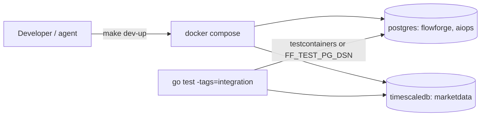

# 01.02 — Local development environment (Compose, databases, test utilities)

## 1. Task Metadata

| Field | Value |
|---|---|
| Task ID | `01.02` |
| Title | Local development environment (Compose, databases, test utilities) |
| Phase | 01 — Foundation |
| Priority | P0 |
| Estimated complexity | Medium |
| Hard dependencies | `01.01` |
| Execution mode | Requires its hard dependencies to be complete first. **Can run in parallel** with: `01.04` (disjoint files/packages; see Context). |
| Requirements covered | NFR-DEV-01, NFR-TEST-02 |

## 2. Context and Reference Files

**Read in this order before coding** (rules: `00C_AGENT_OPERATING_RULES.md` — all rules apply):

```text
Master reference:        00_MASTER_PROJECT_SPEC.md
Architecture reference:  00A_ARCHITECTURE_DECISIONS.md   (especially ADR-013, ADR-019)
Contracts reference:     00E_CONTRACTS_REFERENCE.md
Agent rules:             00C_AGENT_OPERATING_RULES.md
Completion template:     00F_COMPLETION_REPORT_TEMPLATE.md

Previous task (numeric order):
- phase-01-foundation/01.01_repo_toolchain_ci.md   (Repository, toolchain and CI skeleton)

Next task (numeric order):
- phase-01-foundation/01.03_configuration_management.md   (Configuration management)
```

**Dependency relationships (authoritative — numeric order alone does not imply dependency):**

Hard dependencies — review each task file **and** its completion report `docs/implementation-reports/<ID>.md`:

- `phase-01-foundation/01.01_repo_toolchain_ci.md` — Repository, toolchain and CI skeleton

Tasks that depend on this one (do not break their expected inputs):

- `phase-01-foundation/01.03_configuration_management.md` — Configuration management
- `phase-02-workflow-core/02.01_migrations_and_core_schema.md` — Migration framework and core PostgreSQL schema
- `phase-05-kafka-marketdata/05.01_kafka_infra_topics_envelope.md` — Kafka (KRaft) infrastructure, topic bootstrap, event envelope and JSON Schemas
- `phase-06-ai-ops/06.01_ai_service_skeleton_providers.md` — AI service skeleton: FastAPI app, config, provider abstraction with deterministic mocks

Parallel-safe tasks (no dependency relationship; keep edits within your own listed files, wire shared registries only via the additive extension points named in *Technical Design*):

- `phase-01-foundation/01.04_logging_errors_ids_clock_metrics.md` — Cross-cutting foundations: logging, errors, IDs, clock, metrics/health server

Relevant master-spec sections: §3.6, §4, §12.

**Artifacts that should already exist (established by your hard dependencies):**

- (from 01.01) Go module + `Makefile` targets (`lint test test-race test-integration cover-check fmt tidy build`)
- (from 01.01) `.golangci.yml` boundary rules (depguard/forbidigo)
- (from 01.01) CI workflow `go.yml`
- (from 01.01) `docs/decisions/versions.md` convention
- (from 01.01) Blueprint copied at `implementation/` + `original/`
- (from 01.01) `internal/version` package

Verify these exist (build/tests of the repository are green) before starting. If something listed is missing, stop with `BLOCKED:` per `00C §1`.

## 3. Objective

Provide a one-command local environment with the two Postgres-family instances and a reusable Go test harness that provisions real databases (testcontainers or the Compose DBs) for integration tests.

## 4. Detailed Implementation Requirements

- `docker-compose.yml` with services: `postgres` (image `pgvector/pgvector:pg16` — verify tag; creates databases `flowforge` and `aiops` and roles via init SQL in `deploy/docker/postgres-init/`), `timescaledb` (`timescale/timescaledb:latest-pg16` — pin to an explicit version tag; database `marketdata`). Named volumes, healthchecks (`pg_isready`), ports `5432` and `5433`.
- Compose profiles skeleton: `core` (postgres), `streaming` (timescaledb, later kafka), `raft`, `ai`, `ui`, `obs`, `full`. Only populate what exists now; document the intended profile map in `docs/development.md`.
- Makefile targets: `dev-up` (core+streaming DBs, waits for health), `dev-down`, `dev-reset` (drop volumes), `psql`, `psql-md`, `logs`.
- `internal/testutil` package: `NewPostgres(t) *PG` (starts an ephemeral container via testcontainers-go **or** connects to `FF_TEST_PG_DSN` if set; creates a unique database per test; returns DSN + cleanup), `NewTimescale(t)` likewise, `WaitFor(t, cond, timeout)`, `Eventually` helpers, and a `LeakCheck(m)` wrapper around `go.uber.org/goleak`. Integration tests are gated with build tag `integration`.
- `make test-integration` runs `go test -tags=integration ./...` with a 10-minute timeout.
- `.env.example` skeleton with DB DSNs and a comment header explaining it is completed in 01.03.

## 5. Technical Design


- Test DB isolation: each test gets `CREATE DATABASE test_<random>` from a template-less admin connection, dropped on cleanup — so tests run in parallel safely.
- Migrations are *not* applied by `testutil` yet (02.01 adds `testutil.MigrateFlowforge(t, dsn)` hook point; leave a documented function stub `ApplyMigrations(t, dsn, dir)` returning a clear "not yet available" error).
- Credentials are dev-only constants in Compose; never reused elsewhere.

**Design notes / edge cases:**

- If Docker is unavailable in the agent's sandbox, `testutil` constructors must `t.Skip` with a clear message **only** when `FF_TEST_REQUIRE_DOCKER` is unset; CI sets it so skips become failures.
- `pgvector/pgvector` image contains the `vector` extension; the `aiops` init SQL runs `CREATE EXTENSION IF NOT EXISTS vector`.

## 6. Step-by-Step Implementation Instructions

1. Write `deploy/docker/postgres-init/*.sql` creating roles/databases and the vector extension.
2. Write `docker-compose.yml` with healthchecks and profiles; verify `docker compose config`.
3. Add Make targets and verify `make dev-up dev-reset dev-down`.
4. Implement `internal/testutil` (Postgres/Timescale helpers, `Eventually`, goleak wrapper) with testcontainers-go; pin versions in `versions.md`.
5. Write self-tests proving isolated databases and cleanup; add them under the `integration` tag.
6. Write `docs/development.md` (requirements, commands, profile map, troubleshooting).
7. Wire `test-integration` into CI as a separate job (Docker service available on GitHub runners).

## 7. Files to Create or Modify

- docker-compose.yml
- deploy/docker/postgres-init/01-databases.sql
- deploy/docker/postgres-init/02-extensions.sql
- Makefile (modified)
- internal/testutil/{pg.go,timescale.go,eventually.go,leak.go,doc.go}
- internal/testutil/pg_integration_test.go
- .env.example
- docs/development.md
- .github/workflows/go.yml (add integration job)

## 8. Testing Requirements

- Integration: two `NewPostgres` calls in parallel subtests return distinct databases; data written in one is invisible in the other.
- Integration: cleanup drops the database (verify via admin connection).
- Unit: `Eventually` succeeds when condition becomes true, fails with message on timeout (use short durations).
- Smoke: `docker compose --profile core config` and `make dev-up` succeed (documented manual check if CI cannot run it).

General: `make lint` and `make test` must pass; run packages you touched with `-race`; record exact commands and results in the completion report.

## 9. Acceptance Criteria

- [ ] `make dev-up` brings both DB instances healthy; databases `flowforge`, `aiops`, `marketdata` exist; `vector` extension present in `aiops`; `timescaledb` extension available in `marketdata` (verified by `\dx` in the report).
- [ ] `make test-integration` passes locally or in CI.
- [ ] `testutil` helpers documented with examples.
- [ ] Image tags pinned and recorded in `versions.md`.
- [ ] All tests listed in section 8 exist and pass (or non-runnable ones are explicitly reported per 00C §2.13).
- [ ] No regression: full existing test suite passes.
- [ ] No architectural deviation without an ADR amendment and report entry.
- [ ] Completion report written to `docs/implementation-reports/01.02.md`.

## 10. Documentation Requirements

- `docs/development.md`: prerequisites, commands, ports, profile map, how to run integration tests, troubleshooting.
- Update `README.md` quick start.
- Write `docs/implementation-reports/01.02.md` (section 11).

## 11. Completion Report

Create `docs/implementation-reports/01.02.md` from `00F_COMPLETION_REPORT_TEMPLATE.md`. It MUST state: what was implemented; files created/modified; tests executed and their real results; known limitations; architectural decisions made; any deviations from the specification (with ADR amendment reference); confirmation, criterion by criterion, that acceptance criteria were met.

## 12. Handoff Instructions

**Interfaces and contracts this task establishes (record exact final symbol names in your report):**

- `docker-compose.yml` services `postgres`(5432), `timescaledb`(5433) with healthchecks and profiles
- Make targets `dev-up dev-down dev-reset psql psql-md test-integration`
- `internal/testutil`: `NewPostgres`, `NewTimescale`, `Eventually`, `WaitFor`, goleak helper, build tag `integration`
- Connection defaults documented in `.env.example`

**Downstream consumers:** `01.03`, `02.01`, `05.01`, `06.01`. The next agents will read your completion report first.

**Always include in your report's Handoff section:**

- Dependencies introduced (modules/images) and their pinned versions.
- Configuration keys added (also reflected in `.env.example` and `docs/`).
- Outstanding issues, skipped tests and why.
- Files the next agent should inspect before proceeding: the packages listed under *Files to Create or Modify*.
