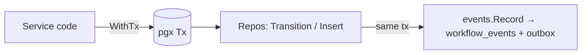

# 02.03 — Persistence layer: repositories, transactions, conditional transitions, event/outbox recording

## 1. Task Metadata

| Field | Value |
|---|---|
| Task ID | `02.03` |
| Title | Persistence layer: repositories, transactions, conditional transitions, event/outbox recording |
| Phase | 02 — Workflow Core (domain, persistence, API, security) |
| Priority | P0 |
| Estimated complexity | Large |
| Hard dependencies | `02.01`, `02.02`, `01.04` |
| Execution mode | Requires its hard dependencies to be complete first. **Run sequentially** (do not run concurrently with other tasks). |
| Requirements covered | FR-WF-01, FR-WF-04, FR-WF-15 |

## 2. Context and Reference Files

**Read in this order before coding** (rules: `00C_AGENT_OPERATING_RULES.md` — all rules apply):

```text
Master reference:        00_MASTER_PROJECT_SPEC.md
Architecture reference:  00A_ARCHITECTURE_DECISIONS.md   (especially ADR-003, ADR-009, ADR-014, ADR-020)
Contracts reference:     00E_CONTRACTS_REFERENCE.md
Agent rules:             00C_AGENT_OPERATING_RULES.md
Completion template:     00F_COMPLETION_REPORT_TEMPLATE.md

Previous task (numeric order):
- phase-02-workflow-core/02.02_domain_model_state_machines_dag.md   (Domain model, state machines and DAG validator (pure logic))

Next task (numeric order):
- phase-02-workflow-core/02.04_rest_api_definitions_runs.md   (REST API: definitions, runs, tasks, OpenAPI contract, idempotent run start)
```

**Dependency relationships (authoritative — numeric order alone does not imply dependency):**

Hard dependencies — review each task file **and** its completion report `docs/implementation-reports/<ID>.md`:

- `phase-02-workflow-core/02.01_migrations_and_core_schema.md` — Migration framework and core PostgreSQL schema
- `phase-02-workflow-core/02.02_domain_model_state_machines_dag.md` — Domain model, state machines and DAG validator (pure logic)
- `phase-01-foundation/01.04_logging_errors_ids_clock_metrics.md` — Cross-cutting foundations: logging, errors, IDs, clock, metrics/health server

Tasks that depend on this one (do not break their expected inputs):

- `phase-02-workflow-core/02.04_rest_api_definitions_runs.md` — REST API: definitions, runs, tasks, OpenAPI contract, idempotent run start
- `phase-03-scheduler-workers/03.02_scheduler_core.md` — Scheduler core: readiness, concurrency limits, run lifecycle loop

Relevant master-spec sections: §4, §3.5, 00E §2–§3.

**Artifacts that should already exist (established by your hard dependencies):**

- (from 02.01) `migrations/flowforge/0001–0004`
- (from 02.01) `internal/persistence/migrate` (`Up`, `Status`, `Version`)
- (from 02.01) `cmd/flowforge-migrate`
- (from 02.01) `testutil.NewFlowforgeDB(t)`, `testutil.ApplyMigrations`
- (from 02.01) `sqlc.yaml` + `internal/persistence/sqlcgen` package
- (from 02.01) Make targets `migrate-up migrate-status sqlc`
- (from 02.02) `internal/workflow/model` (`Definition`, `TaskDef`, `RetryPolicy`, status enums, `Decode`)
- (from 02.02) `internal/dag` (`Validate`, `ValidationIssue` codes, `TopoOrder`, `Ancestors`, `Roots`, `Children`, `ExprValidator` hook)
- (from 02.02) `internal/workflow/statemachine` (`CanTaskTransition`, `DeriveRunStatus`, `EvaluateReadiness`, `NextRetryDelay`, `ExprEvaluator` interface)
- (from 01.04) `internal/logging` (`New`, `FromContext`, `WithFields`, `Redact`)
- (from 01.04) `internal/apperrors` (`Error`, `Code`, constructors, `HTTPStatus`, `GRPCCode`, `FromError`)
- (from 01.04) `internal/ids` (`New`, `Generator`, prefixes)
- (from 01.04) `internal/clock` (`Clock`, `Real`, `Fake`)
- (from 01.04) `internal/obs` (`Registry`, `NewServer`, label allow-list)
- (from 01.04) Lint rules banning raw time/os.Getenv

Verify these exist (build/tests of the repository are green) before starting. If something listed is missing, stop with `BLOCKED:` per `00C §1`.

## 3. Objective

Implement the Postgres access layer used by every control-plane service: transaction manager, repositories for definitions/runs/tasks/attempts/events/cluster-state, **conditional state transitions that enforce the state machine in SQL**, and atomic event + outbox recording on every transition.

## 4. Detailed Implementation Requirements

- `internal/persistence/pg`: pgx v5 pool factory from config, `TxManager.WithTx(ctx, opts, func(tx Tx) error)` with automatic retry (max 3, jittered) on serialization failure (`40001`) and deadlock (`40P01`), context-aware, panics rolled back.
- SQL queries under `internal/persistence/queries/*.sql` (sqlc): definitions (insert, get by id, get by name+version, latest by name, list), runs (insert, get, list with keyset pagination + filters, update status conditional on `(id,status,version)`), tasks (bulk insert, get, list by run, conditional status update, list by run+status), attempts (insert, get, list by task, conditional finish), events (insert), outbox (insert), cluster_state (get, set-if-greater, assert).
- Repository interfaces in `internal/persistence` (`DefinitionRepo, RunRepo, TaskRepo, AttemptRepo, EventRepo, ClusterRepo`) and Postgres implementations; all mutating methods accept a `Querier` (pool or tx).
- **Conditional transitions**: `TaskRepo.Transition(ctx, q, id, from, to, mut TaskMutation) error` executes `UPDATE … SET status=$to, version=version+1, updated_at=now() … WHERE id=$id AND status=$from`; 0 rows → `apperrors.InvalidState` (distinguishing NOT_FOUND by a follow-up read). Rejects illegal `(from,to)` via `statemachine.CanTaskTransition` *before* hitting SQL. Same for runs and attempts.
- **Event recording**: `events.Record(q, Event)` inserts a `workflow_events` row and an `outbox` row (topic/key from event type per `00E §7`; envelope JSON per `00E §7`) — called *inside the same transaction* by every transition helper. `internal/events` package defines event constructors/types for all event types in `00E §7` with payload structs.
- `ClusterRepo`: `GetEpoch`, `SetEpochIfGreater(epoch, leaderID)`, `AssertEpoch(ctx, tx, epoch)` (does `SELECT epoch FROM cluster_state WHERE id=1 FOR SHARE`; returns `apperrors.NotLeader`/`StaleEpoch` if mismatch). Epoch 0 means unfenced single-scheduler mode.
- `RunRepo.CreateWithTasks(ctx, tx, run, tasks)` creates a run and all PENDING task rows (task rows derived from the definition: dependencies, retry policy JSON, timeout, config) and records `run.created` event — in one transaction.

## 5. Technical Design


**Locking/isolation policy:** default `READ COMMITTED`; correctness is by *conditional UPDATE* + unique constraints, not by high isolation. Scheduler/claim code that needs row locks uses `FOR UPDATE SKIP LOCKED` explicitly in its own queries (03.01/03.02).

**Transition helper contract** (used by all later tasks; do not bypass):
```go
type TaskTransitionParams struct {
  TaskID string; From, To model.TaskStatus
  Mutate func(*TaskMutation)   // set result, attempt_count++, available_at, input, etc.
  Event *events.Event          // optional extra/primary event; default derived from (From,To)
}
func (r *TaskRepo) Transition(ctx context.Context, q Querier, p TaskTransitionParams) error
```
Event key for Kafka is `run_id` (ordering per run). `occurred_at` uses the injected clock; `correlation_id` = run id unless a request id is in context.

**Design notes / edge cases:**

- Keyset pagination: `(created_at DESC, id DESC)` with opaque cursor encoding; tests with > 2 pages and equal timestamps.
- `input`/`result` JSONB size limits enforced at API/worker layers; repo does not silently truncate.
- Never store secrets in events; `events` constructors accept only typed payloads.

## 6. Step-by-Step Implementation Instructions

1. Write sqlc queries and regenerate; ensure `make sqlc` clean.
2. Implement `TxManager` with retry semantics; unit-test with a fake `Tx` for retry/rollback and integration-test real serialization failure.
3. Implement repositories and conditional transition helpers with state-machine pre-checks.
4. Implement `internal/events` types and `Record` writing both tables; unit-test envelope against `00E §7` JSON shape.
5. Implement `CreateWithTasks` and read models (`RunView`, `TaskView` for statemachine functions).
6. Write integration tests (below) including concurrency races; run with `-race`.

## 7. Files to Create or Modify

- internal/persistence/pg/{pool.go,tx.go}
- internal/persistence/{repos.go,definition_repo.go,run_repo.go,task_repo.go,attempt_repo.go,event_repo.go,cluster_repo.go,views.go,cursor.go}
- internal/persistence/queries/*.sql
- internal/persistence/sqlcgen/** (generated)
- internal/events/{events.go,types.go,envelope.go}
- tests (unit + integration)
- docs/architecture/persistence.md

## 8. Testing Requirements

- Integration: create definition; duplicate `(name,version)` → CONFLICT; latest-by-name returns highest version.
- Integration: `CreateWithTasks` produces run + N PENDING tasks + exactly one `run.created` event and one outbox row, atomically (inject failure after tasks insert → nothing persisted).
- Integration (race): 20 goroutines attempt `Transition(READY→QUEUED)` on one task → exactly one succeeds, 19 get INVALID_STATE; exactly one event recorded.
- Integration: illegal transition (`SUCCEEDED→RUNNING`) rejected before SQL (no DB write, error INVALID_STATE).
- Integration: `AssertEpoch` passes for matching epoch, fails after `SetEpochIfGreater(5)`; `SetEpochIfGreater(3)` after 5 is a no-op.
- Integration: keyset pagination over 250 runs with identical `created_at` returns every row once in order.
- Unit: TxManager retries on 40001 up to 3 times then surfaces error; rolls back on panic.

General: `make lint` and `make test` must pass; run packages you touched with `-race`; record exact commands and results in the completion report.

## 9. Acceptance Criteria

- [ ] All repositories implemented with conditional transitions; no code path updates `status` outside `Transition` helpers.
- [ ] Every transition records event + outbox in the same transaction (verified by failure-injection test).
- [ ] Race test demonstrates exactly-one-winner semantics.
- [ ] Epoch fencing helpers exist and are tested.
- [ ] sqlc output committed and drift-free.
- [ ] All tests listed in section 8 exist and pass (or non-runnable ones are explicitly reported per 00C §2.13).
- [ ] No regression: full existing test suite passes.
- [ ] No architectural deviation without an ADR amendment and report entry.
- [ ] Completion report written to `docs/implementation-reports/02.03.md`.

## 10. Documentation Requirements

- `docs/architecture/persistence.md`: transaction/locking policy, transition helper contract, event/outbox recording rules, how later tasks must use the repos.
- Write `docs/implementation-reports/02.03.md` (section 11).

## 11. Completion Report

Create `docs/implementation-reports/02.03.md` from `00F_COMPLETION_REPORT_TEMPLATE.md`. It MUST state: what was implemented; files created/modified; tests executed and their real results; known limitations; architectural decisions made; any deviations from the specification (with ADR amendment reference); confirmation, criterion by criterion, that acceptance criteria were met.

## 12. Handoff Instructions

**Interfaces and contracts this task establishes (record exact final symbol names in your report):**

- `internal/persistence` repo interfaces + `pg` implementation
- `persistence.TxManager.WithTx`
- `TaskRepo/RunRepo/AttemptRepo.Transition…` conditional helpers
- `events.Record` + typed event constructors (all `00E §7` event types)
- `ClusterRepo.{GetEpoch,SetEpochIfGreater,AssertEpoch}`
- `RunRepo.CreateWithTasks`
- `RunView/TaskView` read models, keyset cursor utilities

**Downstream consumers:** `02.04`, `03.02`. The next agents will read your completion report first.

**Always include in your report's Handoff section:**

- Dependencies introduced (modules/images) and their pinned versions.
- Configuration keys added (also reflected in `.env.example` and `docs/`).
- Outstanding issues, skipped tests and why.
- Files the next agent should inspect before proceeding: the packages listed under *Files to Create or Modify*.
