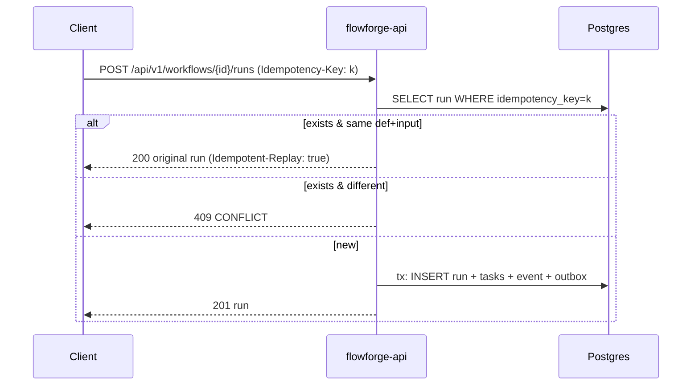

# 02.04 — REST API: definitions, runs, tasks, OpenAPI contract, idempotent run start

## 1. Task Metadata

| Field | Value |
|---|---|
| Task ID | `02.04` |
| Title | REST API: definitions, runs, tasks, OpenAPI contract, idempotent run start |
| Phase | 02 — Workflow Core (domain, persistence, API, security) |
| Priority | P0 |
| Estimated complexity | Large |
| Hard dependencies | `02.03`, `01.03`, `01.04` |
| Execution mode | Requires its hard dependencies to be complete first. **Run sequentially** (do not run concurrently with other tasks). |
| Requirements covered | FR-WF-01, FR-WF-03, FR-WF-13, FR-API-01, FR-API-02, FR-API-03, FR-API-04, FR-API-05, FR-SEC-05 |

## 2. Context and Reference Files

**Read in this order before coding** (rules: `00C_AGENT_OPERATING_RULES.md` — all rules apply):

```text
Master reference:        00_MASTER_PROJECT_SPEC.md
Architecture reference:  00A_ARCHITECTURE_DECISIONS.md   (especially ADR-014, ADR-015, ADR-017)
Contracts reference:     00E_CONTRACTS_REFERENCE.md
Agent rules:             00C_AGENT_OPERATING_RULES.md
Completion template:     00F_COMPLETION_REPORT_TEMPLATE.md

Previous task (numeric order):
- phase-02-workflow-core/02.03_repository_layer.md   (Persistence layer: repositories, transactions, conditional transitions, event/outbox recording)

Next task (numeric order):
- phase-02-workflow-core/02.05_authn_authz_audit.md   (Authentication, RBAC authorization, audit log, rate limiting)
```

**Dependency relationships (authoritative — numeric order alone does not imply dependency):**

Hard dependencies — review each task file **and** its completion report `docs/implementation-reports/<ID>.md`:

- `phase-02-workflow-core/02.03_repository_layer.md` — Persistence layer: repositories, transactions, conditional transitions, event/outbox recording
- `phase-01-foundation/01.03_configuration_management.md` — Configuration management
- `phase-01-foundation/01.04_logging_errors_ids_clock_metrics.md` — Cross-cutting foundations: logging, errors, IDs, clock, metrics/health server

Tasks that depend on this one (do not break their expected inputs):

- `phase-02-workflow-core/02.05_authn_authz_audit.md` — Authentication, RBAC authorization, audit log, rate limiting
- `phase-07-dashboard/07.01_ui_shell_runs_sse.md` — Dashboard shell: auth, navigation, definitions, runs and SSE live updates

Relevant master-spec sections: §5.2, 00E §4, §9.

**Artifacts that should already exist (established by your hard dependencies):**

- (from 02.03) `internal/persistence` repo interfaces + `pg` implementation
- (from 02.03) `persistence.TxManager.WithTx`
- (from 02.03) `TaskRepo/RunRepo/AttemptRepo.Transition…` conditional helpers
- (from 02.03) `events.Record` + typed event constructors (all `00E §7` event types)
- (from 02.03) `ClusterRepo.{GetEpoch,SetEpochIfGreater,AssertEpoch}`
- (from 02.03) `RunRepo.CreateWithTasks`
- (from 02.03) `RunView/TaskView` read models, keyset cursor utilities
- (from 01.03) `internal/config`: `Load[T]`, `Options`, `Secret`, `ValidationError`, service config structs
- (from 01.03) Complete `.env.example`
- (from 01.03) Lint rule banning `os.Getenv` in `internal/**`
- (from 01.04) `internal/logging` (`New`, `FromContext`, `WithFields`, `Redact`)
- (from 01.04) `internal/apperrors` (`Error`, `Code`, constructors, `HTTPStatus`, `GRPCCode`, `FromError`)
- (from 01.04) `internal/ids` (`New`, `Generator`, prefixes)
- (from 01.04) `internal/clock` (`Clock`, `Real`, `Fake`)
- (from 01.04) `internal/obs` (`Registry`, `NewServer`, label allow-list)
- (from 01.04) Lint rules banning raw time/os.Getenv

Verify these exist (build/tests of the repository are green) before starting. If something listed is missing, stop with `BLOCKED:` per `00C §1`.

## 3. Objective

Deliver `flowforge-api`: the REST surface for workflow definitions and runs (read paths for tasks/attempts/events too), the error envelope, pagination, request limits, health/readiness, the OpenAPI 3.1 contract with route-drift checking, and idempotent run creation.

## 4. Detailed Implementation Requirements

- `cmd/flowforge-api/main.go`: config, logger, pg pool, schema-version check (refuse to start if behind), HTTP server with graceful shutdown (SIGTERM drain), obs server for `/metrics`.
- `internal/api/rest`: chi router; middleware chain `RequestID → Recover → Logging → BodyLimit(1 MiB) → Timeout(30 s, SSE exempt) → Auth(stub) → handler`; error writer producing the envelope from `apperrors` (`00E §4`) with `request_id`.
- Endpoints (see `00E §9`): `POST/GET /api/v1/workflows`, `GET /api/v1/workflows/{id}`, `GET /api/v1/workflows/by-name/{name}`, `POST /api/v1/workflows/{id}/runs`, `GET /api/v1/runs`, `GET /api/v1/runs/{run_id}`, `GET /api/v1/runs/{run_id}/tasks`, `GET /api/v1/runs/{run_id}/events`, `GET /api/v1/tasks/{task_id}`, `GET /api/v1/tasks/{task_id}/attempts`, `GET /healthz`, `GET /readyz` (DB reachable + schema current), `GET /openapi.json`. (cancel/pause/resume/retry/rerun: 03.05/03.06; workers/cluster: 03.01/04.06; attempts logs: 03.01; triggers: 03.08; approvals/investigations: 06.06; marketdata: 05.09; api-keys: 02.05; SSE: 03.07.)
- Definition creation: decode strictly, run `dag.Validate`, return `422 INVALID_WORKFLOW` with `details[]` (issue code, task id, message); definition size limit 512 KiB; immutable once created; duplicate `(name,version)` → `409 CONFLICT`; omitted version → next version for the name.
- Run start: validates input is JSON object ≤ 256 KiB; creates run + tasks via `CreateWithTasks`; honors header `Idempotency-Key` (≤ 128 chars): if a run with that key exists **and** same definition + equal input → `200` with the original run and header `Idempotent-Replay: true`; same key with different definition/input → `409 CONFLICT`. (Keys are nulled by the retention job after 24 h — task 03.07.)
- Pagination: `limit` default 50 max 200, opaque `cursor`; list filters per `00E §9`; response `{items, next_cursor}`.
- `api/openapi/flowforge.v1.yaml` (OpenAPI 3.1) authored for all routes implemented so far, including schemas, error envelope, security scheme `ApiKeyAuth` (header `Authorization: Bearer ff_…`). `GET /openapi.json` serves it.
- `make openapi-check`: (1) validates the spec (kin-openapi or `vacuum/redocly`), (2) walks the chi router and fails if any registered route lacks an OpenAPI operation or vice-versa, (3) contract tests validate real responses against the spec.
- Auth is a stub: interface `auth.Authenticator` with dev implementation controlled by `FF_AUTH_DISABLED=true` (rejected when `FF_ENV=prod`); real implementation arrives in 02.05 without changing handlers (handlers read `auth.PrincipalFrom(ctx)`).

## 5. Technical Design


Race on identical concurrent idempotent requests: rely on the unique index; the loser catches the unique violation and re-reads (returns replay or 409).

Error envelope & status mapping come from `apperrors.HTTPStatus`. Handlers contain no SQL and no business rules beyond input validation: they call a `service` layer (`internal/api/service`: `Workflows`, `Runs`) so later tasks (cron, AI actions) reuse "start run" logic: `RunService.Start(ctx, StartRunParams{DefinitionID, Input, IdempotencyKey, TriggerID, ParentRunID, Actor})`.

**Design notes / edge cases:**

- Return `Location` headers on 201.
- `Retry-After` on 503 when DB down.
- Do not leak SQL errors; unknown errors → INTERNAL with request_id only.
- Run `created_by` = principal key id (or `dev` when auth disabled).

## 6. Step-by-Step Implementation Instructions

1. Create `internal/api/service` (workflows, runs) with unit tests against fakes of repositories.
2. Implement router, middleware, error writer; add `RequestID` propagation into logging context.
3. Implement handlers + pagination; implement idempotency logic with race handling.
4. Write the OpenAPI document; implement `/openapi.json` and `make openapi-check` (route/spec parity + response validation).
5. Implement `main.go` with graceful shutdown and schema-version check.
6. Write integration tests with real Postgres and `httptest` server; write contract tests.

## 7. Files to Create or Modify

- cmd/flowforge-api/main.go
- internal/api/rest/{router.go,middleware.go,errors.go,pagination.go,workflows.go,runs.go,tasks.go,health.go,openapi.go}
- internal/api/service/{workflows.go,runs.go}
- internal/api/auth/{auth.go,stub.go}
- api/openapi/flowforge.v1.yaml
- scripts/dev/openapi-check (Go test or tool)
- Makefile (modify: openapi-check)
- tests
- docs/api/README.md

## 8. Testing Requirements

- Contract: every response of every implemented endpoint (success + each error code) validates against the OpenAPI schema.
- Route parity test: router routes == OpenAPI operations.
- Definition validation via HTTP: cycle → 422 with `details[].code=CYCLE`; duplicate task ids; unknown field → 400; oversize body → 413.
- Idempotency: same key twice → one run, second response `Idempotent-Replay: true`; same key different input → 409; 20 concurrent identical requests → exactly one run row.
- Pagination: 120 runs, `limit=50` → three pages, no duplicates/omissions; `limit=1000` clamped to 200.
- Readiness: DB stopped → `/readyz` 503 with `Retry-After`; `/healthz` stays 200.
- Startup refuses when migrations are behind.
- Graceful shutdown: in-flight request completes after SIGTERM.

General: `make lint` and `make test` must pass; run packages you touched with `-race`; record exact commands and results in the completion report.

## 9. Acceptance Criteria

- [ ] All listed endpoints implemented and covered by contract tests.
- [ ] Error envelope identical across all failures; `request_id` present and logged.
- [ ] OpenAPI parity check passes in CI (`make openapi-check`).
- [ ] Idempotent run start behaves exactly as specified under concurrency.
- [ ] No SQL in handlers; service layer reusable (`RunService.Start`).
- [ ] All tests listed in section 8 exist and pass (or non-runnable ones are explicitly reported per 00C §2.13).
- [ ] No regression: full existing test suite passes.
- [ ] No architectural deviation without an ADR amendment and report entry.
- [ ] Completion report written to `docs/implementation-reports/02.04.md`.

## 10. Documentation Requirements

- `docs/api/README.md`: authentication (stub now), error envelope, pagination, idempotency, examples with `curl` for creating the `market-data-hourly` example definition (use the JSON from `00E §3.5`).
- Update README quick start (run API, create a definition).
- Write `docs/implementation-reports/02.04.md` (section 11).

## 11. Completion Report

Create `docs/implementation-reports/02.04.md` from `00F_COMPLETION_REPORT_TEMPLATE.md`. It MUST state: what was implemented; files created/modified; tests executed and their real results; known limitations; architectural decisions made; any deviations from the specification (with ADR amendment reference); confirmation, criterion by criterion, that acceptance criteria were met.

## 12. Handoff Instructions

**Interfaces and contracts this task establishes (record exact final symbol names in your report):**

- `flowforge-api` binary (`cmd/flowforge-api`)
- `internal/api/rest` router + middleware + error writer
- `internal/api/service.RunService.Start`, `WorkflowService`
- `internal/api/auth.Authenticator` interface + `PrincipalFrom(ctx)`
- `api/openapi/flowforge.v1.yaml` + `make openapi-check`
- Pagination/cursor conventions

**Downstream consumers:** `02.05`, `07.01`. The next agents will read your completion report first.

**Always include in your report's Handoff section:**

- Dependencies introduced (modules/images) and their pinned versions.
- Configuration keys added (also reflected in `.env.example` and `docs/`).
- Outstanding issues, skipped tests and why.
- Files the next agent should inspect before proceeding: the packages listed under *Files to Create or Modify*.
