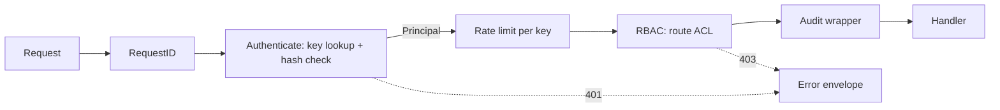

# 02.05 — Authentication, RBAC authorization, audit log, rate limiting

## 1. Task Metadata

| Field | Value |
|---|---|
| Task ID | `02.05` |
| Title | Authentication, RBAC authorization, audit log, rate limiting |
| Phase | 02 — Workflow Core (domain, persistence, API, security) |
| Priority | P0 |
| Estimated complexity | Medium |
| Hard dependencies | `02.04` |
| Execution mode | Requires its hard dependencies to be complete first. **Run sequentially** (do not run concurrently with other tasks). |
| Requirements covered | FR-SEC-01, FR-SEC-02, FR-SEC-03, FR-SEC-05 |

## 2. Context and Reference Files

**Read in this order before coding** (rules: `00C_AGENT_OPERATING_RULES.md` — all rules apply):

```text
Master reference:        00_MASTER_PROJECT_SPEC.md
Architecture reference:  00A_ARCHITECTURE_DECISIONS.md   (especially ADR-015)
Contracts reference:     00E_CONTRACTS_REFERENCE.md
Agent rules:             00C_AGENT_OPERATING_RULES.md
Completion template:     00F_COMPLETION_REPORT_TEMPLATE.md

Previous task (numeric order):
- phase-02-workflow-core/02.04_rest_api_definitions_runs.md   (REST API: definitions, runs, tasks, OpenAPI contract, idempotent run start)

Next task (numeric order):
- phase-03-scheduler-workers/03.01_worker_grpc_protocol_service.md   (Worker gRPC protocol and WorkerService (claim, heartbeat, complete, fail, logs))
```

**Dependency relationships (authoritative — numeric order alone does not imply dependency):**

Hard dependencies — review each task file **and** its completion report `docs/implementation-reports/<ID>.md`:

- `phase-02-workflow-core/02.04_rest_api_definitions_runs.md` — REST API: definitions, runs, tasks, OpenAPI contract, idempotent run start

Tasks that depend on this one (do not break their expected inputs):

- `phase-03-scheduler-workers/03.01_worker_grpc_protocol_service.md` — Worker gRPC protocol and WorkerService (claim, heartbeat, complete, fail, logs)
- `phase-03-scheduler-workers/03.08_cron_triggers.md` — Cron triggers (scheduled runs)
- `phase-05-kafka-marketdata/05.09_marketdata_api_monitoring_quality.md` — Market-data analytics API, pipeline monitoring and data-quality check
- `phase-06-ai-ops/06.02_internal_read_api.md` — FlowForge internal read-only API and `ai-readonly` role
- `phase-07-dashboard/07.01_ui_shell_runs_sse.md` — Dashboard shell: auth, navigation, definitions, runs and SSE live updates

Relevant master-spec sections: §5.3, 00E §2, §9.

**Artifacts that should already exist (established by your hard dependencies):**

- (from 02.04) `flowforge-api` binary (`cmd/flowforge-api`)
- (from 02.04) `internal/api/rest` router + middleware + error writer
- (from 02.04) `internal/api/service.RunService.Start`, `WorkflowService`
- (from 02.04) `internal/api/auth.Authenticator` interface + `PrincipalFrom(ctx)`
- (from 02.04) `api/openapi/flowforge.v1.yaml` + `make openapi-check`
- (from 02.04) Pagination/cursor conventions

Verify these exist (build/tests of the repository are green) before starting. If something listed is missing, stop with `BLOCKED:` per `00C §1`.

## 3. Objective

Replace the auth stub with API-key authentication, role-based authorization over every route, audit logging of all mutations, per-key rate limiting, and admin API-key management. Also expose the reusable token verifier used by gRPC services.

## 4. Detailed Implementation Requirements

- Key format `ff_<keyid>_<secret>`: `keyid` = 12 base32 chars, `secret` = 32 random bytes base64url. Store `salt` (16 bytes) and `secret_hash = SHA-256(salt‖secret)`; compare with `subtle.ConstantTimeCompare`. Secret returned **once** at creation.
- Bootstrap: on API start, if no admin key exists and `FF_ADMIN_BOOTSTRAP_KEY` is set (format-valid), insert it as role `admin` (idempotent). In `dev`, if unset, generate one and log it **once** at WARN with redaction exemption flag (documented).
- `internal/api/auth`: `Authenticator` implementation (`Authorization: Bearer …`), `Principal{KeyID, Name, Role}`, expiry/revocation checks, small LRU cache (TTL 30 s) of key lookups (invalidated on revoke), `VerifyToken(ctx, token) (Principal, error)` reusable by gRPC interceptors (03.01).
- RBAC: role order `viewer < operator < admin`; service roles `worker` and `ai-readonly` valid **only** for their route groups. Route table `internal/api/rest/routes_acl.go` maps each route+method → minimum role per `00E §9`; middleware enforces; unknown route defaults to admin-only. Test generates the matrix from the router.
- Audit: middleware records every non-GET request (and any denied request) into `audit_log` (actor, role, action=`METHOD route`, resource ids from path, request_id, outcome `ok|denied|error`, details with redacted body summary — **never** secrets or full bodies). **Decision:** an audit-write failure logs at ERROR and increments `flowforge_audit_write_failures_total`, but the request still proceeds (availability over audit completeness); this trade-off is documented in `docs/api/authentication.md`.
- Endpoints: `POST/GET/DELETE /api/v1/api-keys` (admin) — create (returns secret once), list (no secrets), revoke.
- Per-key rate limiting: token bucket (config `FF_API_RATE_LIMIT_RPS` default 50, burst 100) → `429 RATE_LIMITED` with `Retry-After`; health endpoints exempt; `ai-readonly` and `worker` have separate higher defaults.
- Update OpenAPI: security scheme, `401/403/429` responses, api-keys routes.

## 5. Technical Design


ACL source of truth is code + the table in `00E §9`; a test fails if a route has no ACL entry. `FF_AUTH_DISABLED` remains available only in `dev`/`test` and logs a loud WARN at startup.

**Design notes / edge cases:**

- Do not log keys or hashes; use key id only.
- Timing: unknown key id path must perform a dummy hash comparison to avoid user-enumeration timing differences.
- Keys cannot elevate their own role; admin cannot delete the last active admin key (409).

## 6. Step-by-Step Implementation Instructions

1. Implement key generation/hash/verify with unit tests (format, constant-time compare, tamper).
2. Implement repository queries for `api_keys` and `audit_log` (sqlc) and the cache.
3. Implement authenticator + middleware; remove `FF_AUTH_DISABLED` default (dev only).
4. Implement ACL table + RBAC middleware; generate and test the role×route matrix.
5. Implement audit middleware/recorder and API-key endpoints.
6. Implement rate limiter; update OpenAPI; run `make openapi-check`.

## 7. Files to Create or Modify

- internal/api/auth/{keys.go,authenticator.go,cache.go,principal.go,bootstrap.go}
- internal/api/rest/{routes_acl.go,rbac.go,audit.go,ratelimit.go,apikeys.go}
- internal/persistence/queries/{api_keys.sql,audit.sql}
- api/openapi/flowforge.v1.yaml (modify)
- tests
- docs/api/authentication.md

## 8. Testing Requirements

- Unit: generated key format; hash verification; tampered secret rejected; dummy-compare path for unknown id.
- Integration: missing/invalid/expired/revoked key → 401 with envelope; revoked key stops working within cache TTL (and immediately after explicit invalidation).
- Matrix test: for each (role × route × method) expected allow/deny equals the ACL table; unknown route → admin only.
- Integration: mutation writes audit row (actor, action, resource, outcome); denied request writes `denied`; bodies/secrets absent from audit details.
- Integration: creating a key returns secret once; listing never returns secrets; deleting last admin → 409.
- Rate limit: burst exceeded → 429 with `Retry-After`; health exempt; separate buckets per key.
- Bootstrap idempotency: starting twice doesn't create duplicate admin.

General: `make lint` and `make test` must pass; run packages you touched with `-race`; record exact commands and results in the completion report.

## 9. Acceptance Criteria

- [ ] Every route requires auth except health/openapi/metrics (network-restricted); verified by test.
- [ ] RBAC matrix test green for all routes registered so far; adding a route without an ACL entry fails CI.
- [ ] Audit row exists for every mutation; no secrets in audit/log output.
- [ ] `Authenticator.VerifyToken` usable outside HTTP (documented, unit-tested) for gRPC.
- [ ] OpenAPI updated and parity check passes.
- [ ] All tests listed in section 8 exist and pass (or non-runnable ones are explicitly reported per 00C §2.13).
- [ ] No regression: full existing test suite passes.
- [ ] No architectural deviation without an ADR amendment and report entry.
- [ ] Completion report written to `docs/implementation-reports/02.05.md`.

## 10. Documentation Requirements

- `docs/api/authentication.md`: key lifecycle, roles table, bootstrap, rate limits, audit semantics, security notes (what is NOT covered: OIDC, key rotation automation).
- Write `docs/implementation-reports/02.05.md` (section 11).

## 11. Completion Report

Create `docs/implementation-reports/02.05.md` from `00F_COMPLETION_REPORT_TEMPLATE.md`. It MUST state: what was implemented; files created/modified; tests executed and their real results; known limitations; architectural decisions made; any deviations from the specification (with ADR amendment reference); confirmation, criterion by criterion, that acceptance criteria were met.

## 12. Handoff Instructions

**Interfaces and contracts this task establishes (record exact final symbol names in your report):**

- `auth.Authenticator` (HTTP middleware + `VerifyToken`)
- `Principal` in context; roles `viewer|operator|admin|worker|ai-readonly`
- `routes_acl.go` ACL table + matrix test hook (every new route must register its ACL)
- Audit recorder `audit.Record(ctx, …)`
- API-key admin endpoints
- Rate limiter middleware

**Downstream consumers:** `03.01`, `03.08`, `05.09`, `06.02`, `07.01`. The next agents will read your completion report first.

**Always include in your report's Handoff section:**

- Dependencies introduced (modules/images) and their pinned versions.
- Configuration keys added (also reflected in `.env.example` and `docs/`).
- Outstanding issues, skipped tests and why.
- Files the next agent should inspect before proceeding: the packages listed under *Files to Create or Modify*.
