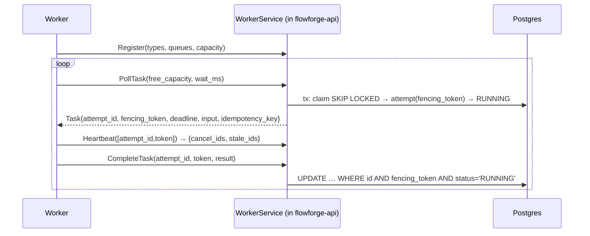

# 03.01 — Worker gRPC protocol and WorkerService (claim, heartbeat, complete, fail, logs)

## 1. Task Metadata

| Field | Value |
|---|---|
| Task ID | `03.01` |
| Title | Worker gRPC protocol and WorkerService (claim, heartbeat, complete, fail, logs) |
| Phase | 03 — Scheduler, Workers and Durable Execution |
| Priority | P0 |
| Estimated complexity | Large |
| Hard dependencies | `02.05` |
| Execution mode | Requires its hard dependencies to be complete first. **Can run in parallel** with: `03.02` (disjoint files/packages; see Context). |
| Requirements covered | FR-WF-06, FR-WF-13, FR-WF-16, FR-SEC-04, FR-API-01 |

## 2. Context and Reference Files

**Read in this order before coding** (rules: `00C_AGENT_OPERATING_RULES.md` — all rules apply):

```text
Master reference:        00_MASTER_PROJECT_SPEC.md
Architecture reference:  00A_ARCHITECTURE_DECISIONS.md   (especially ADR-003, ADR-004, ADR-007, ADR-021)
Contracts reference:     00E_CONTRACTS_REFERENCE.md
Agent rules:             00C_AGENT_OPERATING_RULES.md
Completion template:     00F_COMPLETION_REPORT_TEMPLATE.md

Previous task (numeric order):
- phase-02-workflow-core/02.05_authn_authz_audit.md   (Authentication, RBAC authorization, audit log, rate limiting)

Next task (numeric order):
- phase-03-scheduler-workers/03.02_scheduler_core.md   (Scheduler core: readiness, concurrency limits, run lifecycle loop)
```

**Dependency relationships (authoritative — numeric order alone does not imply dependency):**

Hard dependencies — review each task file **and** its completion report `docs/implementation-reports/<ID>.md`:

- `phase-02-workflow-core/02.05_authn_authz_audit.md` — Authentication, RBAC authorization, audit log, rate limiting

Tasks that depend on this one (do not break their expected inputs):

- `phase-03-scheduler-workers/03.03_worker_runtime.md` — Worker runtime and handler SDK

Parallel-safe tasks (no dependency relationship; keep edits within your own listed files, wire shared registries only via the additive extension points named in *Technical Design*):

- `phase-03-scheduler-workers/03.02_scheduler_core.md` — Scheduler core: readiness, concurrency limits, run lifecycle loop

Relevant master-spec sections: §3.3, §3.4, §5.1, 00E §8.

**Artifacts that should already exist (established by your hard dependencies):**

- (from 02.05) `auth.Authenticator` (HTTP middleware + `VerifyToken`)
- (from 02.05) `Principal` in context; roles `viewer|operator|admin|worker|ai-readonly`
- (from 02.05) `routes_acl.go` ACL table + matrix test hook (every new route must register its ACL)
- (from 02.05) Audit recorder `audit.Record(ctx, …)`
- (from 02.05) API-key admin endpoints
- (from 02.05) Rate limiter middleware

Verify these exist (build/tests of the repository are green) before starting. If something listed is missing, stop with `BLOCKED:` per `00C §1`.

## 3. Objective

Define the worker protocol (`proto/worker/v1`) and implement the server side inside `flowforge-api`: authenticated gRPC with atomic task claiming, fencing-token-checked completion/failure, heartbeats, log shipping and worker listing. Establish the seams later tasks plug into (`OutcomeHandler`, `LeaseProvider`, `CancelSource`).

## 4. Detailed Implementation Requirements

- `proto/worker/v1/worker.proto` per `00E §8` (+ `buf.yaml`, `buf.gen.yaml`, `make proto`, CI drift check, `buf lint`/`buf breaking`). Generated Go in `internal/gen/proto/worker/v1`.
- gRPC server in `flowforge-api` on `FF_API_GRPC_ADDR`: unary+stream interceptors for request-id, logging, panic recovery, metrics, and **auth** (`authorization: Bearer ff_…` verified with `auth.VerifyToken`; only role `worker` allowed; others → PERMISSION_DENIED).
- `internal/workerapi.Service` implementing: `Register` (validates task types/queues/capacity, upserts `worker_observations`, calls `LeaseProvider.Register`), `Heartbeat`, `PollTask`, `CompleteTask`, `FailTask`, `ShipLogs`, `Deregister`.
- **PollTask claim** (single transaction): `SELECT … FROM workflow_tasks WHERE status='QUEUED' AND task_type = ANY($types) AND queue_name = ANY($queues) AND available_at <= $now ORDER BY available_at, created_at FOR UPDATE SKIP LOCKED LIMIT $free`; for each: insert `task_attempts` (attempt_number = attempt_count+1, `deadline_at = now + timeout_seconds`, idempotency key `task_id:attempt_number`, fencing token from sequence default), `QUEUED→RUNNING` via the conditional `Transition` helper (increments `attempt_count`, records `task.started`/`task.attempt.started` events). Run must not be `PAUSED`/cancel-requested (claim query joins `workflow_runs`).
- Long-poll: if nothing is claimable wait up to `wait_ms` (≤ 30 000, default 10 000) waking on Postgres `LISTEN ff_task_queued` (dedicated connection; fallback poll every 1 s); return empty response on timeout. Honor client cancellation.
- **CompleteTask / FailTask**: `UPDATE task_attempts SET … WHERE id=$1 AND fencing_token=$2 AND status='RUNNING'`; zero rows → gRPC `FAILED_PRECONDITION` with `apperrors.StaleAttempt` detail and increment `flowforge_stale_attempt_rejections_total`. Result JSON ≤ 256 KiB (else `PAYLOAD_TOO_LARGE`, attempt recorded as FAILED non-retryable `RESULT_TOO_LARGE`). After a valid report call `OutcomeHandler.OnAttemptFinished(ctx, tx, AttemptOutcome)` inside the same transaction. Default `TerminalOutcomeHandler`: success → task SUCCEEDED; failure → task FAILED (no retries — 03.04 replaces it).
- **Heartbeat**: for each listed `(attempt_id, fencing_token)` that is still RUNNING update `last_heartbeat_at`; update worker `last_seen_at`; call `LeaseProvider.Renew`; response `{cancel_attempt_ids (from CancelSource), lease_ttl_ms, server_time}`. Unknown/stale attempts are returned in `stale_attempt_ids` so the worker aborts them.
- **ShipLogs** (client-streaming): validate token for each line's attempt; redact via `logging.Redact`; cap 1000 lines/attempt and 8 KiB/line (truncate with `…[truncated]`; when the line cap is hit insert one final WARN line `log limit reached` and drop the rest); batch insert (≤ 100/tx).
- REST additions (viewer): `GET /api/v1/workers`, `GET /api/v1/attempts/{attempt_id}/logs?after_id=&limit=`; update OpenAPI + ACL table.
- Seams (interfaces in `internal/workerapi`): `OutcomeHandler`, `LeaseProvider` (`Register, Renew, Release, Expired(ctx) ([]WorkerID, error), Alive(ctx) ([]WorkerInfo, error)`) with **Postgres implementation** (`worker_observations.last_seen_at`, expiry = `last_seen_at < now - FF_WORKER_LEASE_TTL`), `CancelSource` (`CancelledAttempts(ctx, attemptIDs) ([]string, error)`; default returns none).

## 5. Technical Design


Claim guarantees: (1) a task is claimed by at most one poller (row lock), (2) only task types and queues the worker advertised, (3) a worker never receives more than `free_capacity` tasks per poll, (4) paused/cancelled runs are never claimed.

`AttemptOutcome{Attempt, Task, Kind: Succeeded|Failed|TimedOut|Abandoned|Cancelled, ErrorCode, Message, Retryable, Result}`. All fencing decisions are made in SQL; the Go layer never checks-then-writes.

**Design notes / edge cases:**

- gRPC max message 4 MiB; reject larger.
- `PollTask` must not hold a DB connection while waiting (listen on a dedicated conn, claim in a short tx).
- Worker ids are client-chosen but must match `^[a-z0-9][a-z0-9-]{2,62}$`; duplicate live registration of the same id by a different token key id → `CONFLICT`.
- Time comparisons use the API process `clock.Clock` passed as SQL params (ADR-021).

## 6. Step-by-Step Implementation Instructions

1. Author `worker.proto`, configure buf, generate code, add Make targets and CI drift check.
2. Implement auth interceptor using `auth.VerifyToken`; test unauthenticated/wrong-role rejection.
3. Implement claim query + attempt creation (sqlc or hand SQL), `LISTEN/NOTIFY` waker.
4. Implement Complete/Fail with fencing in SQL and the `OutcomeHandler` seam + default handler.
5. Implement Heartbeat, Register/Deregister, `LeaseProvider` PG implementation.
6. Implement `ShipLogs` and log limits; REST read endpoints; OpenAPI/ACL updates.
7. Write integration tests using a Go gRPC client against an in-process server + testcontainers Postgres; run `-race`.

## 7. Files to Create or Modify

- proto/worker/v1/worker.proto
- buf.yaml
- buf.gen.yaml
- internal/gen/proto/worker/v1/** (generated)
- internal/workerapi/{service.go,claim.go,complete.go,heartbeat.go,logs.go,seams.go,lease_pg.go,listener.go}
- internal/workerapi/interceptors.go
- internal/api/rest/{workers.go,attempt_logs.go}
- internal/persistence/queries/{claim.sql,workers.sql,logs.sql}
- cmd/flowforge-api/main.go (modify: start gRPC)
- api/openapi/flowforge.v1.yaml (modify)
- tests
- docs/architecture/worker-protocol.md

## 8. Testing Requirements

- Claim race: 100 QUEUED tasks, 50 concurrent pollers (`free_capacity=3`) → every task claimed exactly once; no attempt duplicates; sum of claimed == 100.
- Routing: worker advertising `{typeA}` never receives `typeB`; queue filter honored; paused run's tasks not claimed; cancel-requested run's tasks not claimed.
- Fencing: Complete with wrong token → FAILED_PRECONDITION (STALE_ATTEMPT); Complete twice → second rejected; Complete after attempt status changed to ABANDONED/TIMED_OUT (simulated) → rejected; stale counter increments.
- Long-poll: returns within 200 ms of a task becoming QUEUED (NOTIFY); returns empty at `wait_ms`; client cancel unblocks.
- Heartbeat: updates `last_heartbeat_at`; returns `stale_attempt_ids` for non-RUNNING attempts; `CancelSource` stub injected returns cancel ids.
- ShipLogs: redaction applied; per-line truncation; 1001st line produces the single limit marker; unauthorized attempt id rejected.
- Auth: no token / non-worker role → UNAUTHENTICATED / PERMISSION_DENIED.
- Result size: 256 KiB + 1 → handled as specified.

General: `make lint` and `make test` must pass; run packages you touched with `-race`; record exact commands and results in the completion report.

## 9. Acceptance Criteria

- [ ] `make proto` is reproducible; `buf lint` clean; generated code committed.
- [ ] Claim race test proves exactly-once claiming; stale-token rejection verified at SQL level.
- [ ] Seams `OutcomeHandler`, `LeaseProvider`, `CancelSource` exist with documented contracts and default implementations.
- [ ] REST workers/logs endpoints implemented, in OpenAPI and ACL table.
- [ ] `docs/architecture/worker-protocol.md` documents semantics, error codes, and stale-attempt handling.
- [ ] All tests listed in section 8 exist and pass (or non-runnable ones are explicitly reported per 00C §2.13).
- [ ] No regression: full existing test suite passes.
- [ ] No architectural deviation without an ADR amendment and report entry.
- [ ] Completion report written to `docs/implementation-reports/03.01.md`.

## 10. Documentation Requirements

- `docs/architecture/worker-protocol.md`: protocol walkthrough, claim guarantees, fencing, heartbeat semantics, log limits, seam interfaces.
- Write `docs/implementation-reports/03.01.md` (section 11).

## 11. Completion Report

Create `docs/implementation-reports/03.01.md` from `00F_COMPLETION_REPORT_TEMPLATE.md`. It MUST state: what was implemented; files created/modified; tests executed and their real results; known limitations; architectural decisions made; any deviations from the specification (with ADR amendment reference); confirmation, criterion by criterion, that acceptance criteria were met.

## 12. Handoff Instructions

**Interfaces and contracts this task establishes (record exact final symbol names in your report):**

- `proto/worker/v1` + generated Go (`internal/gen/proto/worker/v1`)
- `internal/workerapi.Service` hosted by `flowforge-api` gRPC
- Seams: `OutcomeHandler`, `LeaseProvider` (+ PG impl), `CancelSource`
- Claim SQL + `LISTEN ff_task_queued` waker
- Make targets `proto`; buf drift check
- REST `GET /api/v1/workers`, `GET /api/v1/attempts/{id}/logs`

**Downstream consumers:** `03.03`. The next agents will read your completion report first.

**Always include in your report's Handoff section:**

- Dependencies introduced (modules/images) and their pinned versions.
- Configuration keys added (also reflected in `.env.example` and `docs/`).
- Outstanding issues, skipped tests and why.
- Files the next agent should inspect before proceeding: the packages listed under *Files to Create or Modify*.
