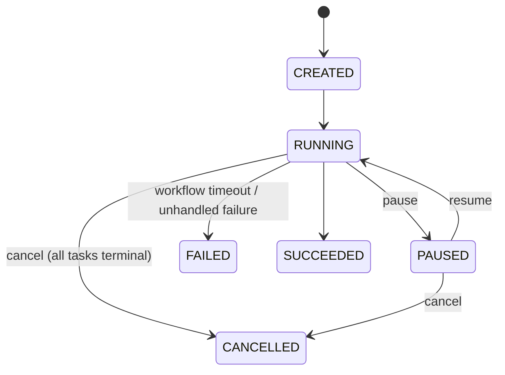

# 03.05 — Run cancellation, pause/resume and workflow-level timeout

## 1. Task Metadata

| Field | Value |
|---|---|
| Task ID | `03.05` |
| Title | Run cancellation, pause/resume and workflow-level timeout |
| Phase | 03 — Scheduler, Workers and Durable Execution |
| Priority | P0 |
| Estimated complexity | Medium |
| Hard dependencies | `03.04` |
| Execution mode | Requires its hard dependencies to be complete first. **Run sequentially** (do not run concurrently with other tasks). |
| Requirements covered | FR-WF-10, FR-WF-08, FR-API-01 |

## 2. Context and Reference Files

**Read in this order before coding** (rules: `00C_AGENT_OPERATING_RULES.md` — all rules apply):

```text
Master reference:        00_MASTER_PROJECT_SPEC.md
Architecture reference:  00A_ARCHITECTURE_DECISIONS.md   (especially ADR-007, ADR-020)
Contracts reference:     00E_CONTRACTS_REFERENCE.md
Agent rules:             00C_AGENT_OPERATING_RULES.md
Completion template:     00F_COMPLETION_REPORT_TEMPLATE.md

Previous task (numeric order):
- phase-03-scheduler-workers/03.04_retry_timeout_recovery.md   (Retries, timeouts, worker-loss recovery and crash-consistent loops)

Next task (numeric order):
- phase-03-scheduler-workers/03.06_results_templating_conditionals_rerun.md   (Task result passing, templating, conditional tasks, rerun/remediation)
```

**Dependency relationships (authoritative — numeric order alone does not imply dependency):**

Hard dependencies — review each task file **and** its completion report `docs/implementation-reports/<ID>.md`:

- `phase-03-scheduler-workers/03.04_retry_timeout_recovery.md` — Retries, timeouts, worker-loss recovery and crash-consistent loops

Tasks that depend on this one (do not break their expected inputs):

- `phase-03-scheduler-workers/03.06_results_templating_conditionals_rerun.md` — Task result passing, templating, conditional tasks, rerun/remediation
- `phase-03-scheduler-workers/03.09_workflow_engine_e2e_gate.md` — Phase gate: flowforgectl CLI and workflow-engine end-to-end/crash-recovery suite

Relevant master-spec sections: §5.1, 00E §3.3.

**Artifacts that should already exist (established by your hard dependencies):**

- (from 03.04) `RetryOutcomeHandler` (installed as default `OutcomeHandler`)
- (from 03.04) `internal/recovery.Loop` (consumes `LeaseProvider`)
- (from 03.04) `scheduler.TimeoutLoop`
- (from 03.04) Failpoint harness (`-tags failpoint`, `FF_FAILPOINTS`)
- (from 03.04) DB invariant checker `testutil.AssertInvariants(t, db)`
- (from 03.04) Metric `flowforge_loop_errors_total{loop}`

Verify these exist (build/tests of the repository are green) before starting. If something listed is missing, stop with `BLOCKED:` per `00C §1`.

## 3. Objective

Add run-level control: cooperative and forced cancellation, pause/resume, and the workflow deadline, including propagation of cancel signals to running workers through heartbeats.

## 4. Detailed Implementation Requirements

- REST (operator): `POST /api/v1/runs/{run_id}/cancel[?force=true]`, `…/pause`, `…/resume`. Valid source states per `00E §3.3` (cancel from CREATED/RUNNING/PAUSED/NEEDS_ATTENTION; pause from RUNNING; resume from PAUSED); otherwise `409 INVALID_STATE`. All idempotent (repeat returns current state). Update OpenAPI/ACL; audit via existing middleware.
- Cancel semantic: set `cancel_requested=true`; scheduler transitions every non-RUNNING, non-terminal head task to `CANCELLED` (PENDING/READY/QUEUED/RETRY_WAIT); RUNNING tasks are cancelled **cooperatively**: `CancelSource` implementation returns their attempt ids in heartbeat responses; worker reports `CANCELLED` → attempt CANCELLED + task CANCELLED. Grace timer `FF_CANCEL_GRACE` (default 30 s) after which the scheduler force-cancels remaining RUNNING attempts (attempt `CANCELLED`, task `CANCELLED`; late worker results then rejected by fencing). `force=true` skips the grace. When all head tasks are terminal the run becomes `CANCELLED` (event `run.cancelled`).
- Pause: run `RUNNING→PAUSED`; scheduler stops READY→QUEUED promotions and `RETRY_WAIT→QUEUED` for that run; PollTask never claims its tasks (already filtered in 03.01); running attempts continue; their completions are processed normally. Resume `PAUSED→RUNNING` and wakes the scheduler.
- Workflow timeout: at run start set `deadline_at = started_at + definition.timeout_seconds` (if defined). `TimeoutLoop` extension: runs past deadline → force-cancel remaining tasks and set run `FAILED` with event payload `reason=WORKFLOW_TIMEOUT`.
- Make `RetryOutcomeHandler` treat outcomes for cancel-requested runs as `CANCELLED` (guarded seam from 03.04); `CancelSource` default replaced by the real implementation (join on runs with `cancel_requested`).

## 5. Technical Design


Cancel flow for a RUNNING task: API sets flag → next worker heartbeat contains the attempt id → worker cancels handler → `FailTask(CANCELLED)` → server marks attempt `CANCELLED` and task `CANCELLED` (not retried). If a worker is dead/unresponsive the recovery loop abandons the attempt; because the run is cancel-requested the outcome handler cancels instead of retrying.

All state changes go through conditional transition helpers; API handlers call `RunService.Cancel/Pause/Resume` (service layer) so AI-approved actions (06.06) reuse them.

**Design notes / edge cases:**

- Pause does not pause timeouts (deadlines keep running) — document.
- Cancelling a run that has an in-flight `AI_INVESTIGATION` task works the same (handler must honor ctx).
- Resume of a run whose workflow deadline already passed → next timeout tick fails it (documented behavior).

## 6. Step-by-Step Implementation Instructions

1. Add service methods + REST handlers + OpenAPI/ACL.
2. Extend scheduler `processRun` for cancel propagation and pause gating.
3. Implement `CancelSource` and grace/force logic.
4. Implement deadline setting and timeout enforcement.
5. Write tests; update docs.

## 7. Files to Create or Modify

- internal/api/service/runs.go (modify)
- internal/api/rest/runs.go (modify)
- internal/scheduler/{process_run.go,loop_timeout.go,cancel.go} (modify/add)
- internal/workerapi/cancel_source.go
- api/openapi/flowforge.v1.yaml (modify)
- tests
- docs/architecture/run-control.md

## 8. Testing Requirements

- Integration: cancel run with PENDING/READY/QUEUED tasks → all CANCELLED, run CANCELLED, no attempts created afterwards.
- Integration: cancel with a running `sleep` task → worker handler ctx cancelled within 2 heartbeat intervals; attempt+task CANCELLED; run CANCELLED.
- Integration: unresponsive worker (heartbeats stopped) + cancel → forced after grace (fake clock) ; late completion rejected.
- Pause: running attempt completes normally; no new task claimed while PAUSED; resume continues to success.
- Workflow timeout: run with `timeout_seconds=5` and a 60 s task → run FAILED with `WORKFLOW_TIMEOUT`, task CANCELLED.
- Idempotency/validation: double cancel OK; cancel of SUCCEEDED run → 409; pause of PAUSED → 200 no-op; resume of RUNNING → 409.
- RBAC: viewer → 403 on all three endpoints.

General: `make lint` and `make test` must pass; run packages you touched with `-race`; record exact commands and results in the completion report.

## 9. Acceptance Criteria

- [ ] Cancel, pause, resume endpoints implemented, documented in OpenAPI, ACL-protected, audited.
- [ ] Cancel observed by running worker within 2 heartbeat intervals (test measures).
- [ ] Forced cancel works with unresponsive workers and fencing blocks late results.
- [ ] Workflow timeout enforced and recorded in events.
- [ ] All tests listed in section 8 exist and pass (or non-runnable ones are explicitly reported per 00C §2.13).
- [ ] No regression: full existing test suite passes.
- [ ] No architectural deviation without an ADR amendment and report entry.
- [ ] Completion report written to `docs/implementation-reports/03.05.md`.

## 10. Documentation Requirements

- `docs/architecture/run-control.md`: state diagram, cancel/pause/timeout semantics and caveats.
- Write `docs/implementation-reports/03.05.md` (section 11).

## 11. Completion Report

Create `docs/implementation-reports/03.05.md` from `00F_COMPLETION_REPORT_TEMPLATE.md`. It MUST state: what was implemented; files created/modified; tests executed and their real results; known limitations; architectural decisions made; any deviations from the specification (with ADR amendment reference); confirmation, criterion by criterion, that acceptance criteria were met.

## 12. Handoff Instructions

**Interfaces and contracts this task establishes (record exact final symbol names in your report):**

- `RunService.{Cancel,Pause,Resume}`
- REST `cancel|pause|resume`
- Real `CancelSource` implementation
- Workflow deadline enforcement in `TimeoutLoop`
- Config `FF_CANCEL_GRACE`

**Downstream consumers:** `03.06`, `03.09`. The next agents will read your completion report first.

**Always include in your report's Handoff section:**

- Dependencies introduced (modules/images) and their pinned versions.
- Configuration keys added (also reflected in `.env.example` and `docs/`).
- Outstanding issues, skipped tests and why.
- Files the next agent should inspect before proceeding: the packages listed under *Files to Create or Modify*.
