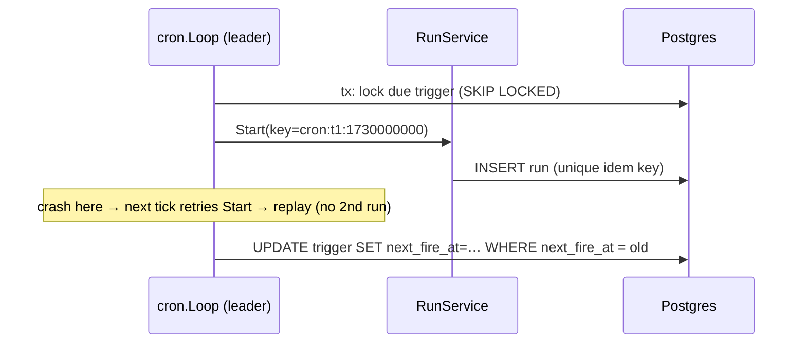

# 03.08 — Cron triggers (scheduled runs)

## 1. Task Metadata

| Field | Value |
|---|---|
| Task ID | `03.08` |
| Title | Cron triggers (scheduled runs) |
| Phase | 03 — Scheduler, Workers and Durable Execution |
| Priority | P1 |
| Estimated complexity | Medium |
| Hard dependencies | `03.02`, `02.05` |
| Execution mode | Requires its hard dependencies to be complete first. **Can run in parallel** with: `03.07` (disjoint files/packages; see Context). |
| Requirements covered | FR-WF-14, FR-API-01 |

## 2. Context and Reference Files

**Read in this order before coding** (rules: `00C_AGENT_OPERATING_RULES.md` — all rules apply):

```text
Master reference:        00_MASTER_PROJECT_SPEC.md
Architecture reference:  00A_ARCHITECTURE_DECISIONS.md   (especially ADR-007)
Contracts reference:     00E_CONTRACTS_REFERENCE.md
Agent rules:             00C_AGENT_OPERATING_RULES.md
Completion template:     00F_COMPLETION_REPORT_TEMPLATE.md

Previous task (numeric order):
- phase-03-scheduler-workers/03.07_events_outbox_sse_retention.md   (Event relay (outbox), SSE stream and retention jobs)

Next task (numeric order):
- phase-03-scheduler-workers/03.09_workflow_engine_e2e_gate.md   (Phase gate: flowforgectl CLI and workflow-engine end-to-end/crash-recovery suite)
```

**Dependency relationships (authoritative — numeric order alone does not imply dependency):**

Hard dependencies — review each task file **and** its completion report `docs/implementation-reports/<ID>.md`:

- `phase-03-scheduler-workers/03.02_scheduler_core.md` — Scheduler core: readiness, concurrency limits, run lifecycle loop
- `phase-02-workflow-core/02.05_authn_authz_audit.md` — Authentication, RBAC authorization, audit log, rate limiting

Tasks that depend on this one (do not break their expected inputs):

- `phase-03-scheduler-workers/03.09_workflow_engine_e2e_gate.md` — Phase gate: flowforgectl CLI and workflow-engine end-to-end/crash-recovery suite

Parallel-safe tasks (no dependency relationship; keep edits within your own listed files, wire shared registries only via the additive extension points named in *Technical Design*):

- `phase-03-scheduler-workers/03.07_events_outbox_sse_retention.md` — Event relay (outbox), SSE stream and retention jobs

Relevant master-spec sections: §2 R12, 00E §2 (cron_triggers).

**Artifacts that should already exist (established by your hard dependencies):**

- (from 03.02) `cmd/flowforge-scheduler`
- (from 03.02) `internal/scheduler`: `Gate`, `AlwaysLeader`, `Loop`, `Runner` (+ `RegisterLoop` extension point)
- (from 03.02) `InputResolver` seam (identity default)
- (from 03.02) Head-task query + `NOTIFY ff_scheduler_wake`
- (from 03.02) Scheduler metrics
- (from 02.05) `auth.Authenticator` (HTTP middleware + `VerifyToken`)
- (from 02.05) `Principal` in context; roles `viewer|operator|admin|worker|ai-readonly`
- (from 02.05) `routes_acl.go` ACL table + matrix test hook (every new route must register its ACL)
- (from 02.05) Audit recorder `audit.Record(ctx, …)`
- (from 02.05) API-key admin endpoints
- (from 02.05) Rate limiter middleware

Verify these exist (build/tests of the repository are green) before starting. If something listed is missing, stop with `BLOCKED:` per `00C §1`.

## 3. Objective

Allow workflows to be started on a schedule with exactly-once firing semantics across leader changes, using the idempotent run-start path.

## 4. Detailed Implementation Requirements

- `internal/cron`: parse standard 5-field cron expressions plus optional timezone using `robfig/cron/v3` **parser only**; `NextFire(spec, tz, after time.Time) (time.Time, error)`; minimum interval 1 minute; timezone via IANA name; DST rules documented (spring-forward skipped times fire at next valid time; fall-back repeats do not double fire).
- `cron.Loop` (leader-gated, tick 5 s): `SELECT … FROM cron_triggers WHERE enabled AND next_fire_at <= $now ORDER BY next_fire_at FOR UPDATE SKIP LOCKED LIMIT 50`; for each trigger compute `fire_time = next_fire_at`; if `now - fire_time > FF_CRON_MISSED_GRACE` (default 60 s) apply `missed_policy`: `skip` (advance to next future time, record event) or `catch_up_one` (fire once now for the oldest missed time, then advance). Otherwise fire: `RunService.Start(...)` with `IdempotencyKey = "cron:<trigger_id>:<fire_time_unix>"`, `TriggerID`, resolving workflow latest version if `workflow_version` is null; then in a tx set `last_fired_at` and `next_fire_at` (conditional on the old `next_fire_at`).
- REST: `POST /api/v1/triggers` (admin), `GET /api/v1/triggers` & `/{id}` (viewer), `PATCH /api/v1/triggers/{id}` (enable/disable/schedule/input; admin), `DELETE` (admin). Validation: workflow exists, schedule parses, timezone valid, input is object. `next_fire_at` computed on create/enable/schedule change. OpenAPI/ACL updates; audit automatically.
- Events: `trigger.fired|trigger.skipped` appended to `workflow_events`? **No** — triggers are not runs; record in `audit_log` with actor `system:cron` and as structured logs; the run itself carries `trigger_id`.
- Metrics `flowforge_cron_fires_total{outcome}`.

## 5. Technical Design

Exactly-once firing argument: the *fire identity* is `(trigger_id, fire_time)`. `RunService.Start` is idempotent on `cron:<id>:<ts>`, so even if two leaders (or a restarted leader) both attempt the same fire, only one run is created; the loser observes `Idempotent-Replay` and simply advances `next_fire_at`. The conditional update on `next_fire_at` prevents double advancement.



**Design notes / edge cases:**

- Because `idempotency_key` is nulled after 24 h (03.07), `catch_up_one` of very old fires could duplicate — cap catch-up age at 24 h (older ⇒ skip) and document.
- Time math uses `clock.Clock`; tests use `Fake`.

## 6. Step-by-Step Implementation Instructions

1. Implement parsing/`NextFire` with DST tests.
2. Implement `cron.Loop` and conditional advance logic.
3. Implement REST endpoints, validation, OpenAPI/ACL.
4. Write integration tests with fake clock and two concurrent loops; update docs.

## 7. Files to Create or Modify

- internal/cron/{schedule.go,loop.go,metrics.go}
- internal/api/rest/triggers.go
- internal/api/service/triggers.go
- internal/persistence/queries/triggers.sql
- cmd/flowforge-scheduler/main.go (modify: register loop via RegisterLoop in `wire_cron.go`)
- api/openapi/flowforge.v1.yaml (modify)
- tests
- docs/architecture/cron.md

## 8. Testing Requirements

- Schedule: `*/5 * * * *`, `0 9 * * 1-5` with `America/New_York`; spring-forward (2027-03-14 02:30 doesn't exist) and fall-back (2026-11-01 01:30 occurs twice) fire expectations; invalid specs/timezones rejected; < 1 min interval rejected.
- Integration (fake clock): 10 minutes advance with `* * * * *` → exactly 10 runs, each with distinct idempotency key and `trigger_id`.
- Two loops running concurrently against the same DB → still exactly one run per fire.
- Crash between `Start` and advance (failpoint) → no duplicate; trigger advances after restart.
- Missed policy: 10-minute outage → `skip` fires none and advances; `catch_up_one` fires exactly one.
- API: RBAC (viewer cannot create), validation errors (422/400), disable stops firing, update schedule recomputes `next_fire_at`.

General: `make lint` and `make test` must pass; run packages you touched with `-race`; record exact commands and results in the completion report.

## 9. Acceptance Criteria

- [ ] Cron firing is exactly-once across concurrent/failed-over loops (tests prove).
- [ ] Missed-fire policies and DST behavior documented and tested.
- [ ] Trigger CRUD API in OpenAPI + ACL, audited.
- [ ] All tests listed in section 8 exist and pass (or non-runnable ones are explicitly reported per 00C §2.13).
- [ ] No regression: full existing test suite passes.
- [ ] No architectural deviation without an ADR amendment and report entry.
- [ ] Completion report written to `docs/implementation-reports/03.08.md`.

## 10. Documentation Requirements

- `docs/architecture/cron.md`: firing algorithm, idempotency argument, missed-fire and DST policies, limits.
- Write `docs/implementation-reports/03.08.md` (section 11).

## 11. Completion Report

Create `docs/implementation-reports/03.08.md` from `00F_COMPLETION_REPORT_TEMPLATE.md`. It MUST state: what was implemented; files created/modified; tests executed and their real results; known limitations; architectural decisions made; any deviations from the specification (with ADR amendment reference); confirmation, criterion by criterion, that acceptance criteria were met.

## 12. Handoff Instructions

**Interfaces and contracts this task establishes (record exact final symbol names in your report):**

- `internal/cron.Loop`, `cron.NextFire`
- REST `/api/v1/triggers`
- `RunService.Start` usage with cron idempotency keys
- Config `FF_CRON_MISSED_GRACE`

**Downstream consumers:** `03.09`. The next agents will read your completion report first.

**Always include in your report's Handoff section:**

- Dependencies introduced (modules/images) and their pinned versions.
- Configuration keys added (also reflected in `.env.example` and `docs/`).
- Outstanding issues, skipped tests and why.
- Files the next agent should inspect before proceeding: the packages listed under *Files to Create or Modify*.
