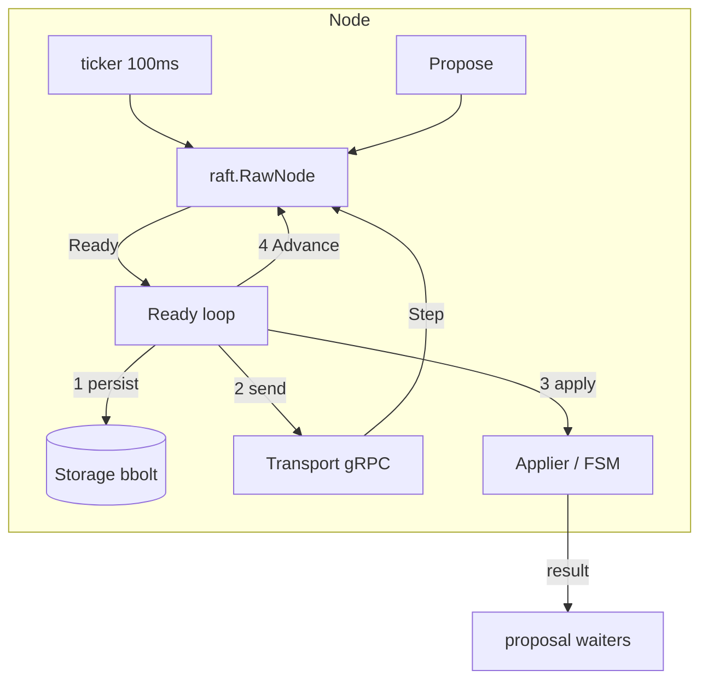

# 04.02 — Raft node core: Ready loop, transport, proposals, membership (static)

## 1. Task Metadata

| Field | Value |
|---|---|
| Task ID | `04.02` |
| Title | Raft node core: Ready loop, transport, proposals, membership (static) |
| Phase | 04 — Raft-backed Coordination |
| Priority | P0 |
| Estimated complexity | Large |
| Hard dependencies | `04.01` |
| Execution mode | Requires its hard dependencies to be complete first. **Can run in parallel** with: `04.03` (disjoint files/packages; see Context). |
| Requirements covered | FR-RAFT-01, FR-RAFT-11 |

## 2. Context and Reference Files

**Read in this order before coding** (rules: `00C_AGENT_OPERATING_RULES.md` — all rules apply):

```text
Master reference:        00_MASTER_PROJECT_SPEC.md
Architecture reference:  00A_ARCHITECTURE_DECISIONS.md   (especially ADR-002, ADR-005, ADR-019)
Contracts reference:     00E_CONTRACTS_REFERENCE.md
Agent rules:             00C_AGENT_OPERATING_RULES.md
Completion template:     00F_COMPLETION_REPORT_TEMPLATE.md

Previous task (numeric order):
- phase-04-raft-coordination/04.01_raftkv_proto_storage.md   (Raft KV foundations: protobuf contracts and durable storage (WAL, hard state, snapshots))

Next task (numeric order):
- phase-04-raft-coordination/04.03_kv_state_machine_snapshots.md   (Deterministic KV state machine: CAS/Txn, leases, counters, dedupe, snapshots)
```

**Dependency relationships (authoritative — numeric order alone does not imply dependency):**

Hard dependencies — review each task file **and** its completion report `docs/implementation-reports/<ID>.md`:

- `phase-04-raft-coordination/04.01_raftkv_proto_storage.md` — Raft KV foundations: protobuf contracts and durable storage (WAL, hard state, snapshots)

Tasks that depend on this one (do not break their expected inputs):

- `phase-04-raft-coordination/04.04_kv_grpc_server_reads_client.md` — KV gRPC server, linearizable reads, leader redirect and Go client

Parallel-safe tasks (no dependency relationship; keep edits within your own listed files, wire shared registries only via the additive extension points named in *Technical Design*):

- `phase-04-raft-coordination/04.03_kv_state_machine_snapshots.md` — Deterministic KV state machine: CAS/Txn, leases, counters, dedupe, snapshots

Relevant master-spec sections: §5.4, 00E §5.3.

**Artifacts that should already exist (established by your hard dependencies):**

- (from 04.01) `proto/coordination/v1` KV/Cluster/RaftPeer + generated Go
- (from 04.01) `internal/raftkv/storage.Storage` (+ `Bolt`, `Mem` impls, `storagetest` suite)
- (from 04.01) Verified Raft library import path recorded in `versions.md`

Verify these exist (build/tests of the repository are green) before starting. If something listed is missing, stop with `BLOCKED:` per `00C §1`.

## 3. Objective

Implement the Raft node runtime on top of the etcd Raft library: the Ready/Advance loop honoring the persistence contract, a gRPC streaming peer transport, proposal handling with completion futures, leader/term tracking, static three-voter membership, and in-process fault-injecting transport for tests. The state machine is plugged in via an interface (implemented in 04.03).

## 4. Detailed Implementation Requirements

- `internal/raftkv/node`: `Node` wrapping `raft.RawNode`/`raft.Node` (choose `raft.StartNode` or `RawNode` — document the choice) with config (`ID, Peers, ElectionTick=10, HeartbeatTick=1, TickInterval=100ms, PreVote=true, CheckQuorum=true, MaxSizePerMsg=1MiB, MaxInflightMsgs=256, SnapshotEntries, SnapshotTrailing=1000`), `Storage` (04.01) and `Applier` interface (`Apply(entry []byte, index uint64) (result []byte, err error)`, `Snapshot() ([]byte, error)`, `Restore([]byte) error`).
- **Ready loop** exactly per contract: `rd := <-node.Ready()` → (leader may send messages in parallel with persist per library docs; follow the documented rules) persist `HardState/Entries/Snapshot` → send messages (to peers) → apply `CommittedEntries` (normal entries to `Applier`; `ConfChange` entries to `ApplyConfChange`) → `Advance()`. Track `applied` index; persist applied index in storage meta.
- Proposals: `Propose(ctx, data) (Result, error)` assigns a unique proposal id embedded in the entry; waiter map completes when the entry is **applied** (returns applier result) or fails (`ErrNotLeader{leader hint}`, `ErrNoQuorum` when `CheckQuorum` demotes/proposal dropped, `ErrTimeout`, `ErrNodeStopped`). Followers reject proposals with `NotLeader` (+ leader id/addr hint from config). Proposals dropped by raft (`ErrProposalDropped`) surface as retriable errors.
- `ReadIndex(ctx) (index uint64, error)` helper using `node.ReadIndex` and waiting until `applied >= index` (used by 04.04 for linearizable reads).
- Transport `internal/raftkv/transport`: gRPC `RaftPeer.Stream` client/server pool with per-peer outbound queue (bounded 4096; drop + `ReportUnreachable` on overflow), reconnection backoff, `ReportSnapshot` status feedback, snapshot chunk streaming, optional TLS config (wired in 09.01).
- `FaultTransport` wrapper (build-tag free, used only in tests/chaos): per-link drop, delay, duplicate, reorder, partition sets, with a deterministic seeded mode.
- Static membership: initial `ConfState` of 3 voters from config (`FF_RAFT_PEERS`), bootstrapped identically on first start (`raft.StartNode(cfg, peers)` or snapshot confstate); node refuses to start with peer list that differs from persisted conf state. Dynamic changes are *not* implemented (optional FR-RAFT-11) but `ApplyConfChange` must be wired so the code path exists for future work.
- Metrics `flowforge_raft_{is_leader,term,commit_index,applied_index,proposals_pending,peer_unreachable,write_duration_seconds}` (update/extend in 04.06).

## 5. Technical Design


Rules that MUST hold (write a test for each):
1. Entries/HardState are durable before any message that depends on them is sent (for followers) — implement the conservative order persist→send→apply for all roles.
2. Committed entries are applied exactly once, in log order, never beyond what is committed.
3. A proposal's waiter completes only after the entry is *applied* locally (so a leader read-after-write is consistent).
4. `CheckQuorum` + `PreVote` on: a partitioned leader steps down; a rejoining isolated node doesn't disrupt the cluster with higher terms.
5. After restart, the node resumes from storage (hard state, log, applied index, snapshot) and re-applies committed-but-unapplied entries idempotently (applier must tolerate re-delivery of entries ≤ persisted applied index? **No**: the node must skip applying entries ≤ `applied` stored with the FSM state; see 04.03 for atomic applied-index persistence).

**Design notes / edge cases:**

- Use the library's own `raft.Config.Logger` adapter to our slog logger; keep library at WARN by default.
- Ticks must use `clock.Clock`-style abstraction **only** in tests: provide `Ticker` injection so tests can drive ticks deterministically (a `ManualTicker`).
- Message size/`MaxInflightMsgs` limits protect against slow followers; verify memory stays bounded when a peer is down.

## 6. Step-by-Step Implementation Instructions

1. Wrap the library; define config and `Applier` interface; implement Ready loop with the documented contract.
2. Implement proposal tracking and `ReadIndex`.
3. Implement gRPC streaming transport, snapshot chunking and the `FaultTransport`.
4. Implement static bootstrap and conf-state validation.
5. Write a 3-node **in-process cluster test harness** (`nodetest.Cluster`) with manual ticks and FaultTransport, using an in-memory Applier that records applied entries.
6. Write the tests below; run with `-race`; run each randomized test with ≥ 20 seeds.

## 7. Files to Create or Modify

- internal/raftkv/node/{node.go,config.go,ready.go,propose.go,readindex.go,applier.go,metrics.go,errors.go}
- internal/raftkv/transport/{grpc.go,peer.go,fault.go,snapshot.go}
- internal/raftkv/nodetest/cluster.go
- tests
- docs/architecture/raft-node.md

## 8. Testing Requirements

- Election: 3-node cluster elects exactly one leader; term stable; leader known by all.
- Replication: 1 000 proposals on leader → all three Appliers observe identical ordered sequences.
- Leader kill (stop node): new leader elected within 5 election timeouts; proposals continue; old node restarted (from storage) rejoins and catches up.
- Follower proposal → `NotLeader` with correct hint; proposal during leader loss times out/fails with documented error; no applied-but-failed ambiguity (waiter semantic).
- No quorum: 2 of 3 stopped → proposals do not complete (`NO_QUORUM`/timeout) and **nothing is applied** on the survivor.
- Partition (FaultTransport): isolate leader alone → majority elects new leader and commits; isolated old leader (CheckQuorum) steps down and its proposals fail; after heal the old leader's uncommitted entries are discarded and logs converge.
- Persistence/restart: stop/start all nodes → state preserved, no re-application beyond stored applied index (counting Applier).
- Random chaos (seeded, 20 seeds): random drops/delays/duplicates/partitions with continuous proposals; invariants: applied sequences are prefixes of one another at all times and equal after healing.
- Slow peer: outbound queue overflow triggers `ReportUnreachable`; memory bounded.

General: `make lint` and `make test` must pass; run packages you touched with `-race`; record exact commands and results in the completion report.

## 9. Acceptance Criteria

- [ ] Ready loop follows the persist→send→apply→advance contract (tests demonstrate durability ordering via an instrumented storage).
- [ ] All election/replication/partition/restart tests pass across ≥ 20 seeds without flakes.
- [ ] Proposal waiters complete only after apply; failure modes mapped to typed errors.
- [ ] Static 3-voter bootstrap validated; conf-change path wired (even if unused).
- [ ] All tests listed in section 8 exist and pass (or non-runnable ones are explicitly reported per 00C §2.13).
- [ ] No regression: full existing test suite passes.
- [ ] No architectural deviation without an ADR amendment and report entry.
- [ ] Completion report written to `docs/implementation-reports/04.02.md`.

## 10. Documentation Requirements

- `docs/architecture/raft-node.md`: Ready-loop contract, proposal lifecycle, ReadIndex, transport, failure semantics, test harness usage, limitations (no dynamic membership).
- Write `docs/implementation-reports/04.02.md` (section 11).

## 11. Completion Report

Create `docs/implementation-reports/04.02.md` from `00F_COMPLETION_REPORT_TEMPLATE.md`. It MUST state: what was implemented; files created/modified; tests executed and their real results; known limitations; architectural decisions made; any deviations from the specification (with ADR amendment reference); confirmation, criterion by criterion, that acceptance criteria were met.

## 12. Handoff Instructions

**Interfaces and contracts this task establishes (record exact final symbol names in your report):**

- `internal/raftkv/node.Node` (`Start`, `Propose`, `ReadIndex`, `Status`, `Stop`)
- `Applier` interface (FSM plug-in point)
- `internal/raftkv/transport` gRPC streaming + `FaultTransport`
- `nodetest.Cluster` harness (manual ticks, partitions)
- Typed errors `ErrNotLeader`, `ErrNoQuorum`, `ErrProposalTimeout`

**Downstream consumers:** `04.04`. The next agents will read your completion report first.

**Always include in your report's Handoff section:**

- Dependencies introduced (modules/images) and their pinned versions.
- Configuration keys added (also reflected in `.env.example` and `docs/`).
- Outstanding issues, skipped tests and why.
- Files the next agent should inspect before proceeding: the packages listed under *Files to Create or Modify*.
