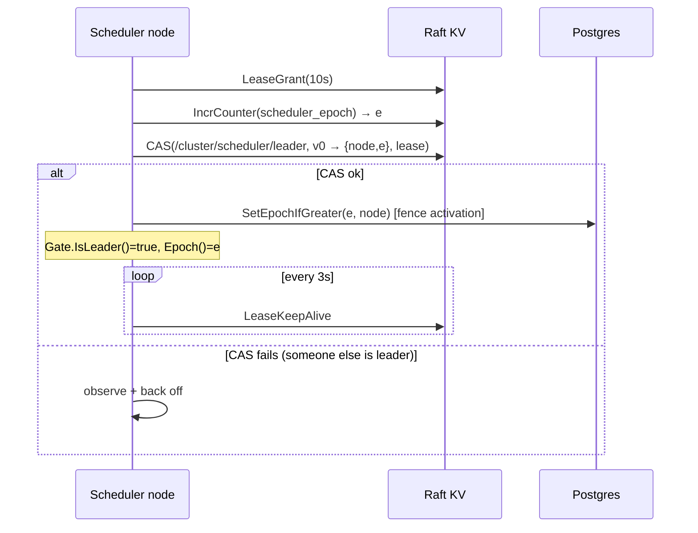

# 04.05 — Coordination library: leader election, fencing epochs, worker leases

## 1. Task Metadata

| Field | Value |
|---|---|
| Task ID | `04.05` |
| Title | Coordination library: leader election, fencing epochs, worker leases |
| Phase | 04 — Raft-backed Coordination |
| Priority | P0 |
| Estimated complexity | Medium |
| Hard dependencies | `04.04` |
| Execution mode | Requires its hard dependencies to be complete first. **Can run in parallel** with: `04.06` (disjoint files/packages; see Context). |
| Requirements covered | FR-RAFT-06 |

## 2. Context and Reference Files

**Read in this order before coding** (rules: `00C_AGENT_OPERATING_RULES.md` — all rules apply):

```text
Master reference:        00_MASTER_PROJECT_SPEC.md
Architecture reference:  00A_ARCHITECTURE_DECISIONS.md   (especially ADR-003, ADR-005, ADR-006)
Contracts reference:     00E_CONTRACTS_REFERENCE.md
Agent rules:             00C_AGENT_OPERATING_RULES.md
Completion template:     00F_COMPLETION_REPORT_TEMPLATE.md

Previous task (numeric order):
- phase-04-raft-coordination/04.04_kv_grpc_server_reads_client.md   (KV gRPC server, linearizable reads, leader redirect and Go client)

Next task (numeric order):
- phase-04-raft-coordination/04.06_cluster_compose_status_metrics.md   (3-node Raft cluster in Compose: cluster status, health, metrics, operator tooling)
```

**Dependency relationships (authoritative — numeric order alone does not imply dependency):**

Hard dependencies — review each task file **and** its completion report `docs/implementation-reports/<ID>.md`:

- `phase-04-raft-coordination/04.04_kv_grpc_server_reads_client.md` — KV gRPC server, linearizable reads, leader redirect and Go client

Tasks that depend on this one (do not break their expected inputs):

- `phase-04-raft-coordination/04.07_scheduler_leadership_worker_leases_integration.md` — Integrate Raft: scheduler leadership + Postgres epoch fencing + worker leases

Parallel-safe tasks (no dependency relationship; keep edits within your own listed files, wire shared registries only via the additive extension points named in *Technical Design*):

- `phase-04-raft-coordination/04.06_cluster_compose_status_metrics.md` — 3-node Raft cluster in Compose: cluster status, health, metrics, operator tooling

Relevant master-spec sections: §3.5, 00E §5.2.

**Artifacts that should already exist (established by your hard dependencies):**

- (from 04.04) `cmd/flowforge-raft`
- (from 04.04) `internal/raftkv/server` (KV + Cluster gRPC)
- (from 04.04) `internal/raftkv/client.Client` (typed KV/lease/counter API, leader redirect, safe retry)
- (from 04.04) Lease sweeper
- (from 04.04) Porcupine history recorder + KV model (`internal/testutil/porcupine`)

Verify these exist (build/tests of the repository are green) before starting. If something listed is missing, stop with `BLOCKED:` per `00C §1`.

## 3. Objective

Build the higher-level coordination primitives FlowForge needs on top of the KV client: scheduler leader election with epochs (implementing the scheduler `Gate`), worker registration/liveness leases (implementing the `LeaseProvider` seam), and fencing-token helpers. Pure client-side library; no changes to Raft server code.

## 4. Detailed Implementation Requirements

- `internal/coordination`: `Elector` — campaign loop: `LeaseGrant(ttl=FF_LEADER_TTL)` → `epoch = IncrCounter("scheduler_epoch")` → `CAS(/cluster/scheduler/leader, expected_version=0, value={node_id, epoch, since}, lease)`; on success becomes leader, renews via `LeaseKeepAlive` every `FF_LEADER_RENEW`; on any renewal failure beyond `TTL - margin` (or `LEASE_EXPIRED`/`NOT_FOUND`) **immediately** declares leadership lost (closes `Done()` channel) *without waiting for the server*; on losing, back off with jitter and re-campaign. Observers can `Current(ctx) (LeaderInfo, error)`.
- `coordination.Gate` implements `scheduler.Gate` (from 03.02): `IsLeader()`, `Epoch()`, `Done()`; guarantees that `IsLeader()` turns false **before** the local lease could have expired on the server (`TTL - safetyMargin`, default margin = TTL/3) — local conservative expiry.
- On becoming leader, the elector performs the **Postgres epoch fence activation** through an injected `EpochFence` interface (`Activate(ctx, epoch, nodeID) error`, implemented in 04.07 using `ClusterRepo.SetEpochIfGreater`): leadership is only announced to loops after `Activate` succeeds.
- `coordination.WorkerRegistry`: `Register(ctx, WorkerInfo) (LeaseHandle)` → `LeaseGrant(ttl=FF_WORKER_LEASE_TTL)` + `Put(/workers/{id}, JSON, lease)`; `Renew(handle)` → `LeaseKeepAlive` (re-registers transparently when `LEASE_EXPIRED`), `Deregister`; `List(ctx)` → alive workers (linearizable `List(/workers/)`); `Expired(ctx)` requires a separate source of truth for *known* workers (the registry persists a `known` set in Postgres `worker_observations` via the API) — implement `Expired(ctx, known []WorkerID)` = known − alive.
- Fencing helpers: `type Fence struct{Epoch int64}`; `FenceFromLeader(Gate)`; unit-tested helpers for comparing epochs.
- Metrics: `flowforge_scheduler_is_leader`, `flowforge_scheduler_epoch`, `flowforge_leader_changes_total`, `flowforge_worker_lease_renewal_failures_total`.

## 5. Technical Design


Safety properties to test: at most one node believes it is leader at any instant **assuming bounded clock drift** and — independent of clocks — **no two nodes can both commit scheduler decisions** because of the Postgres epoch assertion (that end-to-end proof lands in 04.07/04.08). Liveness: after leader failure a new leader emerges within `TTL + campaign interval`.

Worker leases: renewals are written through the API tier (workers do not talk to Raft directly); 04.07 wires `Heartbeat → WorkerRegistry.Renew`.

**Design notes / edge cases:**

- Epoch counter increments even for lost campaigns — gaps are fine; monotonicity is what matters.
- Elector must handle Raft unavailability: while the KV is unreachable, an existing leader steps down at local conservative expiry (cannot renew) — matches the degraded matrix (§6.2).
- Use `clock.Clock` everywhere to test with fake time.

## 6. Step-by-Step Implementation Instructions

1. Define interfaces `KV` (subset of the client) for fakes.
2. Implement `Elector`/`Gate` with a fake KV + fake clock first; table-test leadership timelines.
3. Implement `WorkerRegistry` and `Fence`.
4. Add metrics.
5. Integration tests against the real in-process Raft cluster (`nodetest`) and Postgres fence stub.

## 7. Files to Create or Modify

- internal/coordination/{elector.go,gate.go,registry.go,fence.go,metrics.go,kv.go}
- internal/coordination/fake/{kv.go}
- tests
- docs/architecture/coordination.md

## 8. Testing Requirements

- Fake-KV/fake-clock: single candidate becomes leader; second candidate loses CAS; leader stops renewing → `Done()` closes before server-side expiry (assert margin); follower takes over after expiry with a strictly higher epoch.
- Race: 5 electors campaign simultaneously → exactly one leader; epochs unique and increasing across successive leaders (200 randomized rounds).
- Raft integration: kill Raft leader node during leadership → elector retains leadership if renewals succeed within TTL (client failover) — measured; with quorum lost > TTL, leader steps down and no new leader until quorum returns.
- Fence activation failure (injected) → leadership not announced; retried.
- Registry: register/renew/expire lifecycle; renew after expiry re-registers; `Expired(known)` correct; deregister removes key.

General: `make lint` and `make test` must pass; run packages you touched with `-race`; record exact commands and results in the completion report.

## 9. Acceptance Criteria

- [ ] `coordination.Gate` satisfies `scheduler.Gate`; compile-time assertion present.
- [ ] Leadership loss is detected locally before server-side lease expiry (margin tested).
- [ ] Randomized election rounds never produce two simultaneous leaders under the fake clock.
- [ ] Worker registry implements the semantic needed by `LeaseProvider` (wired in 04.07).
- [ ] All tests listed in section 8 exist and pass (or non-runnable ones are explicitly reported per 00C §2.13).
- [ ] No regression: full existing test suite passes.
- [ ] No architectural deviation without an ADR amendment and report entry.
- [ ] Completion report written to `docs/implementation-reports/04.05.md`.

## 10. Documentation Requirements

- `docs/architecture/coordination.md`: election algorithm, epochs/fencing, timing parameters and safety margins, worker leases, failure behavior.
- Write `docs/implementation-reports/04.05.md` (section 11).

## 11. Completion Report

Create `docs/implementation-reports/04.05.md` from `00F_COMPLETION_REPORT_TEMPLATE.md`. It MUST state: what was implemented; files created/modified; tests executed and their real results; known limitations; architectural decisions made; any deviations from the specification (with ADR amendment reference); confirmation, criterion by criterion, that acceptance criteria were met.

## 12. Handoff Instructions

**Interfaces and contracts this task establishes (record exact final symbol names in your report):**

- `internal/coordination.Elector` + `Gate` (implements `scheduler.Gate`)
- `coordination.WorkerRegistry`
- `EpochFence` interface (activation hook)
- Fake KV for tests
- Metrics `flowforge_scheduler_is_leader`, `…_epoch`

**Downstream consumers:** `04.07`. The next agents will read your completion report first.

**Always include in your report's Handoff section:**

- Dependencies introduced (modules/images) and their pinned versions.
- Configuration keys added (also reflected in `.env.example` and `docs/`).
- Outstanding issues, skipped tests and why.
- Files the next agent should inspect before proceeding: the packages listed under *Files to Create or Modify*.
