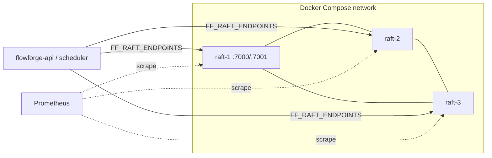

# 04.06 — 3-node Raft cluster in Compose: cluster status, health, metrics, operator tooling

## 1. Task Metadata

| Field | Value |
|---|---|
| Task ID | `04.06` |
| Title | 3-node Raft cluster in Compose: cluster status, health, metrics, operator tooling |
| Phase | 04 — Raft-backed Coordination |
| Priority | P1 |
| Estimated complexity | Medium |
| Hard dependencies | `04.04` |
| Execution mode | Requires its hard dependencies to be complete first. **Can run in parallel** with: `04.05` (disjoint files/packages; see Context). |
| Requirements covered | FR-RAFT-07 |

## 2. Context and Reference Files

**Read in this order before coding** (rules: `00C_AGENT_OPERATING_RULES.md` — all rules apply):

```text
Master reference:        00_MASTER_PROJECT_SPEC.md
Architecture reference:  00A_ARCHITECTURE_DECISIONS.md   (especially ADR-002, ADR-019)
Contracts reference:     00E_CONTRACTS_REFERENCE.md
Agent rules:             00C_AGENT_OPERATING_RULES.md
Completion template:     00F_COMPLETION_REPORT_TEMPLATE.md

Previous task (numeric order):
- phase-04-raft-coordination/04.05_coordination_library.md   (Coordination library: leader election, fencing epochs, worker leases)

Next task (numeric order):
- phase-04-raft-coordination/04.07_scheduler_leadership_worker_leases_integration.md   (Integrate Raft: scheduler leadership + Postgres epoch fencing + worker leases)
```

**Dependency relationships (authoritative — numeric order alone does not imply dependency):**

Hard dependencies — review each task file **and** its completion report `docs/implementation-reports/<ID>.md`:

- `phase-04-raft-coordination/04.04_kv_grpc_server_reads_client.md` — KV gRPC server, linearizable reads, leader redirect and Go client

Tasks that depend on this one (do not break their expected inputs):

- `phase-04-raft-coordination/04.07_scheduler_leadership_worker_leases_integration.md` — Integrate Raft: scheduler leadership + Postgres epoch fencing + worker leases
- `phase-08-observability/08.02_grafana_dashboards_metrics_audit.md` — Grafana dashboards as code and metrics catalogue audit

Parallel-safe tasks (no dependency relationship; keep edits within your own listed files, wire shared registries only via the additive extension points named in *Technical Design*):

- `phase-04-raft-coordination/04.05_coordination_library.md` — Coordination library: leader election, fencing epochs, worker leases

Relevant master-spec sections: §3.6, §5.4.

**Artifacts that should already exist (established by your hard dependencies):**

- (from 04.04) `cmd/flowforge-raft`
- (from 04.04) `internal/raftkv/server` (KV + Cluster gRPC)
- (from 04.04) `internal/raftkv/client.Client` (typed KV/lease/counter API, leader redirect, safe retry)
- (from 04.04) Lease sweeper
- (from 04.04) Porcupine history recorder + KV model (`internal/testutil/porcupine`)

Verify these exist (build/tests of the repository are green) before starting. If something listed is missing, stop with `BLOCKED:` per `00C §1`.

## 3. Objective

Run the 3-node Raft cluster locally with healthchecks, expose accurate cluster status and Prometheus metrics, and provide operator/debug tooling (`flowforge-raft` admin subcommands) used by chaos tests.

## 4. Detailed Implementation Requirements

- Dockerfile for `flowforge-raft` (multi-stage, non-root; final hardening in 09.02) and Compose services `raft-1..3` (profile `raft`): fixed node ids, peer addresses on the internal network, data volumes per node, healthcheck (`flowforge-raft health --addr`), client port exposed (`7001-7003`) and peer port internal (`7000`).
- `Cluster.Status` response (also REST-adaptable): `{node_id, leader_id, term, commit_index, applied_index, state, peers:[{id, addr, reachable, match_index, lag}], state_hash@applied_index, snapshot_index, uptime}`. Health: `READY` only when the node knows a leader and `applied` is within N entries of `commit`.
- Prometheus `/metrics` on each node (`obs` server): finalize the Raft metrics catalogue from `00E §11` incl. `_snapshot_total`, `_apply_duration_seconds`, `_peer_unreachable{peer}`; add `flowforge_raft_leader_changes_total`.
- Admin subcommands in `flowforge-raft`: `status --addr`, `health`, `transfer-leader --to`, `dump-state-hash`, `snapshot-now` (triggers snapshot), `compact` — requires an `admin` flag token; documented as dev/ops tooling.
- Snapshot trigger: when `applied - snapshotIndex >= FF_RAFT_SNAPSHOT_ENTRIES` (default 10 000; configurable down to 50 for tests) take FSM snapshot, persist, compact log keeping `FF_RAFT_SNAPSHOT_TRAILING` (1 000) entries; followers lagging beyond compaction receive snapshots via the transport (test!).
- Make targets: `raft-up`, `raft-down`, `raft-status`, `raft-logs`, `raft-kill N`, `raft-restart N`.

## 5. Technical Design


Snapshot policy rationale: bounded log growth; trailing entries let slightly-lagging followers catch up without a snapshot; a follower wiped and restarted must recover **via snapshot** (explicit test).

**Design notes / edge cases:**

- Do not expose peer ports to the host.
- Node bootstrapping: all three nodes start with identical static peer lists; first start with empty data dir bootstraps; subsequent starts reuse storage.

## 6. Step-by-Step Implementation Instructions

1. Implement snapshot trigger + compaction + snapshot install path; integration-test with tiny thresholds.
2. Implement `Cluster.Status`/health and finalize metrics.
3. Write Dockerfile + Compose services + Make targets.
4. Implement admin subcommands.
5. Add Compose-based smoke test script (`scripts/dev/raft-smoke.sh`) and a Go integration test that talks to the cluster.

## 7. Files to Create or Modify

- deploy/docker/Dockerfile.raft
- docker-compose.yml (modify: raft profile)
- internal/raftkv/server/{cluster.go (modify),snapshot_trigger.go}
- internal/raftkv/node/{snapshot.go}
- cmd/flowforge-raft/{admin.go}
- Makefile (modify)
- scripts/dev/raft-smoke.sh
- tests
- docs/runbooks/raft-quorum-loss.md (initial)

## 8. Testing Requirements

- Compose smoke: `make raft-up` → three healthy nodes; exactly one reports leader; `Put/Get` through client works.
- Status accuracy: after killing the leader container, status from survivors shows new leader and increased term within election timeout (poll ≤ 5 s).
- Snapshot: with threshold 50, 500 writes → snapshot taken, log compacted (first index advanced); node wiped+restarted restores via snapshot and `state_hash` equals peers.
- Metrics: golden-name test asserts presence of all `00E §11` Raft metric names on `/metrics`.
- Admin: `transfer-leader --to` moves leadership; `dump-state-hash` equal on all nodes at same applied index.

General: `make lint` and `make test` must pass; run packages you touched with `-race`; record exact commands and results in the completion report.

## 9. Acceptance Criteria

- [ ] `make raft-up` runs a healthy 3-node cluster; kill/restart helpers work.
- [ ] Snapshots/compaction/install-snapshot verified (wiped follower recovers).
- [ ] All Raft metrics from `00E §11` exported.
- [ ] Initial runbook `docs/runbooks/raft-quorum-loss.md` written (expanded in 09.05).
- [ ] All tests listed in section 8 exist and pass (or non-runnable ones are explicitly reported per 00C §2.13).
- [ ] No regression: full existing test suite passes.
- [ ] No architectural deviation without an ADR amendment and report entry.
- [ ] Completion report written to `docs/implementation-reports/04.06.md`.

## 10. Documentation Requirements

- `docs/runbooks/raft-quorum-loss.md` (initial), `docs/architecture/raft-operations.md` (compose layout, ports, admin commands, snapshot policy).
- Write `docs/implementation-reports/04.06.md` (section 11).

## 11. Completion Report

Create `docs/implementation-reports/04.06.md` from `00F_COMPLETION_REPORT_TEMPLATE.md`. It MUST state: what was implemented; files created/modified; tests executed and their real results; known limitations; architectural decisions made; any deviations from the specification (with ADR amendment reference); confirmation, criterion by criterion, that acceptance criteria were met.

## 12. Handoff Instructions

**Interfaces and contracts this task establishes (record exact final symbol names in your report):**

- Compose services `raft-1..3` (profile `raft`)
- Make targets `raft-up raft-down raft-status raft-kill raft-restart`
- `Cluster.Status/Health` semantics + admin subcommands
- Snapshot/compaction policy + config `FF_RAFT_SNAPSHOT_ENTRIES/TRAILING`
- Dockerfile pattern for Go services (`deploy/docker/Dockerfile.raft`)

**Downstream consumers:** `04.07`, `08.02`. The next agents will read your completion report first.

**Always include in your report's Handoff section:**

- Dependencies introduced (modules/images) and their pinned versions.
- Configuration keys added (also reflected in `.env.example` and `docs/`).
- Outstanding issues, skipped tests and why.
- Files the next agent should inspect before proceeding: the packages listed under *Files to Create or Modify*.
