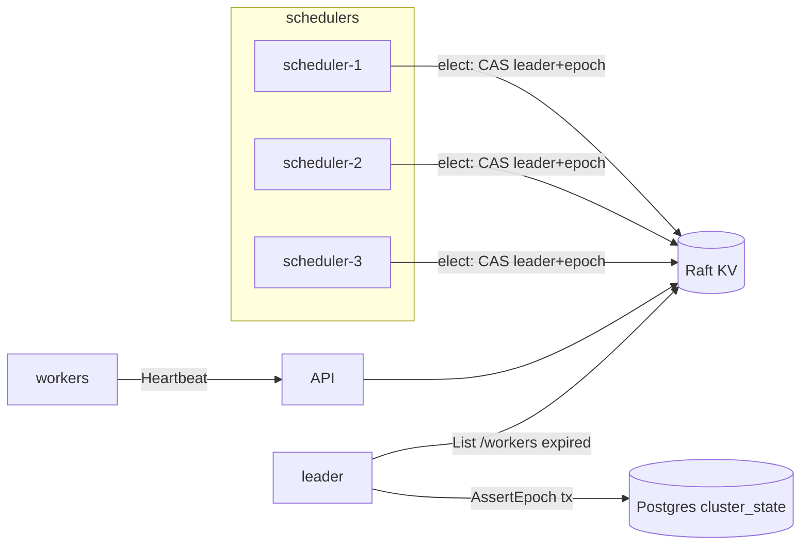

# 04.07 — Integrate Raft: scheduler leadership + Postgres epoch fencing + worker leases

## 1. Task Metadata

| Field | Value |
|---|---|
| Task ID | `04.07` |
| Title | Integrate Raft: scheduler leadership + Postgres epoch fencing + worker leases |
| Phase | 04 — Raft-backed Coordination |
| Priority | P0 |
| Estimated complexity | Large |
| Hard dependencies | `04.05`, `04.06`, `03.07`, `03.04` |
| Execution mode | Requires its hard dependencies to be complete first. **Run sequentially** (do not run concurrently with other tasks). |
| Requirements covered | FR-RAFT-08, FR-RAFT-09 |

## 2. Context and Reference Files

**Read in this order before coding** (rules: `00C_AGENT_OPERATING_RULES.md` — all rules apply):

```text
Master reference:        00_MASTER_PROJECT_SPEC.md
Architecture reference:  00A_ARCHITECTURE_DECISIONS.md   (especially ADR-003, ADR-005)
Contracts reference:     00E_CONTRACTS_REFERENCE.md
Agent rules:             00C_AGENT_OPERATING_RULES.md
Completion template:     00F_COMPLETION_REPORT_TEMPLATE.md

Previous task (numeric order):
- phase-04-raft-coordination/04.06_cluster_compose_status_metrics.md   (3-node Raft cluster in Compose: cluster status, health, metrics, operator tooling)

Next task (numeric order):
- phase-04-raft-coordination/04.08_raft_fault_injection_suite.md   (Phase gate: Raft fault-injection and linearizability suite)
```

**Dependency relationships (authoritative — numeric order alone does not imply dependency):**

Hard dependencies — review each task file **and** its completion report `docs/implementation-reports/<ID>.md`:

- `phase-04-raft-coordination/04.05_coordination_library.md` — Coordination library: leader election, fencing epochs, worker leases
- `phase-04-raft-coordination/04.06_cluster_compose_status_metrics.md` — 3-node Raft cluster in Compose: cluster status, health, metrics, operator tooling
- `phase-03-scheduler-workers/03.07_events_outbox_sse_retention.md` — Event relay (outbox), SSE stream and retention jobs
- `phase-03-scheduler-workers/03.04_retry_timeout_recovery.md` — Retries, timeouts, worker-loss recovery and crash-consistent loops

Tasks that depend on this one (do not break their expected inputs):

- `phase-04-raft-coordination/04.08_raft_fault_injection_suite.md` — Phase gate: Raft fault-injection and linearizability suite
- `phase-06-ai-ops/06.02_internal_read_api.md` — FlowForge internal read-only API and `ai-readonly` role
- `phase-07-dashboard/07.02_ui_dag_logs_cluster_marketdata.md` — Dashboard: live DAG, attempts and logs, cluster/workers and market-data panels
- `phase-09-hardening-deployment/09.01_security_hardening_tls.md` — Security hardening: TLS/mTLS, secrets handling, key rotation, dependency scanning

Relevant master-spec sections: §3.4, §3.5, §6.2.

**Artifacts that should already exist (established by your hard dependencies):**

- (from 04.05) `internal/coordination.Elector` + `Gate` (implements `scheduler.Gate`)
- (from 04.05) `coordination.WorkerRegistry`
- (from 04.05) `EpochFence` interface (activation hook)
- (from 04.05) Fake KV for tests
- (from 04.05) Metrics `flowforge_scheduler_is_leader`, `…_epoch`
- (from 04.06) Compose services `raft-1..3` (profile `raft`)
- (from 04.06) Make targets `raft-up raft-down raft-status raft-kill raft-restart`
- (from 04.06) `Cluster.Status/Health` semantics + admin subcommands
- (from 04.06) Snapshot/compaction policy + config `FF_RAFT_SNAPSHOT_ENTRIES/TRAILING`
- (from 04.06) Dockerfile pattern for Go services (`deploy/docker/Dockerfile.raft`)
- (from 03.07) `internal/outbox.Publisher` + `RelayLoop`
- (from 03.07) SSE endpoint + `internal/api/sse.Hub`
- (from 03.07) `internal/retention.Loop`
- (from 03.07) `NOTIFY ff_events` emitted by `events.Record`
- (from 03.07) Config `FF_EVENT_PUBLISHER`, `FF_SSE_MAX_CONNECTIONS`, `FF_RETENTION_*`
- (from 03.04) `RetryOutcomeHandler` (installed as default `OutcomeHandler`)
- (from 03.04) `internal/recovery.Loop` (consumes `LeaseProvider`)
- (from 03.04) `scheduler.TimeoutLoop`
- (from 03.04) Failpoint harness (`-tags failpoint`, `FF_FAILPOINTS`)
- (from 03.04) DB invariant checker `testutil.AssertInvariants(t, db)`
- (from 03.04) Metric `flowforge_loop_errors_total{loop}`

Verify these exist (build/tests of the repository are green) before starting. If something listed is missing, stop with `BLOCKED:` per `00C §1`.

## 3. Objective

Wire the coordination library into the control plane: multi-instance schedulers elect a leader through Raft; every leader-gated loop uses the Raft-backed `Gate`; Postgres epoch fencing rejects stale leaders; worker heartbeats renew Raft leases, and the recovery loop consumes Raft lease expirations. Prove failover end-to-end.

## 4. Detailed Implementation Requirements

- `flowforge-scheduler`: select `Gate` via `FF_COORDINATION=raft|local` (`local` = `AlwaysLeader`, still supported for dev); in `raft` mode construct `coordination.Elector` with an `EpochFence` implementation using `ClusterRepo.SetEpochIfGreater`; `Runner` gates all registered loops (scheduler, timeout, recovery, cron, outbox relay, retention).
- Epoch plumbing: every leader loop obtains `gate.Epoch()` and passes it to `AssertEpoch` in each decision transaction (verify no loop bypasses — add a test that greps/uses an interceptor in the TxManager under test tag to fail when a scheduler-package write occurs without an `AssertEpoch` call).
- `flowforge-api`: when `FF_COORDINATION=raft`, replace the Postgres `LeaseProvider` with `RaftLeaseProvider` (uses `coordination.WorkerRegistry`): `Register` → Raft lease + key; `Heartbeat` → `Renew` (errors → degrade: continue and return `lease_ttl`; log + metric `flowforge_worker_lease_renewal_failures_total`; if Raft unreachable the API **keeps accepting heartbeats** and records them in `worker_observations.last_seen_at` so no spurious expiry occurs when quorum returns); `Alive()`/`Expired(known)` for recovery.
- Recovery loop (03.04) unchanged except it reads `LeaseProvider` from DI; verify it now acts on Raft expirations **only when the scheduler is leader and Raft reads succeed** — if the linearizable list fails, it performs *no* abandonment (fail-safe).
- Cluster status: `GET /api/v1/cluster/status` (viewer) aggregates Raft `Cluster.Status`, current scheduler leader info (`/cluster/scheduler/leader`), epoch, worker count; `GET /internal/v1/cluster/status` alias will be used by AI (06.02). Update OpenAPI/ACL. `scheduler.leader_changed` and `worker.registered|lost` events are recorded via `events.Record` by the new leader/API.
- Compose: add `flowforge-scheduler` ×3, `flowforge-api`, `flowforge-worker` ×2 services behind profile `raft` + `core` combination for the failover demo (Dockerfiles generic from 04.06 pattern; production hardening in 09.02).

## 5. Technical Design


**Two-layer fence** (the central safety claim, to be demonstrated in tests):
1. Raft layer: only the CAS winner is leader; others cannot hold the leader key.
2. Postgres layer: `cluster_state.epoch` is raised by the new leader *before* it announces leadership; every scheduler tx asserts `epoch == own`. A deposed leader (paused, partitioned, slow) that wakes up gets `STALE_EPOCH` on its first write and stops.

Failure matrix to implement/verify here: leader scheduler killed (SIGKILL) → takeover ≤ 10 s; scheduler paused (SIGSTOP) past TTL then resumed → its in-flight tx rejected; Raft quorum lost → schedulers step down, running tasks continue (workers keep executing; completions still accepted by API from Postgres), no reassignments; quorum returns → single leader elected; API keeps working throughout.

**Design notes / edge cases:**

- Worker lease TTL (15 s) must exceed Raft failover (≈ 3 s) comfortably; document parameter relationships and validate in config (`WorkerLeaseTTL >= 3×Raft election timeout`).
- Never use Raft for per-attempt state; only worker liveness and leadership.
- Keep `FF_COORDINATION=local` fully working (regression-tested).

## 6. Step-by-Step Implementation Instructions

1. Add config `FF_COORDINATION` and wiring in scheduler/API mains.
2. Implement `RaftLeaseProvider` + fail-safe semantics.
3. Implement `EpochFence` and the AssertEpoch coverage check.
4. Implement cluster status endpoint and events.
5. Extend Compose with multi-scheduler/API/worker services.
6. Write the integration/failover tests (subprocess-based where possible) and measure failover/recovery times.

## 7. Files to Create or Modify

- cmd/flowforge-scheduler/main.go (modify)
- cmd/flowforge-api/main.go (modify)
- internal/workerapi/lease_raft.go
- internal/coordination/pgfence.go
- internal/api/rest/cluster.go
- internal/scheduler/epoch_guard_test.go
- docker-compose.yml (modify)
- api/openapi/flowforge.v1.yaml (modify)
- test/e2e/raft_failover_test.go
- docs/architecture/leadership-and-fencing.md

## 8. Testing Requirements

- E2E (3 schedulers + Raft + workers): exactly one scheduler loops active (metric `is_leader` sums to 1); runs complete.
- Kill leader scheduler during a workload → new leader within 10 s (measured); all runs finish; invariants hold; no double-queued tasks.
- SIGSTOP leader > TTL then SIGCONT → old leader's next write fails with STALE_EPOCH, it demotes itself; no divergent decisions (compare event log ordering).
- Worker kill → Raft lease expires → recovery abandons+reassigns within TTL+2 ticks (measured); with Raft quorum lost, **no** reassignment occurs and running work completes normally; after quorum returns no spurious abandonment of healthy workers.
- AssertEpoch coverage guard: injected scheduler code path writing without `AssertEpoch` makes the guard test fail.
- Regression: full workflow e2e suite (03.09) passes in `FF_COORDINATION=local` and `raft` modes.

General: `make lint` and `make test` must pass; run packages you touched with `-race`; record exact commands and results in the completion report.

## 9. Acceptance Criteria

- [ ] Multi-scheduler failover verified with measured takeover time ≤ 10 s.
- [ ] Deposed-leader writes rejected (STALE_EPOCH) in a deterministic test using SIGSTOP/injected pause.
- [ ] Quorum-loss behavior matches the degraded matrix (no new leader, running tasks continue, no spurious reassignment).
- [ ] `/api/v1/cluster/status` reports leader, epoch, Raft health, workers.
- [ ] Local (non-Raft) mode still passes the Phase-3 e2e suite.
- [ ] All tests listed in section 8 exist and pass (or non-runnable ones are explicitly reported per 00C §2.13).
- [ ] No regression: full existing test suite passes.
- [ ] No architectural deviation without an ADR amendment and report entry.
- [ ] Completion report written to `docs/implementation-reports/04.07.md`.

## 10. Documentation Requirements

- `docs/architecture/leadership-and-fencing.md` (two-layer fence argument, failure matrix with observed results)
- `docs/runbooks/scheduler-failover.md`, `docs/runbooks/worker-unavailable.md` (initial versions)
- Write `docs/implementation-reports/04.07.md` (section 11).

## 11. Completion Report

Create `docs/implementation-reports/04.07.md` from `00F_COMPLETION_REPORT_TEMPLATE.md`. It MUST state: what was implemented; files created/modified; tests executed and their real results; known limitations; architectural decisions made; any deviations from the specification (with ADR amendment reference); confirmation, criterion by criterion, that acceptance criteria were met.

## 12. Handoff Instructions

**Interfaces and contracts this task establishes (record exact final symbol names in your report):**

- `FF_COORDINATION=raft|local` wiring
- `RaftLeaseProvider` (implements `LeaseProvider`)
- `pgfence` (EpochFence impl) + AssertEpoch coverage guard test
- REST `GET /api/v1/cluster/status`
- Events `scheduler.leader_changed`, `worker.registered`, `worker.lost`
- Compose multi-instance control-plane services

**Downstream consumers:** `04.08`, `06.02`, `07.02`, `09.01`. The next agents will read your completion report first.

**Always include in your report's Handoff section:**

- Dependencies introduced (modules/images) and their pinned versions.
- Configuration keys added (also reflected in `.env.example` and `docs/`).
- Outstanding issues, skipped tests and why.
- Files the next agent should inspect before proceeding: the packages listed under *Files to Create or Modify*.
