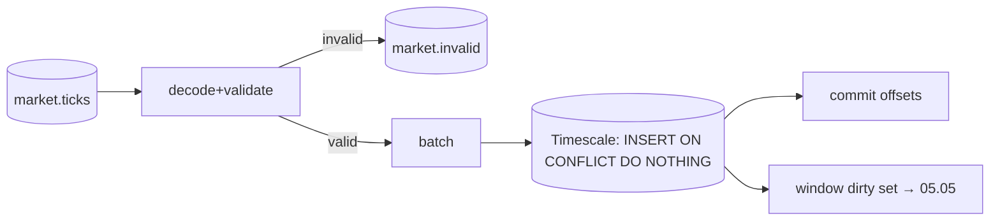

# 05.04 — Stream processor: consume, validate/normalize, DLQ, persisted dedupe

## 1. Task Metadata

| Field | Value |
|---|---|
| Task ID | `05.04` |
| Title | Stream processor: consume, validate/normalize, DLQ, persisted dedupe |
| Phase | 05 — Kafka Streaming and Market-Data Workload |
| Priority | P0 |
| Estimated complexity | Large |
| Hard dependencies | `05.03`, `05.02` |
| Execution mode | Requires its hard dependencies to be complete first. **Run sequentially** (do not run concurrently with other tasks). |
| Requirements covered | FR-KAFKA-06, FR-KAFKA-07 |

## 2. Context and Reference Files

**Read in this order before coding** (rules: `00C_AGENT_OPERATING_RULES.md` — all rules apply):

```text
Master reference:        00_MASTER_PROJECT_SPEC.md
Architecture reference:  00A_ARCHITECTURE_DECISIONS.md   (especially ADR-008, ADR-010, ADR-011)
Contracts reference:     00E_CONTRACTS_REFERENCE.md
Agent rules:             00C_AGENT_OPERATING_RULES.md
Completion template:     00F_COMPLETION_REPORT_TEMPLATE.md

Previous task (numeric order):
- phase-05-kafka-marketdata/05.03_tick_generator_loader_producer.md   (Deterministic tick generator, historical loader and Kafka producer)

Next task (numeric order):
- phase-05-kafka-marketdata/05.05_windowed_aggregation_recompute.md   (Event-time windowed aggregation with late-data recompute and idempotent upserts)
```

**Dependency relationships (authoritative — numeric order alone does not imply dependency):**

Hard dependencies — review each task file **and** its completion report `docs/implementation-reports/<ID>.md`:

- `phase-05-kafka-marketdata/05.03_tick_generator_loader_producer.md` — Deterministic tick generator, historical loader and Kafka producer
- `phase-05-kafka-marketdata/05.02_marketdata_domain_timescale.md` — Market-data domain library and TimescaleDB schema (windows, indicators, anomaly math)

Tasks that depend on this one (do not break their expected inputs):

- `phase-05-kafka-marketdata/05.05_windowed_aggregation_recompute.md` — Event-time windowed aggregation with late-data recompute and idempotent upserts

Relevant master-spec sections: §5.5.

**Artifacts that should already exist (established by your hard dependencies):**

- (from 05.03) `Source` interface + `Synthetic`/`FileSource`
- (from 05.03) `cmd/flowforge-producer`
- (from 05.03) Deterministic event-id function
- (from 05.03) Sample data fixtures
- (from 05.02) `internal/stream/domain` (Tick, Window, Aggregate, indicators, watermark classify)
- (from 05.02) Timescale schema (`market_ticks`, `market_aggregates`, `market_ingest_state`, `market_replay_jobs`)
- (from 05.02) `migrations/marketdata/`

Verify these exist (build/tests of the repository are green) before starting. If something listed is missing, stop with `BLOCKED:` per `00C §1`.

## 3. Objective

Implement the processor's ingest half as a long-running service: consume `market.ticks`, validate and normalize, route poison/invalid events to `market.invalid` with reasons, and persist valid ticks to TimescaleDB with `ON CONFLICT DO NOTHING` dedupe and duplicate counting. Offsets are committed by the batching layer completed in 05.06; in this task use a simple *commit-after-DB-commit per batch* loop.

## 4. Detailed Implementation Requirements

- `cmd/flowforge-processor`, `internal/stream/processor`: pipeline stages `decode → validate → classify(dup via DB result) → persist → emit(aggregate trigger)`.
- Decode failures (bad JSON, schema violation, unknown schema version) → publish original bytes + reason + source topic/partition/offset to `market.invalid` (DLQ envelope `market.invalid.v1`), count metric, **continue** (poison never blocks).
- Batch persist: `INSERT … ON CONFLICT (event_id,event_time) DO NOTHING` via pgx `CopyFrom` into a temp table or multi-row insert (choose and benchmark; document), returning inserted count; `duplicates = batch − inserted` metric `flowforge_stream_duplicates_total`.
- Normalization: symbol uppercase/trim, price scale, event_time to UTC; keep `raw` JSONB only for debug when `FF_STREAM_KEEP_RAW=true`.
- Late classification applied at ingest (flag stored in `market_ticks.late boolean`) using the domain watermark policy; TooLate → DLQ reason `too_late`.
- State: `market_ingest_state` row per partition tracking `last_offset, max_event_time, updated_at` (informational; not authoritative for offsets — Kafka group commits are).
- Config via 01.03 loader: `FF_STREAM_BATCH_SIZE=500`, `FF_STREAM_BATCH_MAX_WAIT=200ms`, `FF_TIMESCALE_DSN`, `FF_STREAM_GROUP=flowforge-processor`.

## 5. Technical Design


Invariant: **an offset is committed only after the batch containing it (and any DLQ publishes for it) is durable**. DLQ publish failure fails the batch (retry), never silently drops.

**Design notes / edge cases:**

- Ensure `INSERT` idempotency makes reprocessing after crash safe.
- Do not hold DB transactions open across Kafka calls.

## 6. Step-by-Step Implementation Instructions

1. Implement decode/validate/route to DLQ.
2. Implement batch persister + duplicate accounting.
3. Implement loop with commit-after-persist.
4. Integration tests with kafkatest + timescale testcontainer.
5. Add metrics.

## 7. Files to Create or Modify

- cmd/flowforge-processor/main.go
- internal/stream/processor/{pipeline.go,decode.go,dlq.go,persist.go,state.go,metrics.go}
- tests
- docs/architecture/stream-processor.md

## 8. Testing Requirements

- Valid stream of 10 000 ticks → exactly 10 000 rows; replaying the same topic offset range inserts 0 new rows and counts 10 000 duplicates.
- Malformed JSON, schema-violating, unknown-version, negative-price events → DLQ entries with correct reasons; valid events around them still persisted.
- Poison at the head of a partition does not block subsequent events.
- Kill -9 processor mid-batch (subprocess) → after restart rows == unique events, no gaps.
- DLQ publish failure (Kafka paused) causes batch retry, no commit.

General: `make lint` and `make test` must pass; run packages you touched with `-race`; record exact commands and results in the completion report.

## 9. Acceptance Criteria

- [ ] Ingest correct under duplicates and poison input.
- [ ] Offsets committed strictly after durable writes.
- [ ] Duplicate and DLQ counters exposed.
- [ ] All tests listed in section 8 exist and pass (or non-runnable ones are explicitly reported per 00C §2.13).
- [ ] No regression: full existing test suite passes.
- [ ] No architectural deviation without an ADR amendment and report entry.
- [ ] Completion report written to `docs/implementation-reports/05.04.md`.

## 10. Documentation Requirements

- `docs/architecture/stream-processor.md`: pipeline, DLQ contract, dedupe, commit rules.
- Write `docs/implementation-reports/05.04.md` (section 11).

## 11. Completion Report

Create `docs/implementation-reports/05.04.md` from `00F_COMPLETION_REPORT_TEMPLATE.md`. It MUST state: what was implemented; files created/modified; tests executed and their real results; known limitations; architectural decisions made; any deviations from the specification (with ADR amendment reference); confirmation, criterion by criterion, that acceptance criteria were met.

## 12. Handoff Instructions

**Interfaces and contracts this task establishes (record exact final symbol names in your report):**

- `cmd/flowforge-processor` ingest pipeline
- DLQ contract `market.invalid.v1` producer
- Persisted tick store with dedupe counters
- Dirty-window hook interface `WindowSink` (consumed in 05.05)

**Downstream consumers:** `05.05`. The next agents will read your completion report first.

**Always include in your report's Handoff section:**

- Dependencies introduced (modules/images) and their pinned versions.
- Configuration keys added (also reflected in `.env.example` and `docs/`).
- Outstanding issues, skipped tests and why.
- Files the next agent should inspect before proceeding: the packages listed under *Files to Create or Modify*.
