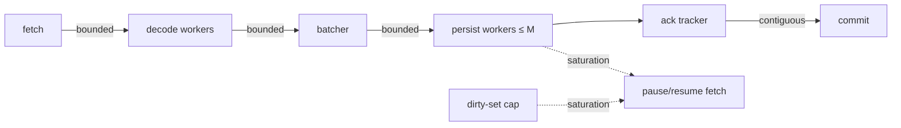

# 05.06 — Backpressure, rebalance-safe offset commits and graceful shutdown

## 1. Task Metadata

| Field | Value |
|---|---|
| Task ID | `05.06` |
| Title | Backpressure, rebalance-safe offset commits and graceful shutdown |
| Phase | 05 — Kafka Streaming and Market-Data Workload |
| Priority | P0 |
| Estimated complexity | Medium |
| Hard dependencies | `05.05` |
| Execution mode | Requires its hard dependencies to be complete first. **Can run in parallel** with: `05.09` (disjoint files/packages; see Context). |
| Requirements covered | FR-KAFKA-11, FR-KAFKA-12, NFR-REL-02 |

## 2. Context and Reference Files

**Read in this order before coding** (rules: `00C_AGENT_OPERATING_RULES.md` — all rules apply):

```text
Master reference:        00_MASTER_PROJECT_SPEC.md
Architecture reference:  00A_ARCHITECTURE_DECISIONS.md   (especially ADR-008, ADR-011)
Contracts reference:     00E_CONTRACTS_REFERENCE.md
Agent rules:             00C_AGENT_OPERATING_RULES.md
Completion template:     00F_COMPLETION_REPORT_TEMPLATE.md

Previous task (numeric order):
- phase-05-kafka-marketdata/05.05_windowed_aggregation_recompute.md   (Event-time windowed aggregation with late-data recompute and idempotent upserts)

Next task (numeric order):
- phase-05-kafka-marketdata/05.07_replay_backfill.md   (Replay and backfill service (offset/time/symbol/range) with isolated consumer group)
```

**Dependency relationships (authoritative — numeric order alone does not imply dependency):**

Hard dependencies — review each task file **and** its completion report `docs/implementation-reports/<ID>.md`:

- `phase-05-kafka-marketdata/05.05_windowed_aggregation_recompute.md` — Event-time windowed aggregation with late-data recompute and idempotent upserts

Tasks that depend on this one (do not break their expected inputs):

- `phase-05-kafka-marketdata/05.07_replay_backfill.md` — Replay and backfill service (offset/time/symbol/range) with isolated consumer group

Parallel-safe tasks (no dependency relationship; keep edits within your own listed files, wire shared registries only via the additive extension points named in *Technical Design*):

- `phase-05-kafka-marketdata/05.09_marketdata_api_monitoring_quality.md` — Market-data analytics API, pipeline monitoring and data-quality check

Relevant master-spec sections: §5.5, §6.2.

**Artifacts that should already exist (established by your hard dependencies):**

- (from 05.05) `internal/stream/aggregator`
- (from 05.05) `market_aggregates` populated with `status/version/input_hash`
- (from 05.05) `market.aggregates` publishing

Verify these exist (build/tests of the repository are green) before starting. If something listed is missing, stop with `BLOCKED:` per `00C §1`.

## 3. Objective

Make the processor robust under load and lifecycle events: bounded queues everywhere, consumer pause/resume driven by downstream saturation, bounded DB write concurrency, rebalance-safe commit tracking, and a graceful shutdown that drains and commits.

## 4. Detailed Implementation Requirements

- Replace ad-hoc loop with a staged pipeline: `fetch → decode (N workers) → batch → persist (M workers, DB pool-bounded) → ack tracker`. All channels bounded (`FF_STREAM_QUEUE_DEPTH`, default 4 batches). No unbounded slices/maps (dirty set cap from 05.05).
- Backpressure: when persist queue ≥ high-water mark or aggregator dirty set ≥ cap, **pause fetch** (`PauseFetchPartitions`) and resume at low-water mark; metric `flowforge_stream_backpressure_active`; hysteresis to avoid flapping.
- Ack tracker: per-partition contiguous-offset watermark; commit only the highest offset such that all lower offsets in the partition are durably processed (out-of-order completion across workers is safe). Commits are batched (`FF_STREAM_COMMIT_INTERVAL=1s`) and synchronous on shutdown/revoke.
- Rebalance: `OnPartitionsRevoked` → stop fetching those partitions, drain in-flight, commit; `OnPartitionsAssigned` → resume from committed offsets; cooperative-sticky balancer; tests with 2–3 processor instances.
- Graceful shutdown (SIGTERM): stop fetch → drain pipeline within `FF_SHUTDOWN_TIMEOUT` (default 30s) → flush aggregator provisional state → commit → close; second SIGTERM forces exit. Exit code 0 on clean drain.
- DB write limiter: semaphore + `pgxpool` max conns; DB errors → bounded exponential retry; sustained failure → pause consumption and flip readiness (`/readyz`) false.

## 5. Technical Design


Memory bound: `queue_depth × batch_size × avg_event_bytes + dirty_cap × key_size` — document the formula and verify with a heap-profile test under a stalled DB.

**Design notes / edge cases:**

- Never commit offset N if offset N−1 in the same partition is still in flight.
- goleak on shutdown: no goroutine leaks.

## 6. Step-by-Step Implementation Instructions

1. Refactor pipeline to bounded stages.
2. Implement ack tracker + commit logic with property tests.
3. Implement pause/resume with hysteresis.
4. Implement rebalance handlers + shutdown.
5. Run fault tests (slow DB, kill -9, rebalance).

## 7. Files to Create or Modify

- internal/stream/processor/{stages.go,acktracker.go,backpressure.go,rebalance.go,shutdown.go}
- internal/stream/processor/pipeline.go (modify)
- cmd/flowforge-processor/main.go (modify)
- tests
- docs/architecture/stream-backpressure.md

## 8. Testing Requirements

- Ack tracker property test: random completion order never commits past a gap.
- Slow-DB test (Toxiproxy latency 2 s): queue depth capped, fetch paused (`backpressure_active=1`), memory stays under bound (assert heap < threshold), resumes on recovery, zero loss.
- kill -9 mid-batch ×20: after restart no event lost, duplicates absorbed (row count == unique events).
- Rebalance: start 2nd instance during load → no loss, no stuck partition, duplicate rate bounded and absorbed.
- SIGTERM under load: exits 0 within timeout, committed offsets == processed offsets.
- goleak passes after shutdown.

General: `make lint` and `make test` must pass; run packages you touched with `-race`; record exact commands and results in the completion report.

## 9. Acceptance Criteria

- [ ] No unbounded buffers; backpressure observable and effective.
- [ ] Offsets never committed ahead of durable writes (property + crash tests).
- [ ] Graceful shutdown drains and commits; rebalance safe.
- [ ] All tests listed in section 8 exist and pass (or non-runnable ones are explicitly reported per 00C §2.13).
- [ ] No regression: full existing test suite passes.
- [ ] No architectural deviation without an ADR amendment and report entry.
- [ ] Completion report written to `docs/implementation-reports/05.06.md`.

## 10. Documentation Requirements

- `docs/architecture/stream-backpressure.md`: stage diagram, bounds formula, commit invariant, shutdown sequence.
- Write `docs/implementation-reports/05.06.md` (section 11).

## 11. Completion Report

Create `docs/implementation-reports/05.06.md` from `00F_COMPLETION_REPORT_TEMPLATE.md`. It MUST state: what was implemented; files created/modified; tests executed and their real results; known limitations; architectural decisions made; any deviations from the specification (with ADR amendment reference); confirmation, criterion by criterion, that acceptance criteria were met.

## 12. Handoff Instructions

**Interfaces and contracts this task establishes (record exact final symbol names in your report):**

- Bounded staged pipeline + ack tracker
- Pause/resume backpressure with metrics
- Rebalance and graceful-shutdown handlers

**Downstream consumers:** `05.07`. The next agents will read your completion report first.

**Always include in your report's Handoff section:**

- Dependencies introduced (modules/images) and their pinned versions.
- Configuration keys added (also reflected in `.env.example` and `docs/`).
- Outstanding issues, skipped tests and why.
- Files the next agent should inspect before proceeding: the packages listed under *Files to Create or Modify*.
