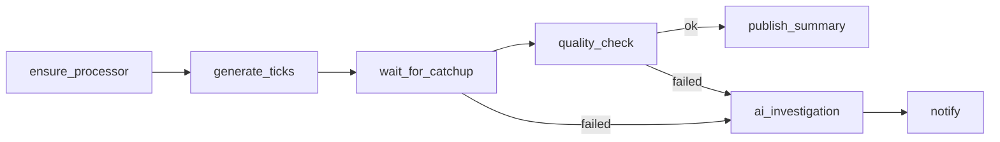

# 05.10 — Market-data workflow, task handlers and streaming fault-injection gate

## 1. Task Metadata

| Field | Value |
|---|---|
| Task ID | `05.10` |
| Title | Market-data workflow, task handlers and streaming fault-injection gate |
| Phase | 05 — Kafka Streaming and Market-Data Workload |
| Priority | P0 |
| Estimated complexity | Large |
| Hard dependencies | `05.07`, `05.08`, `05.09`, `03.09` |
| Execution mode | Requires its hard dependencies to be complete first. **Run sequentially** (do not run concurrently with other tasks). |
| Requirements covered | FR-KAFKA-15, NFR-TEST-02, NFR-TEST-03 |

## 2. Context and Reference Files

**Read in this order before coding** (rules: `00C_AGENT_OPERATING_RULES.md` — all rules apply):

```text
Master reference:        00_MASTER_PROJECT_SPEC.md
Architecture reference:  00A_ARCHITECTURE_DECISIONS.md   (especially ADR-008, ADR-013)
Contracts reference:     00E_CONTRACTS_REFERENCE.md
Agent rules:             00C_AGENT_OPERATING_RULES.md
Completion template:     00F_COMPLETION_REPORT_TEMPLATE.md

Previous task (numeric order):
- phase-05-kafka-marketdata/05.09_marketdata_api_monitoring_quality.md   (Market-data analytics API, pipeline monitoring and data-quality check)

Next task (numeric order):
- phase-06-ai-ops/06.01_ai_service_skeleton_providers.md   (AI service skeleton: FastAPI app, config, provider abstraction with deterministic mocks)
```

**Dependency relationships (authoritative — numeric order alone does not imply dependency):**

Hard dependencies — review each task file **and** its completion report `docs/implementation-reports/<ID>.md`:

- `phase-05-kafka-marketdata/05.07_replay_backfill.md` — Replay and backfill service (offset/time/symbol/range) with isolated consumer group
- `phase-05-kafka-marketdata/05.08_kafka_outbox_publisher.md` — Outbox relay Kafka publisher for workflow events (flowforge.workflow-events, flowforge.task-events)
- `phase-05-kafka-marketdata/05.09_marketdata_api_monitoring_quality.md` — Market-data analytics API, pipeline monitoring and data-quality check
- `phase-03-scheduler-workers/03.09_workflow_engine_e2e_gate.md` — Phase gate: flowforgectl CLI and workflow-engine end-to-end/crash-recovery suite

Tasks that depend on this one (do not break their expected inputs):

- `phase-06-ai-ops/06.06_ai_investigation_task_approvals.md` — FlowForge integration: AI_INVESTIGATION task handler and approval workflow

Relevant master-spec sections: §5.5, v1.0 §8.8.

**Artifacts that should already exist (established by your hard dependencies):**

- (from 05.07) `internal/stream/replay` service + `flowforgectl replay`
- (from 05.07) `market_replay_jobs` lifecycle
- (from 05.07) Replay idempotency by `replay_id`
- (from 05.08) `kafkapub.Publisher`
- (from 05.08) `FF_OUTBOX_PUBLISHER` switch
- (from 05.08) `flowforge-eventtail`
- (from 05.08) Outbox metrics
- (from 05.09) REST `/api/v1/marketdata/*` and `/internal/v1/marketdata/*`
- (from 05.09) `stream/quality.Check`
- (from 05.09) Lag/freshness collector + Prometheus gauges
- (from 03.09) `cmd/flowforgectl`
- (from 03.09) `test/e2e` harness (`Harness.StartAPI/StartScheduler/StartWorker/Kill/Restart/PausePostgres`)
- (from 03.09) Fixtures `test/fixtures/workflows/*.json`
- (from 03.09) Make target `test-e2e`; CI e2e job
- (from 03.09) Phase gate report

Verify these exist (build/tests of the repository are green) before starting. If something listed is missing, stop with `BLOCKED:` per `00C §1`.

## 3. Objective

Deliver the flagship demonstration: the `market-data-hourly` workflow executed through FlowForge using bounded controller task handlers around the long-running processor, plus the automated streaming fault-injection suite that gates Phase 05.

## 4. Detailed Implementation Requirements

- Worker handlers (registered via the 03.03 handler registry): `START_PROCESSOR`/`ENSURE_PROCESSOR` (idempotently ensures the long-running processor service is healthy — in Compose by health-checking the service, in tests by starting it in-process), `GENERATE_TICKS` (invokes producer library with spec; idempotent by `batch_id`), `WAIT_FOR_CATCHUP` (poll lag until ≤ threshold or timeout), `QUALITY_CHECK`, `REPLAY_RANGE`, `PUBLISH_SUMMARY`/`NOTIFY` (writes a summary event). Each is bounded, retry-safe and emits structured logs.
- Workflow definition `workflows/market-data-hourly.yaml`: DAG `ensure_processor → generate_ticks → wait_for_catchup → quality_check → (run_if success) publish_summary`; failure branch `run_if=failed(quality_check|wait_for_catchup)` → `ai_investigation` (placeholder task type registered now; handler arrives in 06.06 — until then the branch runs a `LOG_ONLY` stub and the definition validates because the type exists) → `notify`. Cron trigger example hourly and a manual-run variant for demos.
- Streaming fault suite `test/fault/streaming/` with expected-vs-observed rows in `docs/testing/streaming-fault-report.md`: (1) processor kill -9, (2) Kafka broker restart, (3) Timescale outage (writes retried, backpressure, recovery), (4) duplicate storm, (5) late-data flood, (6) malformed/poison flood, (7) consumer rebalance during load, (8) replay during live ingest, (9) slow DB, (10) topic partition skew. Each asserts: no loss, dedupe correctness, convergence of aggregates to the golden result, bounded memory.
- End-to-end demo script `scripts/demo/market-data.sh` (used by `make demo` later): start streaming profile, run the workflow, inject a stall, show the failure branch.

## 5. Technical Design


Processor-as-service vs workflow-as-controller (ADR-013): the workflow **controls and verifies** the pipeline; it does not host the stream loop. A workflow task never blocks beyond its timeout and is safe to retry.

**Design notes / edge cases:**

- Golden result for the e2e: generator seed + spec ⇒ expected aggregate hash committed in `testdata/golden/`.
- Fault suite is tagged `fault`; in-process variants default in CI, container-level in nightly.

## 6. Step-by-Step Implementation Instructions

1. Implement handlers with unit tests (fake lag/DB).
2. Author workflow YAML; validate via definition API; run end-to-end.
3. Implement fault scenarios with golden comparison.
4. Generate report; wire nightly job.
5. Document demo.

## 7. Files to Create or Modify

- internal/worker/handlers/marketdata/*.go
- workflows/market-data-hourly.yaml
- test/fault/streaming/*_test.go
- test/e2e/marketdata_workflow_test.go
- scripts/demo/market-data.sh
- testdata/golden/*
- docs/testing/streaming-fault-report.md
- docs/architecture/marketdata-workflow.md

## 8. Testing Requirements

- E2E: workflow SUCCEEDED, aggregate hash == golden, run events on Kafka.
- E2E failure: inject stall → `wait_for_catchup` fails (after retries) → failure branch executes; run FAILED with correct task states and events.
- Handler idempotency: duplicate execution of `generate_ticks` for same `batch_id` does not double-publish.
- All 10 fault scenarios pass 3 consecutive runs; report generated.
- Memory/queue bounds hold during slow-DB scenario.

General: `make lint` and `make test` must pass; run packages you touched with `-race`; record exact commands and results in the completion report.

## 9. Acceptance Criteria

- [ ] `market-data-hourly` runs end-to-end through FlowForge with success and failure paths.
- [ ] Streaming faults produce no loss and converge to the golden aggregates.
- [ ] Expected-vs-observed report committed.
- [ ] All tests listed in section 8 exist and pass (or non-runnable ones are explicitly reported per 00C §2.13).
- [ ] No regression: full existing test suite passes.
- [ ] No architectural deviation without an ADR amendment and report entry.
- [ ] Completion report written to `docs/implementation-reports/05.10.md`.

## 10. Documentation Requirements

- `docs/architecture/marketdata-workflow.md`, `docs/testing/streaming-fault-report.md`, demo instructions.
- Write `docs/implementation-reports/05.10.md` (section 11).

## 11. Completion Report

Create `docs/implementation-reports/05.10.md` from `00F_COMPLETION_REPORT_TEMPLATE.md`. It MUST state: what was implemented; files created/modified; tests executed and their real results; known limitations; architectural decisions made; any deviations from the specification (with ADR amendment reference); confirmation, criterion by criterion, that acceptance criteria were met.

## 12. Handoff Instructions

**Interfaces and contracts this task establishes (record exact final symbol names in your report):**

- Market-data task handlers + workflow definition
- Streaming fault suite + report
- Golden dataset/hash
- Demo script `scripts/demo/market-data.sh`
- Registered `AI_INVESTIGATION` placeholder consumer point

**Downstream consumers:** `06.06`. The next agents will read your completion report first.

**Always include in your report's Handoff section:**

- Dependencies introduced (modules/images) and their pinned versions.
- Configuration keys added (also reflected in `.env.example` and `docs/`).
- Outstanding issues, skipped tests and why.
- Files the next agent should inspect before proceeding: the packages listed under *Files to Create or Modify*.
