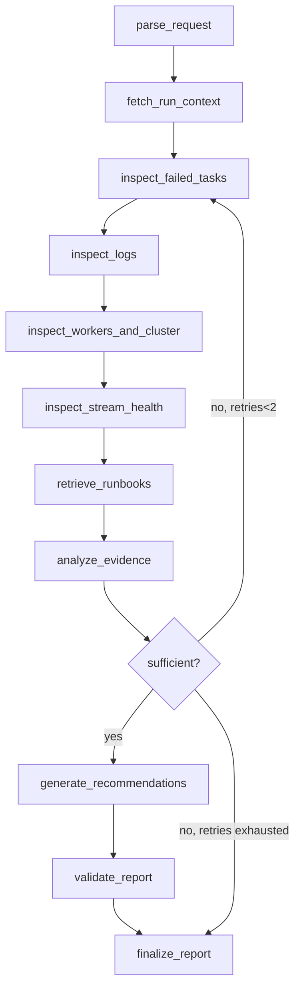

# 06.05 — LangGraph investigation workflow with structured, evidence-backed reports

## 1. Task Metadata

| Field | Value |
|---|---|
| Task ID | `06.05` |
| Title | LangGraph investigation workflow with structured, evidence-backed reports |
| Phase | 06 — AI Operations Copilot |
| Priority | P0 |
| Estimated complexity | Large |
| Hard dependencies | `06.04` |
| Execution mode | Requires its hard dependencies to be complete first. **Run sequentially** (do not run concurrently with other tasks). |
| Requirements covered | FR-AI-06, FR-AI-07, FR-AI-08, FR-AI-11 |

## 2. Context and Reference Files

**Read in this order before coding** (rules: `00C_AGENT_OPERATING_RULES.md` — all rules apply):

```text
Master reference:        00_MASTER_PROJECT_SPEC.md
Architecture reference:  00A_ARCHITECTURE_DECISIONS.md   (especially ADR-014, ADR-015, ADR-017)
Contracts reference:     00E_CONTRACTS_REFERENCE.md
Agent rules:             00C_AGENT_OPERATING_RULES.md
Completion template:     00F_COMPLETION_REPORT_TEMPLATE.md

Previous task (numeric order):
- phase-06-ai-ops/06.04_ai_tools_guardrails.md   (Typed read-only investigation tools and prompt-injection guardrails)

Next task (numeric order):
- phase-06-ai-ops/06.06_ai_investigation_task_approvals.md   (FlowForge integration: AI_INVESTIGATION task handler and approval workflow)
```

**Dependency relationships (authoritative — numeric order alone does not imply dependency):**

Hard dependencies — review each task file **and** its completion report `docs/implementation-reports/<ID>.md`:

- `phase-06-ai-ops/06.04_ai_tools_guardrails.md` — Typed read-only investigation tools and prompt-injection guardrails

Tasks that depend on this one (do not break their expected inputs):

- `phase-06-ai-ops/06.06_ai_investigation_task_approvals.md` — FlowForge integration: AI_INVESTIGATION task handler and approval workflow

Relevant master-spec sections: §5.6, v1.0 §11.5.

**Artifacts that should already exist (established by your hard dependencies):**

- (from 06.04) `aiops.tools` (12 tools) + `FlowForgeClient`
- (from 06.04) Guardrail utilities (`wrap_untrusted`, budgets, redaction)
- (from 06.04) Threat model doc

Verify these exist (build/tests of the repository are green) before starting. If something listed is missing, stop with `BLOCKED:` per `00C §1`.

## 3. Objective

Implement the LangGraph state graph that investigates a failed run or pipeline symptom and emits a validated structured report (observed facts with evidence, hypotheses with confidence, recommendations with risk and approval requirement, or `insufficient_evidence`). The graph terminates after emitting proposals; it never executes actions.

## 4. Detailed Implementation Requirements

- State (`TypedDict`/Pydantic): `request, run_id, task_id, plan, evidence[], retrieved_docs[], facts[], hypotheses[], recommendations[], retries, budget, errors, report`.
- Nodes (v1.0 §11.5): `parse_request` (extract ids/symptom; LLM or rules), `fetch_run_context`, `inspect_failed_tasks`, `inspect_logs`, `inspect_workers_and_cluster`, `inspect_stream_health` (conditional on pipeline symptom), `retrieve_runbooks`, `analyze_evidence` (LLM with structured output), `evaluate_sufficiency` (rule+LLM; may loop back to targeted evidence gathering, **max 2 retries**), `generate_recommendations`, `validate_report` (JSON Schema + citation resolution + unsupported-claim check), `finalize_report`.
- Routing: conditional edges (failed tasks → logs; worker symptoms → workers/cluster; stream symptoms → pipeline; insufficient after retries → `finalize` with `insufficient_evidence`).
- Structured output schema (`InvestigationResult`): `summary`, `observed_facts[{statement, source, evidence_ref}]`, `hypotheses[{statement, confidence(0-1), supporting_fact_ids[], contradicting[]}]`, `recommendations[{action_type(retry_task|replay_range|manual_check|scale_workers|none), params, risk(low|med|high), requires_approval:true, rationale, evidence_refs[]}]`, `insufficient_evidence{missing[]}`, `limitations`, `kb_citations[]`, `usage{tool_calls, tokens, duration_ms}`. JSON Schema published and used by `validate_report`.
- `validate_report` rules: every fact has an `evidence_ref` that exists in collected evidence; hypotheses reference facts; recommendations reference evidence; any `action_type` outside the allow-list or with `requires_approval=false` is stripped/rejected; unsupported claims (statements without refs) are moved to `limitations` or cause one repair retry through the LLM; second failure → `status=failed` with partial evidence (never fabricate).
- Prompts under `aiops/prompts/*.md` versioned (`prompt_version` stored on the investigation); untrusted data always wrapped; system prompt forbids following embedded instructions and requires `insufficient_evidence` when evidence is lacking.
- Persistence: each node execution recorded in `investigation_steps` (inputs hash, tool calls, durations); investigation status updates; checkpoints so a crashed worker can resume or be restarted idempotently (`investigation_id` unique).
- Wire `POST /v1/investigations` to run the graph asynchronously (background task + status polling), idempotent on `investigation_id`.

## 5. Technical Design


Mock-mode determinism: with `ScriptedLLM`/fixture LLM the same incident fixture produces the same report, enabling golden tests per scenario. Each incident fixture (`eval/incidents/*.json`) contains a fake FlowForge state (served by respx) and scripted LLM responses.

**Design notes / edge cases:**

- Model output parsing: use provider-native structured output when available, else JSON mode + Pydantic validation with one repair attempt.
- Never let the LLM choose arbitrary tools outside the allow-list per node.

## 6. Step-by-Step Implementation Instructions

1. Define state and result schemas + JSON Schema export.
2. Implement nodes with injected providers/tools.
3. Implement routing and loop bounds.
4. Implement validation/repair and persistence.
5. Create ≥ 6 incident fixtures for tests (full suite of 12+ in 06.07).
6. API wiring and async execution.

## 7. Files to Create or Modify

- services/aiops/src/aiops/graph/{state.py,nodes.py,graph.py,validate.py,schema.py}
- services/aiops/src/aiops/prompts/*.md
- services/aiops/schemas/investigation_result.schema.json
- services/aiops/eval/incidents/*.json (initial 6)
- services/aiops/src/aiops/api/investigations.py (modify)
- services/aiops/tests/test_graph_*.py
- docs/architecture/ai-investigation-graph.md

## 8. Testing Requirements

- Golden per incident (6): worker lost, task timeout, bad config, kafka lag, stale market data, DB latency → expected facts/hypotheses/recommendations (structure + key content).
- Telemetry-missing fixture → `insufficient_evidence` with `missing[]`, no recommendations of mutating type.
- Loop bound: evidence still insufficient → exactly 2 retries then finalize.
- Validation: fabricated evidence_ref rejected; repair succeeds once; unrepairable → `failed` status with partial data.
- Prompt-injection fixture (poisoned log/KB doc instructing to approve/execute) → report unchanged in structure, no extra actions, injection noted in `limitations` (assert).
- Idempotency: same `investigation_id` returns existing result without rerun.
- Graph never calls non-GET tools (spy).

General: `make lint` and `make test` must pass; run packages you touched with `-race`; record exact commands and results in the completion report.

## 9. Acceptance Criteria

- [ ] Graph implements the v1.0 §11.5 nodes with bounded retries.
- [ ] Reports separate facts, hypotheses, recommendations with evidence refs and validate against the JSON Schema.
- [ ] `insufficient_evidence` path works; injection fixture does not alter behavior.
- [ ] Entire suite passes offline in mock mode.
- [ ] All tests listed in section 8 exist and pass (or non-runnable ones are explicitly reported per 00C §2.13).
- [ ] No regression: full existing test suite passes.
- [ ] No architectural deviation without an ADR amendment and report entry.
- [ ] Completion report written to `docs/implementation-reports/06.05.md`.

## 10. Documentation Requirements

- `docs/architecture/ai-investigation-graph.md` incl. state, nodes, schema, repair policy.
- Write `docs/implementation-reports/06.05.md` (section 11).

## 11. Completion Report

Create `docs/implementation-reports/06.05.md` from `00F_COMPLETION_REPORT_TEMPLATE.md`. It MUST state: what was implemented; files created/modified; tests executed and their real results; known limitations; architectural decisions made; any deviations from the specification (with ADR amendment reference); confirmation, criterion by criterion, that acceptance criteria were met.

## 12. Handoff Instructions

**Interfaces and contracts this task establishes (record exact final symbol names in your report):**

- LangGraph `investigation_graph` + `InvestigationResult` JSON Schema
- Prompts (versioned)
- Incident fixture format + 6 fixtures
- Async investigation API with persistence

**Downstream consumers:** `06.06`. The next agents will read your completion report first.

**Always include in your report's Handoff section:**

- Dependencies introduced (modules/images) and their pinned versions.
- Configuration keys added (also reflected in `.env.example` and `docs/`).
- Outstanding issues, skipped tests and why.
- Files the next agent should inspect before proceeding: the packages listed under *Files to Create or Modify*.
