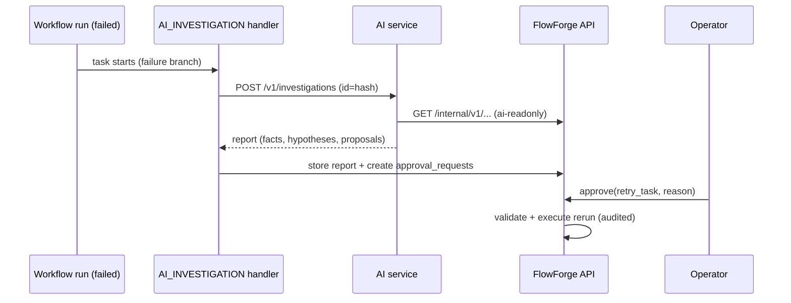

# 06.06 — FlowForge integration: AI_INVESTIGATION task handler and approval workflow

## 1. Task Metadata

| Field | Value |
|---|---|
| Task ID | `06.06` |
| Title | FlowForge integration: AI_INVESTIGATION task handler and approval workflow |
| Phase | 06 — AI Operations Copilot |
| Priority | P0 |
| Estimated complexity | Large |
| Hard dependencies | `06.05`, `05.10`, `03.06` |
| Execution mode | Requires its hard dependencies to be complete first. **Run sequentially** (do not run concurrently with other tasks). |
| Requirements covered | FR-AI-09, FR-AI-10 |

## 2. Context and Reference Files

**Read in this order before coding** (rules: `00C_AGENT_OPERATING_RULES.md` — all rules apply):

```text
Master reference:        00_MASTER_PROJECT_SPEC.md
Architecture reference:  00A_ARCHITECTURE_DECISIONS.md   (especially ADR-015, ADR-018)
Contracts reference:     00E_CONTRACTS_REFERENCE.md
Agent rules:             00C_AGENT_OPERATING_RULES.md
Completion template:     00F_COMPLETION_REPORT_TEMPLATE.md

Previous task (numeric order):
- phase-06-ai-ops/06.05_langgraph_investigation_graph.md   (LangGraph investigation workflow with structured, evidence-backed reports)

Next task (numeric order):
- phase-06-ai-ops/06.07_ai_evaluation_gate.md   (AI evaluation harness (≥ 12 incidents) and Phase 06 gate)
```

**Dependency relationships (authoritative — numeric order alone does not imply dependency):**

Hard dependencies — review each task file **and** its completion report `docs/implementation-reports/<ID>.md`:

- `phase-06-ai-ops/06.05_langgraph_investigation_graph.md` — LangGraph investigation workflow with structured, evidence-backed reports
- `phase-05-kafka-marketdata/05.10_marketdata_workflow_streaming_gate.md` — Market-data workflow, task handlers and streaming fault-injection gate
- `phase-03-scheduler-workers/03.06_results_templating_conditionals_rerun.md` — Task result passing, templating, conditional tasks, rerun/remediation

Tasks that depend on this one (do not break their expected inputs):

- `phase-06-ai-ops/06.07_ai_evaluation_gate.md` — AI evaluation harness (≥ 12 incidents) and Phase 06 gate
- `phase-07-dashboard/07.03_ui_ai_reports_approvals_gate.md` — Dashboard: AI investigation reports, approval inbox and UI end-to-end gate
- `phase-08-observability/08.01_distributed_tracing.md` — OpenTelemetry tracing across API, workers, Kafka, processor and AI service
- `phase-08-observability/08.02_grafana_dashboards_metrics_audit.md` — Grafana dashboards as code and metrics catalogue audit
- `phase-09-hardening-deployment/09.01_security_hardening_tls.md` — Security hardening: TLS/mTLS, secrets handling, key rotation, dependency scanning

Relevant master-spec sections: §5.6, 00E §2, §9.

**Artifacts that should already exist (established by your hard dependencies):**

- (from 06.05) LangGraph `investigation_graph` + `InvestigationResult` JSON Schema
- (from 06.05) Prompts (versioned)
- (from 06.05) Incident fixture format + 6 fixtures
- (from 06.05) Async investigation API with persistence
- (from 05.10) Market-data task handlers + workflow definition
- (from 05.10) Streaming fault suite + report
- (from 05.10) Golden dataset/hash
- (from 05.10) Demo script `scripts/demo/market-data.sh`
- (from 05.10) Registered `AI_INVESTIGATION` placeholder consumer point
- (from 03.06) `internal/workflow/template.Resolver`
- (from 03.06) `internal/workflow/expr` (implements `ExprEvaluator`, `ExprValidator`)
- (from 03.06) `RunService.Rerun` + REST `rerun|retry`
- (from 03.06) `include_superseded` history view
- (from 03.06) Scheduler `InputResolver` = template resolver

Verify these exist (build/tests of the repository are green) before starting. If something listed is missing, stop with `BLOCKED:` per `00C §1`.

## 3. Objective

Close the loop inside FlowForge: a worker handler runs an AI investigation as a workflow task (idempotent, polled), stores the report with the run, converts recommendations into `approval_requests`, and executes approved actions exclusively through FlowForge APIs.

## 4. Detailed Implementation Requirements

- Worker handler `AI_INVESTIGATION` (Go): resolves input (`run_id` of the failing run, `question`, context) → `investigation_id = sha256(run_id|task_id|question)[:32]` → `POST /v1/investigations` (idempotent) → poll with backoff until terminal or task timeout (default 120 s) → output stored as the task result (summary + `report_ref`); report JSON persisted in `ai_reports` (FlowForge DB; table in a new migration `0005_ai_reports_approvals` if not already in 0001–0004 — check `00E §2` and amend the migration plan note if you add it). Failure of AI service = task failure `AI_UNAVAILABLE` (retry policy applies); workflow must treat the task as best-effort via `allow_failure`/`run_if` semantics in the market-data definition (update 05.10's workflow to use the real task).
- Approvals: on report persistence, each recommendation with `requires_approval` becomes an `approval_requests` row `{id, report_id, run_id, action_type, params, risk, rationale, status: pending, expires_at (24h), requested_by: ai}`; events `approval.requested`.
- API: `GET /api/v1/approvals?status`, `GET /api/v1/approvals/{id}`, `POST /api/v1/approvals/{id}/approve|reject` (role operator+, body `{reason}` required for reject), all audited; idempotent; expired → `EXPIRED`. Optimistic locking on status.
- Executor (FlowForge-owned): on approval, validates the action against an **allow-list and current state** (`retry_task`: task must be FAILED and run not terminal-cancelled → creates rerun via 03.06 mechanism; `replay_range`: validated spec within retention → 05.07 service; `manual_check`/`none`: acknowledged only) and records `approval.executed` with result; execution errors recorded, never retried automatically. The AI service never calls these endpoints (`ai-readonly` cannot) — verified.
- Reports API: `GET /api/v1/ai/reports?run_id`, `GET /api/v1/ai/reports/{id}` (viewer+).
- Update `market-data-hourly` to use the real `AI_INVESTIGATION` handler on the failure branch; e2e in mock mode.

## 5. Technical Design


Ownership rule (ADR-015/018): AI proposes; FlowForge decides and executes. Approval state machine: `PENDING → APPROVED → EXECUTED | EXECUTION_FAILED`, `PENDING → REJECTED | EXPIRED`.

**Design notes / edge cases:**

- Idempotency end-to-end: re-running the handler returns the same report; approvals are created once per `(report_id, recommendation_index)` (unique constraint).
- Approver identity recorded; self-approval not applicable (AI is not a principal).

## 6. Step-by-Step Implementation Instructions

1. Add migration/tables if needed; sqlc queries.
2. Implement approvals service + REST + audit + state machine.
3. Implement executor with state validation.
4. Implement the Go handler with polling/idempotency.
5. Update workflow definition and run e2e with mock AI.
6. Tests.

## 7. Files to Create or Modify

- migrations/0005_ai_reports_approvals.sql (if needed)
- internal/approvals/*.go
- internal/api/rest/approvals.go, aireports.go
- internal/worker/handlers/aiinvestigation/*.go
- workflows/market-data-hourly.yaml (modify)
- api/openapi/flowforge.v1.yaml (modify)
- test/e2e/ai_approval_test.go
- docs/architecture/ai-approvals.md

## 8. Testing Requirements

- Handler: idempotent across retries; AI 500 → retriable failure; timeout → failure with `AI_TIMEOUT`.
- E2E (mock AI): induced failure → investigation → approval pending → approve `retry_task` → rerun created and executed → run eventually succeeds; audit trail complete.
- Reject path with reason; expiry path; double-approve idempotent; approve of stale action (task already succeeded) → `EXECUTION_FAILED` with clear reason, no mutation.
- Authorization: viewer cannot approve; `ai-readonly` cannot call approval endpoints (403).
- Allow-list: unknown `action_type` never executes.
- Unique constraint prevents duplicate approvals on report reprocessing.

General: `make lint` and `make test` must pass; run packages you touched with `-race`; record exact commands and results in the completion report.

## 9. Acceptance Criteria

- [ ] AI investigation runs as a normal workflow task and persists a report.
- [ ] Recommendations become approvals; only FlowForge executes approved allow-listed actions with state validation.
- [ ] Full audit trail and e2e demonstrate approve→retry→recovery.
- [ ] All tests listed in section 8 exist and pass (or non-runnable ones are explicitly reported per 00C §2.13).
- [ ] No regression: full existing test suite passes.
- [ ] No architectural deviation without an ADR amendment and report entry.
- [ ] Completion report written to `docs/implementation-reports/06.06.md`.

## 10. Documentation Requirements

- `docs/architecture/ai-approvals.md`; update `docs/runbooks` index; API docs.
- Write `docs/implementation-reports/06.06.md` (section 11).

## 11. Completion Report

Create `docs/implementation-reports/06.06.md` from `00F_COMPLETION_REPORT_TEMPLATE.md`. It MUST state: what was implemented; files created/modified; tests executed and their real results; known limitations; architectural decisions made; any deviations from the specification (with ADR amendment reference); confirmation, criterion by criterion, that acceptance criteria were met.

## 12. Handoff Instructions

**Interfaces and contracts this task establishes (record exact final symbol names in your report):**

- `AI_INVESTIGATION` handler
- `approval_requests`/`ai_reports` + REST + executor
- Events `approval.requested|approved|rejected|executed`
- Updated `market-data-hourly` with real AI branch

**Downstream consumers:** `06.07`, `07.03`, `08.01`, `08.02`, `09.01`. The next agents will read your completion report first.

**Always include in your report's Handoff section:**

- Dependencies introduced (modules/images) and their pinned versions.
- Configuration keys added (also reflected in `.env.example` and `docs/`).
- Outstanding issues, skipped tests and why.
- Files the next agent should inspect before proceeding: the packages listed under *Files to Create or Modify*.
