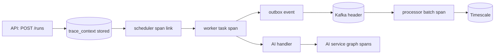

# 08.01 — OpenTelemetry tracing across API, workers, Kafka, processor and AI service

## 1. Task Metadata

| Field | Value |
|---|---|
| Task ID | `08.01` |
| Title | OpenTelemetry tracing across API, workers, Kafka, processor and AI service |
| Phase | 08 — Observability |
| Priority | P1 |
| Estimated complexity | Medium |
| Hard dependencies | `06.06`, `05.08` |
| Execution mode | Requires its hard dependencies to be complete first. **Can run in parallel** with: `08.02` (disjoint files/packages; see Context). |
| Requirements covered | NFR-OBS-02 |

## 2. Context and Reference Files

**Read in this order before coding** (rules: `00C_AGENT_OPERATING_RULES.md` — all rules apply):

```text
Master reference:        00_MASTER_PROJECT_SPEC.md
Architecture reference:  00A_ARCHITECTURE_DECISIONS.md   (especially ADR-019)
Contracts reference:     00E_CONTRACTS_REFERENCE.md
Agent rules:             00C_AGENT_OPERATING_RULES.md
Completion template:     00F_COMPLETION_REPORT_TEMPLATE.md

Previous task (numeric order):
- phase-07-dashboard/07.03_ui_ai_reports_approvals_gate.md   (Dashboard: AI investigation reports, approval inbox and UI end-to-end gate)

Next task (numeric order):
- phase-08-observability/08.02_grafana_dashboards_metrics_audit.md   (Grafana dashboards as code and metrics catalogue audit)
```

**Dependency relationships (authoritative — numeric order alone does not imply dependency):**

Hard dependencies — review each task file **and** its completion report `docs/implementation-reports/<ID>.md`:

- `phase-06-ai-ops/06.06_ai_investigation_task_approvals.md` — FlowForge integration: AI_INVESTIGATION task handler and approval workflow
- `phase-05-kafka-marketdata/05.08_kafka_outbox_publisher.md` — Outbox relay Kafka publisher for workflow events (flowforge.workflow-events, flowforge.task-events)

Tasks that depend on this one (do not break their expected inputs):

- `phase-08-observability/08.03_alert_rules_logs_audit.md` — Prometheus alert rules, structured-log audit and observability gate

Parallel-safe tasks (no dependency relationship; keep edits within your own listed files, wire shared registries only via the additive extension points named in *Technical Design*):

- `phase-08-observability/08.02_grafana_dashboards_metrics_audit.md` — Grafana dashboards as code and metrics catalogue audit

Relevant master-spec sections: §5.8, 00E §11.

**Artifacts that should already exist (established by your hard dependencies):**

- (from 06.06) `AI_INVESTIGATION` handler
- (from 06.06) `approval_requests`/`ai_reports` + REST + executor
- (from 06.06) Events `approval.requested|approved|rejected|executed`
- (from 06.06) Updated `market-data-hourly` with real AI branch
- (from 05.08) `kafkapub.Publisher`
- (from 05.08) `FF_OUTBOX_PUBLISHER` switch
- (from 05.08) `flowforge-eventtail`
- (from 05.08) Outbox metrics

Verify these exist (build/tests of the repository are green) before starting. If something listed is missing, stop with `BLOCKED:` per `00C §1`.

## 3. Objective

Make a single trace follow a workflow run through run creation, task scheduling, worker execution, outbox → Kafka → processor → DB, and into AI investigations, with Jaeger available for inspection.

## 4. Detailed Implementation Requirements

- Go: shared `internal/obs/tracing` (OTLP gRPC exporter, resource attrs `service.name/version/instance`, sampler `FF_OTEL_SAMPLER` default parent-based 10% in prod / 100% dev); instrument HTTP (chi middleware), gRPC (stats handlers), pgx (otelpgx or manual spans for key queries), franz-go produce/consume (manual spans).
- Context propagation: at run creation store `traceparent` in `workflow_runs.trace_context` (and propagate to task rows/outbox); scheduler spans link to the run trace (span links for batch ops); worker receives `traceparent` in the task lease payload (gRPC metadata/field) and continues the trace; outbox rows copy it into the envelope `trace.traceparent`; Kafka headers carry it; processor extracts it for the batch span (per-event spans sampled/linked, not one span per tick by default).
- AI: Go `AI_INVESTIGATION` handler injects W3C headers to the AI service; Python service uses `opentelemetry-instrumentation-fastapi/httpx`, graph node spans (`ai.node.<name>`), tool-call spans with sanitized attributes (no log text).
- Jaeger all-in-one (profile `observability`) + OTel collector optional; `make trace-demo` runs a sample workflow and prints the Jaeger URL.
- Span attribute policy (documented): ids and enums only; no payloads, secrets, prices, or log text; errors recorded with `exception` event but message truncated/redacted.

## 5. Technical Design



**Design notes / edge cases:**

- Tracing must be optional: if the exporter is down the system continues (non-blocking batch exporter, dropped spans counted).
- Keep per-tick spans off by default for performance.

## 6. Step-by-Step Implementation Instructions

1. Implement tracing package + middleware wiring in all Go binaries.
2. Propagate through DB, gRPC, outbox, Kafka.
3. Instrument Python service.
4. Compose Jaeger; trace-demo.
5. Automated trace-completeness test.

## 7. Files to Create or Modify

- internal/obs/tracing/*.go
- cmd/*/main.go (modify)
- internal/{scheduler,workerapi,events,stream,worker}/** (modify: spans)
- services/aiops/src/aiops/obs/tracing.py
- docker-compose.yml (modify: jaeger)
- scripts/dev/trace-demo.sh
- docs/architecture/tracing.md

## 8. Testing Requirements

- In-memory span exporter test: one run produces spans with the same trace id across api→scheduler(link)→worker→outbox publish.
- Compose e2e (nightly): query Jaeger API: trace for a market-data run contains spans from `flowforge-api`, `flowforge-worker`, `flowforge-processor`, `aiops` (when failure branch) — assert service set.
- Exporter outage: stop Jaeger → workflow still completes; dropped-span metric increments.
- Attribute policy test: no span attribute matches secret/payload patterns across a sample run.
- Overhead check: throughput regression < 10% at 100% sampling on the e2e benchmark (recorded).

General: `make lint` and `make test` must pass; run packages you touched with `-race`; record exact commands and results in the completion report.

## 9. Acceptance Criteria

- [ ] A single trace spans run → task → Kafka → DB (and AI when invoked).
- [ ] Tracing failures never affect service operation.
- [ ] Attribute policy enforced by test.
- [ ] All tests listed in section 8 exist and pass (or non-runnable ones are explicitly reported per 00C §2.13).
- [ ] No regression: full existing test suite passes.
- [ ] No architectural deviation without an ADR amendment and report entry.
- [ ] Completion report written to `docs/implementation-reports/08.01.md`.

## 10. Documentation Requirements

- `docs/architecture/tracing.md`: propagation map, sampling, attribute policy.
- Write `docs/implementation-reports/08.01.md` (section 11).

## 11. Completion Report

Create `docs/implementation-reports/08.01.md` from `00F_COMPLETION_REPORT_TEMPLATE.md`. It MUST state: what was implemented; files created/modified; tests executed and their real results; known limitations; architectural decisions made; any deviations from the specification (with ADR amendment reference); confirmation, criterion by criterion, that acceptance criteria were met.

## 12. Handoff Instructions

**Interfaces and contracts this task establishes (record exact final symbol names in your report):**

- `internal/obs/tracing` + propagation through DB/gRPC/Kafka
- Jaeger in Compose (`observability` profile)
- AI service tracing
- `make trace-demo`

**Downstream consumers:** `08.03`. The next agents will read your completion report first.

**Always include in your report's Handoff section:**

- Dependencies introduced (modules/images) and their pinned versions.
- Configuration keys added (also reflected in `.env.example` and `docs/`).
- Outstanding issues, skipped tests and why.
- Files the next agent should inspect before proceeding: the packages listed under *Files to Create or Modify*.
